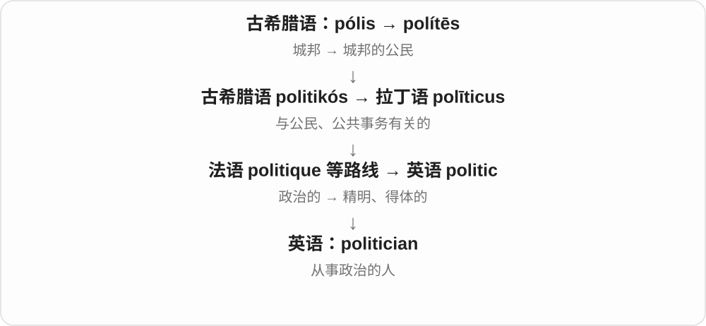
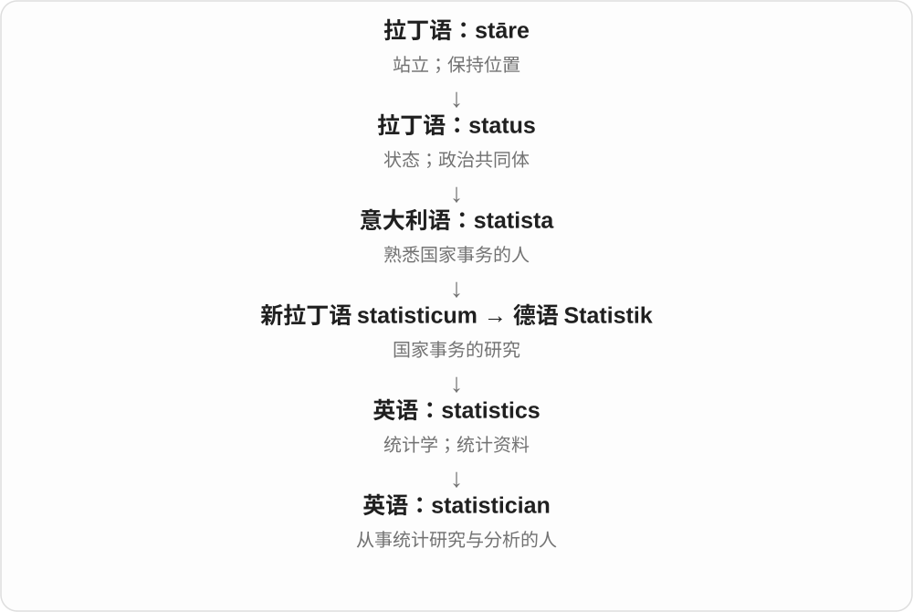

# 1363 · -ian — 相关领域的人；属于、涉及某一类的〔-ian〕

[逐词精讲目录](../00_逐词精讲目录.md) · [总目录](../00_总目录_按常用程度.md)

## 核心词根与来源

-ian 与 -an 是常见关系人物、形容词材料，经拉丁 -ianus 等及法语形式传入，也在英语中继续构词。不同词的借入、词干变化和发音各自固定，不是把所有英语词后直接加 ian。

**IAN：先认清前面的领域，再看是人还是性质**

history → historian 是历史学家；electric → electrician 是电工；avian 却形容鸟类的，不是一个职业人物。

- **历史、政治及普通身份**：historian · politician · civilian
- **职业及学科人物**：technician · electrician · physician · pediatrician · clinician · statistician · tactician · academician · logician
- **人物命名与舞台**：thespian · draconian
- **类别、立场和性质**：mammalian · avian · reptilian · egalitarian

## 词形与演化规律

history ↔ historian；politics ↔ politician；electric ↔ electrician；statistics ↔ statistician。thespian 则接 Thespis 人名，表现同一类后缀还可用于人名命名。

## 单词速览（按词族由简到繁）

同一基础词的相关扩展放在一起，先读基础形式，再读扩展；各组之间优先读常用的。具体词源关系见各词讲解。

| 单词 | 音标 | 核心意思 |
|---|---|---|
| [civilian](#w-1) | /səˈvɪliən/ | 平民；非军人的；民用的 |
| [physician](#w-2) | /fɪˈzɪʃən/ | 医生；内科医师〔部分语境〕 |
| [politician](#w-3) | 英 /ˌpɒləˈtɪʃən/；美 /ˌpɑːləˈtɪʃən/ | 政治人物；从政者 |
| [historian](#w-4) | 英 /hɪˈstɔːriən/；美 /hɪˈstɔːriən/ | 历史学家；历史研究者、记述者 |
| [technician](#w-5) | 英、美 /tekˈnɪʃən/ | 技术员；技师；精于技巧的人 |
| [electrician](#w-6) | /ɪˌlekˈtrɪʃən/ | 电工 |
| [mammalian](#w-7) | /məˈmeɪliən/ | 哺乳动物的 |
| [avian](#w-8) | 英、美 /ˈeɪviən/ | 鸟类的 |
| [pediatrician](#w-9) | /ˌpiːdiəˈtrɪʃən/ | 儿科医生 |
| [egalitarian](#w-10) | 英 /ɪˌɡælɪˈteəriən/；美 /ɪˌɡæləˈteriən/ | 主张平等的；平等主义者 |
| [clinician](#w-11) | /klɪˈnɪʃən/ | 临床工作者；直接照护病人的医疗专业人员 |
| [draconian](#w-13) | 英 /drəˈkəʊniən/；美 /drəˈkoʊniən/ | 严酷的；过于苛刻的 |
| [statistician](#w-14) | /ˌstætɪˈstɪʃən/ | 统计学家；统计专业人员 |
| [reptilian](#w-15) | /repˈtɪliən/ | 爬行动物的；像爬行动物的；冷酷阴险的〔比喻〕 |
| [tactician](#w-16) | 英、美 /tækˈtɪʃən/ | 战术家；善于安排具体策略的人 |
| [academician](#w-18) | /ˌækədəˈmɪʃən/ | 学术或艺术机构的成员；院士；学者〔较正式〕 |
| [thespian](#w-20) | /ˈθespiən/ | 演员〔较文学或诙谐〕；戏剧表演的 |
| [logician](#w-22) | /ləˈdʒɪʃən/ | 逻辑学家；逻辑学研究者 |

## 逐词讲解

### 1. civilian — 平民；非军人的；民用的

**音标**：/səˈvɪliən/

**先抓住这个画面**

把普通社会生活中的人和军队等制服体系区分开。

**怎么拆**

借古法语 civilien，接 civil／拉丁 cīvīlis。现代可用 civil + -ian 记形；历史上先指民法专家，后来发展为普通非军事人员。

**怎么变成今天的意思**

**拉丁 cīvis**  
公民；共同生活在一个城邦中的人

↓

**拉丁 cīvīlis → 古法语 civilien → 中古英语 cyvylien**  
民法相关的 → 民法专业人员

↓

**英语 civilian**  
后来常指非军事人员；也用于民用性质的事物

a civilian 是平民；civilian clothes 是便服；civilian aircraft 是民用飞机。一般语境常与军人或警务人员对照；它不是“有国籍的人”的同义词。

**常见搭配与例句**

civilian life；civilian clothes；a civilian employee；civilian aircraft。

> After leaving the army, he found civilian life unfamiliar.

离开军队后，他对平民生活感到陌生。

> The airfield handles both military and civilian aircraft.

这座机场同时处理军用和民用飞机的起降。

**别混淆**

citizen 说一个人与国家的公民身份关系；civilian 说是否属于军事等特定体系。军人也可以是 citizen。

### 2. physician — 医生；内科医师〔部分语境〕

**音标**：/fɪˈzɪʃən/

**先抓住这个画面**

把医学知识用来诊察和治疗病人的人。

**怎么拆**

经古法语 fisicien，接 fisique“医术、自然学”和拉丁 physica；早期自然学与医术的联系保留在职业名里，不是从现代 physics 现场加 -ian。

**怎么变成今天的意思**

**希腊 phyein → physis → physikos**  
生长、产生 → 自然、本性 → 自然的

↓

**希腊 physikē／physika → 拉丁 physica**  
关于自然的知识、自然事物

↓

**古法语 fisique → fisicien**  
医术 → 行医的人

↓

**英语 physician**  
医生；与外科医师对照时常指内科医师

美式英语里的 physician 常是正式的医生称呼；在与 surgeon 对照的某些语境中，它更具体地指非外科、尤其内科方向的医师。读职业介绍时看地区与上下文，不把它一律译成物理学家，也不把所有用法都限死为内科。

**常见搭配与例句**

a family physician；a primary care physician；consult a physician。

> Her father worked as a family physician in a small town.

她父亲曾在一座小镇担任家庭医生。

> The physician explained the test results in plain language.

医生用通俗的话解释了检查结果。

**别混淆**

doctor 还可指博士，physician 明确是医疗职业；physicist 才是物理学家。

### 3. politician — 政治人物；从政者

**音标**：英 /ˌpɒləˈtɪʃən/；美 /ˌpɑːləˈtɪʃən/

**先抓住这个画面**

把参与公共事务、争取支持、进入政府或议会当作主要工作的人。

**怎么拆**

politic 的词干 + -ian“从事某事的人”；词尾 -cian 在这里读 /ʃən/，重音也移到后部。

**怎么变成今天的意思**

这个词本身可以中性，也可能在语境里带“善于权衡、说场面话”的批评。单凭 politician 并不能判断此人的品德。

**常见搭配与例句**

a local politician；an elected politician；a career politician。

> A local politician attended the public meeting.

一位当地政治人物参加了公开会议。

> The journalist asked the politician to explain the proposal in plain language.

记者请这位政治人物用大白话解释提案。

**别混淆**

politician 从事政治活动；political scientist 研究政治，两者可能重合，也可能完全不同。

### 4. historian — 历史学家；历史研究者、记述者

**音标**：英 /hɪˈstɔːriən/；美 /hɪˈstɔːriən/

**先抓住这个画面**

不只是记住几个年代，而是研究、解释过去的人。

**怎么拆**

中古英语 historian / historien 有法语、拉丁语历史词族背景；现代可按 histor(y) + -ian 理解这个从事历史研究的人名词。

**怎么变成今天的意思**

**古希腊语 historía**  
探究所得的知识；记述

↓

**拉丁语 historia → 古法语 estoire / estorie → 中古英语 historie**  
叙述、纪事

↓

**英语 history**  
过去发生的事；关于过去的记录与研究

↓

**historia 词族 → historian**  
历史、记述 → 历史研究或写作者

a local historian 地方史研究者，an art historian 艺术史研究者。专业方向可以是政治、城市、艺术等。

**常见搭配与例句**

a local historian；an economic historian；historians argue that...。

> A local historian showed us photographs of the old market.

一位地方史研究者给我们看了老市场的照片。

> Historians disagree about why the settlement was abandoned.

历史学家对这处聚落为何被遗弃有不同看法。

**别混淆**

historian 是研究历史的人，historical 是与历史有关的，historic 是具有历史重要性的。不要凭词长猜成三种职业。

### 5. technician — 技术员；技师；精于技巧的人

**音标**：英、美 /tekˈnɪʃən/

**先抓住这个画面**

把设备调好、检测做准、具体技术工作完成的人。

**怎么拆**

英语 technic + -ian“从事者”；不是直接用完整 technology 加一个职业词尾。

**怎么变成今天的意思**

**希腊语 tekhnē**  
技艺、手艺、掌握方法的实践能力

↓

**希腊语 tekhnikos → 拉丁语 technicus → 英语 technic**  
与技艺有关的；有技巧的

↓

**英语 technic + -ian → technician**  
熟悉技术细节、实践操作的人员

a laboratory technician 负责具体实验技术工作；a sound technician 处理音响设备。也可称某表演者 a fine technician，夸技巧娴熟，但未必同时夸情感表达。

**常见搭配与例句**

a laboratory technician；a service technician；a sound technician。

> The technician calibrated the instrument before the test.

技术员在测试前校准了仪器。

> A sound technician checked the microphones on stage.

一位音响技师检查了舞台上的话筒。

**别混淆**

technician 常强调专门操作与维护技能；technologist 更常强调某领域技术的开发、应用与组织，实际职称范围依行业而变。

### 6. electrician — 电工

**音标**：/ɪˌlekˈtrɪʃən/

**先抓住这个画面**

把“电”落实到线路、开关和设备上，负责安装、检查和维修这些东西的人。

**怎么拆**

英语 electric + -ian，形成职业名词；-cian 读 /ʃən/。早期也可指研究电的人，现代主要指电工。

**怎么变成今天的意思**

**古希腊 elektron → 拉丁 electrum**  
琥珀；摩擦后能吸引轻小物体

↓

**近代拉丁 electricus**  
像琥珀那样具有电性；吉尔伯特在 1600 年用于这一现象

↓

**英语 electric**  
电的、电动的；比喻气氛激动人心

↓

**英语 electric + -ian → electrician**  
研究电者的旧称 → 安装、维护电气设备和线路的人

an electrician 常处理建筑配线、配电和设备接线。词本身不等于 electrical engineer；各地职业资格制度另有规定，普通学词先记工作对象。

**常见搭配与例句**

call an electrician；a qualified electrician；an apprentice electrician。

> The electrician replaced the damaged wiring.

电工更换了损坏的线路。

> She began training as an apprentice electrician.

她开始接受电工学徒培训。

**别混淆**

electrician 通常做电气安装维修；electrical engineer 侧重电气系统的工程设计与分析，实际工作可有交集。

### 7. mammalian — 哺乳动物的

**音标**：/məˈmeɪliən/

**先抓住这个画面**

给细胞、器官或某种特征加上范围：这里说的是哺乳动物这一类。

**怎么拆**

关联新拉丁分类名 Mammalia 和英语形容词后缀；现代可联系 mammal + -ian 记忆。词史上不要仅凭短词与长词的外形，硬排成先有英语 mammal 才有 mammalian。

**怎么变成今天的意思**

**拉丁 mamma**  
乳房

↓

**晚期拉丁 mammalis → 新拉丁 Mammalia**  
乳房的 → 哺乳纲这一动物分类

↓

**英语 mammalian**  
属于哺乳动物这一类的

mammalian cells 是哺乳动物的细胞，mammalian evolution 是哺乳动物的演化。它修饰的东西不必本身是一整只动物。例如实验室说 mammalian cells，重点是细胞来源和类别，而不是细胞会哺乳。

**常见搭配与例句**

mammalian cells；mammalian species；mammalian evolution。

> The experiment compared mammalian cells with bacterial cells.

这项实验比较了哺乳动物细胞和细菌细胞。

> The course explores the history of mammalian evolution.

这门课探讨哺乳动物的演化史。

**别混淆**

mammalian 说明属于哪类动物，mammary 则说明与乳房或乳腺有关。mammalian brain 是哺乳动物的大脑，不能换成 mammary brain。

### 8. avian — 鸟类的

**音标**：英、美 /ˈeɪviən/

**先抓住这个画面**

把对象明确限定为鸟类，而不是所有会飞的动物。

**怎么拆**

取拉丁 avis“鸟”的词干 avi-，加 -ian 构成英语形容词。它不从 aviation“航空”缩略而来，也不意味着每种相关动物都能飞。

**怎么变成今天的意思**

**拉丁语 avis**  
鸟

↓

**英语 avi- + -ian → avian**  
鸟类相关的

avian species 是鸟类物种，avian behaviour 是鸟类行为。看到 avian flu，可以先理解为与鸟类相关的流感名称；avi- 关注的是鸟这类动物，不是飞行这个动作。

**常见搭配与例句**

avian species；avian behaviour；avian flu。

> The wetland supports a rich variety of avian species.

这片湿地生活着种类丰富的鸟类。

> The researchers compared avian behaviour in urban and rural areas.

研究人员比较了城市和乡村鸟类的行为。

**别混淆**

avian 说鸟类；aerial 说空中的。蝙蝠会飞，却不因此成为 avian animal；企鹅属于鸟类，即使不会飞。

### 9. pediatrician — 儿科医生

**音标**：/ˌpiːdiəˈtrɪʃən/

**先抓住这个画面**

家长带孩子来咨询生长、发育或疾病问题时，这位医生接受过专门的儿童医疗训练。

**怎么拆**

pediatric + -ian，表示从事该领域的人；构词后重音移到 -trician 的 /trɪʃ/，不能照 pediatric 原来的重音读。

**怎么变成今天的意思**

**希腊 pais，属格 paidos；词干 paid-**  
儿童；孩子

↓

**希腊来源 paid- 儿童 + 医疗构件 -iatric**  
以儿童为对象的医疗

↓

**英语 pediatric／paediatric**  
儿科的；儿童医疗的

↓

**英语 pediatric／paediatric + -ian → pediatrician／paediatrician**  
从事儿科医疗的医生

既可处理儿童常见健康问题，也可能继续专攻儿科某一方向。不是只照顾新生儿，后者属于更具体的医疗分工。

**常见搭配与例句**

see a pediatrician；a general pediatrician；the child’s pediatrician。

> The pediatrician asked about the child’s sleep and appetite.

儿科医生询问了孩子的睡眠和食欲。

> Her pediatrician explained the growth chart to the family.

她的儿科医生向家人解释了生长曲线图。

**别混淆**

pediatric nurse 是儿科护士，pediatrician 是儿科医生；两者都可能在同一个团队。

### 10. egalitarian — 主张平等的；平等主义者

**音标**：英 /ɪˌɡælɪˈteəriən/；美 /ɪˌɡæləˈteriən/

**先抓住这个画面**

不因为出身、地位就觉得某些人天生应有更多权利，主张人们受到平等对待，可以说 egalitarian。

**怎么拆**

取法语 egalitaire 平等主义的材料 + -ian，远接 egal 平等与拉丁 aequalis。这里 egal- 才是平等材料，不是 legal 合法前面多了一个 e。

**怎么变成今天的意思**

**法语 egal、egalitaire 的材料**  
平等、主张平等的

↓

**英语 egalitarian**  
平等主义的；相应主张者

an egalitarian society 平等取向的社会；egalitarian values 平等价值观；an egalitarian 平等主义者。具体平等的是权利、机会还是结果，须看主张内容。

**常见搭配与例句**

egalitarian values；an egalitarian approach。

> The group aims to build a more egalitarian workplace.

这个团体希望建立更平等的工作环境。

> Her egalitarian values shaped the way she led the team.

她的平等价值观影响了带领团队的方式。

**别混淆**

egalitarian 不是 identical 完全一样；平等对待并不自动意味着所有人每件事都得到完全相同结果。

### 11. clinician — 临床工作者；直接照护病人的医疗专业人员

**音标**：/klɪˈnɪʃən/

**先抓住这个画面**

工作重心在病人面前：倾听症状、检查、照护或提供治疗服务，而不是只在实验室里研究机制。

**怎么拆**

借法语 clinicien，法语以 clinicus、clinique 一族为基础，类比 physicien 等职业名称形成。现代能对应 clinic 与 -ian，但实际历史不是必须经过英语 clinic 才有这个职业词。

**怎么变成今天的意思**

**希腊 klinein／klinō → klinē**  
倾斜、躺下 → 床、卧榻

↓

**希腊 klinikos／klinikē〔technē〕 → 拉丁 clinicus**  
床边的；病床旁的诊疗；相关病人与医者称谓

↓

**法语 clinicien → 英语 clinician**  
从事实际诊疗、直接照护病人的专业人员

an experienced clinician 是有经验的临床工作者。依语境可包括医生、护士、治疗师等，并不总专指持某一类头衔的医生。

**常见搭配与例句**

an experienced clinician；a practising clinician；clinicians and researchers。

> The clinician asked about the patient’s daily routine before discussing the next steps.

临床工作者先询问了病人的日常生活，再讨论下一步安排。

> The project brought together laboratory researchers and experienced clinicians.

这个项目把实验室研究人员与经验丰富的临床工作者聚集在一起。

**别混淆**

physician 通常指医生；clinician 强调直接临床照护这一角色，范围可以更广。一个人也可以同时做 clinician 和 researcher。

### 12. draconian — 严酷的；过于苛刻的

**音标**：英 /drəˈkəʊniən/；美 /drəˈkoʊniən/

**先抓住这个画面**

规定一出台，惩罚或限制就重得让人觉得难以承受。

**怎么拆**

来自古雅典立法者 Draco 的名字加 -ian。Draco 是希腊名 Drakōn 的拉丁形式；这位立法者以严厉法律闻名，于是人名变成严酷的形容词。

**怎么变成今天的意思**

**古希腊人名 Drakōn → 拉丁 Draco／Dracon-**  
以严厉法令闻名的雅典立法者

↓

**Draco + -ian → draconian**  
与德拉古有关 → 法令、措施严酷的

draconian measures 是严酷措施，draconian penalties 是过于严厉的处罚。现代使用常带批评，表示说话人认为管得太重。虽然 Draco 与 dragon 的历史词形有关，直接语义来源仍是那位立法者，不是龙很凶。

**常见搭配与例句**

draconian laws；draconian measures；draconian penalties；draconian restrictions。

> The new school rules were criticised as draconian.

新校规被批评为过于严苛。

> Residents opposed the draconian restrictions on everyday activities.

居民反对那些严酷限制日常活动的规定。

**别混淆**

strict 是严格，未必过分；draconian 通常强调苛刻得不合理。不要把它当成对任何严格管理的中性赞扬。

### 13. statistician — 统计学家；统计专业人员

**音标**：/ˌstætɪˈstɪʃən/

**先抓住这个画面**

不只是会把数字相加，而是会设计数据收集、选择分析方法、判断结果是否可靠的人。

**怎么拆**

来自 statistic 的词干与 -ian（专业人员），属于 statistics 词族。

**怎么变成今天的意思**

学科名转为职业名称，重点在处理数据中的变动和不确定性。不同岗位具体工作会不同。

**常见搭配与例句**

consult a statistician；a professional statistician；a team of statisticians。

> A statistician helped us design the survey.

一位统计专业人员帮助我们设计调查。

> The statistician checked how missing data affected the results.

统计学家检查了缺失数据对结果的影响。

**别混淆**

statistician 是人，statistics 是学科或数据；statist 是强调国家作用的政治立场词。

### 14. reptilian — 爬行动物的；像爬行动物的；冷酷阴险的〔比喻〕

**音标**：/repˈtɪliən/

**先抓住这个画面**

把 reptile 变成形容词：可以客观谈爬行动物的特征，也可以形容一个虚构角色的眼神或动作像蛇蜥，让人觉得冷冷的。

**怎么拆**

英语 reptile + -ian，去掉末尾不发音的 e 后构成形容词。十九世纪先用于爬行动物相关特征，随后出现冷酷、阴险等文学比喻。

**怎么变成今天的意思**

**拉丁 repere → reptilis → 英语 reptile**  
爬行 → 爬行动物

↓

**英语 reptile + -ian → reptilian**  
属于或像爬行动物的

↓

**后起比喻 reptilian**  
用人的想象描写冷酷、阴险等气质

reptilian skin 可以是爬行动物的皮肤，也可能是道具模仿出来的鳞状质感。a reptilian stare 则是作者把人的眼神比作想象中的蛇蜥眼神；这是文学效果，不是科学上判定爬行动物“道德冷酷”。

**常见搭配与例句**

reptilian features；reptilian skin；a reptilian creature；a reptilian stare。重音在 -til-，不同于 reptile 的首音节重音。

> The costume gave the creature a reptilian appearance.

这套戏服让那个生物看起来像爬行动物。

> The novelist describes the villain’s silent, reptilian stare.

小说家描写了反派那种沉默而冷酷阴森的凝视。

**别混淆**

reptile 常指一只动物；reptilian 常形容属性或相似外观。figurative reptilian 的“冷酷”是修辞，不能拿来等同于动物学的体温调节方式。

### 15. tactician — 战术家；善于安排具体策略的人

**音标**：英、美 /tækˈtɪʃən/

**先抓住这个画面**

知道在什么时机，把哪一招用到哪里的人。

**怎么拆**

有法语 tacticien 借入说，也可从 tactic 词基加 -ian 分析；-ician 在这里形成擅长某种技艺的人名词，读 /ˈtɪʃən/。

**怎么变成今天的意思**

**希腊 tassein / tasso；taxis、taktos**  
安排、列队；排列、被安排的

↓

**希腊 taktikos、taktike / taktika → 新拉丁 tactica**  
关于部署的；部署的技艺

↓

**法语 tacticien 或英语 tactic- + -ian**  
擅长部署、采取战术的人

↓

**英语 tactician**  
战术家；善于具体谋划的人

可以形容指挥官，也可以形容教练、棋手或善于周旋的人。它强调安排具体行动的本领，不一定暗示此人能设计长期方向。

**常见搭配与例句**

a skilled tactician；a brilliant tactician；a political tactician。

> She is a patient chess player and an excellent tactician.

她下棋沉着，也是一位出色的战术高手。

> The new coach earned a reputation as a clever tactician.

新教练赢得了善用战术的名声。

**别混淆**

strategist 偏长远布局；tactician 偏具体较量中的安排。technician 是技术人员，不是同一个词。

### 16. academician — 学术或艺术机构的成员；院士；学者〔较正式〕

**音标**：/ˌækədəˈmɪʃən/

**先抓住这个画面**

重点常在“被某个学术或艺术团体接纳为正式成员”，不只是“在大学里工作”。

**怎么拆**

现代可联系 academic + -ian；英语历史也借入法语 académicien，不能只讲成英语临时加后缀。

**怎么变成今天的意思**

**希腊语 Akadēmeia／Akadēmia**  
雅典城外的一处园林及活动场所；名称传统上与传说人物 Akademos 相连

↓

**柏拉图在此讲学 → 拉丁 Academia**  
地点名成为学园和学派名

↓

**法语 académique + -ien → académicien**  
学术或艺术团体的成员

↓

**英语 academician**  
相关机构的正式成员，也可泛指学者

在一些机构语境里 academician 可以译为院士；在艺术学会里也可能指正式成员。翻译要跟着机构身份走，不能看到这个词就认定是某一国家科学院的院士。泛指大学教师或研究者时，academic 通常更平常。

**常见搭配与例句**

an academician of an academy；be elected an academician。

> She was elected an academician after years of work in sculpture.

从事雕塑多年后，她当选为该艺术院的正式成员。

> The conference included both academicians and young researchers.

会议既有院士参加，也有年轻研究人员参加。

**别混淆**

academic 是较宽的学者称呼；academician 常突出机构成员身份。professor 是教授职称，不自动等于 academician。

### 17. thespian — 演员〔较文学或诙谐〕；戏剧表演的

**音标**：/ˈθespiən/

**先抓住这个画面**

日常 actor 就能说演员；thespian 常让人想到舞台、戏剧圈，语气更书面，有时带亲切的戏称。

**怎么拆**

以古希腊戏剧人物 Thespis 的名字 + -ian 形成；他的生平与戏剧起源传统带有传说成分。先有戏剧表演相关形容词，再转为演员名词。

**怎么变成今天的意思**

**Thespis 人名 + -ian**  
与古希腊戏剧人物相关的命名

↓

**thespian 由形容词转人物名**  
戏剧表演的；演员

a veteran thespian 资深演员；thespian talents 表演才能。它不一定只用于古希腊演员，也不表示某个人属于一个叫 Thespia 的现代职业工会。

**常见搭配与例句**

a distinguished thespian；thespian talent。

> The theatre invited a veteran thespian to speak to the students.

剧院邀请了一位资深演员给学生们讲话。

> Her thespian talents first appeared in school plays.

她的表演才能最早在学校话剧中显露。

**别混淆**

actor 中性、通用；thespian 常有舞台文学色彩或诙谐感。人名来源不保证所有演员都知道或信奉同一套历史传统。

### 18. logician — 逻辑学家；逻辑学研究者

**音标**：/ləˈdʒɪʃən/

**先抓住这个画面**

专门检查推理的规则、结构和边界的人。

**怎么拆**

古法语 logicien 来自 logique，借入中古英语；现代可对应 logic + -ian，但原有法语职业名称路线。

**怎么变成今天的意思**

**希腊 légō / lógos**  
选取、收集 → 讲述；话语、说明、道理、计算

↓

**希腊 logikḗ → 拉丁 logica → 古法语 logique / logicien**  
逻辑 → 擅长或研究逻辑的人

↓

**中古英语 logicien → 英语 logician**  
逻辑学研究者

他可以研究一种推理系统能证明什么，也可以分析论证中的矛盾。logician 不是对任何“讲话很有道理的人”的固定职业称呼。

**常见搭配与例句**

a mathematical logician；the work of a logician；a trained logician。

> The logician tested whether the two assumptions could both be true.

逻辑学家检验了那两个假设能否同时为真。

> A logician helped the team express its rules without contradictions.

一位逻辑学研究者帮助团队把规则写得前后不矛盾。

**别混淆**

logician 研究逻辑；logistician 通常做后勤管理，不能只看拼写相近就混为一类。

## 这一组要分清什么

electrician、physician 等的 -cian 常读类似 /ʃən/，historian 的末尾则不按同一串声音硬套；avian、mammalian 并非人；thespian 是演员用词，不是新的专门国籍名称。

## 串起来练习

The historian interviewed a physician and a veteran thespian about the old theatre.

历史学家采访了一位医生和一位资深演员，了解那座老剧院。
