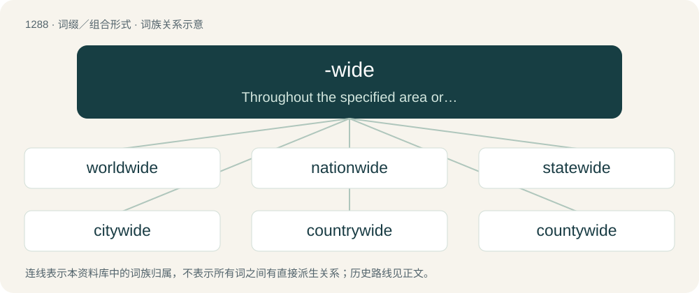

# 1373 · -wide — Throughout the specified area or thing.

[总目录](../00_总目录_按常用程度.md)

**类型**：词缀／组合形式　｜　**来源语言**：见词源记录

## 核心含义与来源

- 核心含义：Throughout the specified area or thing.
- 英文含义：Throughout the specified area or thing.
- 词形：-wide

**来源记录 1**（后缀／后置成分；Throughout the specified area or thing.）

See wide.

## 词族图

## 单词速览（常用到不常用）

| 单词 | 音标 | 释义 |
|---|---|---|
| [worldwide](#w-1) | 英 /ˈwɜːldˌwaɪd/；美 /ˈwɝldˌwaɪd/ | a. 全世界的 |
| [nationwide](#w-2) | /ˌneɪ.ʃənˈwaɪd/ | a. 全国性的；\[法\] 全国的, 全国范围的 |
| [statewide](#w-3) | /steɪtˈwaɪd/ | a. 全州的, 遍及全州的 |
| [citywide](#w-4) | /ˈsɪt.iˌwaɪd/ | a. 全市的, 全市性的 |
| [countrywide](#w-5) | /ˌkʌn.tɹiˈwaɪd/ | a. 全国范围的 |
| [countywide](#w-6) |  | 遍及全郡（或县）的；全郡（或县）的 |
| [sitewide](#w-7) |  | 【英文】Throughout a site (either a physical place or a website). |
| [systemwide](#w-8) |  | 全系统的 |

## 逐词详解

### 1. worldwide

**词性**：形容词　｜　**音标**：英 /ˈwɜːldˌwaɪd/；美 /ˈwɝldˌwaɪd/

**中文释义**：a. 全世界的

**英文义项**：Spanning the world; global.

**词源与演化**：

From world + -wide.

**例句**：

> A large meteorite impact would cause worldwide extinction of life.

该用例对应义项：Spanning the world; global.

### 2. nationwide

**词性**：形容词　｜　**音标**：/ˌneɪ.ʃənˈwaɪd/

**中文释义**：a. 全国性的；\[法\] 全国的, 全国范围的

**英文义项**：Extending throughout an entire nation.

**构词拆分**：nation + -wide

**词源与演化**：

From nation + -wide.

**例句**：

> There was a nationwide search on for the bankrobbers.

该用例对应义项：Extending throughout an entire nation.

### 3. statewide

**词性**：形容词　｜　**音标**：/steɪtˈwaɪd/

**中文释义**：a. 全州的, 遍及全州的

**英文义项**：Happening in or affecting an entire state (political subdivision of a federal union). / Happening in or affecting an entire sovereign state; nationwide.

**构词拆分**：state + -wide

**词源与演化**：

From state + -wide.

**例句**：

> The statewide recycling program.

该用例对应义项：occurring or extending throughout a state

### 4. citywide

**词性**：形容词　｜　**音标**：/ˈsɪt.iˌwaɪd/

**中文释义**：a. 全市的, 全市性的

**英文义项**：Throughout a city.

**构词拆分**：city + -wide

**词源与演化**：

From city + -wide.

**用法示例／搭配（非完整句）**：

> citywide violence

该用例对应义项：Throughout a city.

### 5. countrywide

**词性**：形容词　｜　**音标**：/ˌkʌn.tɹiˈwaɪd/

**中文释义**：a. 全国范围的

**英文义项**：Throughout a country.

**构词拆分**：country + -wide

**词源与演化**：

From country + -wide.

**例句**：

> A countrywide fund-raising campaign.

该用例对应义项：occurring or extending throughout a country or nation

### 6. countywide

**词性**：形容词

**中文释义**：遍及全郡（或县）的；全郡（或县）的

**英文义项**：Occurring or extending throughout a county

**构词拆分**：county + -wide

**词源与演化**：

From county + -wide.

**例句**：

> A countywide war on drugs.

该用例对应义项：occurring or extending throughout a county

### 7. sitewide

**词性**：形容词

**英文义项**：Throughout a site (either a physical place or a website).

**构词拆分**：site + -wide

**词源与演化**：

From site + -wide.

### 8. systemwide

**词性**：形容词

**中文释义**：全系统的

**英文义项**：Throughout a system.

**构词拆分**：system + -wide

**词源与演化**：

From system + -wide.
