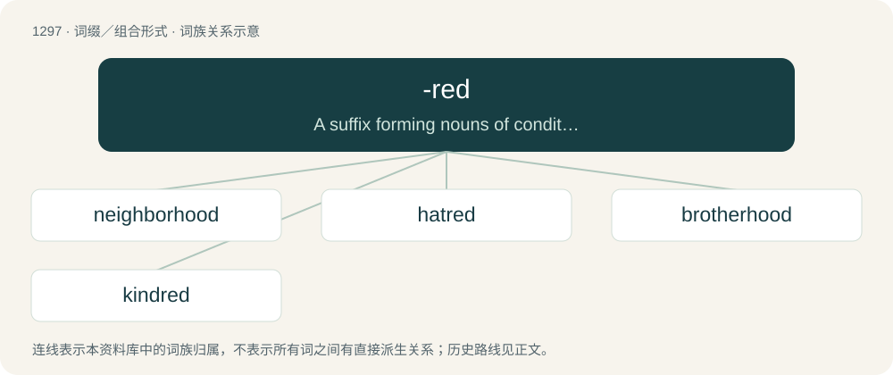

# 1382 · -red — A suffix forming nouns of condition or state.

[总目录](../00_总目录_按常用程度.md)

**类型**：词缀／组合形式　｜　**来源语言**：见词源记录

## 核心含义与来源

- 核心含义：A suffix forming nouns of condition or state.
- 英文含义：A suffix forming nouns of condition or state.
- 词形：-red

**来源记录 1**（后缀／后置成分；A suffix forming nouns of condition or state.）

From Middle English -rede, -red, -redde, -reden, from Old English -rǣden (which see). Cognate with German -rat (as in Heirat (“wedding”)).

## 词族图

## 单词速览（常用到不常用）

| 单词 | 音标 | 释义 |
|---|---|---|
| [neighborhood](#w-1) | 英 /ˈneɪbə.hʊd/；美 /ˈneɪbɚˌhʊd/ | n. 附近, 邻近 |
| [hatred](#w-2) | 英 /ˈheɪtɹɪd；美 /ˈheɪtɹɪd/ | n. 憎恨, 仇恨, 憎恶；\[法\] 敌意, 憎恨, 憎恶 |
| [brotherhood](#w-3) | 英 /ˈbɹʌðəˌhʊd/；美 /ˈbɹʌðɚˌhʊd/ | n. 手足情谊, 兄弟关系 |
| [kindred](#w-4) | /ˈkɪndɹɪd/ | n. 家族, 相似, 亲戚关系；a. 同族的, 同类的, 血缘的 |

## 逐词详解

### 1. neighborhood

**词性**：名词　｜　**音标**：英 /ˈneɪbə.hʊd/；美 /ˈneɪbɚˌhʊd/

**中文释义**：n. 附近, 邻近

**英文义项**：The residential area near one's home. / The inhabitants of a residential area.

**构词拆分**：neighbor + -red；neighbor + -hood

**词源与演化**：

From an alteration of earlier neighborred (“neighborhood”), from Middle English neȝeburredde, neheborreden, equivalent to neighbor + -red; the term being interpreted as neighbor + -hood. For change in suffix (-red to -hood), compare brotherhood. Cognates Cognate with Scots nichbourheid (“neighbourhood”). Compare also Dutch naburigheid (“neighbourhood”).

**例句**：

> He must be making in the neighborhood of $200,000 per year.

该用例对应义项：An approximate amount.

### 2. hatred

**词性**：名词　｜　**音标**：英 /ˈheɪtɹɪd；美 /ˈheɪtɹɪd/

**中文释义**：n. 憎恨, 仇恨, 憎恶；\[法\] 敌意, 憎恨, 憎恶

**英文义项**：A strong aversion; an intense dislike.

**构词拆分**：hate + -red

**词源与演化**：

From Middle English haterede, hatrede (“hatred”), from hate (“hate”) + -rede (“suffix denoting state or condition”), equivalent to hate + -red; compare sibred, Scots luferent. Related to Icelandic hatur (“hatred”).

**例句**：

> They are unanimous in their hate for me—and I welcome their hatred.

### 3. brotherhood

**词性**：名词　｜　**音标**：英 /ˈbɹʌðəˌhʊd/；美 /ˈbɹʌðɚˌhʊd/

**中文释义**：n. 手足情谊, 兄弟关系

**英文义项**：The state of being brothers or a brother (also figuratively). / An association of people for any purpose, such as a society of monks; a fraternity.

**构词拆分**：brother + -hood；brother + -red

**词源与演化**：

From Middle English brotherhod, equivalent to brother + -hood, from earlier brotherhede, alteration (influenced by suffixes in -hood, -head) of Early Middle English brotherrede (“brotherhood, fraternity”), from Old English brōþorrǣden (“brotherhood, fellowship”), equivalent to brother + -red (see brotherred). More at brother, -red. Piecewise doublet of friarhood.

**例句**：

> James formed a kind of brotherhood for ex-pats who were working in Valencia.

该用例对应义项：An association of people for any purpose, such as a society of monks; a fraternity.

### 4. kindred

**词性**：形容词　｜　**音标**：/ˈkɪndɹɪd/

**中文释义**：n. 家族, 相似, 亲戚关系；a. 同族的, 同类的, 血缘的

**英文义项**：Of the same nature, or of similar character. / Connected, related, cognate, akin.

**构词拆分**：kin + -red

**词源与演化**：

From Middle English kyndrede, from older kynrede (“kindred”), from Old English \*cynrēd, \*cynrǣden (“kindred, family, stock”), from cynn (“kind, kin, lineage”) + -rǣden (“condition, state”). Equivalent to kin + -red, see these. The -d- is epenthetic between a nasal and a liquid (as e.g. in spindle).

**用法示例／搭配（非完整句）**：

> the kindred relationship between neuroscience and neurology

该用例对应义项：Of the same nature, or of similar character.
