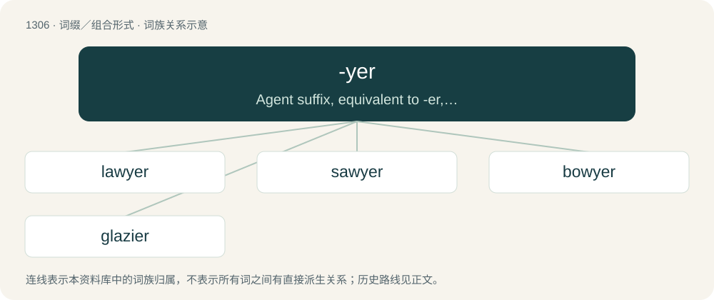

# 1391 · -yer — Agent suffix, equivalent to -er, appended to some nouns (especially those ending in the letter "w" or "v").

[总目录](../00_总目录_按常用程度.md)

**类型**：词缀／组合形式　｜　**来源语言**：见词源记录

## 核心含义与来源

- 核心含义：Agent suffix, equivalent to -er, appended to some nouns (especially those ending in the letter "w" or "v").
- 英文含义：Agent suffix, equivalent to -er, appended to some nouns (especially those ending in the letter "w" or "v").
- 词形：-yer

**来源记录 1**（后缀／后置成分；Agent suffix, equivalent to -er, appended to some nouns (especially those ending in the letter "w" or "v").）

Inherited from Middle English -iere, probably from -ien (infinitival suffix) + -ere (agent noun); i.e. nouns in -ere built on verbs in -ien; possibly reinforced by Old French -ier once -ie- became a rising diphthong. More at -ier, -er.

## 词族图

## 单词速览（常用到不常用）

| 单词 | 音标 | 释义 |
|---|---|---|
| [lawyer](#w-1) | 英 /ˈlɔːjə(ɹ)/；美 /ˈlɔɪ.ɚ/ | n. 律师；\[经\] 律师 |
| [sawyer](#w-2) | 英 /ˈsɔːjə/；美 /ˈsɔɪ.ɚ/ | n. 锯工, 漂流圆木, 显赫天牛 |
| [bowyer](#w-3) | 英 /ˈbəʊ.jə(ɹ)/；美 /ˈbɔɪ.ɚ/ | n. 制弓匠, 弓商 |
| [glazier](#w-4) | 英 /ˈɡleɪzjə(ɹ)/；美 /ˈɡleɪʒəɹ/ | n. 装玻璃工, 上釉工 |

## 逐词详解

### 1. lawyer

**词性**：名词　｜　**音标**：英 /ˈlɔːjə(ɹ)/；美 /ˈlɔɪ.ɚ/

**中文释义**：n. 律师；\[经\] 律师

**英文义项**：A professional person with a graduate law degree that qualifies for legal work (such as Juris Doctor) / A professional person qualified (as by a law degree or bar exam) and authorized to practice law as an attorney-at-law, solicitor, advocate, barrister or equivalent, i.e. represent parties in lawsuits or trials and give legal advice.

**构词拆分**：law + -yer

**词源与演化**：

From Middle English lawiere, lawier, lawer, equivalent to law + -yer.

**用法示例／搭配（非完整句）**：

> A lawyer's time and advice are his stock in trade. \[one of various versions of an aphorism in law\]

该用例对应义项：A professional person qualified (as by a law degree or bar exam) and authorized to practice law as an attorney-at-law, solicitor, advocate, barrister or equivalent, i.e. represent parties in lawsuits or trials and give legal advice.

### 2. sawyer

**词性**：名词　｜　**音标**：英 /ˈsɔːjə/；美 /ˈsɔɪ.ɚ/

**中文释义**：n. 锯工, 漂流圆木, 显赫天牛

**英文义项**：One who saws timber, especially in a sawpit. / A large trunk of a tree brought down by the force of a river's current.

**构词拆分**：saw + -yer

**词源与演化**：

From Middle English sawyer, sawier, sawior, equivalent to saw + -yer. Doublet of sawer.

**例句**：

> He told us a story about a boy named Tom Sawyer.

### 3. bowyer

**词性**：名词　｜　**音标**：英 /ˈbəʊ.jə(ɹ)/；美 /ˈbɔɪ.ɚ/

**中文释义**：n. 制弓匠, 弓商

**英文义项**：A person who makes or sells bows (for use with arrows).

**构词拆分**：bow + -yer

**词源与演化**：

From Middle English bowyere, bowȝere, variant forms of bowere (“bowyer”), equivalent to bow + -yer.

### 4. glazier

**词性**：名词　｜　**音标**：英 /ˈɡleɪzjə(ɹ)/；美 /ˈɡleɪʒəɹ/

**中文释义**：n. 装玻璃工, 上釉工

**英文义项**：One who glazes: a craftsman who works with glass, fitting windows, etc.

**构词拆分**：glass + -er

**词源与演化**：

From Middle English glazier, glasier, glasyer, glasiere, variants (due to influence from words in -yer) of Middle English glaser, equivalent to glass + -er.

**例句**：

> Getting cut is one of the occupational hazards of being a glazier.
