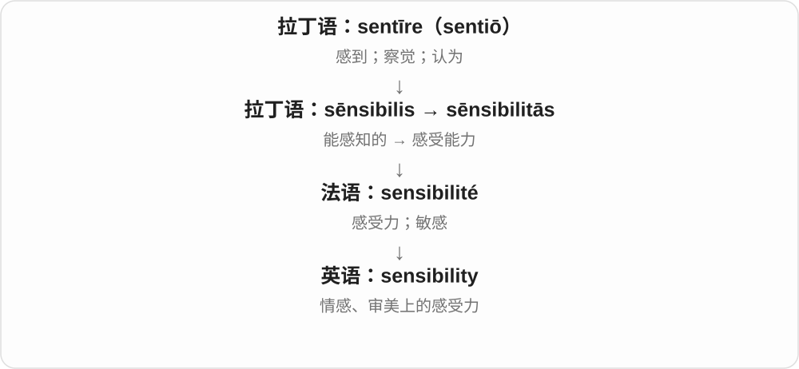

# 1414 · -es — 名词复数等形式中的词尾材料

[逐词精讲目录](../00_逐词精讲目录.md) · [总目录](../00_总目录_按常用程度.md)

## 核心词根与来源

-es 是英语复数词尾 -s 系统中的形式，承接早期英语相应词尾。现代拼写会与词尾音、y 等字母变化配套；成词后也可能形成固定用法。

**ES：先认基本词，再看复数是否有固定的常用含义**

sensibility 是感受能力等抽象性质；sensibilities 常集中说人的审美、情感倾向。并非所有复数都只是在数几个实物。

- **基本词与固定复数用法**：sensibility · sensibilities
- **衣料与服装集合的历史关系**：cloth · clothes

## 词形与演化规律

sensibility 去 y 加 ies → sensibilities；cloth 与 clothes 有旧复数及后续专门化关系。-es 在不同词里不总额外多读一个音节。

## 单词速览（按词族由简到繁）

同一基础词的相关扩展放在一起，先读基础形式，再读扩展；各组之间优先读常用的。具体词源关系见各词讲解。

| 单词 | 音标 | 核心意思 |
|---|---|---|
| [cloth](#w-4) | 英 /klɒθ/；美 /klɔːθ/ 或 /klɑːθ/ | 布料；一块布、抹布 |
| [clothes](#w-1) | 英 /kləʊðz/ 或 /kləʊz/；美 /kloʊðz/ 或 /kloʊz/ | 衣服〔复数集合〕 |
| [sensibility](#w-5) | /ˌsensəˈbɪləti/ | 感受力；审美或情感上的敏锐；容易被触动的感情 |
| [sensibilities](#w-2) | /ˌsensəˈbɪlətiz/ | 细腻感受、审美与情感倾向；容易被触动的感情 |

## 逐词讲解

### 1. cloth — 布料；一块布、抹布

**音标**：英 /klɒθ/；美 /klɔːθ/ 或 /klɑːθ/

**先抓住这个画面**

还没做成衣服的一匹料子，是不可数材料；剪成一块用来擦桌，也可数成 a cloth。

**怎么拆**

接古英语 clāþ，旧义还包括衣物、覆盖物。现代材料与单块布保留；较远来源未定。古复数另发展为 clothes，今天不把所有布块复数写成 clothes。

**怎么变成今天的意思**

**古英语 clāþ → 中古英语 cloth → cloth**  
布、覆盖物、衣物；更远来源不定

↓

**英语 cloth 与衣物支线**  
布料、单块布；旧复数 clothes 专门化为衣服

cotton cloth 棉布，a damp cloth 湿布，two cleaning cloths 两块清洁布。复数 cloths 常读 /klɒθs/〔英〕，不是 clothes 的长元音。

**常见搭配与例句**

cotton cloth；a piece of cloth；a damp cloth；cleaning cloths。

> She bought some blue cloth for the curtains.

她买了些蓝布做窗帘。

> Wipe the table with a damp cloth.

用湿布擦擦桌子。

**别混淆**

cloth 布料或一块布，clothes 衣服，clothing 衣物集合；三者同族，现代不能互换语法。

### 2. clothes — 衣服〔复数集合〕

**音标**：英 /kləʊðz/ 或 /kləʊz/；美 /kloʊðz/ 或 /kloʊz/

**先抓住这个画面**

衬衫、裤子、外套都放在一起叫 clothes。现代说的是穿在身上的衣物，不是所有剪下的布片。

**怎么拆**

来自古英语 clāþas、经中古英语 clothes，是 cloth 衣物旧义的历史复数，后来词义、元音专门化。今天 cloths 表多块布、clothes 表衣物，两者分工。

**怎么变成今天的意思**

**古英语 clāþ → 中古英语 cloth → cloth**  
布、覆盖物、衣物；更远来源不定

↓

**古英语 clāþas → 中古英语 clothes → clothes**  
旧衣物复数 → 现代衣服集合

warm clothes 保暖衣服，change your clothes 换衣服，a change of clothes 一套替换衣物。通常用复数搭配，单件说 an item of clothing 等。

**常见搭配与例句**

warm clothes；change your clothes；a change of clothes。

> Your clean clothes are in the cupboard.

你的干净衣服在柜子里。

> Bring a change of clothes for the trip.

出门旅行带一套替换衣服。

**别混淆**

clothes are，不说 clothes is；a clothes 不能表示一件衣服。close 动词常与它近同音，但来源和意思不同。

### 3. sensibility — 感受力；审美或情感上的敏锐；容易被触动的感情

**音标**：/ˌsensəˈbɪləti/

**先抓住这个画面**

同一幅画，有人只看见颜色，有人会细腻地感到气氛与情绪；这种感受方式和能力是 sensibility。

**怎么拆**

晚期拉丁语 sēnsibilitās 经法语 sensibilité 进入英语，与 sēnsibilis 同族。现代虽与 sensible 对应，意思不只等于理智。

**怎么变成今天的意思**

单数可说一个人的艺术感受方式；复数 sensibilities 常说容易被冒犯或触动的感情与价值感。

**常见搭配与例句**

an artistic sensibility；offend someone’s sensibilities；a modern sensibility。

> The designer has a distinctive visual sensibility.

这位设计师有独特的视觉审美。

> The joke offended her sensibilities.

那个玩笑冒犯了她的感情和价值感。

**别混淆**

sensibility 不是 sensibleness“明智”简单替换词。小说标题 Sense and Sensibility 正利用理智与感性之间的张力。

### 4. sensibilities — 细腻感受、审美与情感倾向；容易被触动的感情

**音标**：/ˌsensəˈbɪlətiz/

**先抓住这个画面**

同一段音乐，有人听出温柔，有人觉得太伤感；这些细腻的感受方式、审美和情感倾向，可以统称 sensibilities。

**怎么拆**

sensibility 的复数，辅音字母后的 y 改为 ies。sensibility 连着 sensible 及拉丁感知词族；复数在实际使用中常集中说一个人的审美、道德感受等。

**怎么变成今天的意思**

**sensibility：感受能力、敏感等**  
来自感知性质的抽象名词

↓

**sensibility → sensibilities**  
复数；常用于多方面的审美、情感倾向

artistic sensibilities 艺术感受力、审美；offend someone’s sensibilities 触犯某人的感情或价值感受。这里不等于所有 sense 义项的普通复数。

**常见搭配与例句**

modern sensibilities；hurt someone’s sensibilities。

> Her artistic sensibilities shaped the room’s design.

她的艺术感受和审美塑造了这个房间的设计。

> Some jokes in the old play offend modern sensibilities.

那出旧戏里的某些笑话触犯了现代人的情感与价值感受。

**别混淆**

sensitivity 常直接说敏感程度、体贴等；sensibilities 常说较成形的审美、情感倾向，不只是耳朵是否听得见。

## 这一组要分清什么

clothes 衣服不等于 cloths 几块布；mythos 是希腊来源的完整借词，不是英语 myth 加 -es 的普通复数。

## 串起来练习

The designer’s sensibilities influenced both the cloth and the finished clothes.

设计师的审美影响了布料选择，也影响了成衣。
