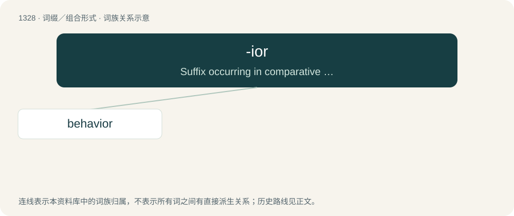

# 1416 · -ior — Suffix occurring in comparative adjectives borrowed from Latin.

[总目录](../00_总目录_按常用程度.md)

**类型**：词缀／组合形式　｜　**来源语言**：见词源记录

## 核心含义与来源

- 核心含义：Suffix occurring in comparative adjectives borrowed from Latin.
- 英文含义：Suffix occurring in comparative adjectives borrowed from Latin.
- 词形：-ior

**来源记录 1**（后缀／后置成分；Suffix occurring in comparative adjectives borrowed from Latin.）

From Latin -ior, the nominative masculine and feminine singular of the comparative suffix -iōr.

## 词族图

## 单词速览（常用到不常用）

| 单词 | 音标 | 释义 |
|---|---|---|
| [behavior](#w-1) | 英 /bɪˈheɪ.vjə/；美 /bɪˈheɪ.vjəɹ/ | n. 行为, 举止；\[医\] 行为 |

## 逐词详解

### 1. behavior

**词性**：名词　｜　**音标**：英 /bɪˈheɪ.vjə/；美 /bɪˈheɪ.vjəɹ/

**中文释义**：n. 行为, 举止；\[医\] 行为

**英文义项**：Human conduct relative to social norms. / An inappropriate or forbidden action.

**构词拆分**：behave + -ior

**词源与演化**：

From Middle English behavoure, behaver, from behaven (modern behave), morphologically equivalent to behave + -ior. The suffix was adopted in imitation of havour (modern haviour, havior), an etymologically unrelated word that was corrupted from Anglo‐Norman Anglo-Norman aveir and Old French Old French avoir (“property, wealth”) through false association with the native English verb have. The French term derives ultimately from Latin Latin habēre (“to have, hold”). Compare Scots havings (“behavior”), from have (“to behave”). Replaced Old English ġebǣru.

**例句**：

> When a patient has a behavior, document it in their records.

该用例对应义项：An inappropriate or forbidden action.
