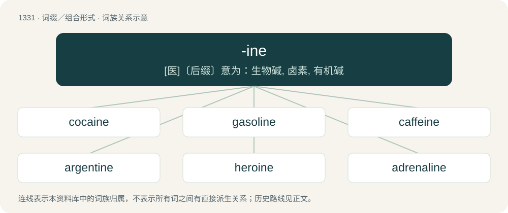

# 1420 · -ine — \[医\]〔后缀〕意为：生物碱, 卤素, 有机碱

[总目录](../00_总目录_按常用程度.md)

**类型**：词缀／组合形式　｜　**来源语言**：见词源记录

## 核心含义与来源

- 核心含义：\[医\]〔后缀〕意为：生物碱, 卤素, 有机碱
- 英文含义：Of or pertaining to.
- 词形：-ine

**多个词源／构词路径**：同一拼写可能有不同来源；以下按词性和含义分别列出。

**来源记录 1**（后缀／后置成分；Of or pertaining to.）

From Middle English -in, -ine, from Old French -in, -ine, from Latin -īnus, from Proto-Indo-European \*-iHnos. More at -en § Etymology 4.

**来源记录 2**（后缀／后置成分；Used to form feminine nouns.）

From French -ine, feminine of -in; Latin -īna, feminine of -īnus. Doublet of -ina.

**来源记录 3**（后缀／后置成分；Found in the plural forms of a small number of English words. Not productive.）

Variant of -en § Etymology 2.

**来源记录 4**（后缀／后置成分；used to form vernacular nouns and adjectives relating to animal taxonomic subfamilies）

From taxonomic suffix -inae, ultimately from the same root as § Etymology 1.

## 词族图

## 单词速览（常用到不常用）

| 单词 | 音标 | 释义 |
|---|---|---|
| [cocaine](#w-1) | 英 /kə(ʊ)ˈkeɪn/；美 /koʊˈkeɪn/ | n. 可卡因, 古柯碱；\[化\] 可卡因; 古柯碱 |
| [gasoline](#w-2) | 英 /ˈɡæs.ə.liːn/；美 /ɡæsˈlin/ | n. 汽油；\[化\] 汽油 |
| [caffeine](#w-3) | /ˈkæfiːn/ | n. 咖啡因, 咖啡碱；\[化\] 咖啡因; 咖啡碱 |
| [argentine](#w-4) | 英 /ˈɑː(ɹ).d͡ʒənˌtiːn/ | n. 银, 银白色金属, 银白色鱼鳞, 阿根廷人；a. 银的, 银色的, 阿根廷的 |
| [heroine](#w-5) | 英 /ˈhɛɹəʊɪn/；美 /ˈhɪɹoʊɪn/ | n. 巾帼英雄, 烈妇, 女主角；\[化\] 海洛因; 二醋吗啡; 二乙酰吗啡 |
| [adrenaline](#w-6) | /əˈdɹɛnəlɪn/ | n. 肾上腺素；\[化\] 肾上腺素 |
| [nicotine](#w-7) | /ˈnɪkətiːn/ | n. 烟碱, 尼古丁；\[化\] 烟碱; 尼古丁 |
| [chlorine](#w-8) | 英 /ˈklɔːɹiːn/；美 /ˈklɔɹin/ | n. 氯；\[化\] 氯Cl |
| [alkaline](#w-9) | 英 /ˈæl.kəl.aɪn/；美 /ˈæl.kə.laɪn/ | a. 碱的, 碱性的；\[化\] 碱的; 强碱的 |
| [iodine](#w-10) | /ˈaɪ.əˌdaɪn | n. 碘, 碘酒；\[化\] 碘I-2 |
| [serpentine](#w-11) | 英 /ˈsɜː.pənˌtaɪn/；美 /ˈsɝ.pənˌtaɪn/ | a. 蛇的, 层层卷绕的, 阴险的, 迂回的；n. 蛇纹石, 弯弯曲曲之物；vi. 蜿蜒 |
| [tangerine](#w-12) | /ˈtæn.d͡ʒəˌɹiːn/ | n. 柑橘 |
| [codeine](#w-13) | 英 /ˈkəʊ.diːn/；美 /ˈkoʊˌdiːn/ | n. 可卡因, 可待因；\[化\] 可待因 |
| [tyrosine](#w-14) | /ˈtirəsiːn/ | n. 酪氨酸；\[化\] 酪氨酸; 3-对羟苯基丙氨酸 |
| [figurine](#w-15) | 英 /fɪɡ(j)əˈɹin/；美 /fɪɡ(j)əˈɹin/ | n. 小雕像 |
| [creatine](#w-16) | 英 /ˈkɹiː.əˌtiːn/；美 /ˈkɹi.əˌtin/ | n. 肌酸；\[化\] 肌酸; 甲胍基乙酸 |
| [amine](#w-17) | 英 /əˈmiːn/；美 /əˈmiːn/ | n. 胺, 卤氮化合物；\[化\] 胺 |
| [palatine](#w-18) | 英 /ˈpæl.ə.taɪn/；美 /ˈpæl.əˌtaɪn/ | 【英文】Of or relating to the palate or to a palatine bone. |
| [vaseline](#w-19) | 英 /ˈvæ.sə.liːn/；美 /ˈvæ.sə.lin/ | n. 凡士林；\[化\] 凡士林 |
| [epinephrine](#w-20) | /ˌɛp.ɪˈnɛ.fɹɪn/ | n. 肾上腺素；\[化\] 肾上腺素 |
| [fluorine](#w-21) | 美 /ˈflʊ(ə)ɹˌin | n. 氟；\[化\] 氟 |
| [lysine](#w-22) | /ˈlaɪsiːn/ | n. 赖氨酸；\[化\] 赖氨酸 |
| [adenosine](#w-23) | 英 /əˈdɛnə(ʊ)siːn/；美 /əˈdɛnəˌsin/ | n. 腺苷；\[化\] 腺嘌呤-9β-呋喃核糖苷; 腺苷 |
| [delphine](#w-24) | /ˈdelfiːn; delˈfiːn/ | 【英文】A fatty substance contained in the oil of the dolphin |
| [glycine](#w-25) | /ˈɡlaɪˌsin/ | \[化\] 甘氨酸; 氨基乙酸；\[医\] 甘氨酸, 氨基乙酸 |
| [turpentine](#w-26) | 英 /ˈtɜː.pənˌtaɪn/；美 /ˈtɝ.pənˌtaɪn/ | n. 松脂, 松木油, 松节油；vt. 涂以松节油 |
| [creatinine](#w-27) | 英 /kɹiːˈæ.təˌniːn/；美 /kɹiˈæ.təˌnin/ | n. 肌酸酐；\[化\] 肌酸酐; 肌酸内酰胺 |
| [methionine](#w-28) | 英 /mɪˈθʌɪəniːn/；美 /mɛˈθaɪəˌniːn/ | \[化\] 甲硫氨酸; 蛋氨酸；\[医\] 蛋氨酸, 甲硫丁氨酸 |
| [atropine](#w-29) | 英 /ˈa.tɹə.piːn/；美 /ˈæ.tɹəˌpin/ | n. 阿托平, 颠茄硷；\[化\] 阿托品 |
| [estuarine](#w-30) | /ˈestjuərin/ | a. 河口的, 港湾的 |
| [saccharine](#w-31) | 英 /ˈsækəɹaɪn/；美 /ˈsækəɹɪn/ | a. 糖的, 含糖的, 产糖的, 极甜的, 过甜的, 太甜的, 奉承的, 讨好的, 和颜悦色的；n. 糖精 |
| [tetracycline](#w-32) | /ˌtɛ.tɹəˈsaɪ.kliːn/ | n. 四环素；\[化\] 四环素 |
| [bromine](#w-33) | 英 /ˈbɹəʊmiːn；美 /ˈbɹoʊmin/ | n. 溴；\[化\] 溴Br |
| [labyrinthine](#w-34) | 英 /ˌlab.əˈɹɪn.θʌɪn/；美 /ˌlæb.əˈɹɪn.θɪn/ | \[医\] 迷路的 |
| [leucine](#w-35) | /ˈluː.siːn/ | n. 白氨酸；\[化\] 亮氨酸; 白氨酸; 异己氨酸 |
| [ephedrine](#w-36) | 英 /ˈɛf.ə.dɹiːn/；美 /ɪˈfɛ.dɹɪn/ | n. 麻黄素；\[化\] 麻黄碱; 麻黄素 |
| [strychnine](#w-37) | 英 /ˈstɹɪk.niːn/；美 /ˈstrɪkˌnaɪn/ | \[化\] 士的宁; 马钱子碱；\[医\] 士的宁, 番木鳖硷 |
| [riverine](#w-38) | 英 /ˈɹɪvəɹaɪn/；美 /ˈɹɪvɚ.ɪn/ | a. 河的, 河边的, 河岸边 |
| [mescaline](#w-39) | /ˈmɛs.kəl.ɪn/ | n. 墨斯卡林；\[化\] 墨斯卡灵; 三甲氧苯乙胺 |
| [taurine](#w-40) | /ˈtɔːɹiːn/ | 【英文】An amino-sulfonic acid, NH₂CH₂CH₂SO₃H, that has regulatory functions in mammals. |
| [guanine](#w-41) | /ˈɡwɑː.niːn/ | n. 鸟嘌呤；\[化\] 鸟嘌呤; 2-氨基-6-羟嘌呤 |
| [opine](#w-42) | /əuˈpain/ | 【英文】Any of a class of organic compounds, derived from amino acids, found in some plant galls. |
| [dauphine](#w-43) | /ˈdɔːfiːn,-fin/ | n. \[法史\]王太子的妻子,王妃 |
| [colchicine](#w-44) | 英 /ˈkɒl.tʃɪs.iːn/；美 /ˈkɑl.t͡ʃəˌsiːn/ | n. 秋水仙碱；\[化\] 秋水仙碱; 秋水仙素 |
| [amitriptyline](#w-45) | 英 /æmɪˈtɹɪptɪliːn/ | n. 阿米替林(抗抑郁药)；\[化\] 阿米替林 |
| [nectarine](#w-46) | 美 /ˌnɛktəˈɹiːn/；/ˈnɛk.tə.ɹiːn/ | n. 蜜桃 |
| [betaine](#w-47) | /ˈbiːtəiːn/ | n. \[化\]甜菜碱, 三甲铵乙内酯 |
| [valine](#w-48) | /ˈveɪliːn/ | n. \[生化\]缬氨酸 |
| [thyroxine](#w-49) | 英 /θaɪˈrɒk.siːn/；美 /θaɪˈrɒk.sin/ | n. 甲状腺素；\[化\] 甲状腺素 |
| [phosphine](#w-50) | /ˈfɒsfiːn/ | n. 磷化氢, 碱性染革黄棕；\[化\] 磷化氢; 膦; 碱性染革黄棕 |
| [promethazine](#w-51) | 英 /pɹəʊˈmɛ.θə.ziːn/；美 /pɹoʊˈmɛ.θəˌzin/ | n. \[药\]普鲁米近,异丙嗪,抗胺荨(一种抗过敏及安定药) |
| [thymine](#w-52) | /ˈθaɪmiːn/ | n. 胸腺嘧啶；\[化\] 胸腺嘧啶 |
| [adamantine](#w-53) | /.ædəˈmæntain/ | 【英文】Synonym of adamantium (“a fictional metal which is indestructible or nearly so”). |

## 逐词详解

### 1. cocaine

**词性**：名词　｜　**音标**：英 /kə(ʊ)ˈkeɪn/；美 /koʊˈkeɪn/

**中文释义**：n. 可卡因, 古柯碱；\[化\] 可卡因; 古柯碱

**英文义项**：An addictive drug derived from coca (Erythroxylum) or prepared synthetically, used sometimes medicinally as a local anesthetic and, often illegally, as a stimulant. / The powder form of this drug, specifically.

**构词拆分**：coca + -ine

**词源与演化**：

From coca + -ine, from Quechua kuka. First use appears c. 1874.

**例句**：

> His life spiraled out of control after he started smoking crack cocaine.

### 2. gasoline

**词性**：名词　｜　**音标**：英 /ˈɡæs.ə.liːn/；美 /ɡæsˈlin/

**中文释义**：n. 汽油；\[化\] 汽油

**英文义项**：A flammable liquid consisting of a mixture of refined petroleum hydrocarbons, mainly used as a motor fuel; petrol. / Any specific kind of this fuel.

**构词拆分**：gas + -ol + -ine；gas + -ol

**词源与演化**：

From gas + -ol (suffix used in the names of oils) + -ine (suffix used in the names of derivatives). So called because it was originally used in the manufacture and enrichment of domestic gases, such as air gas. Some sources suggest that the name originated from the brand name Cazeline, a petroleum-derived lighting oil, from the surname of the man who first marketed it in 1862, John Cassell, and the suffix –eline, from Greek ἔλαιον (élaion, “oil, olive oil”), from ἐλαία (elaía, “olive”). Gasolene is found from 1863, and gasoline from 1864.

**例句**：

> You can't put gasoline in this car. This car takes diesel fuel.

该用例对应义项：A flammable liquid consisting of a mixture of refined petroleum hydrocarbons, mainly used as a motor fuel; petrol.

### 3. caffeine

**词性**：名词　｜　**音标**：/ˈkæfiːn/

**中文释义**：n. 咖啡因, 咖啡碱；\[化\] 咖啡因; 咖啡碱

**英文义项**：An alkaloid, C₈H₁₀N₄O₂, found naturally in tea and coffee plants, which acts as a mild stimulant on the central nervous system.

**词源与演化**：

Borrowed from French caféine, from café (“coffee”), or German Caffein, Kaffein (cp. Coffein, Koffein), from Kaffee (“coffee”) (cp. Kaffe, Koffee, Koffe), or Italian caffè (“coffee”) + -ine.

**例句**：

> Hildebrand says coffee is thought to contain other health-promoting substances besides caffeine.

### 4. argentine

**词性**：形容词　｜　**音标**：英 /ˈɑː(ɹ).d͡ʒənˌtiːn/

**中文释义**：n. 银, 银白色金属, 银白色鱼鳞, 阿根廷人；a. 银的, 银色的, 阿根廷的

**英文义项**：Containing or resembling silver.

**构词拆分**：argent + -ine

**词源与演化**：

From Middle English argentyne, borrowed from Old French argentin (“silvery”), from Latin argentum (“silver”), equivalent to argent + -ine.

**例句**：

> The Argentine president said that diabetes is a disease of people with high purchasing power.

### 5. heroine

**词性**：名词　｜　**音标**：英 /ˈhɛɹəʊɪn/；美 /ˈhɪɹoʊɪn/

**中文释义**：n. 巾帼英雄, 烈妇, 女主角；\[化\] 海洛因; 二醋吗啡; 二乙酰吗啡

**英文义项**：A female hero. / A female lead character.

**构词拆分**：hero + -ine (suffix forming feminine nouns)

**词源与演化**：

From Latin hērōīna, from late Ancient Greek ἡρωΐνη (hērōḯnē) (2nd century), a feminine equivalent of ἥρως (hḗrōs, “hero, demigod”), equivalent to hero + -ine (suffix forming feminine nouns). \* English from 1587. The sense of "female lead character" is from 1715.

**例句**：

> In many old movies the heroine is always the one to die.

### 6. adrenaline

**词性**：名词　｜　**音标**：/əˈdɹɛnəlɪn/

**中文释义**：n. 肾上腺素；\[化\] 肾上腺素

**英文义项**：Epinephrine, the hormone and neurotransmitter. / Excitement; thrills.

**构词拆分**：adrenal + -ine

**词源与演化**：

From adrenal + -ine, coined by Japanese chemist Takamine Jōkichi in 1901.

**例句**：

> Some people bungee jump to feel alive through the surge of adrenaline.

该用例对应义项：Excitement; thrills.

### 7. nicotine

**词性**：名词　｜　**音标**：/ˈnɪkətiːn/

**中文释义**：n. 烟碱, 尼古丁；\[化\] 烟碱; 尼古丁

**英文义项**：An alkaloid (C₁₀H₁₄N₂), commonly occurring in the tobacco plant. / Tobacco or cigarettes.

**构词拆分**：Nicot + -ine

**词源与演化**：

Borrowed from French nicotine, equivalent to Nicot + -ine, named after Jean Nicot (1530–1604), the French ambassador to Portugal, who sent tobacco seeds back to France in 1561. The etymology of the surname itself is unclear.

**例句**：

> He's got nicotine stains on his fingers.

该用例对应义项：Tobacco or cigarettes.

### 8. chlorine

**词性**：名词　｜　**音标**：英 /ˈklɔːɹiːn/；美 /ˈklɔɹin/

**中文释义**：n. 氯；\[化\] 氯Cl

**英文义项**：A toxic, green, gaseous chemical element (symbol Cl) with an atomic number of 17. / A single atom of this element.

**词源与演化**：

Coined by British chemist Humphry Davy in 1810 from Ancient Greek χλωρός (khlōrós, “pale green”) + -ine.

**例句**：

> Putting chlorine in drinking water is the biggest advance in public health.

### 9. alkaline

**词性**：形容词　｜　**音标**：英 /ˈæl.kəl.aɪn/；美 /ˈæl.kə.laɪn/

**中文释义**：a. 碱的, 碱性的；\[化\] 碱的; 强碱的

**英文义项**：Of, or relating to an alkali, one of a class of caustic bases. / Having a pH greater than 7.

**构词拆分**：alkali + -ine

**词源与演化**：

First attested in 1677. From alkali + -ine, ultimately from Arabic اَلْقِلْي (al-qily, “alkali, ashes of the saltwort”), related to قَلَى (qalā, “to roast in a pan, fry”).

**例句**：

> Alkaline soils derived from chalk or limestone.

该用例对应义项：relating to or containing an alkali; having a pH greater than 7

### 10. iodine

**词性**：名词　｜　**音标**：/ˈaɪ.əˌdaɪn

**中文释义**：n. 碘, 碘酒；\[化\] 碘I-2

**英文义项**：A chemical element (symbol: I) with an atomic number of 53; one of the halogens. / An antiseptic incorporating the element.

**词源与演化**：

From French iode + -ine, from Ancient Greek ἰοειδής (ioeidḗs, “violet”). Coined by British chemist Humphry Davy in 1814.

**例句**：

> Hydrogen, nitrogen, oxygen, fluorine, chlorine, bromine and iodine are diatomic elements.

### 11. serpentine

**词性**：形容词　｜　**音标**：英 /ˈsɜː.pənˌtaɪn/；美 /ˈsɝ.pənˌtaɪn/

**中文释义**：a. 蛇的, 层层卷绕的, 阴险的, 迂回的；n. 蛇纹石, 弯弯曲曲之物；vi. 蜿蜒

**英文义项**：Of, pertaining to, or characteristic of snakes. / Of, or having attributes associated with, the serpent referred to in the book of Genesis in the Bible, such as craftiness or deceitfulness.

**构词拆分**：serpent + -ine

**词源与演化**：

From Middle English serpentine, from Old French serpentin, from Latin serpentīnus, from serpēns (“serpent”), equivalent to serpent + -ine.

**例句**：

> The serpentine path through the mountains was narrow and dangerous.

该用例对应义项：Curving in alternate directions; sinuous.

### 12. tangerine

**词性**：名词　｜　**音标**：/ˈtæn.d͡ʒəˌɹiːn/

**中文释义**：n. 柑橘

**英文义项**：A slightly ovoid, orange-coloured citrus fruit with a rough peel and a sour-sweet taste which is larger than a clementine and sometimes classed as a variety of mandarin orange. / A deep yellowish-orange colour, like that of a tangerine fruit.

**词源与演化**：

From French Tanger + English -ine, after Tangier, Morocco.

**例句**：

> The tangerine is generally considered to be a subspecies of mandarin oranges.

### 13. codeine

**词性**：名词　｜　**音标**：英 /ˈkəʊ.diːn/；美 /ˈkoʊˌdiːn/

**中文释义**：n. 可卡因, 可待因；\[化\] 可待因

**英文义项**：An addictive alkaloid narcotic derived from opium and used as a hypnotic, analgesic and antitussive; often mixed with aspirin etc.

**构词拆分**：Ancient Greek κώδεια (kṓdeia, “capsule of the poppy, poppy head”) + -ine

**词源与演化**：

From French codéine, from Ancient Greek κώδεια (kṓdeia, “capsule of the poppy, poppy head”) + -ine.

**例句**：

> The two major active alkaloids in opium are morphine and codeine.

### 14. tyrosine

**词性**：名词　｜　**音标**：/ˈtirəsiːn/

**中文释义**：n. 酪氨酸；\[化\] 酪氨酸; 3-对羟苯基丙氨酸

**英文义项**：A nonessential amino acid 2-amino-3-(4-hydroxyphenyl)propanoic acid found in most animal proteins, especially casein

**构词拆分**：tyro- + -ine

**词源与演化**：

From Ancient Greek τῡρός (tūrós, “cheese”) + -ine (since first discovered in cheese); surface analysis is approximately tyro- + -ine.

**例句**：

> Tyrosine is similar in structure to phenylalanine, with the important distinction that the latter contains a hydroxyl group in its side chain.

### 15. figurine

**词性**：名词　｜　**音标**：英 /fɪɡ(j)əˈɹin/；美 /fɪɡ(j)əˈɹin/

**中文释义**：n. 小雕像

**英文义项**：A small carved or molded figure; a statuette.

**构词拆分**：figure + -ine

**词源与演化**：

Borrowed from French figurine, equivalent to figure + -ine.

**例句**：

> Tom accidentally knocked Mary's favourite figurine off the shelf and broke it.

### 16. creatine

**词性**：名词　｜　**音标**：英 /ˈkɹiː.əˌtiːn/；美 /ˈkɹi.əˌtin/

**中文释义**：n. 肌酸；\[化\] 肌酸; 甲胍基乙酸

**英文义项**：An amino acid, 2-(carbamimidoyl-methyl- amino)acetic acid, which naturally occurs in vertebrates and helps to supply energy to muscle and nerve cells.

**词源与演化**：

From Ancient Greek κρέας (kréas, “meat”) (genitive κρέατος (kréatos)) + -ine. Not related to create.

### 17. amine

**词性**：名词　｜　**音标**：英 /əˈmiːn/；美 /əˈmiːn/

**中文释义**：n. 胺, 卤氮化合物；\[化\] 胺

**英文义项**：A functional group formally derived from ammonia by replacing one, two or three hydrogen atoms with hydrocarbon or other radicals. / Any organic compound containing an amine functional group.

**构词拆分**：ammonia + -ine

**词源与演化**：

From ammonia + -ine.

**例句**：

> The nitrite reacts with an aromatic amine to form a diazonium salt.

### 18. palatine

**词性**：形容词　｜　**音标**：英 /ˈpæl.ə.taɪn/；美 /ˈpæl.əˌtaɪn/

**英文义项**：Of or relating to the palate or to a palatine bone.

**构词拆分**：palate + -ine

**词源与演化**：

Borrowing from French palatin, from New Latin palātīnus, from palātum (“the palate”) + -īnus (“-ine”, adjectival suffix); equivalent to palate + -ine.

### 19. vaseline

**词性**：动词　｜　**音标**：英 /ˈvæ.sə.liːn/；美 /ˈvæ.sə.lin/

**中文释义**：n. 凡士林；\[化\] 凡士林

**英文义项**：To lubricate with vaseline.

**词源与演化**：

From German Wasser (“water”) + Ancient Greek ἔλαιον (élaion, “oil”) + -ine. Genericized trademark of the Vaseline brand of petroleum jelly introduced by American chemist Robert Augustus Chesebrough in 1872.

### 20. epinephrine

**词性**：名词　｜　**音标**：/ˌɛp.ɪˈnɛ.fɹɪn/

**中文释义**：n. 肾上腺素；\[化\] 肾上腺素

**英文义项**：A catecholamine hormone and neurotransmitter; as a hormone, secreted by the adrenal gland in response to stress (when it stimulates the autonomic nervous system); as a neurotransmitter, synthesized from norepinephrine. It is also used as a medication.

**词源与演化**：

From Ancient Greek ἐπι- (epi-, “upon”) + νεφρός (nephrós, “kidney”) + -ine.

**例句**：

> Tom carries an epinephrine injector at all times.

### 21. fluorine

**词性**：名词　｜　**音标**：美 /ˈflʊ(ə)ɹˌin

**中文释义**：n. 氟；\[化\] 氟

**英文义项**：The chemical element (symbol F) with an atomic number of 9. It is the lightest of the halogens, a pale yellow-green, highly reactive gas that attacks all metals. / An atom of this element.

**词源与演化**：

From Latin fluor (“flow”) + English -ine. Coined by British chemist Humphry Davy in 1813.

**用法示例／搭配（非完整句）**：

> an octahedron of fluorines

该用例对应义项：The chemical element (symbol F) with an atomic number of 9. It is the lightest of the halogens, a pale yellow-green, highly reactive gas that attacks all metals.

### 22. lysine

**词性**：名词　｜　**音标**：/ˈlaɪsiːn/

**中文释义**：n. 赖氨酸；\[化\] 赖氨酸

**英文义项**：An amino acid, C₆H₁₄N₂O₂, in L- or D-forms. / The L-form of such a molecule, as it occurs in living organisms; in humans it is an essential amino acid.

**构词拆分**：lysis + -ine

**词源与演化**：

From lysis + -ine, in reference to its tendency to participate in catalysis.

### 23. adenosine

**词性**：名词　｜　**音标**：英 /əˈdɛnə(ʊ)siːn/；美 /əˈdɛnəˌsin/

**中文释义**：n. 腺苷；\[化\] 腺嘌呤-9β-呋喃核糖苷; 腺苷

**英文义项**：A nucleoside derived from adenine and ribose, found in striated muscle tissue.

**词源与演化**：

From German Adenosin, corresponding to aden(ine) + (rib)os(e) + -ine.

**例句**：

> Caffeine is a purinergic antagonist that competitively inhibits adenosine at the sites of P1 receptors.

### 24. delphine

**词性**：名词　｜　**音标**：/ˈdelfiːn; delˈfiːn/

**英文义项**：A fatty substance contained in the oil of the dolphin

**构词拆分**：Latin delphīnus + -ine

**词源与演化**：

From Latin delphīnus + -ine

### 25. glycine

**词性**：名词　｜　**音标**：/ˈɡlaɪˌsin/

**中文释义**：\[化\] 甘氨酸; 氨基乙酸；\[医\] 甘氨酸, 氨基乙酸

**英文义项**：A nonessential amino acid, amino-acetic acid, C₂H₅NO₂ found in most proteins but especially in sugar cane; the simplest amino acid.

**词源与演化**：

From Ancient Greek γλῠκῠ́ς (glŭkŭ́s, “sweet”) + English -ine.

**例句**：

> Is there a simpler amino acid than glycine?

### 26. turpentine

**词性**：名词　｜　**音标**：英 /ˈtɜː.pənˌtaɪn/；美 /ˈtɝ.pənˌtaɪn/

**中文释义**：n. 松脂, 松木油, 松节油；vt. 涂以松节油

**英文义项**：Any oleoresin secreted by the wood or bark of certain trees. / A volatile essential oil now obtained from such oleoresin of from the wood of pine trees by steam distillation; a complex mixture of monoterpenes; now used as a solvent and paint thinner.

**构词拆分**：terebinth + -ine

**词源与演化**：

From Middle English terebentyne, terbentyne, turbentine, from Old French terbentine, turbentine, Latin terebinthina, from Ancient Greek τερεβινθίνη (terebinthínē), the feminine form of τερεβινθινος (terebinthinos, “terebinthine”, adjective), from τερέβινθος (terébinthos, “terebinth tree”, noun). Related to terpene and terpin; etymologically equivalent to terebinth + -ine.

**例句**：

> Turpentine is widely used as a solvent in paints, varnishes and lacquers.

### 27. creatinine

**词性**：名词　｜　**音标**：英 /kɹiːˈæ.təˌniːn/；美 /kɹiˈæ.təˌnin/

**中文释义**：n. 肌酸酐；\[化\] 肌酸酐; 肌酸内酰胺

**英文义项**：A heterocyclic amine, 2-amino-1-methyl-5H-imidazol-4-one, formed by the metabolism of creatine.

**构词拆分**：creatine + -ine

**词源与演化**：

From creatine + -ine, from Ancient Greek κρέας (kréas, “meat”) (genitive κρέατος (kréatos)) + -ine.

### 28. methionine

**词性**：名词　｜　**音标**：英 /mɪˈθʌɪəniːn/；美 /mɛˈθaɪəˌniːn/

**中文释义**：\[化\] 甲硫氨酸; 蛋氨酸；\[医\] 蛋氨酸, 甲硫丁氨酸

**英文义项**：A sulphur-containing amino acid, C₅H₁₁NO₂S, in L- and D-forms. / The L-form thereof, a lipotropic molecule widely occurring in living organisms and found in most protein; in humans it is an essential amino acid.

**构词拆分**：methyl + thio- + -n- + -ine

**词源与演化**：

From methyl + thio- + -n- + -ine.

### 29. atropine

**词性**：名词　｜　**音标**：英 /ˈa.tɹə.piːn/；美 /ˈæ.tɹəˌpin/

**中文释义**：n. 阿托平, 颠茄硷；\[化\] 阿托品

**英文义项**：An alkaloid extracted from the plant deadly nightshade (Atropa belladonna) and other sources, such as the seeds of the thorn-apple. Though overdoses would be fatal it is used as a drug in medicine for its paralytic effects (e.g. in surgery to relax muscles, in dentistry to dry the mouth, in ophthalmology to dilate the pupils).

**词源与演化**：

From Latin Atropa (“genus of deadly nightshade”) + English -ine.

### 30. estuarine

**词性**：形容词　｜　**音标**：/ˈestjuərin/

**中文释义**：a. 河口的, 港湾的

**英文义项**：Of or pertaining to an estuary. / Formed in an estuary by alluvial deposition.

**构词拆分**：From estuary + -ine.

**词源与演化**：

From estuary + -ine.

**例句**：

> Estuarine dolphins can live in both saltwater and freshwater.

### 31. saccharine

**词性**：形容词　｜　**音标**：英 /ˈsækəɹaɪn/；美 /ˈsækəɹɪn/

**中文释义**：a. 糖的, 含糖的, 产糖的, 极甜的, 过甜的, 太甜的, 奉承的, 讨好的, 和颜悦色的；n. 糖精

**英文义项**：Of or relating to sugar; sugary. / Containing a large or excessive amount of sugar.

**词源与演化**：

From New Latin saccharum (“sugar”) + English -ine (suffix meaning ‘of or pertaining to’ forming adjectives). Saccharum is derived from saccharon (“syrupy liquid from bamboo or reeds”), from Ancient Greek σάκχαρον (sákkharon), from Pali sakkharā (“sugar; gravel; granule, grain; crystal; potsherd”), from Sanskrit शर्करा (śárkarā, “ground or candied sugar; cotton sugar, sugarmaple; gravel, grit, pebbles; potsherd”), ultimately from Proto-Indo-European \*ḱorkeh₂ (“boulder; gravel”).

**例句**：

> The little girls were afforded a stretch limousine for their insipid, saccharine songs.

### 32. tetracycline

**词性**：名词　｜　**音标**：/ˌtɛ.tɹəˈsaɪ.kliːn/

**中文释义**：n. 四环素；\[化\] 四环素

**英文义项**：A yellow crystalline broad-spectrum antibiotic C₂₂H₂₄N₂O₈ produced by streptomyces or synthetically. / Any of a large group of antibiotics with the same general structure derived from tetracene with many hydroxyl and other groups.

**构词拆分**：tetracyclic + -ine

**词源与演化**：

From tetracyclic + -ine.

### 33. bromine

**词性**：名词　｜　**音标**：英 /ˈbɹəʊmiːn；美 /ˈbɹoʊmin/

**中文释义**：n. 溴；\[化\] 溴Br

**英文义项**：A nonmetallic chemical element (symbol Br) with an atomic number of 35; one of the halogens, it is a fuming red-brown liquid at room temperature. / A bromine atom.

**构词拆分**：brome + -ine

**词源与演化**：

From obsolete English brome + -ine, this word being from French brome, from Ancient Greek βρῶμος (brômos, “stink”).

**例句**：

> Hydrogen, nitrogen, oxygen, fluorine, chlorine, bromine and iodine are diatomic elements.

### 34. labyrinthine

**词性**：形容词　｜　**音标**：英 /ˌlab.əˈɹɪn.θʌɪn/；美 /ˌlæb.əˈɹɪn.θɪn/

**中文释义**：\[医\] 迷路的

**英文义项**：Physically resembling a labyrinth; with the qualities of a maze. / Relating to the labyrinth of the inner ear.

**构词拆分**：labyrinth + -ine

**词源与演化**：

From labyrinth + -ine from Ancient Greek λᾰβύρῐνθος (lăbúrĭnthos, “a maze”).

**例句**：

> A labyrinthine network of tortuous footpaths.

该用例对应义项：resembling a labyrinth in form or complexity

### 35. leucine

**词性**：名词　｜　**音标**：/ˈluː.siːn/

**中文释义**：n. 白氨酸；\[化\] 亮氨酸; 白氨酸; 异己氨酸

**英文义项**：An essential amino acid, C₆H₁₃NO₂, isomeric with isoleucine, found in most animal proteins; it is essential for growth in children.

**构词拆分**：leuco- + -ine

**词源与演化**：

Derived from Ancient Greek λευκός (leukós, “white”) + -ine, equivalent to leuco- + -ine.

### 36. ephedrine

**词性**：名词　｜　**音标**：英 /ˈɛf.ə.dɹiːn/；美 /ɪˈfɛ.dɹɪn/

**中文释义**：n. 麻黄素；\[化\] 麻黄碱; 麻黄素

**英文义项**：A crystalline alkaloid drug C₁₀H₁₅NO obtained from a Chinese ephedra (Ephedra sinica) or synthesized that has the physiological action of epinephrine. It causes constriction of the blood vessels and widening of the bronchial passages and is used in the form of its hydrochloride or sulfate to relieve asthma and hay fever.

**构词拆分**：From ephedra + -ine.

**词源与演化**：

From ephedra + -ine.

### 37. strychnine

**词性**：名词　｜　**音标**：英 /ˈstɹɪk.niːn/；美 /ˈstrɪkˌnaɪn/

**中文释义**：\[化\] 士的宁; 马钱子碱；\[医\] 士的宁, 番木鳖硷

**英文义项**：A very toxic, colorless crystalline alkaloid, derived from nux vomica, used as a pesticide.

**词源与演化**：

From French strychnine, from Greek στρύχνος (strýchnos, “sleepy nightshade”) (or directly from Ancient Greek στρύχνον (strúkhnon)) + -ine.

### 38. riverine

**词性**：形容词　｜　**音标**：英 /ˈɹɪvəɹaɪn/；美 /ˈɹɪvɚ.ɪn/

**中文释义**：a. 河的, 河边的, 河岸边

**英文义项**：Of or pertaining to rivers, or located on or by a river; inhabiting a river or its surrounds.

**构词拆分**：river + -ine

**词源与演化**：

From river + -ine.

### 39. mescaline

**词性**：名词　｜　**音标**：/ˈmɛs.kəl.ɪn/

**中文释义**：n. 墨斯卡林；\[化\] 墨斯卡灵; 三甲氧苯乙胺

**英文义项**：A hallucinogenic and intoxicating compound present in the peyote cactus (Lophophora williamsii), the San Pedro cactus (Echinopsis pachanoi), and the Peruvian torch (Echinopsis peruviana).

**构词拆分**：From mescal (“peyote”) + -ine.

**词源与演化**：

From mescal (“peyote”) + -ine.

### 40. taurine

**词性**：名词　｜　**音标**：/ˈtɔːɹiːn/

**英文义项**：An amino-sulfonic acid, NH₂CH₂CH₂SO₃H, that has regulatory functions in mammals.

**构词拆分**：taur(ocholic) + -ine

**词源与演化**：

From taur(ocholic) + -ine.

### 41. guanine

**词性**：名词　｜　**音标**：/ˈɡwɑː.niːn/

**中文释义**：n. 鸟嘌呤；\[化\] 鸟嘌呤; 2-氨基-6-羟嘌呤

**英文义项**：A substance first obtained from guano; it is a nucleic base and pairs with cytosine in DNA and RNA (by means of three hydrogen bonds).

**构词拆分**：guano + -ine

**词源与演化**：

From guano + -ine. Guanine was named by the German chemist Julius Bodo Unger in 1846 who isolated it from guano.

**例句**：

> DNA is composed of four nucleotides: adenine, thymine, cytosine and guanine.

### 42. opine

**词性**：名词　｜　**音标**：/əuˈpain/

**英文义项**：Any of a class of organic compounds, derived from amino acids, found in some plant galls.

**词源与演化**：

Derived from Ancient Greek ὀπός (opós, “juice of a plant”) + -ine.

### 43. dauphine

**词性**：名词　｜　**音标**：/ˈdɔːfiːn,-fin/

**中文释义**：n. \[法史\]王太子的妻子,王妃

**英文义项**：The wife of the dauphin; dauphiness.

**构词拆分**：dauphin + -ine

**词源与演化**：

Borrowed from French dauphine, equivalent to dauphin + -ine.

### 44. colchicine

**词性**：名词　｜　**音标**：英 /ˈkɒl.tʃɪs.iːn/；美 /ˈkɑl.t͡ʃəˌsiːn/

**中文释义**：n. 秋水仙碱；\[化\] 秋水仙碱; 秋水仙素

**英文义项**：A highly toxic alkaloid, chemical formula C₂₂H₂₅NO₆, originally extracted from plants of the genus Colchicum and formerly used to treat rheumatic complaints, now used mainly in the treatment of gout.

**构词拆分**：From colchicum + -ine.

**词源与演化**：

From colchicum + -ine.

### 45. amitriptyline

**词性**：名词　｜　**音标**：英 /æmɪˈtɹɪptɪliːn/

**中文释义**：n. 阿米替林(抗抑郁药)；\[化\] 阿米替林

**英文义项**：An antidepressant drug; a tablet containing this drug.

**构词拆分**：amino- + tri- + heptyl + -ine

**词源与演化**：

From ami(no-) + tri- + (he)ptyl + -ine.

### 46. nectarine

**词性**：名词　｜　**音标**：美 /ˌnɛktəˈɹiːn/；/ˈnɛk.tə.ɹiːn/

**中文释义**：n. 蜜桃

**英文义项**：A cultivar of the peach with smooth rather than fuzzy skin.

**构词拆分**：From nectar + -ine.

**词源与演化**：

From nectar + -ine.

### 47. betaine

**词性**：名词　｜　**音标**：/ˈbiːtəiːn/

**中文释义**：n. \[化\]甜菜碱, 三甲铵乙内酯

**英文义项**：A sweet, crystalline compound (not an alkaloid), trimethylammoniumacetate, found in sugar beet and similar plants, sometimes used to treat muscular degeneracy; the zwitterion (CH₃)₃N⁺CH₂COO⁻ / Any derivative of this compound.

**词源与演化**：

From New Latin, from Latin bēta (“beet”) + -ine.

### 48. valine

**词性**：名词　｜　**音标**：/ˈveɪliːn/

**中文释义**：n. \[生化\]缬氨酸

**英文义项**：An essential amino acid 2-amino-3-methylbutanoic acid found in most animal proteins.

**构词拆分**：From valerian + -ine.

**词源与演化**：

From valerian + -ine.

### 49. thyroxine

**词性**：名词　｜　**音标**：英 /θaɪˈrɒk.siːn/；美 /θaɪˈrɒk.sin/

**中文释义**：n. 甲状腺素；\[化\] 甲状腺素

**英文义项**：A thyroid hormone, with the chemical formula C₁₅H₁₁I₄NO₄, that regulates cell metabolism and growth.

**构词拆分**：thyr- + ox- + -ine

**词源与演化**：

From thyr- (“thyroid”) + ox- (“oxygen”) + -ine.

**例句**：

> Thyroxine is 65% iodine.

该用例对应义项：hormone produced by the thyroid glands to regulate metabolism by controlling the rate of oxidation in cells

### 50. phosphine

**词性**：名词　｜　**音标**：/ˈfɒsfiːn/

**中文释义**：n. 磷化氢, 碱性染革黄棕；\[化\] 磷化氢; 膦; 碱性染革黄棕

**英文义项**：A toxic gas, chemical formula PH₃. / Any alkyl or aryl derivative of this compound, PR₃ (where at least one R is not H),

**构词拆分**：phosph- + -ine

**词源与演化**：

From phosph- + -ine.

**例句**：

> On Earth, phosphine is only made industrially or by microbes that thrive in oxygen-free environments.

### 51. promethazine

**词性**：名词　｜　**音标**：英 /pɹəʊˈmɛ.θə.ziːn/；美 /pɹoʊˈmɛ.θəˌzin/

**中文释义**：n. \[药\]普鲁米近,异丙嗪,抗胺荨(一种抗过敏及安定药)

**英文义项**：A first-generation H₁ receptor antagonist derived from phenothiazine, used as antihistamine and antiemetic medication with strong sedative effects.

**构词拆分**：From pro(p)- + meth- + (phenothi)azine.

**词源与演化**：

From pro(p)- + meth- + (phenothi)azine.

### 52. thymine

**词性**：名词　｜　**音标**：/ˈθaɪmiːn/

**中文释义**：n. 胸腺嘧啶；\[化\] 胸腺嘧啶

**英文义项**：A heterocyclic base, 5-methylpyrimidine-2,4(1H,3H)-dione; it pairs with adenine in DNA.

**构词拆分**：thymus + -ine

**词源与演化**：

From thymus + -ine. Thymine was first isolated in 1893 by Albrecht Kossel and Albert Neumann from calves' thymus glands, hence its name.

**例句**：

> DNA is composed of four nucleotides: adenine, thymine, cytosine and guanine.

### 53. adamantine

**词性**：名词　｜　**音标**：/.ædəˈmæntain/

**英文义项**：Synonym of adamantium (“a fictional metal which is indestructible or nearly so”).

**构词拆分**：adamantium + -ine (suffix forming the names of chemical substances or materials)

**词源与演化**：

Possibly from adamantium + -ine (suffix forming the names of chemical substances or materials).
