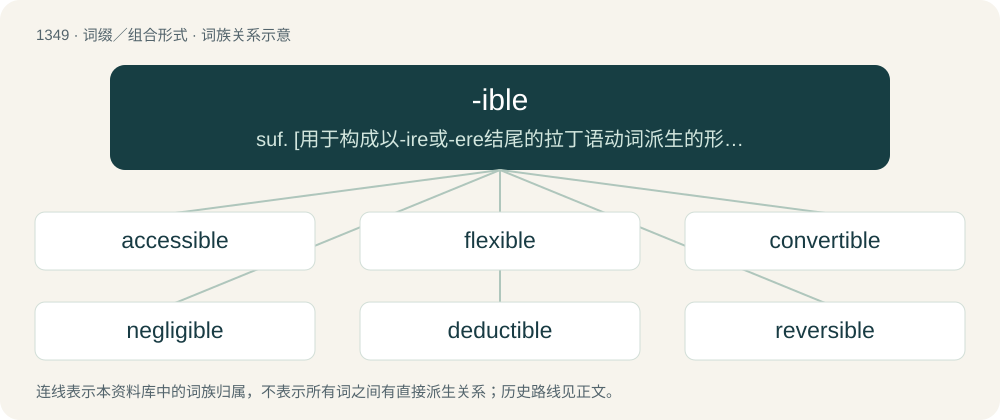

# 1438 · -ible — suf. \[用于构成以-ire或-ere结尾的拉丁语动词派生的形容词\]表示可...的, 能...地

[总目录](../00_总目录_按常用程度.md)

**类型**：词缀／组合形式　｜　**来源语言**：见词源记录

## 核心含义与来源

- 核心含义：suf. \[用于构成以-ire或-ere结尾的拉丁语动词派生的形容词\]表示可...的, 能...地
- 英文含义：An adjective suffix, now usually in a passive sense; forms adjectives meaning "able to be", "relevant or suitable to, in accordance with", or expressing capacity or worthiness in a passive sense.
- 词形：-ible

**多个词源／构词路径**：同一拼写可能有不同来源；以下按词性和含义分别列出。

**来源记录 1**（后缀／后置成分；An adjective suffix, now usually in a passive sense; forms adjectives meaning "able to be", "relevant or suitable to, in accordance with", or expressing capacity or worthiness in a passive sense.）

From Middle English -ible, from Old French -ible, from Latin -ibilis.

**来源记录 2**（后缀／后置成分；a tool or instrument）

From Middle English, from Old French, from Latin -i- + -bulum (instrumental suffix) or -bula (instrumental suffix), from Proto-Indo-European \*-dʰlom. Related to Latin suffixes -brum (candelabrum) and -bra (vertebra).

## 词族图

## 单词速览（常用到不常用）

| 单词 | 音标 | 释义 |
|---|---|---|
| [accessible](#w-1) | 英 /əkˈsɛs.ɪ.bəl/ | a. 易接近的, 可进入的, 可使用的, 易受影响的, 可理解的 |
| [flexible](#w-2) | 英 /ˈflɛk.sɪ.bəl/ | a. 易曲的, 灵活的, 柔顺的, 能变形的, 可通融的；\[医\] 能屈的 |
| [convertible](#w-3) | /kənˈvɜː(ɹ)təbəl/ | a. 可改变的, 可交换的；n. 有活动篷的汽车 |
| [negligible](#w-4) | /ˈnɛɡlɪd͡ʒɪbəl/ | a. 可以忽略的, 不足取的, 无用的；\[医\] 可不计的, 可忽视的 |
| [deductible](#w-5) | /diˈdʌktəbl/ | a. 可扣除的；\[经\] 可减的 |
| [reversible](#w-6) | /ɹəˈvɜː(ɹ)sɪbəl/ | a. 可逆的, 可撤消的；n. 双面可用织物 |
| [collectible](#w-7) | /kəˈlɛktɪbəl/ | a. 可收集的, 可搜集的, 可征收的；\[经\] 可收回的 |
| [gullible](#w-8) | 英 /ˈɡʌlɪbl̩/ | a. 易受骗的；\[法\] 易受骗的, 轻信的 |
| [reprehensible](#w-9) | 英 /ˌɹɛpɹɪˈhɛnsɪb(ə)l/；美 /ˌɹɛpɹəˈhɛnsəb(ə)l/ | a. 应斥责的, 应该谴责的；\[法\] 应受严责的, 应受指责的, 应受申斥的 |
| [admissible](#w-10) | /ədˈmɪsəbəl/ | a. 可进入的, 可容许的 |
| [forcible](#w-11) | /ˈfɒːsəbl/ | a. 强制的, 强迫的, 有气力的；\[法\] 强制的, 强迫的, 有势力的 |
| [defensible](#w-12) | 英 /dɪˈfɛn.sɪ.bəl/ | a. 可防卫的, 可防护的, 可辩护的；\[法\] 可辩护的, 能防卫的 |
| [submersible](#w-13) | /səbˈməːsəbl/ | a. 能沉入水中的, 能潜水的 |
| [reproducible](#w-14) | /.riːprəˈdjuːsəbl/ | a. 可再生的, 可复写的, 能繁殖的 |
| [digestible](#w-15) | 英 /daɪˈdʒɛstəbəɫ/ | a. 可消化的, 易消化的, 可摘要的；\[医\] 可消化的 |
| [collapsible](#w-16) | /kəˈlæps.ə.bəl/ | a. 可折叠的；\[建\] 可收缩的, 可折叠的 |
| [transmissible](#w-17) | /trænsˈmisəbl/ | a. 能递送的, 可传递的, 可传达的；\[医\] 可传播的, 可传染的; 可传递的 |
| [inducible](#w-18) | /inˈdjuːsəbl/ | a. 可导致的；可诱导的 |
| [irascible](#w-19) | /ɪˈɹæs.ɪ.bəl/ | a. 易怒的, 暴躁的 |
| [compressible](#w-20) | /kəmˈpresəbl/ | a. 可压缩的；\[建\] 可压缩的, 可压紧的 |
| [reducible](#w-21) | /riˈdjuːsəbl/ | a. 可缩小的, 可降低的；\[医\] 可复位的, 可还原的 |
| [fungible](#w-22) | 英 /ˈfʌndʒɪbəl/ | a. 可取代的, 代替的；n. 代替物 |
| [invertible](#w-23) | /inˈvəːtibl/ | \[计\] 可逆的 |

## 逐词详解

### 1. accessible

**词性**：形容词　｜　**音标**：英 /əkˈsɛs.ɪ.bəl/

**中文释义**：a. 易接近的, 可进入的, 可使用的, 易受影响的, 可理解的

**英文义项**：Easy of access or approach. / Built or designed as to be usable by people with disabilities.

**构词拆分**：access + -ible

**词源与演化**：

First attested in 1400, from French, from Late Latin accessibilis, from accessus, perfect passive participle of accēdō (“approach”), equivalent to access + -ible.

**用法示例／搭配（非完整句）**：

> an accessible town or mountain

该用例对应义项：Easy of access or approach.

### 2. flexible

**词性**：形容词　｜　**音标**：英 /ˈflɛk.sɪ.bəl/

**中文释义**：a. 易曲的, 灵活的, 柔顺的, 能变形的, 可通融的；\[医\] 能屈的

**英文义项**：Capable of being flexed or bent without breaking; able to be turned or twisted without breaking. / Willing or prone to give way to the influence of others; not invincibly rigid or obstinate.

**构词拆分**：flex + -ible

**词源与演化**：

From Middle French flexible, from Latin flexibilis, from flectō (“to bend, curve”). Morphologically flex + -ible.

**例句**：

> You can't always get what you want: you need to learn to be flexible.

该用例对应义项：Capable of adapting or changing to suit new or modified conditions or situations.

### 3. convertible

**词性**：形容词　｜　**音标**：/kənˈvɜː(ɹ)təbəl/

**中文释义**：a. 可改变的, 可交换的；n. 有活动篷的汽车

**英文义项**：Able to be exchanged, one for the other, especially / Able to be exchanged for foreign currency.

**构词拆分**：convert + -ible

**词源与演化**：

From Old French convertible, from Late Latin convertibilis (“interchangeable”), from Latin convertere (“to turn back, to turn over, to turn around, to turn upside down”), from con- (“with, together”) + vertere (“to turn”), + -ibilis (“-ible: able to”). Equivalent to convert + -ible.

**例句**：

> Tom watched as Mary drove away in her red convertible sports car.

### 4. negligible

**词性**：形容词　｜　**音标**：/ˈnɛɡlɪd͡ʒɪbəl/

**中文释义**：a. 可以忽略的, 不足取的, 无用的；\[医\] 可不计的, 可忽视的

**英文义项**：Able to be neglected, ignored or excluded from consideration; too small or unimportant to be of concern.

**构词拆分**：negligence/negligent + -ible

**词源与演化**：

From negligence/negligent + -ible, as if from New Latin \*negligibilis, from Latin neglegō (“to neglect”) + -ibilis (“-ible”).

**例句**：

> We found errors, but their effects were negligible.

该用例对应义项：Able to be neglected, ignored or excluded from consideration; too small or unimportant to be of concern.

### 5. deductible

**词性**：形容词　｜　**音标**：/diˈdʌktəbl/

**中文释义**：a. 可扣除的；\[经\] 可减的

**英文义项**：Eligible to be deducted.

**构词拆分**：deduct + -ible

**词源与演化**：

From deduct + -ible.

**例句**：

> Tax deductible donations and a portion of ticket revenues go into a special Carousel Restoration fund.

### 6. reversible

**词性**：形容词　｜　**音标**：/ɹəˈvɜː(ɹ)sɪbəl/

**中文释义**：a. 可逆的, 可撤消的；n. 双面可用织物

**英文义项**：Able to be reversed. / Able to be worn inside out.

**构词拆分**：reverse + -ible

**词源与演化**：

Probably from Middle French, equivalent to reverse + -ible.

**例句**：

> A reversible chemical reaction.

该用例对应义项：capable of assuming or producing either of two states

### 7. collectible

**词性**：形容词　｜　**音标**：/kəˈlɛktɪbəl/

**中文释义**：a. 可收集的, 可搜集的, 可征收的；\[经\] 可收回的

**英文义项**：Worthy or suitable for collecting on historical/financial grounds, or for meeting a personal aesthetic. / Rightfully subject to payment.

**构词拆分**：collect + -ible

**词源与演化**：

From collect + -ible.

**例句**：

> He's owed it to us for six months, but it doesn't look very collectible to me.

该用例对应义项：That is likely to be paid.

### 8. gullible

**词性**：形容词　｜　**音标**：英 /ˈɡʌlɪbl̩/

**中文释义**：a. 易受骗的；\[法\] 易受骗的, 轻信的

**英文义项**：Easily deceived or duped; naive, easily cheated or fooled.

**构词拆分**：gull (“to dupe, trick, fool”) + -ible

**词源与演化**：

Origin uncertain. Either from gull (“to dupe, trick, fool”) + -ible; or alternatively from Middle English gole, goll, gol (“an unfledged bird, silly fellow”), perhaps from Old Norse gulr (“yellow, pale”), from the hue of its down.

**例句**：

> Andrew is so gullible, the way he still believes in Santa Claus, the Easter Bunny, the Tooth Fairy, and the Sandman at the age of fourteen.

该用例对应义项：Easily deceived or duped; naive, easily cheated or fooled.

### 9. reprehensible

**词性**：形容词　｜　**音标**：英 /ˌɹɛpɹɪˈhɛnsɪb(ə)l/；美 /ˌɹɛpɹəˈhɛnsəb(ə)l/

**中文释义**：a. 应斥责的, 应该谴责的；\[法\] 应受严责的, 应受指责的, 应受申斥的

**英文义项**：Blameworthy, censurable, guilty. / Deserving of reprehension.

**构词拆分**：reprehend + -ible

**词源与演化**：

Borrowed from Late Latin reprehensibilis, from Latin reprehendo; equivalent to reprehend + -ible.

**例句**：

> Adultery is as reprehensible for a husband as for a wife.

该用例对应义项：bringing or deserving severe rebuke or censure

### 10. admissible

**词性**：形容词　｜　**音标**：/ədˈmɪsəbəl/

**中文释义**：a. 可进入的, 可容许的

**英文义项**：Capable or deserving to be admitted, accepted or allowed; allowable, permissible, acceptable. / Describing a heuristic that never overestimates the cost of reaching a goal.

**构词拆分**：admit + -ible

**词源与演化**：

Borrowed from Middle French admissible. Equivalent to admit + -ible

**例句**：

> That testimony might help convict him, but it would not be admissible in court.

### 11. forcible

**词性**：形容词　｜　**音标**：/ˈfɒːsəbl/

**中文释义**：a. 强制的, 强迫的, 有气力的；\[法\] 强制的, 强迫的, 有势力的

**英文义项**：Done by force, forced. / Having a powerful effect; forceful, telling, strong, convincing, effective.

**构词拆分**：force + -ible

**词源与演化**：

From Middle English forcible, forsable, from Old French forcible, from forcier (“to conquer by force”), equivalent to force + -ible.

**例句**：

> He had to take a forcible approach to the stuck window.

### 12. defensible

**词性**：形容词　｜　**音标**：英 /dɪˈfɛn.sɪ.bəl/

**中文释义**：a. 可防卫的, 可防护的, 可辩护的；\[法\] 可辩护的, 能防卫的

**英文义项**：Capable of being defended against armed attack. / Capable of being justified.

**构词拆分**：defense + -ible

**词源与演化**：

From Old French defensable, from Latin defensibilem. Equivalent to defense + -ible.

**例句**：

> Ukraine turned out to be much more defensible than previously thought.

### 13. submersible

**词性**：形容词　｜　**音标**：/səbˈməːsəbl/

**中文释义**：a. 能沉入水中的, 能潜水的

**英文义项**：Able to be submerged.

**构词拆分**：submerse + -ible

**词源与演化**：

From submerse + -ible.

**例句**：

> It was the first submersible to implode in the history of humanity.

### 14. reproducible

**词性**：形容词　｜　**音标**：/.riːprəˈdjuːsəbl/

**中文释义**：a. 可再生的, 可复写的, 能繁殖的

**英文义项**：Capable of being reproduced at a different time or place and by different people.

**构词拆分**：reproduce + -ible

**词源与演化**：

From reproduce + -ible.

**例句**：

> Astonishingly reproducible results can be obtained.

该用例对应义项：capable of being reproduced

### 15. digestible

**词性**：形容词　｜　**音标**：英 /daɪˈdʒɛstəbəɫ/

**中文释义**：a. 可消化的, 易消化的, 可摘要的；\[医\] 可消化的

**英文义项**：Capable of being digested.

**构词拆分**：digest + -ible

**词源与演化**：

From Old French digestible, equivalent to digest + -ible.

**例句**：

> The pie looked very good, but it wasn't very easily digestible.

### 16. collapsible

**词性**：形容词　｜　**音标**：/kəˈlæps.ə.bəl/

**中文释义**：a. 可折叠的；\[建\] 可收缩的, 可折叠的

**英文义项**：Designed to be collapsed, especially so as to be more compact when not in use.

**构词拆分**：collapse + -ible

**词源与演化**：

From collapse + -ible.

**用法示例／搭配（非完整句）**：

> collapsible shovel

该用例对应义项：Designed to be collapsed, especially so as to be more compact when not in use.

### 17. transmissible

**词性**：形容词　｜　**音标**：/trænsˈmisəbl/

**中文释义**：a. 能递送的, 可传递的, 可传达的；\[医\] 可传播的, 可传染的; 可传递的

**英文义项**：Capable of being transmitted from one person to another. / Capable of being transmitted from a transmitter to a receiver.

**构词拆分**：Latin trānsmissus + -ible

**词源与演化**：

From Latin trānsmissus + -ible.

**例句**：

> The British variant is so transmissible that it is crowding out other variants in many parts of the world.

### 18. inducible

**词性**：形容词　｜　**音标**：/inˈdjuːsəbl/

**中文释义**：a. 可导致的；可诱导的

**英文义项**：Able to be activated, induced, or caused. / Obtainable by induction; derivable; inferable.

**构词拆分**：induce + -ible

**词源与演化**：

From induce + -ible.

**用法示例／搭配（非完整句）**：

> inducible factor — inducible gene — inducible expression — inducible protein — inducible promoter — inducible enzyme

该用例对应义项：Able to be activated, induced, or caused.

### 19. irascible

**词性**：形容词　｜　**音标**：/ɪˈɹæs.ɪ.bəl/

**中文释义**：a. 易怒的, 暴躁的

**英文义项**：Easily provoked to outbursts of anger; irritable. / Manifesting anger.

**词源与演化**：

From Middle English, from Old French irascible, from Late Latin īrāscibilis, from Latin īrāscī (“to be angry, enraged”) + -bilis. See also -ible.

**例句**：

> Ziri has always been an irascible and difficult husband.

### 20. compressible

**词性**：形容词　｜　**音标**：/kəmˈpresəbl/

**中文释义**：a. 可压缩的；\[建\] 可压缩的, 可压紧的

**英文义项**：Able to be compressed. / Of a surface embedded in a 3-dimensional manifold, containing a circle that does not serve as the boundary of a disk that lies in the surface, but does serve as boundary of a disk that lies in the ambient manifold.

**构词拆分**：compress + -ible

**词源与演化**：

From compress + -ible. Compare French compressible and Latin compressibilis.

**例句**：

> Plastic bottles are compressible and recyclable.

### 21. reducible

**词性**：形容词　｜　**音标**：/riˈdjuːsəbl/

**中文释义**：a. 可缩小的, 可降低的；\[医\] 可复位的, 可还原的

**英文义项**：Capable of being reduced. / Able to be factored into polynomials of lower degree, as x²-1.

**构词拆分**：reduce + -ible

**词源与演化**：

From reduce + -ible.

**例句**：

> Reducible to a set of principles of human nature.

该用例对应义项：capable of being reduced

### 22. fungible

**词性**：形容词　｜　**音标**：英 /ˈfʌndʒɪbəl/

**中文释义**：a. 可取代的, 代替的；n. 代替物

**英文义项**：Able to be substituted for something of equal value or utility.

**词源与演化**：

1765 as noun, 1818 as adjective, from Medieval Latin fungibilis, from Latin fungor (“to perform, discharge a duty”) + -ible (“able to”). Originally a legal term, going back to Roman law: res fungibiles (“replaceable things”).

### 23. invertible

**词性**：形容词　｜　**音标**：/inˈvəːtibl/

**中文释义**：\[计\] 可逆的

**英文义项**：Capable of being inverted or turned. / Able to be inverted, having an inverse.

**构词拆分**：invert + -ible

**词源与演化**：

From invert + -ible.

**用法示例／搭配（非完整句）**：

> invertible sugar

该用例对应义项：Capable of being changed or converted.
