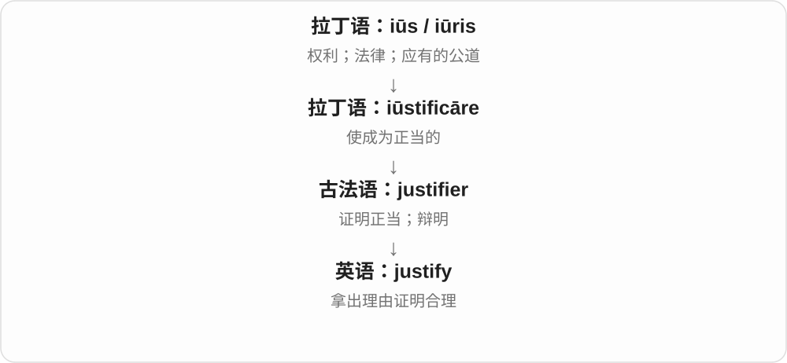
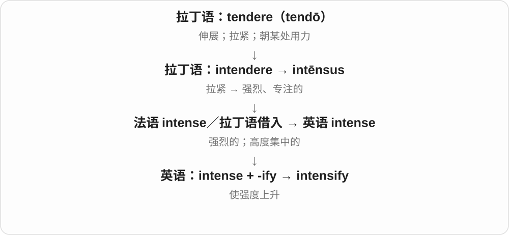

# 1464 · -ify — 做成、使成为，或使产生某种状态

[逐词精讲目录](../00_逐词精讲目录.md) · [总目录](../00_总目录_按常用程度.md)

## 核心词根与来源

这个后缀像一个做变化的按钮，但不是按上就能任意造词。justify 的常用义已固定为说明正当，不能只死译成使正义。

**-IFY：把某种性质做出来，具体意思跟着词走**

simplify 使简单；clarify 使清楚；horrify 使惊骇；detoxify 去除毒性。

- **使性质变清楚或变强**：simplify · clarify · intensify · diversify
- **证明、编排及描述对象**：justify · codify · objectify · personify
- **取消、补偿、损害与去毒**：nullify · indemnify · falsify · vilify · detoxify
- **恐惧感受的来去**：horror · horrify · horrified · horrifying

## 词形与演化规律

拉丁 -ficāre〔与 facere 做相关〕→ 法语 -ifier 等 → 英语 -ify；加后缀时词干常有删字、换形。

## 单词速览（按词族由简到繁）

同一基础词的相关扩展放在一起，先读基础形式，再读扩展；各组之间优先读常用的。具体词源关系见各词讲解。

| 单词 | 音标 | 核心意思 |
|---|---|---|
| [horror](#w-15) | 英 /ˈhɒrə/；美 /ˈhɔːrər/ | 惊骇、恐惧；令人恐怖的事；恐怖作品类型 |
| [horrify](#w-14) | 英 /ˈhɒrɪfaɪ/；美 /ˈhɔːrəfaɪ/ | 使惊骇、使极度不安或厌恶 |
| [horrifying](#w-16) | 英 /ˈhɒrɪfaɪɪŋ/；美 /ˈhɔːrəfaɪɪŋ/ | 令人惊骇的、极其可怕的 |
| [horrified](#w-17) | 英 /ˈhɒrɪfaɪd/；美 /ˈhɔːrəfaɪd/ | 感到惊骇的、极度震惊不安的 |
| [justify](#w-1) | /ˈdʒʌstɪfaɪ/ | 证明合理；为……提供充分理由 |
| [clarify](#w-2) | 英 /ˈklærəfaɪ/；美 /ˈklerəfaɪ/，亦 /ˈklærəfaɪ/ | 澄清；讲清楚；使液体澄清 |
| [simplify](#w-3) | /ˈsɪmplɪfaɪ/ | 简化；使容易理解 |
| [diversify](#w-4) | 英 /daɪˈvɜːsɪfaɪ/；美 /daɪˈvɜːrsəfaɪ/、/dɪˈvɜːrsəfaɪ/ | 使多样化；扩展到不同领域 |
| [intensify](#w-5) | /ɪnˈtensɪfaɪ/ | 加强；变得更强烈 |
| [nullify](#w-6) | /ˈnʌlɪfaɪ/ | 使无效；抵消 |
| [indemnify](#w-7) | /ɪnˈdemnɪfaɪ/ | 赔偿；补偿损失；保障免受某项损失 |
| [falsify](#w-8) | /ˈfɔːlsɪfaɪ/ | 篡改、伪造；证伪、证明错误 |
| [vilify](#w-9) | 英 /ˈvɪlɪfaɪ/；美 /ˈvɪləfaɪ/ | 诋毁；恶意贬损 |
| [codify](#w-10) | 英 /ˈkəʊdɪfaɪ/；美 /ˈkɑːdɪfaɪ/ | 编纂成法规、规则；把做法系统化 |
| [objectify](#w-11) | 英、美 /əbˈdʒektɪfaɪ/ | 把人当作物件；使具体化、对象化 |
| [personify](#w-12) | 英 /pəˈsɒnɪfaɪ/；美 /pərˈsɑːnɪfaɪ/ | 使人格化；成为……的化身 |
| [detoxify](#w-13) | 英 /diːˈtɒksɪfaɪ/；美 /diːˈtɑːksɪfaɪ/ | 去毒；使毒性降低；使脱毒 |

## 逐词讲解

### 1. horror — 惊骇、恐惧；令人恐怖的事；恐怖作品类型

**音标**：英 /ˈhɒrə/；美 /ˈhɔːrər/

**先抓住这个画面**

看到惨烈场面，人一下僵住、汗毛竖起来：horror 抓住这种惊骇，不只是有点担心。

**怎么拆**

经古法语接拉丁 horror，来自 horrēre 竖起、发抖。身体发冷发抖的画面，走向恐惧和惊骇；不是英语 horror 再拆成两个短词。

**怎么变成今天的意思**

**拉丁 horrēre → horror**  
毛发竖起、因冷或怕而发抖 → 恐惧

↓

**古法语 horror → 英语 horror**  
强烈恐惧、惊骇，也可包含厌恶

in horror 惊恐地，to my horror 令我惊骇的是，a horror film 恐怖片，the horrors of war 战争的可怕经历。也可因残忍、丑恶而震惊厌恶。

**常见搭配与例句**

in horror；to my horror；a horror film；the horrors of war。

> She stared in horror at the ruined house.

她惊恐地望着被毁的房子。

> I enjoy mysteries, but I rarely watch horror films.

我喜欢推理故事，但很少看恐怖片。

**别混淆**

fear 可从轻微担心到强烈害怕；horror 通常更强，也容易带震惊、反感。恐怖片叫 horror film，不是所有 suspense 悬疑片都属这一类。

### 2. horrify — 使惊骇、使极度不安或厌恶

**音标**：英 /ˈhɒrɪfaɪ/；美 /ˈhɔːrəfaɪ/

**先抓住这个画面**

horror 是那股惊骇，horrify 是某件事把这股惊骇推到你心里。

**怎么拆**

可对照 horror + -ify，使产生惊骇；历史也联系拉丁 horrificāre 及法语相应形式。-ify 常和拉丁 facere 做、使成为的构词系列相连。

**怎么变成今天的意思**

**拉丁 horrēre → horror**  
毛发竖起、因冷或怕而发抖 → 恐惧

↓

**古法语 horror → 英语 horror**  
强烈恐惧、惊骇，也可包含厌恶

↓

**horror + -ify；拉丁 horrificāre 等相应形式**  
造成恐惧、惊骇 → horrify

The news horrified me 是消息使我惊骇。常用于灾难、残忍行为，也可夸张说某种不合心意的想法让人难以接受。

**常见搭配与例句**

horrify someone；be horrified by；be horrified to hear。

> The reports of cruelty horrified the public.

有关残忍行为的报道令公众震惊。

> The thought of losing those letters horrified her.

想到可能丢掉那些信，她极度不安。

**别混淆**

horrify 强调造成强烈感受；horror 是名词。不要说 I am horrify，表示自己的感受用 I am horrified。

### 3. horrifying — 令人惊骇的、极其可怕的

**音标**：英 /ˈhɒrɪfaɪɪŋ/；美 /ˈhɔːrəfaɪɪŋ/

**先抓住这个画面**

镜头换到消息或经历本身：它能把人吓住，就是 horrifying。

**怎么拆**

horrify + -ing，y 保留。可以是正在使人惊骇的分词，也可成为描述事物性质的形容词。

**怎么变成今天的意思**

**拉丁 horrēre → horror**  
毛发竖起、因冷或怕而发抖 → 恐惧

↓

**古法语 horror → 英语 horror**  
强烈恐惧、惊骇，也可包含厌恶

↓

**horrify + -ing → horrifying**  
造成惊骇的，令人极度不安的

a horrifying experience 极可怕的经历，horrifying footage 令人惊骇的影像，a horrifying possibility 极可怕的可能性。

**常见搭配与例句**

a horrifying experience；horrifying footage；a horrifying possibility。

> The documentary contained horrifying accounts of the disaster.

纪录片中有一些令人惊骇的灾难叙述。

> Losing all the research data was a horrifying possibility.

全部研究数据可能丢失，光想想就令人不安。

**别混淆**

horrifying 侧重引发惊骇；horrible 可广说很糟、讨厌。a horrible meal 可能只是难吃，不必夸成 horrifying。

### 4. horrified — 感到惊骇的、极度震惊不安的

**音标**：英 /ˈhɒrɪfaɪd/；美 /ˈhɔːrəfaɪd/

**先抓住这个画面**

镜头对准承受惊吓的人：我被震住了，就是 I was horrified。

**怎么拆**

horrify 的过去式、过去分词；辅音字母 + y 在加 -ed 时写成 -ied。作形容词强调承受影响后的感受，末尾 /d/ 不另添音节。

**怎么变成今天的意思**

**拉丁 horrēre → horror**  
毛发竖起、因冷或怕而发抖 → 恐惧

↓

**古法语 horror → 英语 horror**  
强烈恐惧、惊骇，也可包含厌恶

↓

**horrify → horrified**  
使人惊骇 → 已受影响、感到惊骇

be horrified at/by 对……惊骇，be horrified to find 发现……而震惊，a horrified expression 惊骇的表情。

**常见搭配与例句**

be horrified by；be horrified to learn；a horrified expression。

> We were horrified to learn how badly the animals had been treated.

得知动物受到如此恶劣的对待，我们十分震惊。

> He gave me a horrified look when I mentioned the price.

我一提价格，他就一脸惊骇地看着我。

**别混淆**

horrified 说感受者；horrifying 说造成感受的事。人也可令人惊骇，事也可被人格化；关键看谁承受、谁造成。

### 5. justify — 证明合理；为……提供充分理由

**音标**：/ˈdʒʌstɪfaɪ/

**先抓住这个画面**

别人问“凭什么这样做”，你拿出能让这件事站得住脚的理由，就是 justify。它不一定是狡辩，也可能是真正说明一项决定为什么值得。

**怎么拆**

历史上是 iūstus（正当）+ 表示“使、做成”的 -ficāre。现代可用 just + -ify 记成“让它显得或被证明是正当的”。

**怎么变成今天的意思**

词从“使正当”发展到“证明有道理”。所以 justify the cost 不是解释花了多少钱，而是说明这些钱为什么花得值。

**常见搭配与例句**

justify a decision；justify the cost；justify doing something；justify something to someone。

> The time saved may justify the extra cost.

节省下来的时间也许足以证明这笔额外开支是值得的。

> How do you justify leaving the team without notice?

你怎样为不打招呼就离开团队这件事辩解？

**别混淆**

explain 只要求把原因讲清楚；justify 要进一步说明“这样做有正当或足够的理由”。

### 6. clarify — 澄清；讲清楚；使液体澄清

**音标**：英 /ˈklærəfaɪ/；美 /ˈklerəfaɪ/，亦 /ˈklærəfaɪ/

**先抓住这个画面**

把挡住理解的疑点或挡住透光的杂质去掉，让事情或液体变清楚。

**怎么拆**

经古法语 clarifiier 借入，来自拉丁语 clarificare，联系 clarus“清楚”和 facere“使、做”；不是英语把 clear 原样接上 -ify。

**怎么变成今天的意思**

**拉丁语 clarus**  
明亮、清楚、响亮；显著、出名

↓

**拉丁语 clarificus / clarificare → 古法语 clarifiier**  
使清楚、使显扬

↓

**中古英语 clarifien → clarify**  
澄清液体；后来也常用于说明意思

clarify a point 是补充说明让某一点不再含糊；clarify butter 是把黄油中的水分、乳固体等分离，得到澄清黄油。

**常见搭配与例句**

clarify the meaning；clarify whether；clarify the situation。

> Could you clarify what you mean by “available”?

你能讲清楚这里的“可用”是什么意思吗？

> The follow-up email clarified the deadline.

后续邮件明确了截止时间。

**别混淆**

explain 可完整讲解一个主题；clarify 常专门处理已经出现的含糊、误解或不确定之处。

### 7. simplify — 简化；使容易理解

**音标**：/ˈsɪmplɪfaɪ/

**先抓住这个画面**

把不必要的环节、层次或说法减少，让事情更容易处理。

**怎么拆**

借自法语 simplifier；现代可对应 simple 的词干 simpl- + -ify 使变成。历史借入与现代可分析的构词关系同时存在。

**怎么变成今天的意思**

**拉丁语 simplex → 古法语 simple → 中古英语 symple**  
一重、一层；不复杂

↓

**英语 simple**  
简单、朴素、不加修饰；某些语境也可贬称头脑简单

↓

**法语 simplifier → 英语 simplify**  
使简单、简化

simplify a process 简化流程；simplify an explanation 简化说明。过去式 simplified，动词 -fy 变 -fied。简化可以合理，也可能丢掉关键条件。

**常见搭配与例句**

simplify the process；simplify the rules；simplify something for beginners。

> The new form simplifies the registration process.

新表格简化了注册流程。

> She simplified the explanation without losing the main point.

她简化了解释，同时保留了要点。

**别混淆**

simplify 是做简化的动作，simple 是简单这一性质；把关键条件也删掉，可能得到 simplistic 那样过分简单化的结论。

### 8. diversify — 使多样化；扩展到不同领域

**音标**：英 /daɪˈvɜːsɪfaɪ/；美 /daɪˈvɜːrsəfaɪ/、/dɪˈvɜːrsəfaɪ/

**先抓住这个画面**

原本只靠一种产品、一种活动，现在多开几条路，不把全部事情压在同一种选择上。

**怎么拆**

经法语 diversifier 借入；拉丁语词族中 dīversus“不同”与 facere“使、做”结合。现代可看 diverse + -ify。

**怎么变成今天的意思**

可以及物：diversify the menu；也可不及物：diversify into tourism。它是增加不同类型，不只是把旧产品生产得更多。

**常见搭配与例句**

diversify into；diversify the business；diversify the menu。

> The farm diversified into fruit growing and tourism.

这家农场把业务扩展到了水果种植和旅游。

> The library wants to diversify its collection of authors.

图书馆希望收藏来自更多不同背景作者的作品。

**别混淆**

expand 是扩大；diversify 需要种类或方向增加，二者并不完全相同。

### 9. intensify — 加强；变得更强烈

**音标**：/ɪnˈtensɪfaɪ/

**先抓住这个画面**

intensify 像继续拧高强度旋钮：雨更猛、争论更激烈、努力更集中。

**怎么拆**

intense + -ify（使成为）；是在英语中从形容词造出的动词。

**怎么变成今天的意思**

既能不带宾语说 The storm intensified，也能说 intensify the search，主动加大搜寻力度。

**常见搭配与例句**

intensify efforts；intensify pressure；competition intensifies。

> The rain intensified after sunset.

日落后雨下得更猛了。

> The team intensified its search for the missing files.

团队加紧寻找丢失的文件。

**别混淆**

increase 可增加数量、长度等；intensify 特别指强度、程度上升。

### 10. nullify — 使无效；抵消

**音标**：/ˈnʌlɪfaɪ/

**先抓住这个画面**

原本存在的效力或优势，被另一件事抹掉。

**怎么拆**

有后期拉丁 nullificāre 借入分析，组成是 nūllus 无 + facere 做、使；现代也常按 null + -ify“使成为”理解。

**怎么变成今天的意思**

**拉丁 nūllus〔没有任何；无〕**  
把某物看成没有、算不上

↓

**后期拉丁 nullificāre〔使归于无〕**  
由 nullus 与 facere 的组合形成

↓

**英语 nullify**  
使规则、决定或实际效果失去作用

它既能用于正式规则，也能用于生活中的效果：折扣省下的钱全被运费吃掉，运费就 nullifies the saving。重点不是事物消失，而是它产生的作用被抵消了。

**常见搭配与例句**

nullify a decision；nullify an advantage；nullify the effect of something。

> The extra delivery charge nullified the saving from the discount.

额外运费抵消了折扣省下的钱。

> The court nullified the disputed decision.

法院宣布那项有争议的决定无效。

**别混淆**

annul 常强调正式宣布无效；nullify 也能说没有正式程序的实际抵消。

### 11. indemnify — 赔偿；补偿损失；保障免受某项损失

**音标**：/ɪnˈdemnɪfaɪ/

**先抓住这个画面**

某项损失落到了你身上，另一方承诺承担或补回来，让你不必独自承受。

**怎么拆**

indemn“不受损的”，接拉丁 indemnis + -ify“使成为”；英语构词。

**怎么变成今天的意思**

**拉丁 damnum**  
损失、损害；罚金、处罚

↓

**拉丁 in- 不 + damnum → indemnis**  
不受损害的

↓

**英语 indemn + -ify → indemnify**  
使不受损 → 补偿、承担特定损失

常说 indemnify someone against loss 或 for specified costs。它是赔偿安排的动词，不能理解为事情从此绝不会发生。旧文献另有极罕见的伤害义，来源分析不同，现代先掌握补偿义。

**常见搭配与例句**

indemnify someone against；indemnify someone for。

> The agreement requires one party to indemnify the other for specified losses.

协议要求一方赔偿另一方的特定损失。

> The policy may indemnify the insured against certain costs.

该保单可能对被保险人的某些费用提供赔偿。

**别混淆**

insure 是投保或承保；indemnify 是补偿、承担损失，保险合同可包含这种义务，但两词不总互换。

### 12. falsify — 篡改、伪造；证伪、证明错误

**音标**：/ˈfɔːlsɪfaɪ/

**先抓住这个画面**

一个方向是把材料做假，另一个方向是把错误揭出来。

**怎么拆**

经古法语 falsifier，接后期拉丁 falsificāre，与 falsus“假的”和“使成”的构词成分有关。现代可对应 false + -ify，但有较早的借入路线。

**怎么变成今天的意思**

**拉丁 fallere；完成分词 falsus**  
欺骗、使落空；错误的、虚假的

↓

**后期拉丁 falsificāre → 古法语 falsifier**  
使变假、伪造；证明不真

↓

**中古英语 falsifien → 英语 falsify**  
伪造、篡改；证伪

falsify records 是篡改记录以制造假象；falsify a hypothesis 是用反例或证据证明假说不成立。两个用法方向差很大，关键看宾语是记录还是待检验的主张。

**常见搭配与例句**

falsify records；falsify evidence；falsify a hypothesis。

> The audit found that someone had falsified the expense records.

审计发现有人篡改了费用记录。

> A reliable counterexample would falsify the universal claim.

一个可靠的反例就能证伪这个全称断言。

**别混淆**

forge 常强调伪造文件、签名等；falsify 既可篡改已有材料，也可在论证中表示证伪。

### 13. vilify — 诋毁；恶意贬损

**音标**：英 /ˈvɪlɪfaɪ/；美 /ˈvɪləfaɪ/

**先抓住这个画面**

用话把一个人的形象往泥里按，让别人觉得他坏透了、毫无价值。

**怎么拆**

来自后期拉丁 vilificare：vilis 低劣 + facere 使、做。现代可联想 vile 与 -ify，但历史上借入的是已有的拉丁动词。

**怎么变成今天的意思**

**拉丁 vilis**  
廉价的；低劣的；不值钱的

↓

**后期拉丁 vilis + facere → vilificare**  
贬低价值；视为低劣

↓

**英语 vilify**  
用恶毒言辞贬损名誉或形象

它常用于讨论舆论攻击，尤其是把人描述成极坏的角色。vilify 不只是指出具体错误，而带有恶毒贬损的意味。过去式 vilified 要把词尾 y 改为 i；读音也别照 vile 的 /aɪ/ 念，开头是 /vɪl/。

**常见搭配与例句**

vilify someone；be vilified in the press；vilify someone as a traitor。

> The article vilified the scientist without addressing her evidence.

文章恶意诋毁了那位科学家，却没有回应她的证据。

> He urged both sides to debate the policy instead of vilifying each other.

他敦促双方讨论政策，而不是互相诋毁。

**别混淆**

criticize 可以理性批评，vilify 强调把对象说得很坏。它与 defame 有交集，但单凭日常词义不能判断是否满足某种法律责任。

### 14. codify — 编纂成法规、规则；把做法系统化

**音标**：英 /ˈkəʊdɪfaɪ/；美 /ˈkɑːdɪfaɪ/

**先抓住这个画面**

原本散着的规定、惯例整理成一套明确条文，让人能查、能统一照做。

**怎么拆**

code 的规则集义 + -ify 使成，词干表现 cod-，不是 cod 鳕鱼 + 一个无关尾巴。

**怎么变成今天的意思**

**拉丁 caudex、codex 木板书、书册 → 古法语 code**  
成册法规、法典

↓

**英语 code**  
成套规则 → 符号编码体系；计算机指令

↓

**code + -ify → codify**  
形成成套规则 → 编纂、系统化

codify the rules 编纂规则，codify existing practices 把现有做法明确成文；不一定是编电脑程序。

**常见搭配与例句**

codify the rules；codify a practice；codify standards。

> The policy codifies practices already used by the team.

政策把团队已有做法明确成文。

> The committee worked to codify the rules.

委员会着手把规则系统编纂成文。

**别混淆**

codify 系统整理为规则，code 写程序或编码；把公司惯例写成手册通常 codify，不必说写软件。

### 15. objectify — 把人当作物件；使具体化、对象化

**音标**：英、美 /əbˈdʒektɪfaɪ/

**先抓住这个画面**

只把一个人看成好用的工具，或把一个抽象想法做成能看见、讨论的东西。

**怎么拆**

object + -ify；词底最终来自拉丁语 obiectum“放在面前的东西、对象”。

**怎么变成今天的意思**

**拉丁语：iacere；分词 iactus**  
投掷、抛出

↓

**拉丁语：ob- + iacere → obicere / obiect-**  
放在面前；提出反对

↓

**英语：object + -ify → objectify**  
使成为对象；当作物件

当对象是人，通常批评忽略其主体性；在哲学、艺术讨论里，也可以只是说把内在想法外化。

**常见搭配与例句**

objectify people；objectify an idea。

> The advertisement was criticized for objectifying its models.

这则广告因把模特当作物件展示而受到批评。

> The sculpture objectifies an otherwise abstract fear.

这件雕塑把原本抽象的恐惧变成了具体可见的东西。

**别混淆**

simplify 是使简单；objectify 是使成为对象，并不必然更简单。

### 16. personify — 使人格化；成为……的化身

**音标**：英 /pəˈsɒnɪfaɪ/；美 /pərˈsɑːnɪfaɪ/

**先抓住这个画面**

把抽象概念画成一个人，或觉得某个人把某种品质活生生体现出来。

**怎么拆**

person + -ify，与法语 personnifier 对应；-ify 表使成为、使具有某种形式。不是验证身份 person + verify。

**怎么变成今天的意思**

**拉丁 persōna → 古法语 persone 等**  
戏剧面具、角色；后来的人、个体等义

↓

**中古英语 persoun → 英语 person**  
一个人、个体

↓

**person + -ify → personify**  
以人的形象表现；具体体现某品质

personify freedom 可说以人物代表自由；She personifies patience 是她把耐心体现得淋漓尽致。事物拟人化与人物代表品质是两种相关用法。

**常见搭配与例句**

personify a quality；personify patience；personify an abstract idea。

> The poet personifies the wind as an impatient traveller.

诗人把风写成一位急躁旅人。

> To her students, she personified kindness.

在学生眼里，她就是善意的化身。

**别混淆**

personify 把概念变成可感的人形象，impersonate 则是模仿、冒充另一个人；对象和动作方向不同。

### 17. detoxify — 去毒；使毒性降低；使脱毒

**音标**：英 /diːˈtɒksɪfaɪ/；美 /diːˈtɑːksɪfaɪ/

**先抓住这个画面**

把有毒性这件事减去、消除或处理掉。

**怎么拆**

近代 de-“去除” + tox-“毒” + -ify“使成为、使发生”。不是由更早的英语 toxify 简单加 de-：detoxify 的记录反而更早。

**怎么变成今天的意思**

**希腊 toxon → toxikos**  
弓 → 与弓箭有关的

↓

**希腊 toxikon pharmakon → 拉丁 toxicum**  
用于箭上的毒药 → 毒物

↓

**晚期拉丁 toxicus → 法语 toxique，亦直接拉丁借入**  
有毒的

↓

**英语 toxic**  
有毒的；也比喻具有破坏性的

↓

**近代 de- + tox- + -ify → detoxify**  
去除毒性；使毒性降低

可用于处理废物或有害物质；在医疗语境还可说帮助人完成酒精或药物相关的脱毒。环境新闻中也会比喻去掉某个组织形象的负面影响。

**常见搭配与例句**

detoxify waste；detoxify a substance；detoxify the body；detoxify a political brand。

> The treatment is designed to detoxify the waste before disposal.

这道处理程序旨在处置废物前降低其毒性。

> The party launched a campaign to detoxify its public image.

这个政党发起宣传活动，试图改善自身的负面公众形象。

**别混淆**

purify 强调去杂质、净化；detoxify 明确针对毒性。名称本身不证明某个宣传产品真能达到效果。

## 这一组要分清什么

不按字母硬拆：horrify 和 horror 对照，但历史还有拉丁相应形式；horrified 承受感受，horrifying 造成感受。

## 串起来练习

The clear explanation simplified the issue, but the facts still horrified us.

清楚的解释让问题容易理解了，但事实仍令我们震惊。
