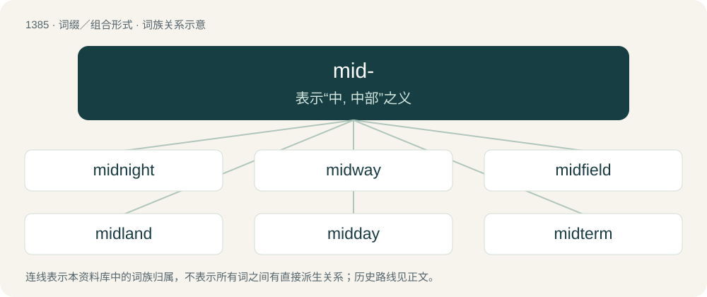

# 1472 · mid- — 表示“中, 中部”之义

[总目录](../00_总目录_按常用程度.md)

**类型**：词缀／组合形式　｜　**来源语言**：见词源记录

## 核心含义与来源

- 核心含义：表示“中, 中部”之义
- 英文含义：Denoting the middle part.
- 词形：mid-

**来源记录 1**（前缀／前置成分；Denoting the middle part.）

See mid.

## 词族图

## 单词速览（常用到不常用）

| 单词 | 音标 | 释义 |
|---|---|---|
| [midnight](#w-1) | /ˈmɪd(ˌ)naɪt/ | n. 午夜, 子夜, 半夜；a. 午夜的, 半夜的 |
| [midway](#w-2) | /mɪdweɪ/ | n. 中途, 中间, 娱乐场；a. 中途的, 中间的；adv. 中途 |
| [midfield](#w-3) | /ˈmɪd.fiːld/ | n. 球场中央部分；a. 中场的 |
| [midland](#w-4) | /ˈmidlənd/ | n. 中部地方, 内地 |
| [midday](#w-5) | /mɪdˈdeɪ/ | n. 正午, 中午；a. 正午的 |
| [midterm](#w-6) | 美 /ˈmɪdˌtɚm/ | a. 中期的；n. 期中考试 |
| [midtown](#w-7) | /ˈmidtajn/ | n. 商业区与住宅区之间的地区 |
| [midwestern](#w-8) | /ˈmidˈwestən/ | a. 美国中西部的 |
| [midsummer](#w-9) | /mɪdˈsʌmə(ɹ)/ | n. 仲夏, 夏至期；a. 仲夏的 |
| [midweek](#w-10) | /ˈmid.wiːk/ | n. 周中, 星期三；a. 周中的, 星期三的 |
| [midlife](#w-11) | 美 /ˈmɪdlaɪf/ | n. 中年 |
| [midseason](#w-12) | /ˈmid,siːzən/ | 季节中期(指仲春,仲夏,仲秋,仲冬),旺季,忙季 |
| [midline](#w-13) | /ˈmidlain/ | n. 中间线, 中线 |
| [midwinter](#w-14) | /ˌmɪdˈwɪntə(ɹ)/ | n. 仲冬, 冬至 |
| [midsection](#w-15) | /ˈmɪdˌsɛkʃən/ | n. 中央部分, 上腹部；\[医\] 正中切开 |
| [midstream](#w-16) | /ˈmidstriːm/ | n. 河流正中, 中流 |
| [midcentury](#w-17) |  | 【英文】Occurring around the middle of the century. (Elliptically refers to whichever century is evident from the context of a discussion.) |
| [midriff](#w-18) | /ˈmɪdɹɪf/ | n. 膈, 上腹部；\[医\] 膈 |
| [midyear](#w-19) | /ˈmidjəː/ | n. 年中, 学年中期 |
| [midbrain](#w-20) | /ˈmidbrein/ | n. 中脑；\[医\] 中脑 |
| [midrib](#w-21) | /ˈmɪdrɪb/ | n. 中脉；\[医\] 中脉(叶) |
| [midsized](#w-22) | /ˈmɪdsaɪzd/ | a. 中等大小的；中型的；中号的 |

## 逐词详解

### 1. midnight

**词性**：名词　｜　**音标**：/ˈmɪd(ˌ)naɪt/

**中文释义**：n. 午夜, 子夜, 半夜；a. 午夜的, 半夜的

**英文义项**：The middle of the night: the sixth temporal hour, equidistant between sunset and sunrise. / Twelve o'clock at night exactly.

**构词拆分**：mid- + night

**词源与演化**：

From Middle English midnight, from Old English midniht, from Proto-Germanic \*midjanahts (“midnight”), equivalent to mid- + night. Cognate with Saterland Frisian Midnoacht (“midnight”), Old High German mittinaht (“midnight”), Danish midnat (“midnight”), Swedish midnatt (“midnight”), Icelandic miðnætti (“midnight”). Compare also Saterland Frisian Middernoacht (“midnight”), Dutch middernacht (“midnight”), German Mitternacht (“midnight”).

**例句**：

> Thanks to its sonar, the narwhal can remain active even at midnight, unhindered by the darkness.

该用例对应义项：The middle of the night: the sixth temporal hour, equidistant between sunset and sunrise.

### 2. midway

**词性**：形容词　｜　**音标**：/mɪdweɪ/

**中文释义**：n. 中途, 中间, 娱乐场；a. 中途的, 中间的；adv. 中途

**英文义项**：Being in the middle of the way or distance; middle.

**构词拆分**：mid- + way

**词源与演化**：

From Middle English mydwaye, mydweye, from Old English midweġ (“midway”), equivalent to mid- + way. Cognate with Dutch midweg (“midway”), Middle Low German midwech (“midway”).

**例句**：

> He told me to identify a good midway point at which I could pause the job.

该用例对应义项：Being in the middle of the way or distance; middle.

### 3. midfield

**词性**：名词　｜　**音标**：/ˈmɪd.fiːld/

**中文释义**：n. 球场中央部分；a. 中场的

**英文义项**：The portion of a team which typically plays centrally, between the attack (or forwards) and the defence (or backs). / The middle of the field of play.

**构词拆分**：mid- + field

**词源与演化**：

From mid- + field.

**例句**：

> He scored a goal from midfield!

### 4. midland

**词性**：名词　｜　**音标**：/ˈmidlənd/

**中文释义**：n. 中部地方, 内地

**英文义项**：The region of a country not near the borders; the interior.

**构词拆分**：mid- + land

**词源与演化**：

From Middle English mydlonde, equivalent to mid- + land.

**例句**：

> The midland region was hampered by lack of access to the sea.

### 5. midday

**词性**：名词　｜　**音标**：/mɪdˈdeɪ/

**中文释义**：n. 正午, 中午；a. 正午的

**英文义项**：Noon; twelve o'clock during the day.

**构词拆分**：mid- + day

**词源与演化**：

From Middle English midday, from Old English middæġ (“midday, noon”), equivalent to mid- + day. Cognate with Scots midday (“midday”), West Frisian middei (“midday, noon, afternoon”), Dutch middag (“midday, noon, afternoon”), German Mittag (“noon, midday, late morning, early afternoon”), Danish middag (“midday, noon, afternoon”), Norwegian Bokmål middag (“midday, noon, afternoon”), Swedish middag (“midday, noon, afternoon”).

**例句**：

> One indicates the time as one hour after twelve midday or midnight.

该用例对应义项：Noon; twelve o'clock during the day.

### 6. midterm

**词性**：形容词　｜　**音标**：美 /ˈmɪdˌtɚm/

**中文释义**：a. 中期的；n. 期中考试

**英文义项**：Halfway through a term, or roughly so.

**构词拆分**：mid- + term

**词源与演化**：

From mid- + term.

**例句**：

> The administration is suffering from the usual midterm drop in approval ratings.

该用例对应义项：Halfway through a term, or roughly so.

### 7. midtown

**词性**：名词　｜　**音标**：/ˈmidtajn/

**中文释义**：n. 商业区与住宅区之间的地区

**英文义项**：The part of a city between uptown and downtown.

**构词拆分**：mid- + town

**词源与演化**：

From mid- + town.

**例句**：

> The daily trek to midtown Manhattan takes about an hour and a half.

### 8. midwestern

**词性**：形容词　｜　**音标**：/ˈmidˈwestən/

**中文释义**：a. 美国中西部的

**英文义项**：Of or pertaining to any region identified as midwest

**构词拆分**：mid- + western

**词源与演化**：

From mid- + western.

**例句**：

> Bermuda lies in the midwestern Atlantic.

该用例对应义项：Of or pertaining to any region identified as midwest

### 9. midsummer

**词性**：名词　｜　**音标**：/mɪdˈsʌmə(ɹ)/

**中文释义**：n. 仲夏, 夏至期；a. 仲夏的

**英文义项**：The period around the summer solstice; around June 21st in the northern hemisphere. / The first day of summer.

**构词拆分**：mid- + summer

**词源与演化**：

From Middle English midsomer, midsumer, from Old English midsumer, midsumor (“midsummer”), from Proto-West Germanic \*midisumar, from Proto-Germanic \*midjasumaraz (“midsummer”), equivalent to mid- + summer. Cognate with West Frisian midsimmer (“midsummer”), Dutch midzomer (“midsummer”), German Mittsommer (“midsummer”), Danish midsommer (“midsummer”), Swedish midsommar (“midsummer”), Icelandic miðsumar (“midsummer”).

**例句**：

> There are often many parties around Midsummer.

### 10. midweek

**词性**：名词　｜　**音标**：/ˈmid.wiːk/

**中文释义**：n. 周中, 星期三；a. 周中的, 星期三的

**英文义项**：The middle of the week. / Midweek worship service, held by many congregations and in addition to a Sunday morning service.

**构词拆分**：mid- + week

**词源与演化**：

From mid- + week. Compare Saterland Frisian Midwiek (“Wednesday”, literally “midweek”), German Low German Middeweek (“Wednesday”, literally “midweek”), German Mittwoch (“Wednesday”, literally “midweek”).

**例句**：

> This Wednesday is churchwide midweek; men's is the next one.

该用例对应义项：Midweek worship service, held by many congregations and in addition to a Sunday morning service.

### 11. midlife

**词性**：形容词　｜　**音标**：美 /ˈmɪdlaɪf/

**中文释义**：n. 中年

**英文义项**：Occurring in the middle point of one's life, usually considered about 45.

**构词拆分**：mid- + life

**词源与演化**：

From mid- + life.

**例句**：

> Maybe I'm going through a midlife crisis.

### 12. midseason

**词性**：名词　｜　**音标**：/ˈmid,siːzən/

**中文释义**：季节中期(指仲春,仲夏,仲秋,仲冬),旺季,忙季

**英文义项**：The middle part of a season, such as a sporting, television, or growing season.

**构词拆分**：mid- + season

**词源与演化**：

From mid- + season.

**例句**：

> Tourism has a high season (summer), a midseason (spring and fall), and a low season (winter).

该用例对应义项：The middle part of a season, such as a sporting, television, or growing season.

### 13. midline

**词性**：名词　｜　**音标**：/ˈmidlain/

**中文释义**：n. 中间线, 中线

**英文义项**：The medial line (or plane) of the body, which divides the body into halves that are mirror-images of each other. / The level of the top of the x-height of a typeface.

**构词拆分**：mid- + line

**词源与演化**：

From mid- + line.

### 14. midwinter

**词性**：名词　｜　**音标**：/ˌmɪdˈwɪntə(ɹ)/

**中文释义**：n. 仲冬, 冬至

**英文义项**：The middle of winter. / The winter solstice; about December 21st or 22nd.

**构词拆分**：mid- + winter

**词源与演化**：

From Middle English midwinter, mydwinter, mydwynter, from Old English midwinter, from Proto-West Germanic \*midiwintru, from Proto-Germanic \*midjawintruz (“midwinter”), equivalent to mid- + winter. Cognate with West Frisian midwinter (“midwinter”), Dutch midwinter (“midwinter”), German Mittwinter (“midwinter”), Danish midvinter (“midwinter”), Swedish midvinter (“midwinter”).

**例句**：

> In the deep midwinter, frosty wind made moan.

### 15. midsection

**词性**：名词　｜　**音标**：/ˈmɪdˌsɛkʃən/

**中文释义**：n. 中央部分, 上腹部；\[医\] 正中切开

**英文义项**：The middle section of something. / The midriff; the section of the human torso, from below the chest to above the waist.

**构词拆分**：mid- + section

**词源与演化**：

From mid- + section.

### 16. midstream

**词性**：名词　｜　**音标**：/ˈmidstriːm/

**中文释义**：n. 河流正中, 中流

**英文义项**：The middle of a stream or river.

**构词拆分**：mid- + stream

**词源与演化**：

From mid- + stream.

### 17. midcentury

**词性**：形容词

**英文义项**：Occurring around the middle of the century. (Elliptically refers to whichever century is evident from the context of a discussion.)

**构词拆分**：mid- + century

**词源与演化**：

From mid- + century.

**例句**：

> This ashtray is very midcentury, but that lamp is the most midcentury thing I've seen all year.

该用例对应义项：Occurring around the middle of the century. (Elliptically refers to whichever century is evident from the context of a discussion.)

### 18. midriff

**词性**：名词　｜　**音标**：/ˈmɪdɹɪf/

**中文释义**：n. 膈, 上腹部；\[医\] 膈

**英文义项**：The middle section of the human torso, from below the chest to above the waist; the abdomen and its back part.

**构词拆分**：mid- + riff

**词源与演化**：

From Middle English midref, mydrif, from Old English midrif, midhrif (“the midriff; diaphragm”), from Proto-West Germanic \*middjahrif. Equivalent to mid- + riff.

**例句**：

> Young American women believe that a bare midriff is fashionable.

该用例对应义项：the middle area of the human torso (usually in front)

### 19. midyear

**词性**：名词　｜　**音标**：/ˈmidjəː/

**中文释义**：n. 年中, 学年中期

**英文义项**：The middle part of a year. / An examination taken in the middle part of an academic year.

**构词拆分**：mid- + year

**词源与演化**：

From mid- + year.

### 20. midbrain

**词性**：名词　｜　**音标**：/ˈmidbrein/

**中文释义**：n. 中脑；\[医\] 中脑

**英文义项**：A part of the brain located rostral to the pons and caudal to the thalamus and the basal ganglia, composed of the tectum (dorsal portion) and the tegmentum (ventral portion).

**构词拆分**：mid- + brain

**词源与演化**：

From mid- + brain.

### 21. midrib

**词性**：名词　｜　**音标**：/ˈmɪdrɪb/

**中文释义**：n. 中脉；\[医\] 中脉(叶)

**英文义项**：The strengthened vein down the middle of a flower petal or simple leaf or leaflet. / The continuation of the petiole of a pinnately compound leaf around which the leaflets attach.

**构词拆分**：mid- + rib

**词源与演化**：

From mid- + rib.

### 22. midsized

**词性**：形容词　｜　**音标**：/ˈmɪdsaɪzd/

**中文释义**：a. 中等大小的；中型的；中号的

**英文义项**：Of medium size, not particularly large or small

**构词拆分**：mid- + sized

**词源与演化**：

From mid- + sized.
