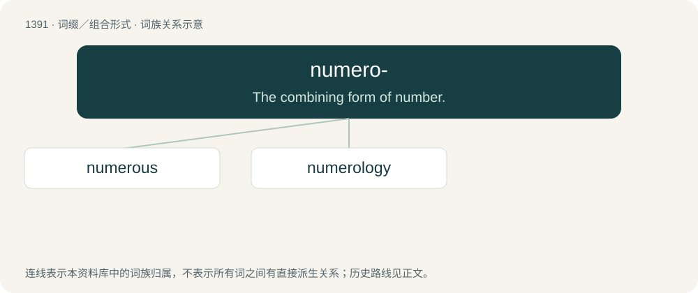

# 1479 · numero- — The combining form of number.

[总目录](../00_总目录_按常用程度.md)

**类型**：词缀／组合形式　｜　**来源语言**：见词源记录

## 核心含义与来源

- 核心含义：The combining form of number.
- 英文含义：The combining form of number.
- 词形：numero-

**来源记录 1**（前缀／前置成分；The combining form of number.）

Borrowed from Latin numerus (“number”) + -o-.

## 词族图

## 单词速览（常用到不常用）

| 单词 | 音标 | 释义 |
|---|---|---|
| [numerous](#w-1) | 英 /ˈnjuːməɹəs/；美 /ˈnuməɹəs/ | a. 很多的, 数目众多的, 多数的；\[机\] 多数的, 甚多的 |
| [numerology](#w-2) | 英 /ˌnjuːməˈɹɒləd͡ʒi/；美 /ˌn(j)u.məˈrɑ.lə.d͡ʒi/ | n. 命理学；数字命理学 |

## 逐词详解

### 1. numerous

**词性**：形容词　｜　**音标**：英 /ˈnjuːməɹəs/；美 /ˈnuməɹəs/

**中文释义**：a. 很多的, 数目众多的, 多数的；\[机\] 多数的, 甚多的

**英文义项**：Indefinitely large numerically; many. / Consisting of a large number of individuals or parts.

**构词拆分**：numero- + -ous

**词源与演化**：

From Middle English numerous from Latin numerōsus (“numerous, abundant; harmonious”), from numerus (“number”). Doublet of numerose. Analyzeable as numero- + -ous.

**例句**：

> The reasons to refrain are numerous.

该用例对应义项：Indefinitely large numerically; many.

### 2. numerology

**词性**：名词　｜　**音标**：英 /ˌnjuːməˈɹɒləd͡ʒi/；美 /ˌn(j)u.məˈrɑ.lə.d͡ʒi/

**中文释义**：n. 命理学；数字命理学

**英文义项**：The study of the purported mystical relationship between numbers (or the letters of words, represented by numbers) and the character or action of physical objects and living beings.

**构词拆分**：numero- + -logy

**词源与演化**：

From numero- + -logy.

**例句**：

> A strict system of numerology is like a mental jail.
