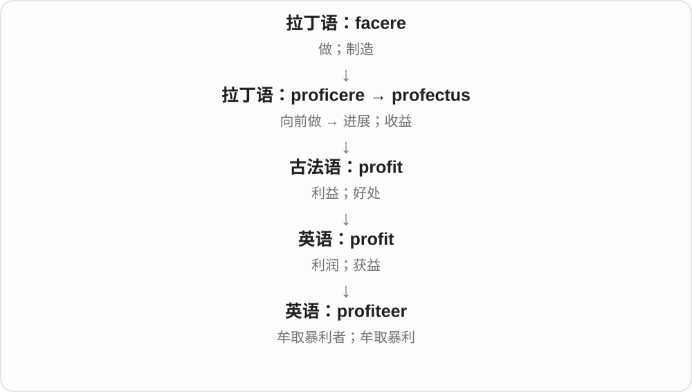

# 1480 · -eer — 从事某活动、与某物有关的人〔常见人物后缀〕

[逐词精讲目录](../00_逐词精讲目录.md) · [总目录](../00_总目录_按常用程度.md)

## 核心词根与来源

-eer 是法语 -ier 在英语中的相应形式之一，上接拉丁 -arius、-iarius 等关系材料。既有整词借入，也有英语后来继续造出的词。

**EER：先找从事的活动，再读固定成词的含义**

auctioneer 主持拍卖，puppeteer 操纵木偶；racketeer 从事敲诈等勾当，不能从球拍义去猜。

- **职业、活动与自愿参与**：engineer · volunteer · auctioneer
- **山地、木偶、航海、火箭等活动**：mountaineer · puppeteer · privateer · rocketeer
- **利益和非法勾当**：profiteer；racket · racketeer
- **出版史带来的特殊发展**：gazette · gazetteer

## 词形与演化规律

auction + -eer → auctioneer；puppet + -eer → puppeteer；racket + -eer → racketeer。gazetteer 的地名辞典义经出版书名发展，现代不一定指人。

## 单词速览（按词族由简到繁）

同一基础词的相关扩展放在一起，先读基础形式，再读扩展；各组之间优先读常用的。具体词源关系见各词讲解。

| 单词 | 音标 | 核心意思 |
|---|---|---|
| [engineer](#w-1) | 英 /ˌendʒɪˈnɪə/；美 /ˌendʒɪˈnɪr/ | 工程师；策划、设计；火车司机〔美式〕 |
| [volunteer](#w-2) | 英 /ˌvɒlənˈtɪə/；美 /ˌvɑːlənˈtɪr/ | 志愿者；自愿参加、主动承担；主动提供 |
| [gazette](#w-11) | /ɡəˈzet/ | 公报；〔某些报纸名称中的〕报；在公报上公布 |
| [gazetteer](#w-7) | 英 /ˌɡæzəˈtɪə/；美 /ˌɡæzəˈtɪr/ | 地名辞典；地理名称索引 |
| [racket](#w-12) | /ˈrækɪt/ | 球拍；吵闹声；敲诈、诈骗等非法勾当 |
| [racketeer](#w-8) | 英 /ˌrækɪˈtɪə/；美 /ˌrækɪˈtɪr/ | 从事有组织敲诈、诈骗等勾当的人 |
| [auctioneer](#w-3) | 英 /ˌɔːkʃəˈnɪə/；美 /ˌɔːkʃəˈnɪr/ | 拍卖师 |
| [mountaineer](#w-4) | 英 /ˌmaʊntɪˈnɪə/；美 /ˌmaʊntənˈɪr/ | 登山者；山区居民〔较旧义〕 |
| [puppeteer](#w-5) | 英 /ˌpʌpɪˈtɪə/；美 /ˌpʌpɪˈtɪr/ | 木偶表演者；操纵木偶的人 |
| [privateer](#w-6) | 英 /ˌpraɪvəˈtɪə/；美 /ˌpraɪvəˈtɪr/ | 私掠船；私掠船员；从事私掠 |
| [rocketeer](#w-9) | 英 /ˌrɒkɪˈtɪə/；美 /ˌrɑːkɪˈtɪr/ | 火箭设计、制造、操作或乘坐者〔依语境〕 |
| [profiteer](#w-10) | /ˌpɹɒfɪˈtɪə(ɹ)/ | 牟取暴利者；牟取暴利 |

## 逐词讲解

### 1. engineer — 工程师；策划、设计；火车司机〔美式〕

**音标**：英 /ˌendʒɪˈnɪə/；美 /ˌendʒɪˈnɪr/

**先抓住这个画面**

把知识用来设计、建造、维护东西的人；作动词，也可以是有计划地把一件事促成。

**怎么拆**

名词早经法语 engigneor 等形式进入英语，与 engin 装置、巧思同族；现代可联系 engine + -eer，但不能说只在现代英语临时给发动机添 er。

**怎么变成今天的意思**

**拉丁 ingenium → 法语 engin**  
天生能力、巧思 → 巧妙装置、战械

↓

**法语 engigneor 等 → 英语 engineer**  
设计、建造装置者 → 工程师；后有策划动词

a civil engineer 土木工程师，a software engineer 软件工程师，engineer a solution 设计促成方案。美式 train engineer 可火车司机。

**常见搭配与例句**

a civil engineer；a software engineer；engineer a solution。

> She works as a civil engineer.

她从事土木工程师工作。

> The team engineered a simple solution to the problem.

团队设计出了一个解决问题的简单方案。

**别混淆**

engineer 不只修发动机的人；engineering 工程范围远宽于 engine。动词 engineer a deal 常策划促成交易，不必画机械图。

### 2. volunteer — 志愿者；自愿参加、主动承担；主动提供

**音标**：英 /ˌvɒlənˈtɪə/；美 /ˌvɑːlənˈtɪr/

**先抓住这个画面**

别人还没硬派给你，你自己举手说“我来”。

**怎么拆**

名词经法语 voluntaire 接拉丁 voluntarius“自愿的”，早期常指自愿从军者；动词在英语中由名词发展。

**怎么变成今天的意思**

**拉丁 velle／volo、volens**  
愿意；我愿意；愿意的

↓

**拉丁 voluntas → voluntarius**  
意愿 → 出于自己意愿的

↓

**法语 voluntaire → 英语 volunteer**  
自愿参加的人 → 志愿者；动词主动承担或提供

a volunteer 常是自愿服务的人。volunteer to help 是主动提出帮忙；volunteer information 则是没人追问也主动说出信息。后一个用法不涉及做公益。volunteer someone for a task 甚至可表示替别人报名，常带“把人推上去”的语气。

**常见搭配与例句**

volunteer to do；volunteer for；volunteer at；volunteer information。

> Three volunteers stayed to clean the hall.

三位志愿者留下来打扫大厅。

> She volunteered to take the first shift.

她主动提出值第一班。

> He did not volunteer any details about the meeting.

他没有主动透露会议的任何细节。

**别混淆**

volunteer 强调主动提出，不等于 accept 接受安排；现代志愿服务常不领工资，但所有历史或动词用法都不能只用“免费”概括。

### 3. gazette — 公报；〔某些报纸名称中的〕报；在公报上公布

**音标**：/ɡəˈzet/

**先抓住这个画面**

一本定期刊出官方通知的刊物，可以叫 gazette；也常作为报纸名称的一部分，不是所有普通报纸都得这样叫。

**怎么拆**

经法语 gazette 接意大利语 gazzetta、威尼斯语 gazeta。通常把新闻纸的名称与当时的小额硬币、阅读费用联系起来，更远命名细节有争论；不从 gaze 凝视硬拆。

**怎么变成今天的意思**

**威尼斯、意大利新闻纸名称 → 法语 gazette**  
早期新闻纸，与小额硬币名称等联系

↓

**英语 gazette**  
报纸名称；官方公报；公报刊载的动词

an official gazette 官方公报；the local Gazette 地方报纸名称；gazette 作动词较正式，指在公报公布。

**常见搭配与例句**

publish in the gazette；a government gazette。

> The appointment was published in the official gazette.

这项任命刊登在官方公报上。

> She found the old notice in a copy of the local Gazette.

她在一份当地报纸里找到了那则旧通知。

**别混淆**

newspaper 是通用报纸；gazette 常用于名称或官方刊物。gazetteer 地名辞典有相关出版史，不能照后缀直接猜成所有记者。

### 4. gazetteer — 地名辞典；地理名称索引

**音标**：英 /ˌɡæzəˈtɪə/；美 /ˌɡæzəˈtɪr/

**先抓住这个画面**

查到一个镇名，书里告诉你它在哪里、有怎样的基本地理情况；这类按地名查阅的工具就是 gazetteer。

**怎么拆**

相关早期词可指新闻撰写者，与 gazette、法语人物后缀材料有关。地名辞典义因十七世纪末一部为新闻读者、新闻人提供地理解释的书名传播开，后来成为此类工具书名称。

**怎么变成今天的意思**

**gazette 词族及早期 gazetteer 人物称呼**  
与新闻、新闻撰写者有关

↓

**十七世纪末相关地理手册书名 → 后来的通用名词**  
供人查询地名、地理情况的工具书

a historical gazetteer 历史地名辞典；a digital gazetteer 数字地名索引。现代常见这个义时，-eer 并不说明它必是个人。

**常见搭配与例句**

consult a gazetteer；a geographical gazetteer。

> She checked the village’s old name in a historical gazetteer.

她在历史地名辞典里查了那个村子的旧名。

> The digital gazetteer lists several places with the same name.

数字地名索引列出了几个同名地点。

**别混淆**

atlas 主要按地图展示，gazetteer 主要按地名提供条目、索引；一本书也可能同时含地图和地名索引。

### 5. racket — 球拍；吵闹声；敲诈、诈骗等非法勾当

**音标**：/ˈrækɪt/

**先抓住这个画面**

球场上是球拍，楼上传来的是吵闹声，犯罪小说里又可能是敲诈生意。不要看到一个中文义就把其他场景全部套进去。

**怎么拆**

球拍义经法语相关形式进入，最远来源有争论；吵闹义常视为拟声一类来源。非法勾当义的具体发展也有不同解释，不能把三义排成确定的球拍敲响然后必然诈骗的故事。

**怎么变成今天的意思**

**法语球拍、手掌游戏词族 → 球拍 racket**  
击球器具这一历史分支

↓

**吵闹 racket；后有非法勾当等义**  
另一路材料；具体扩义关系仍有争论

a tennis racket 网球拍；make a racket 吵得很；a protection racket 收保护费的敲诈勾当。racketeer 取的是非法勾当义。

**常见搭配与例句**

a badminton racket；a terrible racket；run a racket。

> She left her tennis racket by the door.

她把网球拍放在门边。

> The old machine made a terrible racket.

那台旧机器吵得不得了。

**别混淆**

racquet 是球拍义的另一常见拼写；noise 范围很广，racket 的声音义通常带嘈杂、让人受不了的评价。

### 6. racketeer — 从事有组织敲诈、诈骗等勾当的人

**音标**：英 /ˌrækɪˈtɪə/；美 /ˌrækɪˈtɪr/

**先抓住这个画面**

把恐吓、敲诈或欺诈组织成一门长期生意的人；不是普通拿着球拍打球的人。

**怎么拆**

racket 非法勾当 + -eer，从事某种活动的人。二十世纪二十年代美国犯罪相关语境中传播，不取球拍这一同形词义。

**怎么变成今天的意思**

**racket 的非法勾当义 + -eer**  
以该类勾当为活动的人

↓

**现代 racketeer**  
有组织敲诈、诈骗等活动的参与者

a racketeer in a crime novel 犯罪小说里的敲诈者；racketeering 是相应活动名词。在小说、历史叙述中常见，人物称呼带强烈犯罪色彩。

**常见搭配与例句**

a notorious racketeer；a gang of racketeers。

> The novel follows a racketeer who controls the city’s clubs.

小说围绕一个控制城里多家俱乐部的犯罪头目展开。

> The film portrays the racketeer as charming but ruthless.

影片把那个敲诈团伙人物描写得有魅力，却冷酷无情。

**别混淆**

不是 racket 的每种义都能加同一个人物解释：tennis player 才是网球选手；racketeer 取非法勾当的固定发展。

### 7. auctioneer — 拍卖师

**音标**：英 /ˌɔːkʃəˈnɪə/；美 /ˌɔːkʃəˈnɪr/

**先抓住这个画面**

站在竞价活动前面，接收报价并主持出售的人。

**怎么拆**

auction + -eer，后缀在这里构成从事某种活动的人。

**怎么变成今天的意思**

**拉丁 augēre；分词 auctus**  
使增加、成长；已经增长的

↓

**拉丁 auctiō → 英语 auction**  
增加 → 竞价出售、拍卖

↓

**英语 auction + -eer → auctioneer**  
主持拍卖、组织竞价出售的人

画面里的 auctioneer 是主持者；举牌报价的人是 bidder。这个词也可作动词，表示主持拍卖，不过日常更常用名词。

**常见搭配与例句**

a licensed auctioneer；the auctioneer’s hammer；work as an auctioneer。

> The auctioneer acknowledged a bid from the back of the room.

拍卖师确认了房间后方的一次出价。

> An experienced auctioneer conducted the charity sale.

一位经验丰富的拍卖师主持了这场慈善拍卖。

**别混淆**

seller 是卖方，bidder 是出价者，auctioneer 是主持拍卖的人，角色可以区分。

### 8. mountaineer — 登山者；山区居民〔较旧义〕

**音标**：英 /ˌmaʊntɪˈnɪə/；美 /ˌmaʊntənˈɪr/

**先抓住这个画面**

把山当作经常进入、攀登的地方的人；现代首先让人想到有登山经验和技术的人。

**怎么拆**

英语 mountain + -eer，形成与某种活动或领域相关的人。早期也指山里居民，现代常见义是登山者。

**怎么变成今天的意思**

**拉丁 mons，属格 montis，词干 mont-**  
山、高地

↓

**拉丁 montanus → 罗曼语山地名词形式**  
山的；通俗拉丁常重构 \*montanea，另有早期中世纪 montania 路线分析

↓

**古法语 montaigne／盎格鲁法语 muntaine → 中古英语 mountain**  
山、山地

↓

**现代英语 mountain**  
山；比喻巨大的数量或困难

↓

**英语 mountain + -eer → mountaineer**  
山中居民 → 登山者；也可转作动词“登山”

an experienced mountaineer 是经验丰富的登山者；语境可以包括技术攀登、冰雪路线等，但这个词本身不保证任何具体资格。

**常见搭配与例句**

an experienced mountaineer；a team of mountaineers；a novice mountaineer。

> An experienced mountaineer checked the team’s equipment.

一位经验丰富的登山者检查了全队的装备。

> The book follows a young mountaineer through her first major expedition.

这本书讲述一位年轻登山者首次参加大型远征的经历。

**别混淆**

hiker 主要指徒步者；mountaineer 更突出登山，可能涉及陡峭、高海拔或技术路线。

### 9. puppeteer — 木偶表演者；操纵木偶的人

**音标**：英 /ˌpʌpɪˈtɪə/；美 /ˌpʌpɪˈtɪr/

**先抓住这个画面**

镜头前或舞台上是偶，赋予它动作、节奏和声音的人是 puppeteer。

**怎么拆**

puppet + -eer，英语用表示从事某活动的后缀造出人员名称；整词重音落在后面。

**怎么变成今天的意思**

**拉丁 pupa 女孩、娃娃；相关阳性 pupus 男孩**  
小人、儿童和玩偶的意象；后续各词沿不同路线发展

↓

**法语 popee、popette 等娃娃词形 → 中古英语 popet → puppet**  
经法语娃娃词族进入英语；逐渐专指可操纵表演的偶

↓

**英语 puppet + -eer → puppeteer**  
操纵木偶、进行木偶表演的人

a skilled puppeteer 是熟练的木偶表演者。比喻时可指暗中操纵局面的人，但日常字面用法是一种表演职业。

**常见搭配与例句**

a skilled puppeteer；work as a puppeteer；a team of puppeteers。

> The puppeteer made the tiny dragon seem alive.

木偶表演者让那条小龙显得活灵活现。

> Three puppeteers worked together to move the giant figure.

三位木偶表演者一起操纵那个巨大的偶。

**别混淆**

puppet 是被操纵的偶；puppeteer 是操纵者。actor 是更广的演员名称，不限定表演媒介。

### 10. privateer — 私掠船；私掠船员；从事私掠

**音标**：英 /ˌpraɪvəˈtɪə/；美 /ˌpraɪvəˈtɪr/

**先抓住这个画面**

船是私人拥有的，却拿着国家授权去袭取敌国船只；历史上这种船及其人员称 privateer。

**怎么拆**

由 private 加 -eer 形成，可能仿 volunteer、buccaneer 的词形；早期是 private man-of-war 这类私人武装船名称的浓缩。

**怎么变成今天的意思**

**拉丁语 privus → privare / privatus**  
单独的、个人的 → 分开、剥去；与公共部分分开的

↓

**拉丁语 privatus → 英语 private**  
属于个人的、非公共的；私下的

↓

**英语 private + -eer → privateer**  
私人武装船 → 船上从事私掠的人

核心是私人船只与国家委任的组合。它与普通 pirate 的区别在授权身份，但具体冲突中对方未必承认这种身份。

**常见搭配与例句**

a licensed privateer；serve on a privateer；privateering vessels。

> The privateer carried a commission from the government.

这艘私掠船持有政府的委任授权。

> The museum displays the logbook of a privateer.

博物馆展示了一艘私掠船的航海日志。

**别混淆**

pirate 是海盗；privateer 强调历史上的私掠授权，不是任何私人船。

### 11. rocketeer — 火箭设计、制造、操作或乘坐者〔依语境〕

**音标**：英 /ˌrɒkɪˈtɪə/；美 /ˌrɑːkɪˈtɪr/

**先抓住这个画面**

给与火箭活动有关的人起一个有角色感的名字，就是 rocketeer。可能是设计、发射模型火箭的人，也可能是故事里乘火箭的人。

**怎么拆**

rocket + -eer 人物后缀，形成从事、参与火箭活动的人物名词。具体工作并不全由后缀写死。

**怎么变成今天的意思**

**意大利 rocca 纺纱杆 → rocchetto／rocchetta**  
小纺纱杆、线轴；按形状给早期火箭命名

↓

**英语 rocket 火箭**  
烟火火箭、推进装置与飞行器；比喻迅速上升

↓

**rocket + -eer → rocketeer**  
参与火箭设计、操作、飞行等活动的人物

an amateur rocketeer 业余火箭爱好者、制作者，a pioneering rocketeer 火箭先驱。技术史、模型爱好活动或科幻语境较常见。

**常见搭配与例句**

an amateur rocketeer；a pioneering rocketeer。

> The exhibition celebrates pioneering rocketeers.

展览纪念火箭领域的先驱。

> The club brings together amateur rocketeers.

俱乐部把业余火箭爱好者聚到一起。

**别混淆**

rocketeer 不自动等于 astronaut 宇航员；设计火箭的人也可以始终没有进入太空。

### 12. profiteer — 牟取暴利者；牟取暴利

**音标**：/ˌpɹɒfɪˈtɪə(ɹ)/

**先抓住这个画面**

别人遇到紧缺或困难，有人趁机抬价狠赚一笔，profiteer 通常就是这样带批评地使用。

**怎么拆**

profit + -eer，后缀形成从事某种活动的人；整词有贬义。

**怎么变成今天的意思**

普通 profit 可以中性地表示赚钱，profiteer 则常含利用战争、紧缺或他人困境获利的指责。

**常见搭配与例句**

a war profiteer；profiteer from shortages；accuse someone of profiteering。

> The novel follows a profiteer during a period of shortages.

小说追踪了一位在物资紧缺时期牟取暴利的人。

> Residents accused the seller of profiteering from the crisis.

居民指责卖家利用危机牟取暴利。

**别混淆**

entrepreneur 是创业者；profiteer 批评获利方式，不能把所有赚钱者都这样称呼。

## 这一组要分清什么

gazetteer 主要地名辞典，不机械等于记者；privateer 有特定历史航海身份，不只是任何海盗；后缀本身不决定好坏。

## 串起来练习

The mountaineer checked the village name in a gazetteer.

登山者在地名辞典里查了那个村名。
