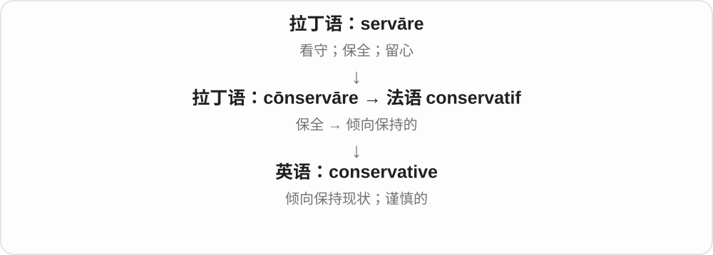
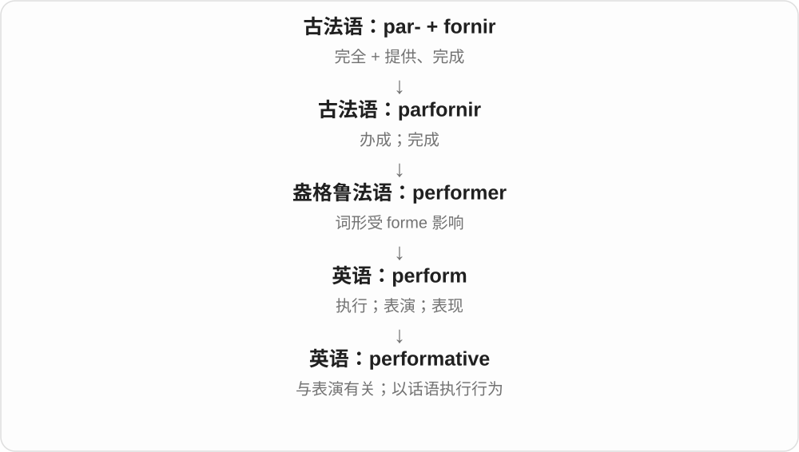
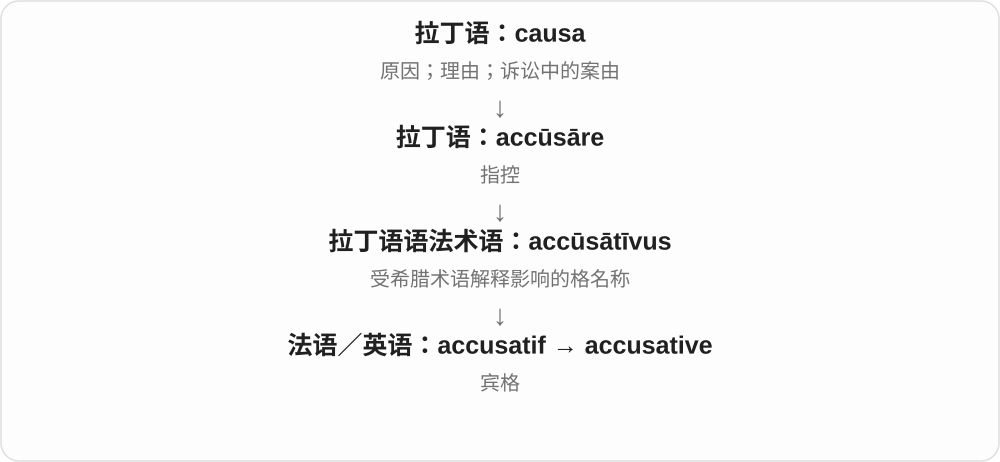

# 1491 · -ative — 与某动作、作用或性质有关的形容词材料

[逐词精讲目录](../00_逐词精讲目录.md) · [总目录](../00_总目录_按常用程度.md)

## 核心词根与来源

与 -ate、-ive 及拉丁 -ativus 等形容词形式有关。英语既有整词借入，也有后来按已有形式继续构词，历史路线要逐词判断。

**ATIVE：从一个动作看它带来的作用、倾向或关系**

informative 能让人获得信息；formative 会塑造发展；summative 把阶段成果汇总起来。相同尾部不代表每个词都译成主动做……。

- **帮助理解、塑造与汇总**：informative；formative；summative
- **习惯、规则与表现**：talkative；normative；performative；qualitative
- **具体作用及专门关系**：conservative · restorative · transformative；authoritative · exploitative；oxidative · accusative · commutative · determinative

## 词形与演化规律

formative 连着 formare、form 的塑造词族；summative 连着 sum、summation；talkative 连着 talk。它们适合并排比较，但不是同一时刻用一张配方造出的词。

## 单词速览（按词族由简到繁）

同一基础词的相关扩展放在一起，先读基础形式，再读扩展；各组之间优先读常用的。具体词源关系见各词讲解。

| 单词 | 音标 | 核心意思 |
|---|---|---|
| [conservative](#w-1) | 英 /kənˈsɜːvətɪv/；美 /kənˈsɜːrvətɪv/ | 保守的；审慎的；保守派 |
| [formative](#w-16) | 英 /ˈfɔːmətɪv/；美 /ˈfɔːrmətɪv/ | 有塑造作用的；形成、发展阶段的 |
| [informative](#w-2) | 英 /ɪnˈfɔːmətɪv/；美 /ɪnˈfɔːrmətɪv/ | 提供有用信息的；让人长见识的 |
| [transformative](#w-5) | 英 /trænsˈfɔːmətɪv/；美 /trænsˈfɔːrmətɪv/ | 带来深刻改变的、具有变革作用的 |
| [qualitative](#w-3) | 英 /ˈkwɒlɪtətɪv/；美 /ˈkwɑːləteɪtɪv/ | 性质上的；定性的 |
| [authoritative](#w-4) | 英 /ɔːˈθɒrətətɪv/；美 /əˈθɔːrəteɪtɪv/ | 权威可靠的；有威信的；有命令意味的 |
| [normative](#w-6) | 英 /ˈnɔːmətɪv/；美 /ˈnɔːrmətɪv/ | 规范性的；规定应当怎样的；以常模为依据的 |
| [oxidative](#w-7) | 英 /ɒkˈsɪdətɪv/；美 /ˈɑːksɪˌdeɪtɪv/ | 氧化的；引起氧化的 |
| [talkative](#w-8) | /ˈtɔːkətɪv/，美也 /ˈtɑːkətɪv/ | 健谈的；话多的 |
| [restorative](#w-9) | 英 /rɪˈstɒrətɪv/；美 /rɪˈstɔːrətɪv/ | 有助恢复的、使重新振作的；恢复性的 |
| [exploitative](#w-10) | /ɪkˈsplɔɪtətɪv/，也读 /ɪksplɔɪˈteɪtɪv/ | 剥削性的；不公平利用人的 |
| [performative](#w-11) | 英 /pəˈfɔːmətɪv/；美 /pərˈfɔːrmətɪv/ | 表演性的；做给人看的；施为的 |
| [accusative](#w-12) | /əˈkjuːzətɪv/ | 宾格的；宾格 |
| [commutative](#w-13) | 英 /kəˈmjuːtətɪv/；美 /kəˈmjuːtətɪv/ | 可交换次序的；满足交换律的 |
| [determinative](#w-14) | 英 /dɪˈtɜːmɪnətɪv/；美 /dɪˈtɜːrməneɪtɪv/，也 /-nətɪv/ | 起决定作用的；限定成分；表义分类符号 |
| [summative](#w-15) | /ˈsʌmətɪv/ | 汇总性的；总结评价的 |

## 逐词讲解

### 1. conservative — 保守的；审慎的；保守派

**音标**：英 /kənˈsɜːvətɪv/；美 /kənˈsɜːrvətɪv/

**先抓住这个画面**

变化来了，先倾向保住现有做法；估数字时，则宁愿稳一点，不把结果说得过大。

**怎么拆**

经法语 conservatif 来自拉丁语 cōnservāre“保持”；现代可联系 conserve 与 -ative。

**怎么变成今天的意思**

可指政治立场、传统风格或审慎估计。a conservative estimate 是偏稳妥的估计，不是有政治立场的估计。

**常见搭配与例句**

conservative views；conservative clothing；a conservative estimate。

> That is a conservative estimate of the time required.

这是对所需时间的一个谨慎估计。

> He prefers conservative styles of clothing.

他偏爱传统稳重的衣着风格。

**别混淆**

conservation 是保护；conservative 是保守或审慎。环保工作者不因此自动属于某种政治保守派。

### 2. formative — 有塑造作用的；形成、发展阶段的

**音标**：英 /ˈfɔːmətɪv/；美 /ˈfɔːrmətɪv/

**先抓住这个画面**

一块材料还在成形，受到的压力会改变最后的样子。人的经历、教育也会这样塑造习惯、观念，所以 formative years 是对成长影响很大的那些年。

**怎么拆**

中古英语经法语 formatif、拉丁 formativus 一路借入，词族连接 formare 塑形。现代对照 form 与 -ative 有助理解，历史上并不只是今天的英语 form 临时加一段字母。

**怎么变成今天的意思**

**拉丁 formare → formativus；法语 formatif**  
赋形、塑造 → 有成形作用的

↓

**英语 formative**  
塑造发展的；教育中帮助学习改进的

a formative experience 塑造一个人的经历；formative assessment 形成性评价，用反馈推动正在进行的学习。它的重点是改进，不只是在结尾报个分数。

**常见搭配与例句**

formative years；a formative influence。

> Working in the small theatre was a formative experience for her.

在那家小剧院工作的经历对她影响很深。

> The teacher used short discussions for formative assessment.

老师用简短讨论了解学生掌握情况，帮助他们继续改进。

**别混淆**

formative 不限幼儿时期，也不只说物体外形。与 summative assessment 对照时看评价目的，不能只凭是否用试卷判断。

### 3. informative — 提供有用信息的；让人长见识的

**音标**：英 /ɪnˈfɔːmətɪv/；美 /ɪnˈfɔːrmətɪv/

**先抓住这个画面**

听完以后，你确实多懂了些东西，而不是只听了一堆漂亮话。

**怎么拆**

现代可看作 inform + -ative；历史上也有中世纪拉丁语 īnfōrmātīvus 的借入路线，根仍是 īnfōrmāre“赋形、教导”。

**怎么变成今天的意思**

常赞扬说明、文章和演讲信息充实、对理解有帮助。它不等于文字很多。

**常见搭配与例句**

an informative article；an informative talk；highly informative。

> The guide gave an informative explanation of the building.

导游对这栋建筑作了很有帮助的讲解。

> The short video was surprisingly informative.

这段短视频出乎意料地有料。

**别混淆**

informed 说人或决定有知识作基础；informative 说内容能把知识给别人。

### 4. transformative — 带来深刻改变的、具有变革作用的

**音标**：英 /trænsˈfɔːmətɪv/；美 /trænsˈfɔːrmətɪv/

**先抓住这个画面**

变化不只换一层颜色，而是让生活、理解、做事方式发生大转变；a transformative experience 是经历之后人不太一样了。

**怎么拆**

历史接中世纪拉丁 transformātīvus 等，使用 trānsfōrmāt- 分词词干；现代可对应 transform + -ative 的形容词材料，不必断言现代英语先造长词才有拉丁形式。

**怎么变成今天的意思**

**拉丁 trāns- + fōrmāre → trānsfōrmāre**  
跨到另一种形态，改变形状、面貌

↓

**英语 transform**  
改造、变形；改变性质、运作方式

↓

**拉丁 transformāt- + -īvus → transformative**  
具有使之转变作用的形容词

a transformative experience 改变人生、认知的经历，transformative change 深刻变革，a transformative effect 深远改变作用。

**常见搭配与例句**

a transformative experience；transformative change；a transformative effect。

> Living abroad was a transformative experience for her.

在国外生活对她是一次改变人生的经历。

> The discovery had a transformative effect on the field.

这个发现给该领域带来了深刻改变。

**别混淆**

transformative 强调造成明显、深刻改变，不只说明东西有不同；transformational 在许多变革语境重叠，也有专门术语用法。

### 5. qualitative — 性质上的；定性的

**音标**：英 /ˈkwɒlɪtətɪv/；美 /ˈkwɑːləteɪtɪv/

**先抓住这个画面**

问发生了什么、是什么体验、有哪些特点，而不只是问有几个、多少分。

**怎么拆**

经拉丁性质词的对应形容词形式与法语等进入英语，现代与 quality 相联系。不能把整个词简单译成质量好的。

**怎么变成今天的意思**

**拉丁 quālis 什么样 → quālitās → 法语 qualité → quality**  
某物是什么性质 → 特点、质量

↓

**拉丁性质词的形容词分支 → qualitative**  
关于性质、特点 → 定性的

qualitative research 定性研究，qualitative data 定性资料，a qualitative difference 性质上的差别；方法名不自动评价研究好坏。

**常见搭配与例句**

qualitative research；qualitative data；a qualitative difference。

> The study uses qualitative interviews to explore people’s experiences.

研究用定性访谈探索人们的经历。

> There is a qualitative difference between the two approaches.

这两种方法存在性质上的差别。

**别混淆**

qualitative 关注性质，quantitative 关注数量；实际研究可以把两类方法结合，并非互相排斥。

### 6. authoritative — 权威可靠的；有威信的；有命令意味的

**音标**：英 /ɔːˈθɒrətətɪv/；美 /əˈθɔːrəteɪtɪv/

**先抓住这个画面**

说的话有根据、有分量，别人有理由认真听。

**怎么拆**

借中世纪拉丁 auctōritātīvus，接拉丁 auctōritās；现代可联系 authority，但历史并非只在现代英语名词后临时加尾巴。

**怎么变成今天的意思**

**拉丁 augēre；分词 auctus**  
使增加、成长；已经增长的

↓

**拉丁 auctor → auctōritās → 中世纪拉丁 auctōritātīvus**  
发起者、担保者 → 权威 → 有权威的

↓

**中古英语 auctoritative → 英语 authoritative**  
可靠、有根据；带权威或命令语气的

an authoritative account 是可信而有分量的介绍；an authoritative voice 也可只是说话坚定、有指挥感。后一种声音并不自动证明内容正确。

**常见搭配与例句**

an authoritative source；an authoritative account；an authoritative voice。

> The museum publishes an authoritative guide to its collection.

博物馆出版了一本介绍馆藏的权威指南。

> She spoke in a calm but authoritative voice.

她说话平静，却很有威信。

**别混淆**

authoritarian 强调要求服从、集权；authoritative 可以称赞专业可靠，不等于专制。

### 7. normative — 规范性的；规定应当怎样的；以常模为依据的

**音标**：英 /ˈnɔːmətɪv/；美 /ˈnɔːrmətɪv/

**先抓住这个画面**

有人说“大家事实上怎样”，另一个人拿出一把尺子说“大家应该怎样”；后者是常见的 normative 视角。

**怎么拆**

经法语 normatif 借入，法语基础是 norme“标准”。现代英语可分析为 norm + -ative；这有助理解，但不应抹掉法语借入路线。

**怎么变成今天的意思**

**拉丁 norma**  
木工直角尺；由此指规则、标准

↓

**法语 norme → normatif → 英语 normative**  
与标准有关的；规定应当怎样的

在伦理、政策和语言讨论中，normative 常提出标准或判断。normative data 则可以是作为比较基准的常模数据，不能在每一处都译成“道德上的”。

**常见搭配与例句**

a normative claim；normative ethics；a normative standard；normative data。

> “Every child should have access to books” is a normative claim.

“每个孩子都应当有书可读”是一个规范性主张。

> The report separates descriptive findings from normative recommendations.

报告把描述性发现与关于应该怎么做的建议分开了。

**别混淆**

descriptive 描述实际情况；normative 常说明应该怎样。一个陈述也可能同时包含事实判断和价值标准。

### 8. oxidative — 氧化的；引起氧化的

**音标**：英 /ɒkˈsɪdətɪv/；美 /ˈɑːksɪˌdeɪtɪv/

**先抓住这个画面**

用来描述与氧化过程相连的作用或条件。

**怎么拆**

与 oxide、oxidate、oxidation 一族，构词可分析为 oxide + -ative 或 oxidate + -ive。现代常与 oxidation 配对记，不必把不同分析排成唯一历史链。

**怎么变成今天的意思**

**希腊 oxýs**  
尖锐的；酸的

↓

**近代法语 oxygène**  
用希腊来源成分造出“产酸者”名称

↓

**法语 oxide / oxyde**  
由 oxygène 与 acide 的成分组合，命名氧化物

↓

**英语 oxide**  
氧化物

↓

**英语氧化词族 → oxidative**  
表示涉及或促成氧化的性质

oxidative damage 是与氧化作用有关的损伤；oxidative processes 也可以是正常的化学、生理过程。这个形容词本身不等于“有毒”。

**常见搭配与例句**

oxidative stress；oxidative damage；oxidative processes。

> The study examines oxidative damage to the material.

研究考察了这种材料受到的氧化损伤。

> The chapter describes several oxidative processes in cells.

这一章描述了细胞中的几种氧化过程。

**别混淆**

oxidative 说氧化性质；oxygenated 说已经携带或含有较多氧。读音也不同。

### 9. talkative — 健谈的；话多的

**音标**：/ˈtɔːkətɪv/，美也 /ˈtɑːkətɪv/

**先抓住这个画面**

话题一开就能不断接着聊，嘴很少闲下来。

**怎么拆**

talk + -ative，接中古英语 talkatyve 等形式；-ative 形成有某种倾向的形容词，不把后缀另拆成几个不存在的现代词。

**怎么变成今天的意思**

**中古英语 talken / talkien**  
交谈、谈论；与更早讲述词族有关

↓

**英语 talk**  
说话；交谈；一次谈话、讲座

↓

**talk + -ative → talkative**  
倾向于多说话的

a talkative child 是话多的孩子，feel talkative 是这会儿很想聊天。可以友好描述，也可能抱怨说得太多。

**常见搭配与例句**

a talkative person；unusually talkative；not very talkative。

> She becomes more talkative when she feels comfortable.

她放松下来就会更健谈。

> The normally talkative child was quiet on the way home.

平时话多的孩子回家路上很安静。

**别混淆**

talkative 重数量、聊天倾向，eloquent 重表达有力、流畅；一个人可以话多却说不清。

### 10. restorative — 有助恢复的、使重新振作的；恢复性的

**音标**：英 /rɪˈstɒrətɪv/；美 /rɪˈstɔːrətɪv/

**先抓住这个画面**

累了一天，安静休息让人恢复力气，这样的休息就是 restorative。别的领域也可强调修复关系、恢复功能，核心是把状态往回带。

**怎么拆**

承中古英语、古法语 restoratif 等，上接拉丁相关形容词形式；现代可对应 restore + -ative，去 e。里面 restore 联系 restaurāre 重建、修复。

**怎么变成今天的意思**

**拉丁 re- 再 + -staurāre 相关词干 → restaurāre**  
重建、修复，使重新牢固

↓

**古法语 restorer → restore**  
恢复、归还、修复

↓

**后缀分支**  
restorative 有恢复作用；restorer 修复的人或物

restorative sleep 使人恢复精力的睡眠，a restorative break 让人缓过来的休息，restorative work 恢复、修复工作。专业搭配另有特定含义。

**常见搭配与例句**

restorative sleep；a restorative break。

> A quiet walk felt restorative after the busy day.

忙碌一天后，安静散步让人恢复了精神。

> They stopped for a short, restorative break.

他们停下来短暂休息，缓一缓精神。

**别混淆**

restorative 说有恢复作用的性质；restored 是已经恢复的状态。一次 restorative break 不等于所有问题都已经解决。

### 11. exploitative — 剥削性的；不公平利用人的

**音标**：/ɪkˈsplɔɪtətɪv/，也读 /ɪksplɔɪˈteɪtɪv/

**先抓住这个画面**

一段安排把好处主要拿走，却让处境较弱的一方承担不公平代价，可以 exploitative。它常把 exploit 的负面支固定成性质评价。

**怎么拆**

exploit + -ative → exploitative，与 exploitation 的性质形式相应；也见 exploitive。常用社会评价聚焦不公平利用，特定学科还可有专门意义。

**怎么变成今天的意思**

**拉丁 explicitum，接 explicare 展开、完成 → 法语 esploit、esploitier**  
完成、成果、收益，再向利用发展

↓

**exploit + -ative → exploitative**  
具有剥削、不公平利用性质的

exploitative practices 剥削性做法；an exploitative relationship 不公平利用的关系。

**常见搭配与例句**

exploitative practices；an exploitative relationship。

> The article criticises exploitative working conditions.

文章批评带剥削性质的工作条件。

> The novel portrays an exploitative relationship.

小说描写了一段不公平利用对方的关系。

**别混淆**

exploitative 常带负面判断；exploitable 只说可以被利用，两词后缀和观察角度不同。

### 12. performative — 表演性的；做给人看的；施为的

**音标**：英 /pəˈfɔːmətɪv/；美 /pərˈfɔːrmətɪv/

**先抓住这个画面**

两种画面要分开：一种是做姿态给别人看；另一种是话一说出口，行为就已完成，比如正式说“我承诺”。

**怎么拆**

perform + -ative；由执行、表演形成不同语境中的形容词用法。

**怎么变成今天的意思**

日常评论中常批评虚假的姿态。语言学中的 performative utterance 则说话语在合适情境下实行了承诺、命名等行为，不带虚假意思。

**常见搭配与例句**

performative concern；a performative utterance；performative art。

> She wanted practical support, not performative concern.

她想要实际支持，不是做给人看的关心。

> In the right context, “I promise” is a performative utterance.

在合适语境中，“我承诺”是一句施为话语。

**别混淆**

技术义 performative 不能一律译成“装出来的”；说 I apologize 本身可以实施道歉。

### 13. accusative — 宾格的；宾格

**音标**：/əˈkjuːzətɪv/

**先抓住这个画面**

accusative 是语法中的“宾格”。初学时可以把它想成给动作承受对象贴上的标签，如“我看见他”里的“他”；具体规则仍取决于语言。

**怎么拆**

借自法语 accusatif 或拉丁语 accūsātīvus。它的确和 accūsāre“指控”有关，但这个语法名称牵涉古代对希腊术语的误解，不能靠“被指控的人”解释宾格。

**怎么变成今天的意思**

希腊术语原本与“受作用、由某事造成”相关，拉丁传统却把相关词理解成“指控”，名称由此保留下来。学习用途比这个名字重要：宾格常标记直接宾语；某些语言还用它表示运动方向等。

**常见搭配与例句**

the accusative case（宾格）；an accusative noun（宾格形式的名词）；take the accusative（要求后接宾格）。

> In Latin, the direct object is often in the accusative case.

在拉丁语中，直接宾语常用宾格。

> The teacher asked us to identify the accusative noun.

老师让我们找出那个使用宾格的名词。

**别混淆**

accusation 是指控；accusative 是语法术语。nominative 常用于主语，accusative 常用于直接宾语，但别把这个概括当成所有语言的全部规则。

### 14. commutative — 可交换次序的；满足交换律的

**音标**：英 /kəˈmjuːtətɪv/；美 /kəˈmjuːtətɪv/

**先抓住这个画面**

commutative 像把两个数交换位置再计算，结果仍一样：2 + 3 与 3 + 2。

**怎么拆**

来自“交换”的 commute 词族；法语 commuter 与 -ative 共同形成这一术语。

**怎么变成今天的意思**

评价的是运算在交换输入次序后是否保持结果。不是说所有计算步骤随便调换都没关系。

**常见搭配与例句**

a commutative operation；commutative addition；a commutative group。

> Addition of ordinary numbers is commutative.

普通数的加法满足交换律。

> Matrix multiplication is not generally commutative.

矩阵乘法一般不满足交换律。

**别混淆**

associative 是结合律，改变括号；commutative 是交换律，改变次序。

### 15. determinative — 起决定作用的；限定成分；表义分类符号

**音标**：英 /dɪˈtɜːmɪnətɪv/；美 /dɪˈtɜːrməneɪtɪv/，也 /-nətɪv/

**先抓住这个画面**

一条信息把答案范围圈小，或一个符号把某个词归到具体意义类别；都在做“限定”。

**怎么拆**

经法语 déterminatif，属于拉丁 dētermināre 词族；现代可联系 determine 与 -ative。

**怎么变成今天的意思**

**拉丁语 terminus**  
边界；界标；尽头

↓

**拉丁 dētermināre → 法语 déterminer / déterminatif**  
确定、限定 → 起限定作用的

↓

**英语 determinative**  
决定性的；限定成分或表义符号

形容词常说决定性因素；名词在语法书中可指限定词类，在古文字研究中可指帮助区分词义类别的符号。具体术语范围随分析体系不同。

**常见搭配与例句**

be determinative of；a determinative sign。

> Cost was important but not determinative of the final choice.

成本很重要，但没有决定最终选择。

> The determinative helps the reader identify the word’s semantic category.

这个表义分类符号帮助读者辨认词的意义类别。

**别混淆**

determinative 强调限定或决定作用；descriptive 主要作描述。语法中的 determinative 与 determiner 有时还区分词类与功能。

### 16. summative — 汇总性的；总结评价的

**音标**：/ˈsʌmətɪv/

**先抓住这个画面**

把一个阶段学到、做到的东西收拢起来，看看总体到了什么水平。像一个阶段结束时的总盘点。

**怎么拆**

sum 总和、汇总这一词基与 -ative 结合，关联 summation 汇总、相加。一般义偏累积、汇总，在教育中常用于阶段学习成果的总结评价。

**怎么变成今天的意思**

**sum 与 -ative 的组合**  
把各部分合起来看

↓

**summative assessment 等用法**  
对阶段成果作总结评价

summative assessment 总结性评价；a summative evaluation 总结评估。它常在单元或阶段末进行；得到的结果仍可用于帮助下一阶段改进。

**常见搭配与例句**

a summative task；a summative assessment。

> The final project serves as a summative assessment.

期末项目用来评价这一阶段的学习成果。

> The course combines formative feedback with summative tasks.

课程把帮助学习改进的反馈与总结评价任务结合起来。

**别混淆**

formative 侧重反馈、帮助过程改进，summative 侧重判断已取得的成果；不是把所有平时活动和所有考试机械分成两类。

## 这一组要分清什么

formative 的塑造不限外形；summative 的汇总评价不等于一句简单摘要；accusative 是格名称，要按语法中的专门用法学。

## 串起来练习

An informative discussion can also be a formative experience.

一次让人长见识的讨论，也可能成为塑造自己的经历。
