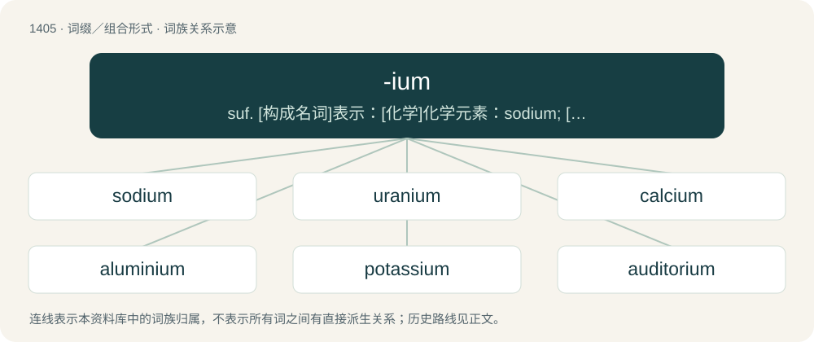

# 1491 · -ium — suf. \[构成名词\]表示：\[化学\]化学元素：sodium; \[化学\]阳离子：ammonium, carbonium; \[生物学\]身体部位, 生物构造：mycelium; \[植物学\]块,小块：pollinium

[总目录](../00_总目录_按常用程度.md)

**类型**：词缀／组合形式　｜　**来源语言**：见词源记录

## 核心含义与来源

- 核心含义：suf. \[构成名词\]表示：\[化学\]化学元素：sodium; \[化学\]阳离子：ammonium, carbonium; \[生物学\]身体部位, 生物构造：mycelium; \[植物学\]块,小块：pollinium
- 英文含义：Used to form the names of metal elements, after the style of early-named elements, as well as the isotopes of hydrogen.
- 词形：-ium

**多个词源／构词路径**：同一拼写可能有不同来源；以下按词性和含义分别列出。

**来源记录 1**（后缀／后置成分；Used to form the names of metal elements, after the style of early-named elements, as well as the isotopes of hydrogen.）

From Latin -um (neuter singular morphological suffix), based on Latin terms for metals such as ferrum (“iron”).

**来源记录 2**（后缀／后置成分；Used to form the name of an aggregation or mass of something, such as biological tissue）

Reanalysis from multiple Latin or New Latin compounds suffixed with -ium, whose function, among others, is to derive parasynthetic compounds.

**来源记录 3**（后缀／后置成分；Used to indicate the setting where a given activity is carried out）

Reanalysis of Latin words suffixed with -tōrium, -ārium and -ium.

## 词族图

## 单词速览（常用到不常用）

| 单词 | 音标 | 释义 |
|---|---|---|
| [sodium](#w-1) | 英 /ˈsəʊ.di.əm/；美 /ˈsoʊ.di.əm/ | n. 钠；\[化\] 钠Na |
| [uranium](#w-2) | 英 /jʊˈɹeɪniəm/；美 /ˌjuː.ˈɹeɪ.ni.əm/ | n. 铀；\[化\] 铀U |
| [calcium](#w-3) | 英 /ˈkælsi.əm/ | n. 钙；\[化\] 钙Ca |
| [aluminium](#w-4) | 英 /ˌæl.(j)ʊˈmɪn.i.əm/；美 /ˌæl.(j)uˈmɪn.i.əm/ | n. 铝；a. 铝的 |
| [potassium](#w-5) | /pəˈtæsiəm/ | n. 钾；\[化\] 钾K |
| [auditorium](#w-6) | 英 /ɔː.dɪˈtɔː.ɹi.əm/；美 /ˌɔ.dɪˌto.ɹi.əm/ | n. 听众席, 礼堂；\[医\] 大讲堂, 大会堂 |
| [helium](#w-7) | /ˈhiː.li.əm/ | n. 氦；\[化\] 氦 |
| [plutonium](#w-8) | /pluːˈtoʊniəm/ | n. 钚；\[化\] 钚Pu |
| [ammonium](#w-9) | 美 /əˈmoʊni.əm/ | n. 铵；\[化\] 铵 |
| [beryllium](#w-10) | /bəˈɹɪl.i.əm/ | n. 铍；\[化\] 铍Be |
| [radium](#w-11) | 英 /ˈɹeɪ.dɪ.əm/；美 /ˈɹeɪ.di.əm/ | n. 镭；\[化\] 镭Ra |
| [thorium](#w-12) | /ˈθɔːɹiəm/ | n. 钍；\[化\] 钍Th |
| [iridium](#w-13) | /ɪˈɹɪd.i.əm/ | n. 铱；\[化\] 铱Ir |
| [barium](#w-14) | 英 /ˈbɛəɹɪəm/ | n. 钡；\[化\] 钡Ba |
| [deuterium](#w-15) | 英 /djuːˈtɪəɹɪəm/；美 /djuːˈtɪɹi.əm/ | n. 氘, 重氢；\[化\] 氘; 重氢 |
| [gallium](#w-16) | /ˈɡæliəm/ | n. 镓；\[化\] 镓 |
| [colloquium](#w-17) | /kəˈləʊkwiəm/ | n. 讨论会 |
| [mycelium](#w-18) | /maɪˈsi.li.əm/ | n. 菌丝体；\[医\] 菌丝体 |
| [niobium](#w-19) | /naɪˈoʊbiəm/ | n. 铌；\[化\] 铌Nb |
| [thallium](#w-20) | /ˈθæliəm/ | n. 铊；\[化\] 铊Tl |
| [caesium](#w-21) | /ˈsiːzi.əm/ | \[医\] 铯(55号元素) |
| [magisterium](#w-22) | /.mædʒisˈtiəriəm/ | n. (天主教的)教诲职责 |
| [euphonium](#w-23) | /juːˈfəʊnɪəm/ | n. 〈音〉次中音号 |
| [adamantium](#w-24) | 英 /ˌæ.dəˈmæn.tɪ.əm/ | 【英文】A fictional metal which is indestructible or nearly so. |
| [cerium](#w-25) | /ˈsɪəɹiəm/ | n. 铈；\[化\] 铈Ce |
| [tellurium](#w-26) | /tɪˈljʊəɹiəm/ | n. 碲；\[化\] 碲Te |
| [yttrium](#w-27) | /ˈɪtɹiːəm/ | n. 钇；\[化\] 钇Y |
| [gadolinium](#w-28) | /ˌɡæd.əˈlɪn.i.əm/ | n. 钆；\[化\] 钆 |
| [technetium](#w-29) | 美 /tɛkˈni.ʃi.əm/ | n. 锝；\[化\] 锝 |
| [osmium](#w-30) | 英 /ˈɒz.mi.əm/；美 /ˈɑz.mi.əm/ | n. 锇；\[化\] 锇Os |

## 逐词详解

### 1. sodium

**词性**：名词　｜　**音标**：英 /ˈsəʊ.di.əm/；美 /ˈsoʊ.di.əm/

**中文释义**：n. 钠；\[化\] 钠Na

**英文义项**：The chemical element (symbol Na) with an atomic number of 11 and atomic weight of 22.990. It is a soft, waxy, silvery, reactive alkali metal that is never found unbound in nature. / An atom of this element.

**构词拆分**：soda + -ium

**词源与演化**：

Coined by British chemist Humphry Davy in 1808, from soda + -ium.

**例句**：

> Sodium is one of the most abundant elements in the Earth's crust.

### 2. uranium

**词性**：名词　｜　**音标**：英 /jʊˈɹeɪniəm/；美 /ˌjuː.ˈɹeɪ.ni.əm/

**中文释义**：n. 铀；\[化\] 铀U

**英文义项**：The element with atomic number 92 and symbol U. A radioactive silvery-grey metal in the actinide series. / An atom of this element.

**构词拆分**：Uranus + -ium

**例句**：

> Nuclear power plants rely upon the fission of uranium to generate heat.

### 3. calcium

**词性**：名词　｜　**音标**：英 /ˈkælsi.əm/

**中文释义**：n. 钙；\[化\] 钙Ca

**英文义项**：The chemical element (symbol Ca) with atomic number 20: a soft, silvery-white alkaline earth metal which occurs naturally as carbonate in limestone and as silicate in many rocks. / An atom of this element.

**词源与演化**：

Coined by British chemist Humphry Davy in 1808, from Latin calx (“lime, limestone”) because it occurs in limestone. By surface analysis, calc- + -ium.

**例句**：

> Natural mineral water contains calcium, magnesium, sodium, potassium as well as nitrate.

### 4. aluminium

**词性**：名词　｜　**音标**：英 /ˌæl.(j)ʊˈmɪn.i.əm/；美 /ˌæl.(j)uˈmɪn.i.əm/

**中文释义**：n. 铝；a. 铝的

**英文义项**：A light, silvery metal extracted from bauxite, and a chemical element (symbol Al) with an atomic number of 13. / An atom of this element.

**构词拆分**：Latin alūmen + -ium

**词源与演化**：

First used in 1812 as an alternative form of aluminum which was coined in the same year. From Latin alūmen + -ium. \* For information on the origins of the two spellings, see the Wikipedia article.

**例句**：

> The aluminium is melted here and then poured into the moulds there.

### 5. potassium

**词性**：名词　｜　**音标**：/pəˈtæsiəm/

**中文释义**：n. 钾；\[化\] 钾K

**英文义项**：A soft, waxy, silvery reactive metal that is never found unbound in nature; an element with atomic number 19 and atomic weight of 39.0983. / An atom of this element.

**构词拆分**：potassa (a Latinized form of potash) + -ium

**词源与演化**：

Coined by British chemist Humphry Davy in 1807, from potassa (a Latinized form of potash) + -ium.

**例句**：

> We all need potassium, and green vegetables are a good source.

该用例对应义项：A soft, waxy, silvery reactive metal that is never found unbound in nature; an element with atomic number 19 and atomic weight of 39.0983.

### 6. auditorium

**词性**：名词　｜　**音标**：英 /ɔː.dɪˈtɔː.ɹi.əm/；美 /ˌɔ.dɪˌto.ɹi.əm/

**中文释义**：n. 听众席, 礼堂；\[医\] 大讲堂, 大会堂

**英文义项**：A large room for public meetings or performances. / The space where the audience is located in a theater, etc.

**构词拆分**：auditory + -ium

**词源与演化**：

Borrowed from Latin audītōrium, from audītōrius (“pertaining to hearing”). Equivalent to auditory + -ium.

**例句**：

> Tom and his friend were sitting in the back of the auditorium.

### 7. helium

**词性**：名词　｜　**音标**：/ˈhiː.li.əm/

**中文释义**：n. 氦；\[化\] 氦

**英文义项**：The second-lightest chemical element (symbol He), with an atomic number of 2 and atomic weight of 4.002602, a colorless, odorless and inert noble gas. / A form or sample of the element.

**词源与演化**：

From New Latin helium, from Ancient Greek ἥλιος (hḗlios, “sun”) (because its presence was first theorised in the Sun's atmosphere) with the suffix + -ium. Probably coined by Norman Lockyer. This suffix is unusual, because it is usually used only for metallic elements. It is likely that Lockyer, being an astronomer, was unaware of the usual chemical conventions.

**例句**：

> Mercury's atmosphere is very thin and is composed of helium and sodium.

### 8. plutonium

**词性**：名词　｜　**音标**：/pluːˈtoʊniəm/

**中文释义**：n. 钚；\[化\] 钚Pu

**英文义项**：The transuranic chemical element with atomic number 94 and symbol Pu: a silvery-gray fissile radioactive actinide metal that tarnishes when exposed to air. / An atom of this element.

**构词拆分**：Pluto + -n- + -ium；Pluto (dwarf planet) + -n- + -ium

**例句**：

> Plutonium-244 has a half-life of 80 million years.

### 9. ammonium

**词性**：名词　｜　**音标**：美 /əˈmoʊni.əm/

**中文释义**：n. 铵；\[化\] 铵

**英文义项**：The univalent NH₄⁺ cation, derived by the protonation of ammonia / Any similar cation formed by replacing one or more hydrogen atoms with alkyl or aryl radicals

**构词拆分**：ammonia + -ium

**词源与演化**：

From New Latin ammōnium. Equivalent to ammonia + -ium.

### 10. beryllium

**词性**：名词　｜　**音标**：/bəˈɹɪl.i.əm/

**中文释义**：n. 铍；\[化\] 铍Be

**英文义项**：The chemical element (symbol Be) with an atomic number of 4; a soft silvery-white low density alkaline earth metal with specialist industrial applications. / An atom of this element.

**构词拆分**：beryl + -ium

**词源与演化**：

From beryl + -ium, so called because the element is a key component of the mineral beryl.

### 11. radium

**词性**：名词　｜　**音标**：英 /ˈɹeɪ.dɪ.əm/；美 /ˈɹeɪ.di.əm/

**中文释义**：n. 镭；\[化\] 镭Ra

**英文义项**：The chemical element (symbol Ra) with an atomic number of 88. It is a soft, shiny and silvery radioactive alkaline earth metal. / An atom of this element.

**词源与演化**：

Borrowed from French radium, from rad(ioactif) (“radioactive”) + -ium (suffix used to form the names of metallic elements).

**例句**：

> It was Marie Curie who discovered radium.

### 12. thorium

**词性**：名词　｜　**音标**：/ˈθɔːɹiəm/

**中文释义**：n. 钍；\[化\] 钍Th

**英文义项**：A chemical element (symbol Th) with atomic number 90. A weakly radioactive, malleable, moderately hard silvery metal that tarnishes black when exposed to air. / An atom of this element.

**构词拆分**：Thor + -ium

**词源与演化**：

From Thor + -ium.

### 13. iridium

**词性**：名词　｜　**音标**：/ɪˈɹɪd.i.əm/

**中文释义**：n. 铱；\[化\] 铱Ir

**英文义项**：(uncountable) A chemical element with an atomic number of 77: a very hard, brittle, silvery-white transition metal of the platinum group. / An atom of this element.

**词源与演化**：

From international scientific vocabulary, from New Latin iridium, from Classical Latin iris + -ium, from Ancient Greek ἶρις (îris, “rainbow”), because of the bright colour of many of the element's salts.

**例句**：

> Iridium is one of the rarest elements.

### 14. barium

**词性**：名词　｜　**音标**：英 /ˈbɛəɹɪəm/

**中文释义**：n. 钡；\[化\] 钡Ba

**英文义项**：The chemical element (symbol Ba) with an atomic number of 56. It is a soft, reactive, silvery alkaline earth metal. / A single atom of this element.

**构词拆分**：baryta + -ium

**词源与演化**：

Coined by British chemist Humphry Davy in 1808, from baryta + -ium.

**例句**：

> Barium is a chemical element with the symbol Ba.

### 15. deuterium

**词性**：名词　｜　**音标**：英 /djuːˈtɪəɹɪəm/；美 /djuːˈtɪɹi.əm/

**中文释义**：n. 氘, 重氢；\[化\] 氘; 重氢

**英文义项**：An isotope of hydrogen with one proton and one neutron in each atom - 21H. / An atom of this isotope.

**构词拆分**：deutero- + -ium

**词源与演化**：

From deutero- + -ium. Coined by American physical chemist Harold Urey, from Ancient Greek δεύτερος (deúteros, “second”).

**例句**：

> There were about 80 deuteriums for every million protiums, and virtually no tritium.

该用例对应义项：An atom of this isotope.

### 16. gallium

**词性**：名词　｜　**音标**：/ˈɡæliəm/

**中文释义**：n. 镓；\[化\] 镓

**英文义项**：A chemical element (symbol Ga) with an atomic number of 31; a soft bluish metal.

**词源与演化**：

Named by its discoverer Lecoq, after Latin Gallia (“Gaul”). It was claimed that Lecoq had named the element after himself, since gallus is the Latin translation of the French le coq, but Lecoq denied this in an article of 1877.

**例句**：

> Gallium is a chemical element with the symbol Ga and atomic number 31.

### 17. colloquium

**词性**：名词　｜　**音标**：/kəˈləʊkwiəm/

**中文释义**：n. 讨论会

**英文义项**：A colloquy; a meeting for discussion. / An academic meeting or seminar usually led by a different lecturer and on a different topic at each meeting.

**构词拆分**：colloquy + -ium

**词源与演化**：

From Latin colloquium. Doublet of colloquy. Equivalent to colloquy + -ium.

### 18. mycelium

**词性**：名词　｜　**音标**：/maɪˈsi.li.əm/

**中文释义**：n. 菌丝体；\[医\] 菌丝体

**英文义项**：The vegetative part of any fungus, consisting of a mass of branching, threadlike hyphae, often underground.

**构词拆分**：myc- + -el- + -ium

**词源与演化**：

From New Latin mycelium; synchronically, myc- + -el- + -ium, where the infix -el- is of unknown origin, perhaps introduced from a rebracketing of epithelium.

**例句**：

> Mycelium products don't agree with me.

### 19. niobium

**词性**：名词　｜　**音标**：/naɪˈoʊbiəm/

**中文释义**：n. 铌；\[化\] 铌Nb

**英文义项**：A chemical element (symbol Nb) with an atomic number of 41: a light grey, crystalline, ductile transition metal used in superconducting materials. / A single atom of this element.

**构词拆分**：Niobe + -ium

**词源与演化**：

From Niobe + -ium, because of the element's affinity with tantalum, named after Niobe's father Tantalus.

**例句**：

> Niobium is a chemical element with the symbol Nb.

### 20. thallium

**词性**：名词　｜　**音标**：/ˈθæliəm/

**中文释义**：n. 铊；\[化\] 铊Tl

**英文义项**：A metallic chemical element (symbol Tl) with atomic number 81: a gray post-transition metal that discolors when exposed to air. / An atom of this element.

**词源与演化**：

Coined based on Ancient Greek θαλλός (thallós, “green branch”) (after the color of the radiation spectra), + -ium.

**例句**：

> In the United States, thallium has been restricted from use in rodenticides and depilatory cosmetics.

### 21. caesium

**词性**：名词　｜　**音标**：/ˈsiːzi.əm/

**中文释义**：\[医\] 铯(55号元素)

**英文义项**：The chemical element (symbol Cs) with an atomic number of 55. It is a soft, gold-colored, highly reactive alkali metal.

**词源与演化**：

From Latin caesius (“sky-blue”), in reference to the radiation spectra, + -ium.

### 22. magisterium

**词性**：名词　｜　**音标**：/.mædʒisˈtiəriəm/

**中文释义**：n. (天主教的)教诲职责

**英文义项**：The teaching authority or office of the Roman Catholic Church. / An authoritative statement.

**构词拆分**：magister + -ium

**词源与演化**：

Learned borrowing from Latin magisterium (“office of a president, chief; magisterium”), from magister (“master”). Equivalent to magister + -ium. Doublet of magistery.

### 23. euphonium

**词性**：名词　｜　**音标**：/juːˈfəʊnɪəm/

**中文释义**：n. 〈音〉次中音号

**英文义项**：A valved brass instrument with conical tubing similar in appearance to a tuba but of higher pitch.

**词源与演化**：

From Ancient Greek εὔφωνος (eúphōnos, “sweet-voiced”) + -ium.

**例句**：

> A trombonist by trade, Harry sometimes doubles on the euphonium.

### 24. adamantium

**词性**：名词　｜　**音标**：英 /ˌæ.dəˈmæn.tɪ.əm/

**英文义项**：A fictional metal which is indestructible or nearly so.

**构词拆分**：adamant + -ium (suffix forming humorous- or scientific-sounding fictional substance names)

**词源与演化**：

From adamant + -ium (suffix forming humorous- or scientific-sounding fictional substance names).

**例句**：

> Can Superman's x-ray vision see through adamantium?

### 25. cerium

**词性**：名词　｜　**音标**：/ˈsɪəɹiəm/

**中文释义**：n. 铈；\[化\] 铈Ce

**英文义项**：A chemical element (symbol Ce) with an atomic number of 58, a very soft, ductile, silvery-white metal that tarnishes when exposed to air.

**词源与演化**：

From Ceres (a famous asteroid and dwarf planet), + -ium. The element was discovered and named in 1803. It was named after the asteroid, which had been discovered recently (1801) and had been named after Ceres, the Roman goddess of agriculture. This was during an era when asteroids were culturally exciting things that humans were just beginning to understand properly in astronomical terms, and the era also featured a fascination with neoclassical themes and thus naming things after icons of ancient Greek and Roman mythology and literature.

### 26. tellurium

**词性**：名词　｜　**音标**：/tɪˈljʊəɹiəm/

**中文释义**：n. 碲；\[化\] 碲Te

**英文义项**：The chemical element with atomic number 52. Symbol: Te. A rare, brittle, mildly toxic, silver-white metalloid. / A single atom of this element.

### 27. yttrium

**词性**：名词　｜　**音标**：/ˈɪtɹiːəm/

**中文释义**：n. 钇；\[化\] 钇Y

**英文义项**：A silvery metallic chemical element with an atomic number of 39, mainly found in combination with lanthanide elements in rare earth minerals.

**构词拆分**：Ytterby + -ium

**词源与演化**：

From Ytterby + -ium, named after Ytterby, Sweden. Doublet of erbium, terbium, and ytterbium.

### 28. gadolinium

**词性**：名词　｜　**音标**：/ˌɡæd.əˈlɪn.i.əm/

**中文释义**：n. 钆；\[化\] 钆

**英文义项**：A chemical element (symbol Gd) with atomic number 64: a ductile silvery-white metal. / An atom of this element.

**词源与演化**：

Named after chemist Johan Gadolin, a Swedish-speaking Finn, + -ium.

### 29. technetium

**词性**：名词　｜　**音标**：美 /tɛkˈni.ʃi.əm/

**中文释义**：n. 锝；\[化\] 锝

**英文义项**：A metallic chemical element (symbol Tc) with an atomic number of 43.

**词源与演化**：

From Ancient Greek τεχνητός (tekhnētós, “artificial, manmade”) + -ium, because it was the first manmade element synthesized.

**例句**：

> Technetium was first theorized to exist on paper.

### 30. osmium

**词性**：名词　｜　**音标**：英 /ˈɒz.mi.əm/；美 /ˈɑz.mi.əm/

**中文释义**：n. 锇；\[化\] 锇Os

**英文义项**：A chemical element (symbol Os) with atomic number 76: a hard, brittle, heavy, bluish-white transition metal found as a trace element in alloys, mostly in platinum ores. / An atom of this element.

**词源与演化**：

From Ancient Greek ὀσμή (osmḗ, “smell”) (because of the strong smell of its oxide) + -ium.

**例句**：

> This reaction substitutes a ruthenium for an osmium.

该用例对应义项：A chemical element (symbol Os) with atomic number 76: a hard, brittle, heavy, bluish-white transition metal found as a trace element in alloys, mostly in platinum ores.
