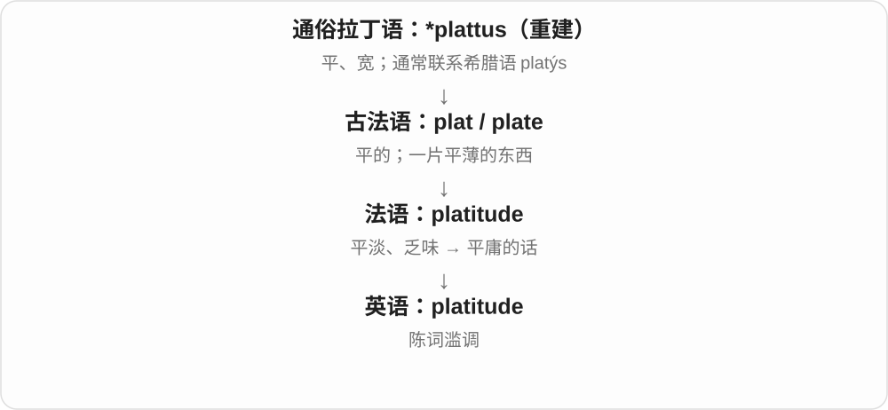

# 1144 · -itude — -tude／-itude：性质、状态、程度的名词词尾

[逐词精讲目录](../00_逐词精讲目录.md) · [总目录](../00_总目录_按常用程度.md)

## 核心词根与来源

-tude 和 -itude 是一组来自拉丁语性质、状态名词形式的英语词尾。本页把高度、宽度、力量、独处、感激和陈词滥调放在一起比较：共同点是把一种性质当作名词，具体含义仍要回到各自的词根和历史语境。它们不共享同一个实义词根，也不能都硬译成可测量的“度”。

**-TUDE／-ITUDE：把一种性质或状态，当作名词来谈**

高、宽、大可以形成度量名词；强、独自、感激可以形成状态名词；话语的平淡乏味则形成 platitude。

- **众多与受役状态**：multitude · servitude
- **aptitude 与 attitude：适合的性质、姿态与态度**：apt · aptitude · attitude
- **attitude → attitudes：身体姿态到心理态度**：attitude · attitudes
- **不适合、不胜任的性质**：apt · inept · ineptitude
- **高、宽、长与大小**：altitude · latitude · longitude · magnitude
- **坚毅、独处、感激与正直**：fortitude · solitude · gratitude · rectitude
- **平淡乏味的话语**：platitude

## 词形与演化规律

拉丁 -tudo、-itudo 等名词材料，经法语等进入英语 -itude 形式；不少是整体借入，不是现代英语任意加尾。

aptitude 接拉丁 aptitudo 适合；attitude 经意大利语、法语借入，同族材料在姿态、心理倾向方向分化；现代拼写不同，不能随意互换。

意大利、法语艺术姿态用语借入后扩展到心态，较早接适合词族。

ineptitude 经法语接拉丁 ineptitudo，属于 ineptus（不适合、不妥当）的词族；更早连接 in-（不）与 aptus（适合）。ept- 是这条历史词形中的形式，现代可借 inept + -itude 记忆。

-tude 与 -itude 不是两套需要按含义严格区分的现代英语后缀；它们反映拉丁语 -tudo、-itudo 及经法语等借入后的词形。不要任意给英语形容词加 -tude 造词。platitude 在法语中由 plat（平的、平淡的）构成，联系 plat- 词族；attitude 则经意大利语、法语发展到姿态和心理态度，不能按现代 apt 直接加后缀理解。

## 单词速览（按词族由简到繁）

同一基础词的相关扩展放在一起，先读基础形式，再读扩展；各组之间优先读常用的。具体词源关系见各词讲解。

| 单词 | 音标 | 核心意思 |
|---|---|---|
| [apt](#w-4) | /æpt/ | 恰当贴切的；聪敏、学得快的；容易、往往会的 |
| [attitude](#w-3) | 英 /ˈætɪtjuːd/；美 /ˈætɪtuːd/ | 态度、看法；姿态；不合作的架势〔部分口语〕 |
| [attitudes](#w-6) | 英 /ˈætɪtjuːdz/；美 /ˈætɪtuːdz/ | 态度、看法；姿态〔attitude 的复数〕 |
| [aptitude](#w-5) | 英 /ˈæptɪtjuːd/；美 /ˈæptɪtuːd/ | 天资、学习某事的潜能；适合某种活动的能力 |
| [magnitude](#w-9) | 英 /ˈmæɡnɪtjuːd/；美 /ˈmæɡnɪtuːd/ | 大小；规模；程度；震级；星等 |
| [altitude](#w-10) | 英 /ˈæltɪtjuːd/；美 /ˈæltɪtuːd/ | 海拔；高度 |
| [gratitude](#w-11) | 英 /ˈɡrætɪtjuːd/；美 /ˈɡrætɪtuːd/ | 感激；谢意 |
| [multitude](#w-1) | 英 /ˈmʌltɪtjuːd/；美 /ˈmʌltɪtuːd/ | 大量；众多；人群 |
| [latitude](#w-12) | 英 /ˈlætɪtjuːd/；美 /ˈlætɪtuːd/ | 纬度；自主决定的余地 |
| [solitude](#w-13) | 英 /ˈsɒlɪtjuːd/；美 /ˈsɑːlɪtuːd/ | 独处；清静；孤寂 |
| [longitude](#w-14) | 英 /ˈlɒŋɡɪtjuːd/ 或 /ˈlɒndʒɪtjuːd/；美 /ˈlɑːndʒɪtuːd/ | 经度 |
| [fortitude](#w-15) | 英 /ˈfɔːtɪtjuːd/；美 /ˈfɔːrtɪtuːd/ | 坚毅；面对困难的勇气与忍耐 |
| [inept](#w-7) | 英、美 /ɪˈnept/ | 不称职的；笨拙的；处理不当的 |
| [servitude](#w-2) | 英 /ˈsɜːvɪtjuːd/；美 /ˈsɜːrvɪtuːd/ | 奴役状态；受束缚的服役 |
| [ineptitude](#w-8) | 英 /ɪˈnep.tɪ.tʃuːd/；美 /ˌɪnˈep.tə.tuːd/；主重音落在 ept | 无能；不称职；笨拙的处理或表现 |
| [rectitude](#w-16) | 英 /ˈrektɪtjuːd/；美 /ˈrektɪtuːd/ | 正直；品行端正 |
| [platitude](#w-17) | 英 /ˈplætɪtjuːd/；美 /ˈplætɪtuːd/ | 陈词滥调；空泛套话 |

## 逐词讲解

### 1. apt — 恰当贴切的；聪敏、学得快的；容易、往往会的

**音标**：/æpt/

**先抓住这个画面**

一句比喻恰好贴住眼前情况，是 apt。be apt to 又说某事容易照这个方向发生，像总有这种倾向。

**怎么拆**

经法语 ate、apte 或直接借自拉丁 aptus 合适、适配的；更早接连接、贴合的旧动词材料。英语适合与倾向两支都较早存在。

**怎么变成今天的意思**

**拉丁 aptus → 法语／英语 apt**  
贴合、适合、具备所需性质

↓

**现代常用搭配**  
贴切的；学得快的；倾向于、容易

an apt description 贴切描述；an apt pupil 聪明好学的学生；be apt to forget 容易忘；an apt comparison 恰当比喻。

**常见搭配与例句**

an apt choice of words；apt to change。

> That is an apt description of the problem.

那是对这个问题的贴切描述。

> The weather here is apt to change suddenly.

这里的天气容易突然变化。

**别混淆**

apt to do 是容易、往往会，不一定是有能力。an apt description 说描述贴切，an able person 则说人有能力，不能只按一个中文词换。

### 2. attitude — 态度、看法；姿态；不合作的架势〔部分口语〕

**音标**：英 /ˈætɪtjuːd/；美 /ˈætɪtuːd/

**先抓住这个画面**

身体可以摆出一个姿势，心里也可以摆出一种面对事情的姿势：愿意试、满不在乎、处处防备，都是 attitude。

**怎么拆**

经法语 attitude 接意大利语 attitudine，较早联系拉丁 aptitudo 等适合、姿态材料。英语先作艺术中人物姿态的词，再扩展到显示心理状态的姿态、稳定的看法与态度。

**继续看词根／词基**：[apt（基础词讲解）](../03_词缀与组合形式/1492_itude_A1822.md#w-4)

**怎么变成今天的意思**

**拉丁相关性质词 → 意大利语 attitudine → 法语 attitude**  
适合、倾向；身体姿态

↓

**英语 attitude**  
艺术中的姿态 → 面对事物的心理态度

an attitude to／towards work 对工作的态度；a positive attitude 积极态度；change one’s attitude 改变态度；have an attitude 在某些口语中指摆出不合作、挑衅的架势。

**常见搭配与例句**

a relaxed attitude；an attitude of respect。

> Her attitude towards the project changed after the first meeting.

第一次会议后，她对项目的态度变了。

> He approached the problem with a positive attitude.

他以积极态度处理这个问题。

**别混淆**

attitude 说怎样看待、面对事情；aptitude 说某方面的潜能。a good attitude 不保证技术已经很好，但说明愿意怎样对待这件事。

### 3. attitudes — 态度、看法；姿态〔attitude 的复数〕

**音标**：英 /ˈætɪtjuːdz/；美 /ˈætɪtuːdz/

**先抓住这个画面**

身体以什么姿势面对事物，后来转到心里以什么姿态对待它，就是 attitudes。这个身体姿态到心理立场的变化有清楚历史。

**怎么拆**

attitude + -s，/d/ 后读 /z/。法语 attitude 接意大利语 attitudine，较早接拉丁 aptitūdō 适合等材料；英语先用作艺术人物姿态，后扩展为显示心态的姿态、稳定态度。

**继续看词根／词基**：[attitude（基础词讲解）](../03_词缀与组合形式/1492_itude_A1822.md#w-3) · [apt（基础词讲解）](../03_词缀与组合形式/1492_itude_A1822.md#w-4)

**怎么变成今天的意思**

**拉丁 aptitūdō → 意大利语 attitudine → 法语 → attitude**  
适合、姿态 → 艺术中的人物姿势

↓

**心理态度义扩展；attitude + -s → attitudes**  
多种身体或心理立场、对待方式

attitudes towards work 对工作的态度；positive attitudes 积极态度；changing attitudes 变化中的观念。

**常见搭配与例句**

attitudes reflected in behaviour；attitudes towards new ideas。

> The survey examined attitudes towards public transport.

调查考察了人们对公共交通的态度。

> Their attitudes changed after working together.

一起工作之后，他们的态度改变了。

**别混淆**

attitudes 往往不只是某一句意见，还会体现在一贯怎样对待事情。opinions 更容易说具体判断，两者在语境中可以相连。

### 4. aptitude — 天资、学习某事的潜能；适合某种活动的能力

**音标**：英 /ˈæptɪtjuːd/；美 /ˈæptɪtuːd/

**先抓住这个画面**

有人一摸乐器就容易找准节奏，有人很快看懂空间关系。aptitude 看的是做这类事容易上手、容易发展的潜能。

**怎么拆**

接法语或晚期拉丁 aptitudo 适合、胜任的性质，来自 aptus 合适的，与 apt 同族；-itude 接性质、状态名词材料。后来常说学习、掌握特定技能的能力。

**继续看词根／词基**：[apt（基础词讲解）](../03_词缀与组合形式/1492_itude_A1822.md#w-4)

**怎么变成今天的意思**

**拉丁 aptus → aptitudo**  
合适的 → 适合、胜任的性质

↓

**英语 aptitude**  
对某类学习、活动的潜能、天资

an aptitude for languages 语言天资；an aptitude test 能力倾向测验；show an aptitude for 显示某方面潜能。

**常见搭配与例句**

musical aptitude；an aptitude for solving problems。

> She showed an early aptitude for languages.

她很早就表现出语言天资。

> The course helps students discover their aptitudes.

课程帮助学生发现自己的能力倾向。

**别混淆**

aptitude 偏容易学会、适合发展的潜能；skill 偏已经练成的技能。attitude 则是看待事情的态度，两词相像但所问不同。

### 5. magnitude — 大小；规模；程度；震级；星等

**音标**：英 /ˈmæɡnɪtjuːd/；美 /ˈmæɡnɪtuːd/

**先抓住这个画面**

先问“有多大、多严重、多强”，暂时不问朝哪个方向。这可以说工作的规模，也可以成为科学里衡量大小的量。

**怎么拆**

来自拉丁 magnitudo，由 magnus“大”加表示性质、状态的 -tudo 构成。词虽然接“大”，现代 magnitude 也能是一个很小的大小数值。

**继续看词根／词基**：[magn-](../01_古典词根/2046_magn_C0698.md)

**怎么变成今天的意思**

**拉丁 magnus + -tudo → magnitudo**  
大、伟大 → 大小、规模

↓

**中古英语 magnitude**  
大小、程度；后发展出不同学科的量度名称

the magnitude of a problem 是问题的规模；向量的 magnitude 是长度，不带方向。地震中 magnitude 是震级，概括地震自身大小，不等于某地感受到的烈度。天文的 magnitude 是星等，数值越小表示越亮，不能按“大数一定更亮”理解。

**常见搭配与例句**

the magnitude of the task；a magnitude 5 earthquake；an order of magnitude。

> We did not understand the magnitude of the task until work began.

工作开始后，我们才明白这项任务规模有多大。

> The report gives the earthquake’s magnitude and maps the shaking in different towns.

报告给出了地震震级，并标示了不同城镇的震动情况。

> The vector has a magnitude of five, regardless of how it is drawn on the page.

这个向量的大小是五，不受它在纸上如何示意绘制的影响。

**别混淆**

size 很日常；magnitude 更适合抽象规模或专业量度。order of magnitude 是数量级，比较时通常一档对应十倍，不是“大约差一点”。

### 6. altitude — 海拔；高度

**音标**：英 /ˈæltɪtjuːd/；美 /ˈæltɪtuːd/

**先抓住这个画面**

把一个位置与规定的基准面相比较，看它在多高处。

**怎么拆**

借拉丁 altitudo“高度”，来自 altus“高”。-tude 是相关名词形式的一部分，不能把 altitude 拆成英语 all + attitude。

**继续看词根／词基**：[alt-](../01_古典词根/1662_alt_C0039.md)

**怎么变成今天的意思**

**拉丁语 altus**  
高的；也可从另一端描述深度

↓

**拉丁语 altitudo → 中古英语 altitude**  
高度

↓

**现代英语 altitude**  
海拔；飞机等所处的高度

山村的 altitude 通常以海平面为基准；飞机的 altitude 则要结合飞行中采用的高度基准理解。核心是“处在多高的位置”，并非物体本身从底到顶有多长。

**常见搭配与例句**

at an altitude of 2,000 metres；gain altitude；lose altitude；at high altitude。

> The village lies at an altitude of about 1,500 metres.

这个村庄位于海拔约 1,500 米的地方。

> The aircraft gained altitude as it left the valley.

飞机离开山谷时逐渐爬升。

**别混淆**

height 用法更广，可以是一个人的身高或建筑物自身的高度。altitude 常用于地理、航空；不要把 mountain altitude 与 mountain slope 的坡度混为一谈。

### 7. gratitude — 感激；谢意

**音标**：英 /ˈɡrætɪtjuːd/；美 /ˈɡrætɪtuːd/

**先抓住这个画面**

知道别人给了自己帮助或好意，心里记得这份好，而不把它当成理所当然。

**怎么拆**

法语 gratitude 接中世纪拉丁 gratitudo，来自 gratus“感激的”。是名词的独立借入，不是从现代 grateful 剪出来的。

**继续看词根／词基**：[grat-](../01_古典词根/0371_grat_C0503.md)

**怎么变成今天的意思**

**拉丁 gratus**  
令人喜欢、受欢迎；也指心怀感谢

↓

**中世纪拉丁 gratitudo → 法语 gratitude → 英语 gratitude**  
感激这种心情、态度

gratitude to a person for something：对谁、为了什么而感谢。express gratitude 把谢意说出来或做出来，feel gratitude 则说内心感受。

**常见搭配与例句**

deep gratitude；express gratitude；in gratitude for。

> She expressed her gratitude to everyone who had helped.

她向所有帮过忙的人表达了感激。

> He wrote the letter in gratitude for their support.

他写这封信是为了感谢他们的支持。

**别混淆**

gratitude 是名词，grateful 是形容词；gratuity 是钱款、小费，不能混用。

### 8. multitude — 大量；众多；人群

**音标**：英 /ˈmʌltɪtjuːd/；美 /ˈmʌltɪtuːd/

**先抓住这个画面**

眼前不是几件零散的东西，而是一大批。

**怎么拆**

经法语 multitude 或直接借拉丁 multitūdō：multus“多” + -tūdō 状态名词后缀。不是现代 multi- 加英语 attitude 的后半截。

**继续看词根／词基**：[multi-（构词成分）](../03_词缀与组合形式/1028_multi_C0771.md)

**怎么变成今天的意思**

**拉丁 multus + -tūdō → multitūdō**  
多 → 大量、众多

↓

**法语 multitude／拉丁直接借入 → 中古英语及英语 multitude**  
数量众多；大群人

a multitude of choices 是大量选择；the multitude 可说大众或人群，偏书面。a multitude of 后通常接复数可数名词。

**常见搭配与例句**

a multitude of；a great multitude；a multitude of reasons。

> The city offers a multitude of places to eat.

这座城市有许多用餐去处。

> A multitude gathered outside the hall.

一大群人聚集在大厅外。

**别混淆**

a lot of 更日常；a multitude of 更有数量繁多、铺开一大片的书面感觉。

### 9. latitude — 纬度；自主决定的余地

**音标**：英 /ˈlætɪtjuːd/；美 /ˈlætɪtuːd/

**先抓住这个画面**

地图上，它告诉你离赤道向北或向南有多远的角度；工作中，它表示你可以自行决定的空间。

**怎么拆**

经法语 latitude 或直接借拉丁 latitudo 宽度，来自 latus 宽。地理义与古代把地图南北方向看作宽度的习惯相关；抽象义则把宽广空间变成行动余地。

**继续看词根／词基**：[lat-](../01_古典词根/3224_lat_C0651.md)

**怎么变成今天的意思**

**拉丁 latus 宽的**  
这一支讲宽广，不是英语 late 晚，也不是表示携带的分词 latus

↓

**拉丁 latitudo 宽度 → 法语 latitude／英语 latitude**  
宽度，后来用于地理纬度和行动自由

赤道是零纬度，两极是九十度；高纬度通常意味着更靠近极地，不代表海拔高。give someone latitude 则是放宽限制，让对方自己拿主意。

**常见搭配与例句**

at a latitude of 40 degrees north；high latitudes；give someone considerable latitude。

> The city lies at a latitude of about forty degrees north.

这座城市大约位于北纬四十度。

> The manager gave us considerable latitude in choosing the design.

经理给了我们很大的设计选择余地。

**别混淆**

longitude 经度看东西位置；latitude 纬度看南北位置，但同纬度线大致东西延伸。altitude 是高度，latitudinal 是纬度相关的。

### 10. solitude — 独处；清静；孤寂

**音标**：英 /ˈsɒlɪtjuːd/；美 /ˈsɑːlɪtuːd/

**先抓住这个画面**

把人群和杂事放远一点，自己待一会儿的状态。

**怎么拆**

法语或直接拉丁 solitudo 借入，来自 solus；现代可与 solitary 联想，但不是从英语 solitary 改尾得到。

**继续看词根／词基**：[sol-](../01_古典词根/1184_sol_C1361.md)

**怎么变成今天的意思**

**拉丁语 solus**  
独自、唯一；更早来源未定

↓

**拉丁语 solitudo，词干 solitudin-**  
独处、孤独；荒僻之地

↓

**古法语 solitude / 拉丁语 → 英语 solitude**  
独处、清静

seek solitude 常指主动寻找清静；forced solitude 也可能令人难受。它比 loneliness 更容易带平静、自愿的意味，但不是永远褒义。

**常见搭配与例句**

peace and solitude；seek solitude；in solitude。

> He went to the garden to enjoy a little solitude.

他去花园享受片刻清静。

> Months of enforced solitude changed her daily routine.

数月被迫独处改变了她的日常生活。

**别混淆**

loneliness 是缺乏联系带来的孤独感；solitude 主要说独处的状态。

### 11. longitude — 经度

**音标**：英 /ˈlɒŋɡɪtjuːd/ 或 /ˈlɒndʒɪtjuːd/；美 /ˈlɑːndʒɪtuːd/

**先抓住这个画面**

在地球表面定位时，回答一个地方在本初子午线以东或以西多少度。

**怎么拆**

借拉丁 longitudo 长度，接 longus；历史上既指长度，也用于天文和地理中的东西向位置。

**继续看词根／词基**：[long-](../01_古典词根/2300_long_C0686.md)

**怎么变成今天的意思**

**拉丁 longus 长的、远的**  
这条拉丁线与英语本族词 long 的日耳曼线分开

↓

**拉丁 longitudo 长度，词干 longitudin-**  
由长的性质构成抽象名词

↓

**拉丁 longitudo → 英语 longitude**  
长度名称进入天文、地理定位用语

longitude 以角度表示东西位置，常与 latitude 纬度成对出现。经线本身大致连接南北极，但经度数值区分的是东西位置，别因此反过来记。

**常见搭配与例句**

latitude and longitude；degrees east longitude；determine longitude。

> The map displays both latitude and longitude.

这张地图同时显示纬度和经度。

> The island lies at approximately 20 degrees west longitude.

这座岛大约位于西经 20 度。

**别混淆**

latitude 给出南北位置，longitude 给出东西位置。两者都是角度坐标，不能把经度直接当成公里距离。

### 12. fortitude — 坚毅；面对困难的勇气与忍耐

**音标**：英 /ˈfɔːtɪtjuːd/；美 /ˈfɔːrtɪtuːd/

**先抓住这个画面**

压力压下来，心里仍能撑住，不轻易垮掉。

**怎么拆**

拉丁 fortitūdō“力量、勇气”由 fortis 加性质名词词尾形成，经法语进入英语；不是 fort + attitude 的混合。

**继续看词根／词基**：[fort-](../01_古典词根/0210_fort_C0446.md)

**怎么变成今天的意思**

**拉丁 fortis**  
强壮、坚固、勇敢；更早来源有不同分析

↓

**拉丁 fortitūdō → 古法语 fortitude → 中古英语／英语 fortitude**  
强大、勇敢 → 承受逆境的精神力量

现代多指承受痛苦、挫折或长期压力的精神韧劲，语气庄重。它不只表示冲上去的一刻勇敢，也包括漫长等待中仍然稳得住。

**常见搭配与例句**

show fortitude；with great fortitude；mental fortitude。

> She faced the long recovery with remarkable fortitude.

她以非凡的坚毅面对漫长的恢复过程。

> Finishing the project after so many setbacks required fortitude.

经历这么多挫折后仍完成项目，需要坚忍的意志。

**别混淆**

courage 可强调面对危险采取行动；fortitude 更突出在困境中坚持承受。

### 13. inept — 不称职的；笨拙的；处理不当的

**音标**：英、美 /ɪˈnept/

**先抓住这个画面**

任务需要某种本领，做事的人却总是安排失当、说错话或把事情弄糟。这种“能力与任务不相称”的状态，就是 inept。

**怎么拆**

英语经法语 inepte 或直接从拉丁 ineptus 借入；更早由 in-（不）与 aptus（适合）构成。apt- 在这条拉丁复合词中呈现 ept- 的形式，这是历史词形变化，不是现代英语把所有 apt 都改成 ept。不能按 in“在里面”来理解。

**继续看词根／词基**：[apt（基础词讲解）](../03_词缀与组合形式/1492_itude_A1822.md#w-4)

**怎么变成今天的意思**

**拉丁 aptus**  
适合的、合用的

↓

**否定前缀 in- + aptus → ineptus**  
不适合、不妥当；笨拙、不胜任

↓

**法语 inepte／拉丁 ineptus → 英语 inept**  
不合适 → 缺乏技巧、不能妥善处理

inept at organizing 强调不擅长组织；inept handling 强调处理方式很糟。它是明显的负面评价，比单纯 inexperienced“经验不足”更重；既可指工作能力，也可指社交中笨拙、不懂得体应对。

**常见搭配与例句**

inept at handling complaints 不善于处理投诉；politically inept 政治上缺乏手腕；an inept response 应对失当。

> The team was inept at organizing the evacuation.

这支队伍组织疏散的能力很差。

> An inept response made a small misunderstanding worse.

一次失当的回应让一个小误会变得更严重。

**别混淆**

inept 是形容词，ineptitude 是名词。inexperienced 只说经验少，不一定做得差；inept 强调表现笨拙或不称职。apt 与 inept 有历史联系，但不要把 aptitude“天资、能力倾向”当成 attitude“态度”。

### 14. servitude — 奴役状态；受束缚的服役

**音标**：英 /ˈsɜːvɪtjuːd/；美 /ˈsɜːrvɪtuːd/

**先抓住这个画面**

工作不只是辛苦，而是人失去自由，长期被迫为别人效力。

**怎么拆**

经法语 servitude 来自拉丁语 servitūdō，来自 servus“奴仆”。

**继续看词根／词基**：[serv-](../01_古典词根/0136_serv_C1325.md) · [serve](../02_英语词基/0980_serve_B4081.md) · [server](../02_英语词基/1059_server_B4082.md)

**怎么变成今天的意思**

通常用于历史、社会或法律讨论。不是给所有忙碌工作起的普通名称；修辞中也可比喻长期受某物支配。

**常见搭配与例句**

forced servitude；escape servitude；a life of servitude。

> The book describes people struggling to escape servitude.

这本书描写人们努力摆脱奴役的经历。

> The exhibition traces the history of forced servitude.

展览梳理了被迫服役与奴役的历史。

**别混淆**

service 可以是自愿、专业、有报酬的服务；servitude 突出自由被剥夺或严重受支配。

### 15. ineptitude — 无能；不称职；笨拙的处理或表现

**音标**：英 /ɪˈnep.tɪ.tʃuːd/；美 /ˌɪnˈep.tə.tuːd/；主重音落在 ept

**先抓住这个画面**

人坐在负责的位置上，却不会安排、不会协调，连本该办好的事也办不好。ineptitude 说的是这种做事无方、不能胜任的表现，不只是一次不走运。

**怎么拆**

可用 inept（不称职的）+ -itude（性质、状态名词材料）记忆。历史上英语借自法语 ineptitude，后者来自拉丁 ineptitudo，是 ineptus 的性质名词；更深一层是 in-（不）+ aptus（适合），在复合词中出现 ept-。这是完整借词的来路，不能说是英语临时把 aptitude 的 a 改成 e。

**继续看词根／词基**：[apt（基础词讲解）](../03_词缀与组合形式/1492_itude_A1822.md#w-4)

**怎么变成今天的意思**

**拉丁 aptus**  
适合的、合用的

↓

**否定前缀 in- + aptus → ineptus**  
不适合、不妥当；笨拙、不胜任

↓

**拉丁 ineptus → ineptitudo → 法语 ineptitude**  
把不适合、笨拙的性质作为名词来谈

↓

**英语 ineptitude**  
不称职、无能；做事笨拙或应对失当

常作不可数名词，强调缺乏能力或技巧造成的差劲表现。书中 politicians’ corruption and ineptitude 可理解为“政客的腐败与无能”：corruption 侧重以权谋私等不廉洁行为，ineptitude 侧重不会办事、治理无方。两者可以同时存在，但一个词不能替另一个；ineptitude 本身也不等于恶意或不诚实。

**常见搭配与例句**

administrative ineptitude 行政无能；political ineptitude 政治上的无能或手腕欠缺；sheer ineptitude 十足的无能；display ineptitude 表现得很不称职；ineptitude in handling a crisis 处理危机时的无能。

> Administrative ineptitude delayed the delivery of emergency supplies.

行政上的无能延误了应急物资的运送。

> The report criticized the committee’s ineptitude in handling complaints.

报告批评了委员会在处理投诉方面的无能。

> The failure reflected ineptitude rather than deliberate dishonesty.

这次失败反映的是能力不足，而不是蓄意的不诚实行为。

**别混淆**

incompetence 与 ineptitude 都可指不胜任，ineptitude 常突出笨拙、失当的表现；inefficiency 是效率低，不一定完全没有能力。aptitude 是某方面的天赋或能力倾向，attitude 是态度。不要把 ineptitude 误记成“坏态度”，也不要看到 -itude 就机械译成“程度”。

### 16. rectitude — 正直；品行端正

**音标**：英 /ˈrektɪtjuːd/；美 /ˈrektɪtuːd/

**先抓住这个画面**

做人像站得笔直：不为了眼前好处就弯到不诚实的一边。

**怎么拆**

后期拉丁语 rectitudo“笔直、正直”，来自 rectus，经法语和拉丁语借入。

**继续看词根／词基**：[rect-, reg-, -rig-](../01_古典词根/0122_rect_C1209.md)

**怎么变成今天的意思**

**拉丁语：regere**  
引导、使直；治理

↓

**拉丁语：rectus**  
拉直的、正的；regere 的分词形式

↓

**后期拉丁语 rectitudo → 法语 rectitude**  
笔直 → 正直

↓

**英语：rectitude**  
道德上的正直

这是较庄重的词，常见 moral rectitude。它强调道德操守，有时也被讽刺地用来形容一个人自认永远正确。

**常见搭配与例句**

moral rectitude；a reputation for rectitude。

> She gained a reputation for rectitude in public office.

她在公职任上以正直著称。

> His speeches were full of claims to moral rectitude.

他的讲话充满了对自身道德正直的宣称。

**别混淆**

correctness 可以只是答案正确；rectitude 主要评价人的操守。

### 17. platitude — 陈词滥调；空泛套话

**音标**：英 /ˈplætɪtjuːd/；美 /ˈplætɪtuːd/

**先抓住这个画面**

话听起来四平八稳，却没有给眼前的问题增加什么理解，就像一块没有起伏的平面。

**怎么拆**

借自法语 platitude“平淡、乏味”，来自 plat“平的”；不是把英语 plate 盘子直接加一个后缀。

**继续看词根／词基**：[plat-](../01_古典词根/0149_plat_C1060.md)

**怎么变成今天的意思**

常批评把人人早已知道的空话说得像重大启发。比如别人需要具体办法，你只说“努力就会成功”，在那个场景中就可能是 platitude。

**常见搭配与例句**

empty platitudes；offer platitudes；repeat a platitude。

> She wanted practical advice, not empty platitudes.

她想要实际建议，不是空泛套话。

> The speech was full of platitudes about working together.

演讲充满了关于携手合作的陈词滥调。

**别混淆**

a proverb 是谚语，未必空泛；platitude 强调眼下这句话陈旧、没提供帮助。

## 这一组要分清什么

multitude 常可指一大群、许多，servitude 指受役状态；不是所有 -itude 都能按同一种可测量尺度理解。

altitude 是高度，latitude 可说纬度及行动余地，longitude 是经度；magnitude 说大小或量级。solitude 可是主动享受的独处，不必然等于 loneliness 的孤独感；platitude 指平淡无新意的套话，不是平坦地面的度量。

## 串起来练习

The reading moves from a multitude of examples to a discussion of servitude.

阅读从大量例子延伸到对受役状态的讨论。
