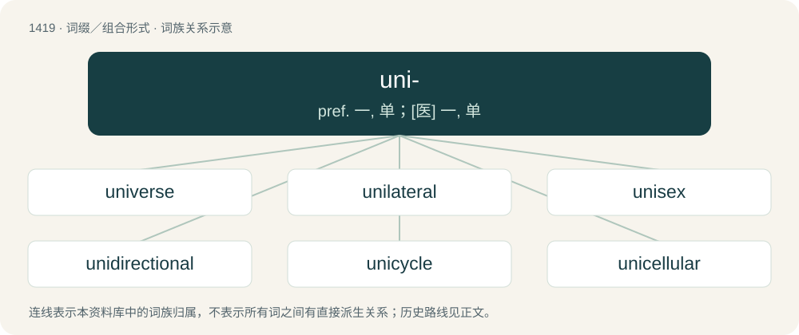

# 1502 · uni- — pref. 一, 单；\[医\] 一, 单

[总目录](../00_总目录_按常用程度.md)

**类型**：词缀／组合形式　｜　**来源语言**：见词源记录

## 核心含义与来源

- 核心含义：pref. 一, 单；\[医\] 一, 单
- 英文含义：one, single
- 词形：uni-

**来源记录 1**（前缀／前置成分；one, single）

From Latin uni-, combining form of unus (“one”).

## 词族图

## 单词速览（常用到不常用）

| 单词 | 音标 | 释义 |
|---|---|---|
| [universe](#w-1) | 英 /ˈjuːnɪˌvɜːs/；美 /ˈjunəˌvɝs/ | n. 宇宙, 星系, (思想等)范围 |
| [unilateral](#w-2) | /ˌjuːnɪˈlætərəl/ | a. 单方面的, 单边的, 片面的；\[医\] 单侧的, 一侧的 |
| [unisex](#w-3) | 英 /ˈjuːnɪsɛks/；美 /ˈjunəˌsɛks/ | a. 男女皆宜的 |
| [unidirectional](#w-4) | 英 /ˌjuː.nɪ.dɪˈɹɛk.ʃə.nəl；美 /ˌjuː.nɪ.dɪˈɹɛk.ʃə.nəl | a. 单向性的；\[计\] 单向的 |
| [unicycle](#w-5) | /ˈjun.ɪˌsaɪ.kəl/ | n. 单轮脚踏车 |
| [unicellular](#w-6) | /ˌjuːnɪˈsɛljʊlə(ɹ)/ | a. 单细胞的；\[医\] 单细胞的 |
| [univariate](#w-7) | /,juːniˈveəriət/ | a. \[统\]单变量的,单变的 |
| [unibody](#w-8) | /ˈjuːniˈbɔdi/ | 单片式汽车车身, 单片式车身的汽车 |
| [unipolar](#w-9) | /.juːniˈpəulə/ | a. 单极的；\[计\] 单极性的 |
| [unicameral](#w-10) | 英 /juːniːˈkaməɹəl/；美 /junɪˈkæməɹəl/ | a. 一院的, 单院的；\[医\] 单腔的 |
| [unibrow](#w-11) | /ʌnaɪbˈraʊ/ | n. a single continuous brow resulting from the growin; 左右眉毛长在一起 |

## 逐词详解

### 1. universe

**词性**：名词　｜　**音标**：英 /ˈjuːnɪˌvɜːs/；美 /ˈjunəˌvɝs/

**中文释义**：n. 宇宙, 星系, (思想等)范围

**英文义项**：The sum of everything that exists in the cosmos. / An entity similar to our universe; one component of a larger entity known as the multiverse.

**构词拆分**：uni- + -verse

**词源与演化**：

From Middle English universe, from Old French univers, from Latin universum (“all things, as a whole, the universe”), neuter of universus (“all together, whole, entire, collective, general, literally turned or combined into one”), from uni-, combining form of unus (“one”) + versus (“turned”), perfect passive participle of vertō (“to turn”). Analyzable as uni- + -verse through backformation of -verse.

**例句**：

> In all this universe of possibilities, there is only one feasible option.

该用例对应义项：Everything under consideration.

### 2. unilateral

**词性**：形容词　｜　**音标**：/ˌjuːnɪˈlætərəl/

**中文释义**：a. 单方面的, 单边的, 片面的；\[医\] 单侧的, 一侧的

**英文义项**：Done by one side only. / Affecting only one side of the body.

**构词拆分**：uni- + lateral

**词源与演化**：

A modern creation (circa 1802), from New Latin ūnilaterālis (“one-sided”), from Latin ūnus (“one”) + laterālis (“sided, lateral”), equivalent to uni- + lateral.

**例句**：

> Tom's boss made a unilateral decision to close several small branches of the company.

### 3. unisex

**词性**：形容词　｜　**音标**：英 /ˈjuːnɪsɛks/；美 /ˈjunəˌsɛks/

**中文释义**：a. 男女皆宜的

**英文义项**：Not distinguished on the basis of sex or gender; suitable for any sex or gender. / Of or pertaining to only one sex or gender; unisexual.

**构词拆分**：uni- (prefix meaning ‘one, single’) + sex

**词源与演化**：

From uni- (prefix meaning ‘one, single’) + sex.

**例句**：

> Kim is a unisex name.

该用例对应义项：Not distinguished on the basis of sex or gender; suitable for any sex or gender.

### 4. unidirectional

**词性**：形容词　｜　**音标**：英 /ˌjuː.nɪ.dɪˈɹɛk.ʃə.nəl；美 /ˌjuː.nɪ.dɪˈɹɛk.ʃə.nəl

**中文释义**：a. 单向性的；\[计\] 单向的

**英文义项**：Pertaining to only one direction, e.g.: where all component parts are aligned in the same direction in space. / Not subject to change or reversal of direction.

**构词拆分**：uni- + directional

**词源与演化**：

From uni- + directional.

**例句**：

> A unidirectional approach to a problem.

该用例对应义项：operating or moving or allowing movement in one direction only

### 5. unicycle

**词性**：形容词　｜　**音标**：/ˈjun.ɪˌsaɪ.kəl/

**中文释义**：n. 单轮脚踏车

**英文义项**：Synonym of unicyclic.

**构词拆分**：uni- + cycle

**词源与演化**：

From uni- + cycle.

**用法示例／搭配（非完整句）**：

> unicycle graph (unicyclic graph)

该用例对应义项：Synonym of unicyclic.

### 6. unicellular

**词性**：形容词　｜　**音标**：/ˌjuːnɪˈsɛljʊlə(ɹ)/

**中文释义**：a. 单细胞的；\[医\] 单细胞的

**英文义项**：Describing any microorganism that has a single cell.

**构词拆分**：uni- + cellular

**词源与演化**：

From uni- + cellular.

**例句**：

> The amoeba is a unicellular organism.

### 7. univariate

**词性**：形容词　｜　**音标**：/,juːniˈveəriət/

**中文释义**：a. \[统\]单变量的,单变的

**英文义项**：Having or involving a single variable

**构词拆分**：uni- + variate

**词源与演化**：

From uni- + variate.

### 8. unibody

**词性**：名词　｜　**音标**：/ˈjuːniˈbɔdi/

**中文释义**：单片式汽车车身, 单片式车身的汽车

**英文义项**：An automobile construction technique in which the body is integrated into a single unit with the chassis rather than having a separate body-on-frame. / A body of this type.

**构词拆分**：uni- + body

**词源与演化**：

From uni- + body.

### 9. unipolar

**词性**：形容词　｜　**音标**：/.juːniˈpəulə/

**中文释义**：a. 单极的；\[计\] 单极性的

**英文义项**：Having a single pole. / Not both depressive and manic; not bipolar.

**构词拆分**：uni- + polar

**词源与演化**：

From uni- + polar.

**例句**：

> The neocons were building the US unipolar world.

### 10. unicameral

**词性**：形容词　｜　**音标**：英 /juːniːˈkaməɹəl/；美 /junɪˈkæməɹəl/

**中文释义**：a. 一院的, 单院的；\[医\] 单腔的

**英文义项**：Of, or having, a single legislative chamber. / Of a script or typeface: making no distinction between upper and lower case, but rather having only one case.

**构词拆分**：uni- + cameral

**词源与演化**：

From uni- + cameral.

**例句**：

> The new constitution proposed replacing the old unicameral parliament with a bicameral one.

### 11. unibrow

**词性**：名词　｜　**音标**：/ʌnaɪbˈraʊ/

**中文释义**：n. a single continuous brow resulting from the growin; 左右眉毛长在一起

**英文义项**：A pair of eyebrows which meet in the middle.

**构词拆分**：uni- + brow

**词源与演化**：

From uni- + brow.

**例句**：

> He's self-conscious because of his unibrow.
