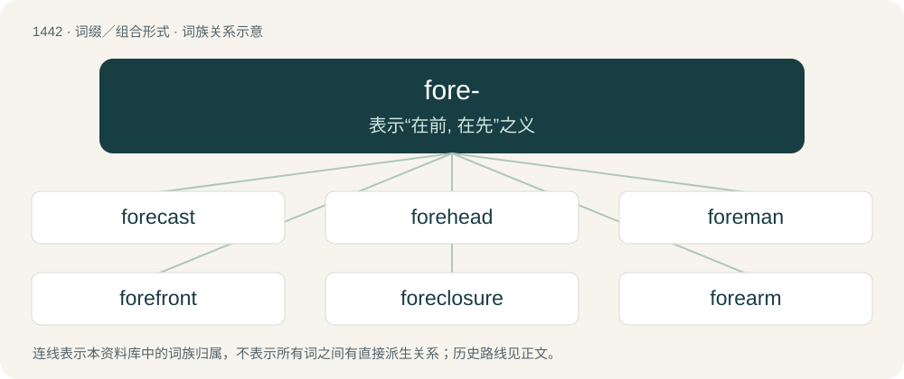

# 1525 · fore- — 表示“在前, 在先”之义

[总目录](../00_总目录_按常用程度.md)

**类型**：词缀／组合形式　｜　**来源语言**：见词源记录

## 核心含义与来源

- 核心含义：表示“在前, 在先”之义
- 英文含义：Before: the root is happening earlier in time.
- 词形：fore-

**来源记录 1**（前缀／前置成分；Before: the root is happening earlier in time.）

From Middle English fore-, from Old English fore-, from Proto-West Germanic \*forē-, from Proto-Germanic \*fura-, \*furai- (“before, in front of, for”), from Proto-Indo-European \*per- (“before, formerly; through, throughout”). Akin to Old Saxon and Old High German fora-, Gothic 𐍆𐌰𐌿𐍂𐌰- (faura-) (see 𐍆𐌰𐌿𐍂𐌰 (faura)), Dutch voor- (“fore-”).

## 词族图

## 单词速览（常用到不常用）

| 单词 | 音标 | 释义 |
|---|---|---|
| [forecast](#w-1) | 英 /ˈfɔːkɑːst/；美 /ˈfɔɹkæst/ | n. 预想, 预测, 预报；vt. 预想, 预测, 预报；\[计\] 趋势预测 |
| [forehead](#w-2) | 英 /ˈfɔːhɛd/；美 /ˈfɔɹ.hɛd/ | n. 额, 前额, 前部；\[医\] 额 |
| [foreman](#w-3) | /ˈfɔː(ɹ).mən/ | n. 领班, 工头, 陪审长；\[经\] 领班, 工头 |
| [forefront](#w-4) | 英 /ˈfɔːfɹʌnt/；美 /ˈfoɹfɹʌnt/ | n. 最前部, 最前线 |
| [foreclosure](#w-5) | /fɔːɹˈkləʊʒ.əɹ/ | n. 取消抵押品赎回权；\[经\] 取消抵押品赎回权的法律手续 |
| [forearm](#w-6) | /ˈfɔːˌɹɑːm/ | n. 前臂；vt. 预先武装, 准备 |
| [foreground](#w-7) | 英 /ˈfɔː(ɹ)ˌɡɹaʊnd/ | n. 前景, 最显著的位置；\[计\] 前景, 前台 |
| [foresee](#w-8) | 英 /fɔːˈsiː/；美 /fɔɹˈsi/ | vt. 预见, 预知 |
| [foreword](#w-9) | 英 /ˈfɔːwɜːd/；美 /ˈfɔɹwɝd/ | n. 前言, 序 |
| [foreplay](#w-10) | /ˈfɔː(ɹ)pleɪ/ | n. 性交前的爱抚, 前奏, 前戏 |
| [forerunner](#w-11) | 美 /ˈfɔɹˌɹʌnɚ/ | n. 先驱, 前兆 |
| [forego](#w-12) | 英 /fɔːˈɡəʊ/；美 /fɔɹˈɡoʊ/ | vt. 放弃, 在...之前, 居先 |
| [foreskin](#w-13) | 英 /ˈfɔːskɪn/；美 /ˈfɔɹskɪn/ | n. 包皮；\[医\] 包皮 |
| [forehand](#w-14) | 英 /fɔːhænd/；美 /fɔːɹhænd/ | n. 正打, 正击；a. 正打的 |
| [forestall](#w-15) | /fɔː(ɹ)ˈstɔːl/ | vt. 预先阻止, 先...一步行动, 占先一步, 垄断, 阻碍；\[法\] 先采取行动预防或阻止, 垄断 |
| [foreshore](#w-16) | /ˈfɒːʃɒː/ | n. 前滩, 海滩 |
| [foreclose](#w-17) | 英 /fɔːˈkləʊz/；美 /fɔɹˈkloʊz/ | vt. 阻止, 排除, 预先处理, 取消抵押品赎回权；vi. 取消抵押品赎回权 |
| [forecourt](#w-18) | /ˈfɒːkɒːt/ | n. 前院 |
| [forethought](#w-19) | /ˈfɔː(ɹ)θɔːt/ | n. 事先的考虑, 事先的筹划, 深虑, 先见；\[法\] 预谋 |
| [foreshadow](#w-20) | /fɔːˈʃædəʊ/ | vt. 成为前兆, 预示 |
| [forefinger](#w-21) | 英 /ˈfɔːˌfɪŋ.ɡə/；美 /ˈfɔɹˌfɪŋ.ɡɚ/ | n. 食指；\[医\] 食指, 示指 |
| [foretell](#w-22) | /fɔɹˈtɛl/ | vt. 预言, 预告, 预示 |
| [foreknowledge](#w-23) | /ˈfɒːnɒlidʒ/ | n. 预知, 先见之明 |
| [forecastle](#w-24) | 美 /ˈfoʊk.səl/ | n. 前甲板下面的水手舱, 船头船楼, 前甲板 |
| [forebrain](#w-25) | /ˈfɒːbrein/ | n. 前脑；\[医\] 前脑 |
| [forefoot](#w-26) | /ˈfɒːfut/ | n. 前脚；\[医\] 前肢(四肢动物), 足前段 |
| [foretaste](#w-27) | /fɒːˈteist/ | vt. 预尝, 先试；n. 先尝, 预示 |
| [foreland](#w-28) | /ˈfɒːlənd/ | n. 沿海地区, 海角, 海岸地 |
| [forewarning](#w-29) | /fɔːˈwɔːnɪŋ/ | a. 预先警告的；v. 预先警告, 事先告知( forewarn的现在分词 ) |
| [forefather](#w-30) | 英 /ˈfɔːˌfɑːðə/；美 /ˈfɔɹˌfɑːðɚ/ | n. 祖先 |

## 逐词详解

### 1. forecast

**词性**：动词　｜　**音标**：英 /ˈfɔːkɑːst/；美 /ˈfɔɹkæst/

**中文释义**：n. 预想, 预测, 预报；vt. 预想, 预测, 预报；\[计\] 趋势预测

**英文义项**：To estimate how something will be in the future. / To foreshadow; to suggest something in advance.

**构词拆分**：fore- + cast

**词源与演化**：

From Middle English forecasten, forcasten, equivalent to fore- + cast. The noun is from Middle English forecast, forcast.

**用法示例／搭配（非完整句）**：

> to forecast the weather, or a storm

该用例对应义项：To estimate how something will be in the future.

### 2. forehead

**词性**：名词　｜　**音标**：英 /ˈfɔːhɛd/；美 /ˈfɔɹ.hɛd/

**中文释义**：n. 额, 前额, 前部；\[医\] 额

**英文义项**：The part of the face above the eyebrows and below the hairline. / confidence; audacity; impudence.

**构词拆分**：fore- + head

**词源与演化**：

From Middle English forhed, forheed, from Old English forehēafod, from Proto-West Germanic \*forēhaubid, corresponding to fore- + head. Cognate with Scots foreheid (“forehead”), Dutch voorhoofd (“forehead”), German Vorhaupt (“forehead”), Danish forhoved (“brow; forehead; face”). Compare also West Frisian foarholle (“forehead”), German Low German Vörkopp (“forehead”).

**例句**：

> The man put the gun against his forehead and squeezed the trigger.

### 3. foreman

**词性**：名词　｜　**音标**：/ˈfɔː(ɹ).mən/

**中文释义**：n. 领班, 工头, 陪审长；\[经\] 领班, 工头

**英文义项**：The leader of a work crew. / The boss or manager of a particular workplace or section of a workplace, particularly a factory.

**构词拆分**：By surface analysis, fore- + man

**词源与演化**：

From Middle English foremon, forman. Compare West Frisian foarman, Dutch voorman, German Vormann, Danish formand, Swedish förman, Icelandic formaður. By surface analysis, fore- + man.

**用法示例／搭配（非完整句）**：

> factory foreman

该用例对应义项：The boss or manager of a particular workplace or section of a workplace, particularly a factory.

### 4. forefront

**词性**：名词　｜　**音标**：英 /ˈfɔːfɹʌnt/；美 /ˈfoɹfɹʌnt/

**中文释义**：n. 最前部, 最前线

**英文义项**：The leading position or edge.

**构词拆分**：fore- + front

**词源与演化**：

From Middle English forefrount, forfrount, forefronte, equivalent to fore- + front.

**例句**：

> That laboratory researches topics at the forefront of technology.

该用例对应义项：The leading position or edge.

### 5. foreclosure

**词性**：名词　｜　**音标**：/fɔːɹˈkləʊʒ.əɹ/

**中文释义**：n. 取消抵押品赎回权；\[经\] 取消抵押品赎回权的法律手续

**英文义项**：The proceeding, by a creditor, to regain property or other collateral following a default on mortgage payments. / The absence of a symbolic father for a fatherless child, as a cause for psychosis.

**构词拆分**：fore- + closure

**词源与演化**：

From foreclose by analogy with closure, equivalent to fore- + closure.

**例句**：

> Anyone may bid on properties sold at a foreclosure sale.

### 6. forearm

**词性**：名词　｜　**音标**：/ˈfɔːˌɹɑːm/

**中文释义**：n. 前臂；vt. 预先武装, 准备

**英文义项**：The part of the arm between the wrist and the elbow. / A section of the weapon between the receiver and the muzzle, used to hold the firearm steady.

**构词拆分**：fore- + arm

**词源与演化**：

From fore- + arm. Compare Dutch voorarm (“forearm”), Danish forarm (“forearm”), German Vorderarm (“forearm”).

**例句**：

> The elbow is a joint that connects the forearm and the upper arm.

### 7. foreground

**词性**：名词　｜　**音标**：英 /ˈfɔː(ɹ)ˌɡɹaʊnd/

**中文释义**：n. 前景, 最显著的位置；\[计\] 前景, 前台

**英文义项**：The elements of an image which lie closest to the picture plane. / The subject of an image, often depicted at the bottom in a two-dimensional work.

**构词拆分**：fore- + ground

**词源与演化**：

From fore- + ground. Compare Dutch voorgrond (“foreground”), German Vordergrund (“foreground”), Danish forgrund (“foreground”), Swedish förgrund (“foreground”), Norwegian forgrunn (“foreground”), Icelandic forgrunni (“foreground”).

**例句**：

> In terms of themes, that movie put gender and sexuality at the foreground.

### 8. foresee

**词性**：动词　｜　**音标**：英 /fɔːˈsiː/；美 /fɔɹˈsi/

**中文释义**：vt. 预见, 预知

**英文义项**：To perceive (a situation or event) in advance.

**构词拆分**：fore- + see

**词源与演化**：

From Middle English foreseen, forseen, from Old English foresēon; equivalent to fore- + see. Similar formations in Dutch voorzien, German vorsehen, Latin prōvideō, (whence provide and purvey), Ancient Greek πρόοιδα (próoida), Polish przewidzieć, Russian провидеть (providetʹ).

**例句**：

> It's not possible to foresee everything, so just live and enjoy life.

### 9. foreword

**词性**：名词　｜　**音标**：英 /ˈfɔːwɜːd/；美 /ˈfɔɹwɝd/

**中文释义**：n. 前言, 序

**英文义项**：An introductory section preceding the main text of a book or other document; especially, one written by another person (not the author of the work thus introduced).

**构词拆分**：fore- + word

**词源与演化**：

Morphologically fore- + word. Calque of German Vorwort, itself a calque of Latin praefatio (“preface”). Cognate with German Low German Vörwoord (“foreword”), Dutch voorwoord (“foreword”), West Frisian foarwurd (“foreword”), Danish forord (“preface; proviso”), Swedish förord (“foreword”). Compare also Old English forword, foreword (“proviso; condition”).

**例句**：

> A book without a foreword is like a body without a soul.

### 10. foreplay

**词性**：名词　｜　**音标**：/ˈfɔː(ɹ)pleɪ/

**中文释义**：n. 性交前的爱抚, 前奏, 前戏

**英文义项**：The acts at the beginning of a (usually human) sexual encounter that serve to build up sexual arousal.

**构词拆分**：From fore- + play.

**词源与演化**：

From fore- + play.

**例句**：

> Do you think that foreplay is an important part of sex?

### 11. forerunner

**词性**：名词　｜　**音标**：美 /ˈfɔɹˌɹʌnɚ/

**中文释义**：n. 先驱, 前兆

**英文义项**：A runner at the front or ahead. / By extension, a non-competitor who leads out the competitors on to the circuit, or who runs/rides the course prior to competitor trials, usually testing or checking the way.

**构词拆分**：fore- + runner；forerun + -er

**词源与演化**：

From Middle English forrenner, foreriner. Calque of Latin praecursor (“one who runs before, a forerunner”). Equivalent to fore- + runner and/or forerun + -er.

**例句**：

> Bakelite is a forerunner of today's plastics.

该用例对应义项：A forebear, an ancestor, a predecessor.

### 12. forego

**词性**：动词　｜　**音标**：英 /fɔːˈɡəʊ/；美 /fɔɹˈɡoʊ/

**中文释义**：vt. 放弃, 在...之前, 居先

**英文义项**：To precede, to go before.

**构词拆分**：fore- + go

**词源与演化**：

From Middle English forgan, from Old English foregān, equivalent to fore- + go.

**例句**：

> Many athletes forego a social life, so they can achieve their performance goals.

### 13. foreskin

**词性**：名词　｜　**音标**：英 /ˈfɔːskɪn/；美 /ˈfɔɹskɪn/

**中文释义**：n. 包皮；\[医\] 包皮

**英文义项**：The nerve-dense, retractable fold of skin which covers and protects the glans of the penis in humans and some other mammals.

**构词拆分**：fore- + skin

**词源与演化**：

From fore- + skin, a loose calque of Latin praepūtium. Compare German Vorhaut, etc. First attested in c. 1535.

**例句**：

> In the female genitalia, the clitoral hood is homologous to the foreskin.

该用例对应义项：The nerve-dense, retractable fold of skin which covers and protects the glans of the penis in humans and some other mammals.

### 14. forehand

**词性**：名词　｜　**音标**：英 /fɔːhænd/；美 /fɔːɹhænd/

**中文释义**：n. 正打, 正击；a. 正打的

**英文义项**：A stroke in which the palm of the hand faces the direction of the stroke. / A throw similar to a sidearm throw in baseball, where the disc remains on the throwing-arm side of the body and is led by the middle finger.

**构词拆分**：fore- + hand

**词源与演化**：

From fore- + hand.

**用法示例／搭配（非完整句）**：

> the devastating speed of her forehand return

该用例对应义项：A stroke in which the palm of the hand faces the direction of the stroke.

### 15. forestall

**词性**：动词　｜　**音标**：/fɔː(ɹ)ˈstɔːl/

**中文释义**：vt. 预先阻止, 先...一步行动, 占先一步, 垄断, 阻碍；\[法\] 先采取行动预防或阻止, 垄断

**英文义项**：To prevent, delay or hinder something by taking precautionary or anticipatory measures; to avert. / To preclude or bar from happening, render impossible.

**构词拆分**：fore- + stall

**词源与演化**：

From Middle English forestallen (“to forestall, intercept, ambush, way-lay”), from forestalle (“a forestalling, interception”), from Old English foresteall (“intervention, hindrance of justice, ambush”), from fore- (“ahead of, before”) + steall (“position”), equivalent to fore- + stall.

**例句**：

> Fred forestalled disaster by his prompt action.

该用例对应义项：To prevent, delay or hinder something by taking precautionary or anticipatory measures; to avert.

### 16. foreshore

**词性**：名词　｜　**音标**：/ˈfɒːʃɒː/

**中文释义**：n. 前滩, 海滩

**英文义项**：The part of a shore between high water and low water.

**构词拆分**：fore- + shore

**词源与演化**：

From fore- + shore.

### 17. foreclose

**词性**：动词　｜　**音标**：英 /fɔːˈkləʊz/；美 /fɔɹˈkloʊz/

**中文释义**：vt. 阻止, 排除, 预先处理, 取消抵押品赎回权；vi. 取消抵押品赎回权

**英文义项**：To repossess a mortgaged property whose owner has failed to make the necessary payments; used with on. / To cut off (a mortgager) by a judgment of court from the power of redeeming the mortgaged premises.

**构词拆分**：fore- + close

**词源与演化**：

Partially from Middle English foreclosen, forclosen, from Old French forclos, past participle of forclore (“to exclude”), from for- (“(prefix used to express error, exclusion, or inadequacy)”) + clore (“to shut”), and partially from Middle English forclusen (“to close up”), from Old English forclȳsan (“to close up”), equivalent to fore- + close.

**例句**：

> Just when the bank was about to foreclose on her home, she came into a lot of money.

### 18. forecourt

**词性**：名词　｜　**音标**：/ˈfɒːkɒːt/

**中文释义**：n. 前院

**英文义项**：The area in front of a petrol station where the petrol pumps are situated; pumping area. / Any open area in front of a building.

**构词拆分**：fore- + court

**词源与演化**：

From fore- + court.

**例句**：

> The forecourt looked grimy, like it hadn't been cleaned in days.

### 19. forethought

**词性**：名词　｜　**音标**：/ˈfɔː(ɹ)θɔːt/

**中文释义**：n. 事先的考虑, 事先的筹划, 深虑, 先见；\[法\] 预谋

**英文义项**：Thinking beforehand or in advance, planning; prior or previous consideration. / Anticipation.

**构词拆分**：fore- + thought

**词源与演化**：

From Middle English forethouht, forethoght, from Old English \*foreþōht (“forethought”); equivalent to fore- + thought. See also forethink.

**例句**：

> With a little forethought we'd have planned for this contingency and not been stuck here now.

该用例对应义项：Thinking beforehand or in advance, planning; prior or previous consideration.

### 20. foreshadow

**词性**：动词　｜　**音标**：/fɔːˈʃædəʊ/

**中文释义**：vt. 成为前兆, 预示

**英文义项**：To suggest (someone or something) in advance; to prefigure, to presage. / Of a person: to have an intuition or premonition about (something); to forebode.

**构词拆分**：fore- (prefix meaning ‘before with respect to time, earlier’) + shadow (“to shade, cloud, or darken”, verb)；fore- + shadow (“faint and imperfect representation”, noun)

**词源与演化**：

The verb is derived from fore- (prefix meaning ‘before with respect to time, earlier’) + shadow (“to shade, cloud, or darken”, verb). The noun is derived from fore- + shadow (“faint and imperfect representation”, noun), probably modelled after the verb which is attested earlier.

### 21. forefinger

**词性**：名词　｜　**音标**：英 /ˈfɔːˌfɪŋ.ɡə/；美 /ˈfɔɹˌfɪŋ.ɡɚ/

**中文释义**：n. 食指；\[医\] 食指, 示指

**英文义项**：The index finger: the first finger next to the thumb.

**构词拆分**：fore- + finger

**词源与演化**：

Mid-15th century, from Middle English forefynger; equivalent to fore- + finger.

**例句**：

> He picked up a butterfly between his thumb and forefinger.

### 22. foretell

**词性**：动词　｜　**音标**：/fɔɹˈtɛl/

**中文释义**：vt. 预言, 预告, 预示

**英文义项**：To predict; to tell (the future) before it occurs; to prophesy. / To tell (a person) of the future.

**构词拆分**：fore- + tell

**词源与演化**：

First use appears before 1400, from Middle English foretellen, equivalent to fore- + tell.

**例句**：

> I count the sparkle of constellations to foretell the future of my love.

### 23. foreknowledge

**词性**：名词　｜　**音标**：/ˈfɒːnɒlidʒ/

**中文释义**：n. 预知, 先见之明

**英文义项**：Knowing beforehand via natural or ordinary means. / Knowing beforehand via supernatural or paranormal means.

**构词拆分**：From fore- + knowledge.

**词源与演化**：

From fore- + knowledge.

**例句**：

> The prosecution intends to prove that the defendant had foreknowledge.

该用例对应义项：Knowing beforehand via natural or ordinary means.

### 24. forecastle

**词性**：名词　｜　**音标**：美 /ˈfoʊk.səl/

**中文释义**：n. 前甲板下面的水手舱, 船头船楼, 前甲板

**英文义项**：A raised part of the upper deck at the front of a ship; the structure of this part of the ship; the crew's quarters located within it.

**构词拆分**：fore- + castle

**词源与演化**：

From Middle English forecastel, forcastel, (whence also Anglo-French forechasteil), equivalent to fore- + castle. Compare Dutch voorkasteel.

### 25. forebrain

**词性**：名词　｜　**音标**：/ˈfɒːbrein/

**中文释义**：n. 前脑；\[医\] 前脑

**英文义项**：The anterior part of the brain, including the cerebrum, thalamus, and hypothalamus.

**构词拆分**：fore- + brain

**词源与演化**：

From fore- + brain.

### 26. forefoot

**词性**：名词　｜　**音标**：/ˈfɒːfut/

**中文释义**：n. 前脚；\[医\] 前肢(四肢动物), 足前段

**英文义项**：Either of the front feet of a quadruped. / The front part of a person's foot.

**构词拆分**：fore- + foot

**词源与演化**：

From Middle English forefot, forfote, equivalent to fore- + foot.

### 27. foretaste

**词性**：名词　｜　**音标**：/fɒːˈteist/

**中文释义**：vt. 预尝, 先试；n. 先尝, 预示

**英文义项**：A taste beforehand. / A sample taken in anticipation; an experience undergone in advance.

**构词拆分**：fore- + taste (noun)

**词源与演化**：

From Middle English fortaste, equivalent to fore- + taste (noun).

**例句**：

> Every parting gives a foretaste of death, every reunion a hint of the resurrection.

### 28. foreland

**词性**：名词　｜　**音标**：/ˈfɒːlənd/

**中文释义**：n. 沿海地区, 海角, 海岸地

**英文义项**：A headland. / In plate tectonics, the zone adjacent to a mountain chain where material eroded from it is deposited.

**构词拆分**：fore- + land

**词源与演化**：

From Middle English foreland, equivalent to fore- + land.

### 29. forewarning

**词性**：名词　｜　**音标**：/fɔːˈwɔːnɪŋ/

**中文释义**：a. 预先警告的；v. 预先警告, 事先告知( forewarn的现在分词 )

**英文义项**：An advance warning; an omen.

**构词拆分**：forewarn + -ing；fore- + warning

**词源与演化**：

From Middle English forwarning, equivalent to forewarn + -ing or fore- + warning. Cognate with German Vorwarnung (“forewarning”), Swedish förvarning (“forewarning”).

### 30. forefather

**词性**：名词　｜　**音标**：英 /ˈfɔːˌfɑːðə/；美 /ˈfɔɹˌfɑːðɚ/

**中文释义**：n. 祖先

**英文义项**：An ancestor. / A cultural ancestor; one who originated an idea or tradition.

**构词拆分**：fore- + father

**词源与演化**：

From Middle English forefader, forfader, vorvader, from Old English forefæder (“forefather”), but possibly also merged with Old Norse forfaðir. Equivalent to fore- + father. Compare Dutch voorvader (“forefather”), German Vorvater, Vorfahr (“forefather”), Danish forfader (“forefather”), Swedish förfader (“forefather”).

**例句**：

> Abraham was the common forefather of the Jews and Arabs.
