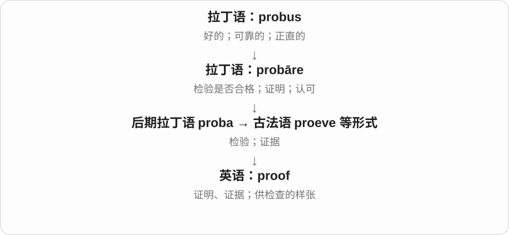
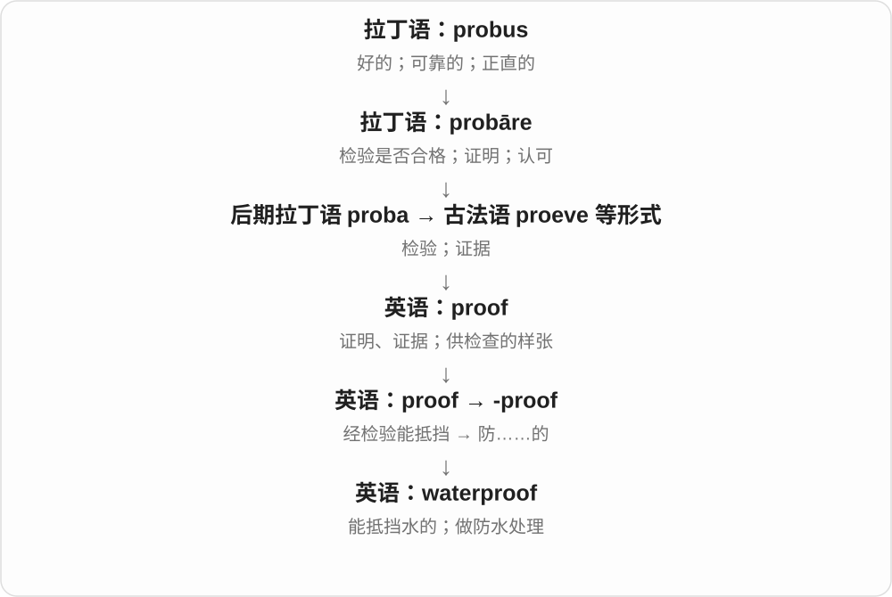
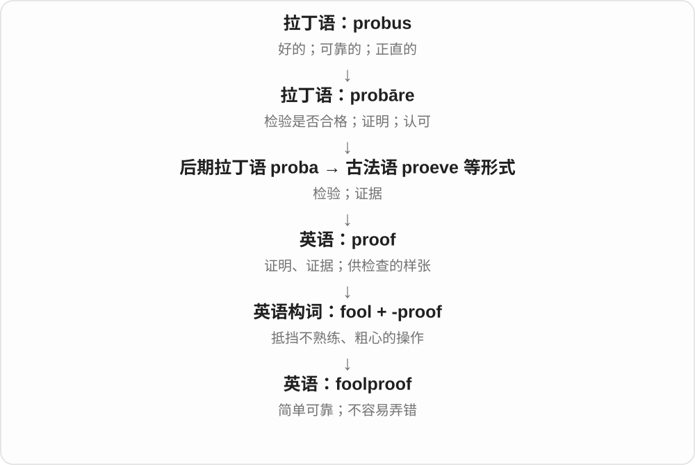
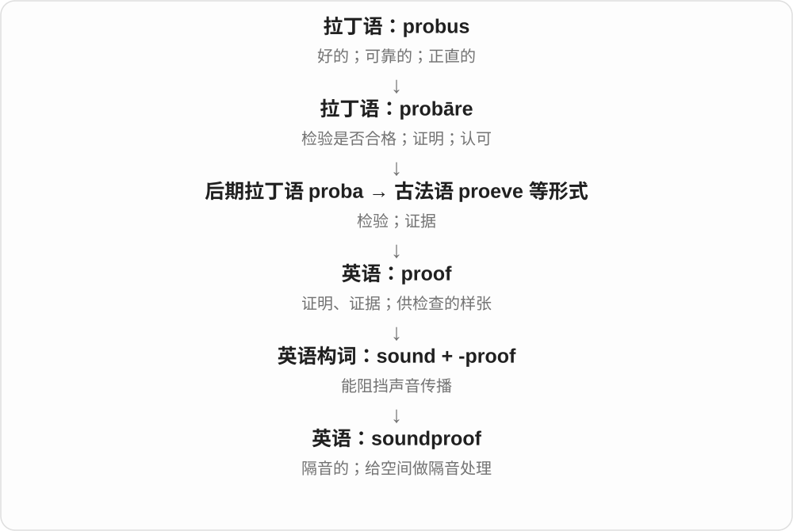

# 1533 · -proof — 抵挡某种影响，或不容易被某种做法弄坏

[逐词精讲目录](../00_逐词精讲目录.md) · [总目录](../00_总目录_按常用程度.md)

## 核心词根与来源

前半告诉你要挡住水、火、声音还是天气，后半 proof 说具有相应抵抗能力。用在实际产品时，单靠词形并不能读出全部条件和程度。

**PROOF：让某种东西难以穿过、影响或破坏**

waterproof、fireproof、soundproof 先看防什么；foolproof 再借去说不容易操作出错。

- **防外界物质、作用**：waterproof · fireproof · weatherproof · soundproof · bulletproof
- **不容易操作出错**：foolproof
- **-proof 的容器用品：防洒、防漏**：proof · spillproof · leakproof

## 词形与演化规律

proof 的检验、经受考验材料走向抗某物的复合词尾；water、fire、sound、weather 等限定对象。

后置 proof 表能抵抗前项，不是证明液体；具体性能需看对象、使用条件。

## 单词速览（按词族由简到繁）

同一基础词的相关扩展放在一起，先读基础形式，再读扩展；各组之间优先读常用的。具体词源关系见各词讲解。

| 单词 | 音标 | 核心意思 |
|---|---|---|
| [proof](#w-7) | 英 /pruːf/；美 /pruːf/ | 证明；证据；校样；酒精度数标示 |
| [waterproof](#w-1) | 英 /ˈwɔːtəpruːf/；美 /ˈwɔːtərpruːf/ | 防水的；做防水处理 |
| [bulletproof](#w-2) | 英 /ˈbʊlɪtpruːf/；美 /ˈbʊlɪtpruːf/ | 防弹的；坚不可摧的；难以反驳的 |
| [foolproof](#w-3) | 英 /ˈfuːlpruːf/；美 /ˈfuːlpruːf/ | 容易操作、不易出错的；周全可靠的 |
| [fireproof](#w-4) | 英 /ˈfaɪəpruːf/；美 /ˈfaɪərpruːf/ | 防火的；耐火的；做防火处理 |
| [soundproof](#w-5) | 英 /ˈsaʊndpruːf/；美 /ˈsaʊndpruːf/ | 隔音的；做隔音处理 |
| [weatherproof](#w-6) | 英 /ˈweðəpruːf/；美 /ˈweðərpruːf/ | 耐风雨的；使能抵御风雨 |
| [leakproof](#w-8) | /ˈliːkpruːf/ | 防漏的、不渗漏的 |
| [spillproof](#w-9) | /ˈspɪlpruːf/ | 防洒的、不易把内容物洒出的 |

## 逐词讲解

### 1. proof — 证明；证据；校样；酒精度数标示

**音标**：英 /pruːf/；美 /pruːf/

**先抓住这个画面**

能让一个说法站住脚的东西；也可以是先拿出来检查是否合格的一份样品。

**怎么拆**

名词经古法语 proeve 等形式来自后期拉丁语 proba；与 prove 同源，但有自己的名词借入链。词末历史上的 v 清化成 f，形成今天的 proof。

**怎么变成今天的意思**

proof of purchase 是购买凭证；数学中 a proof 是一套证明；printing proofs 是印刷校样。酒类标签的 proof 源于检验酒液强度，数值规则要看所用制度。

**常见搭配与例句**

proof of identity；provide proof；a mathematical proof；check the proofs。

> Keep the receipt as proof of purchase.

留好收据，作为购买凭证。

> The editor found a spelling error in the final proofs.

编辑在最后一版校样里发现了一个拼写错误。

**别混淆**

evidence 是支持或反对判断的材料；proof 更强调材料足以把结论确立。普通证据义常不可数，数学证明或校样可数。

### 2. waterproof — 防水的；做防水处理

**音标**：英 /ˈwɔːtəpruːf/；美 /ˈwɔːtərpruːf/

**先抓住这个画面**

水来到表面，材料能挡住它，不让里面轻易湿掉。

**怎么拆**

water 水 + -proof“能经受、能抵挡”；-proof 从经检验而能抵御的意思发展出来，不是“证明水”。

**怎么变成今天的意思**

常见 waterproof jacket、waterproof bag；作动词可说 waterproof a surface。产品的实际防水能力取决于使用条件与说明。

**常见搭配与例句**

a waterproof jacket；waterproof material；waterproof the seams。

> She packed her phone in a waterproof pouch.

她把手机装进一个防水袋里。

> The workers waterproofed the roof before the rainy season.

工人在雨季前给屋顶做了防水处理。

**别混淆**

waterproof 通常比 water resistant 表达更强的防水能力，但单看一个词并不能知道具体耐水条件。

### 3. bulletproof — 防弹的；坚不可摧的；难以反驳的

**音标**：英 /ˈbʊlɪtpruːf/；美 /ˈbʊlɪtpruːf/

**先抓住这个画面**

字面上是能挡住子弹；比喻时是攻击、批评打过来，论点或系统仍站得住。

**怎么拆**

bullet 子弹 + -proof 能抵挡；这是英语复合词。

**怎么变成今天的意思**

防护材料在具体条件下发挥作用；比喻 bulletproof argument 则赞扬论证难以推翻，常带夸张。

**常见搭配与例句**

bulletproof glass；a bulletproof argument；a bulletproof system。

> The guard sat behind bulletproof glass.

警卫坐在防弹玻璃后面。

> She wanted stronger evidence before calling the argument bulletproof.

她希望有更强的证据，再把这个论证称为无懈可击。

**别混淆**

bulletproof 比喻“很牢靠”，不是已经严格证明没有任何漏洞。

### 4. foolproof — 容易操作、不易出错的；周全可靠的

**音标**：英 /ˈfuːlpruːf/；美 /ˈfuːlpruːf/

**先抓住这个画面**

把容易弄错的地方提前堵上，让不熟悉的人也能顺利操作。

**怎么拆**

fool 笨人、不熟练的人 + -proof 能抵挡；原构词带有“不易被错误操作搞坏”的夸张。

**怎么变成今天的意思**

常修饰 method、system、plan。日常经常带夸张语气，不保证世界上绝无失败情形。

**常见搭配与例句**

a foolproof method；a foolproof plan。

> The guide offers a nearly foolproof way to fold the map.

指南提供了一种几乎不会出错的折地图方法。

> No backup plan is completely foolproof.

没有任何备用方案能保证万无一失。

**别混淆**

foolproof 指方法不易出错，不是说使用者真的愚蠢；ordinary mistake 与 fool 是不同层面的评价。

### 5. fireproof — 防火的；耐火的；做防火处理

**音标**：英 /ˈfaɪəpruːf/；美 /ˈfaɪərpruːf/

**先抓住这个画面**

让材料或结构在火面前更能坚持，保护里面的东西或延缓损坏。

**怎么拆**

fire 火 + -proof 能抵御。

**怎么变成今天的意思**

常见 fireproof safe、fireproof door；具体耐火能力有条件和时间范围，词本身不是“无论烧多久都没事”的保证。

**常见搭配与例句**

a fireproof safe；fireproof materials；fireproof a structure。

> Important documents were stored in a fireproof safe.

重要文件存放在防火保险柜里。

> The renovation included fireproofing the steel supports.

翻修工程包括给钢支撑做防火处理。

**别混淆**

fireproof 指防火耐火；firefighter 是消防员，后半段是 fighter，与 proof 无关。

### 6. soundproof — 隔音的；做隔音处理

**音标**：英 /ˈsaʊndpruːf/；美 /ˈsaʊndpruːf/

**先抓住这个画面**

给声音的进出加一道阻挡，让外面的噪声不容易进来，里面的声音不容易传出去。

**怎么拆**

sound 声音 + -proof 能抵挡。

**怎么变成今天的意思**

可形容 room、wall，也可作动词 soundproof a studio。实际降低多少声音要看结构和频率，日常说法不必意味着绝对无声。

**常见搭配与例句**

a soundproof room；soundproof the walls。

> The interview took place in a soundproof booth.

采访在一间隔音小室里进行。

> They soundproofed the studio to reduce street noise.

他们给录音室做了隔音处理，以减轻街道噪声。

**别混淆**

soundproof 强调阻挡声音穿过；sound absorbing 强调吸收声音、减少反射，功能有联系但不相同。

### 7. weatherproof — 耐风雨的；使能抵御风雨

**音标**：英 /ˈweðəpruːf/；美 /ˈweðərpruːf/

**先抓住这个画面**

放在室外也有办法挡雨、耐晒，经受天气影响。-proof 强调抵御某种影响。

**怎么拆**

weather + -proof，形成形容词，也能转作使耐风雨的动词。具体保护程度仍看产品和环境，词义不保证任何极端条件都无损。

**怎么变成今天的意思**

**古英语 weder → 中古英语 weder → weather**  
天空、大气、风暴等天气状况

↓

**名词 weather 派生动词用法**  
受风雨影响而风化；经受风暴 → 挺过困难

↓

**weather + -proof → weatherproof**  
能抵御天气影响；使耐风雨

a weatherproof cover 防风雨罩，weatherproof paint 耐候涂料，weatherproof a shed 给棚屋做耐风雨处理。

**常见搭配与例句**

a weatherproof cover；weatherproof paint；weatherproof the shed。

> Put a weatherproof cover over the outdoor furniture.

给户外家具盖上防风雨罩。

> They weatherproofed the shed before winter.

他们入冬前给棚屋做了耐风雨处理。

**别混淆**

weatherproof 防天气影响，waterproof 防水，侧重点不同；weatherproof 里的 proof 不表示证明天气存在。

### 8. leakproof — 防漏的、不渗漏的

**音标**：/ˈliːkpruːf/

**先抓住这个画面**

液体没有从盖边、接缝等地方钻出去，是 leakproof 的画面。leak 是漏，proof 说明抵抗这种问题。

**怎么拆**

英语 leak + proof 组合，取后置 proof 抵抗、经得住的构词义。leak 本身接日耳曼流漏词族，直接传入的细节有不同分析。

**怎么变成今天的意思**

**日耳曼流漏材料 → leak；proof 的抵抗义**  
漏；能够经受某种影响

↓

**leak + proof → leakproof**  
防止渗漏的

a leakproof bottle 防漏瓶；a leakproof seal 防漏密封。

**常见搭配与例句**

leakproof containers 防漏容器；a leakproof lid 防漏盖。

> She packed the soup in a leakproof container.

她把汤装进防漏容器。

> The bottle needs a leakproof seal.

这个瓶子需要防漏密封。

**别混淆**

漏强调不该通过的缝、孔有东西通过。与 spillproof 的防洒侧重点不同，实际产品也可能同时宣传两种特点。

### 9. spillproof — 防洒的、不易把内容物洒出的

**音标**：/ˈspɪlpruːf/

**先抓住这个画面**

杯子被晃一下，里面的液体也不容易洒到外面，是 spillproof 的使用画面。spill 提供意外洒出，proof 表抵抗。

**怎么拆**

英语 spill + 后置 proof 的组合。proof 的抵抗义来自经历检验、能经受的用法；这里已形成能抵抗前项的构词方式。

**怎么变成今天的意思**

**proof 的检验、经受材料 → 后置抵抗义**  
能经受、抵抗某种影响

↓

**spill + proof → spillproof**  
抵抗意外洒出 → 防洒的

a spillproof cup 防洒杯；a spillproof lid 防洒盖。

**常见搭配与例句**

spillproof design 防洒设计；spillproof containers 防洒容器。

> The child used a spillproof cup.

孩子用了一只防洒杯。

> She chose a bottle with a spillproof lid.

她选了一个带防洒盖的瓶子。

**别混淆**

spillproof 关注晃动、倾斜时内容物洒出；leakproof 更关注从缝隙渗漏。日常名称表达设计用途，实际效果仍随具体物件而定。

## 这一组要分清什么

proof 在这些复合词里不是证明文件；foolproof 说设计易用、不容易出错，也常带夸张，不是逻辑上排除所有错误。

## 串起来练习

The weatherproof box has a foolproof lid that is easy to close.

这个耐候箱子的盖子设计简单，容易关好。
