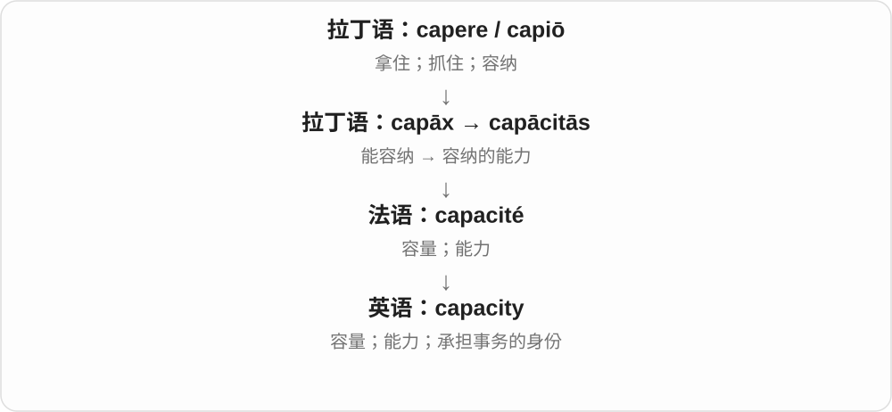
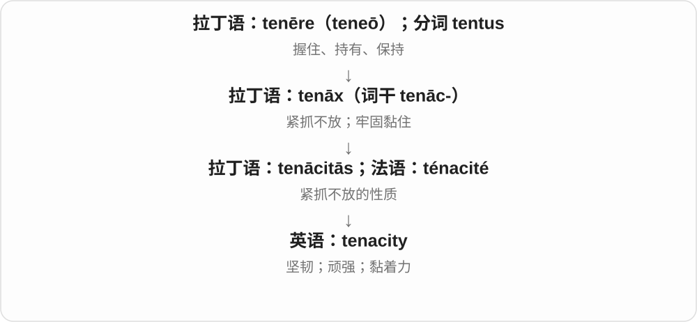

# 1554 · -acity — ……这种性质或程度〔多见于拉丁词族的抽象名词〕

[逐词精讲目录](../00_逐词精讲目录.md) · [总目录](../00_总目录_按常用程度.md)

## 核心词根与来源

常见词接拉丁 -acitas 一类抽象名词材料，经法语 -acité 等路线进入英语；与 -ax、-acis 或英语 -acious 的词族对应有关。不能一见这几字母就用同一个英语小词硬拆。

**ACITY：把某种特点收成一个可以讨论的性质**

tenacious 是抓住不放的，tenacity 就是那股韧劲；veracious 是说真的，veracity 就是是否真实、诚实这种性质。

- **真实、能力和判断**：veracious · veracity；capacity；sagacity
- **坚持、胆量和活力**：tenacity；audacity；vivacity

## 词形与演化规律

veracious ↔ veracity；tenacious ↔ tenacity 是学习上的对应。capacity、audacity 等各有自己的借词史，不能假设都先有一个现代英语基础词再统一换尾巴。

## 单词速览（按词族由简到繁）

同一基础词的相关扩展放在一起，先读基础形式，再读扩展；各组之间优先读常用的。具体词源关系见各词讲解。

| 单词 | 音标 | 核心意思 |
|---|---|---|
| [capacity](#w-1) | /kəˈpæsəti/ | 容量；处理能力；身份 |
| [audacity](#w-2) | /ɔːˈdæsəti/ | 大胆；胆量；放肆 |
| [tenacity](#w-3) | /təˈnæsəti/ | 坚韧；顽强；不轻易放弃 |
| [veracious](#w-7) | /vəˈreɪʃəs/ | 诚实的；如实的 |
| [veracity](#w-4) | /vəˈræsəti/ | 真实性；诚实、说真话的品性〔较正式〕 |
| [vivacity](#w-5) | /vɪˈvæsəti/ | 活泼；生气；谈吐举止中的活力 |
| [sagacity](#w-6) | /səˈɡæsəti/ | 洞察力；明智而敏锐的判断力 |

## 逐词讲解

### 1. capacity — 容量；处理能力；身份

**音标**：/kəˈpæsəti/

**先抓住这个画面**

先想一个容器最多装多少，再想一个人或系统最多能承担多少。capacity 常在说这种“能装、能处理的量”。

**怎么拆**

来自拉丁语 capāx“能容纳的”及名词 capācitās，经法语进入英语。cap- 仍与 capere 有关。

**怎么变成今天的意思**

杯子的容积、工厂的产能、人的学习能力，都能从“装得下或应付得了多少”理解。in my capacity as manager 则指“以经理这个身份”，是另一个固定用法。

**常见搭配与例句**

at full capacity（满负荷）；a capacity for…；in one’s capacity as…。

> The theater has a capacity of five hundred people.

这家剧院可容纳五百人。

> I am writing in my capacity as team leader.

我以团队负责人的身份写这封信。

**别混淆**

capacity 与 capability 都谈能力，但 capacity 更常涉及数量、潜力或承受上限。capacity 不能一律译成容积。

### 2. audacity — 大胆；胆量；放肆

**音标**：/ɔːˈdæsəti/

**先抓住这个画面**

敢走别人不敢走的一步，可以是令人佩服，也可以是令人恼火的胆大妄为。

**怎么拆**

接中世纪拉丁 audacitas，来自 audax，词干 audac-，敢于冒险的，往前接 audere 敢。不是 audio 声音的派生。

**怎么变成今天的意思**

**拉丁 audere 敢 → audax，词干 audac-**  
敢于越过一般人不敢跨的界线

↓

**拉丁／中世纪拉丁 audacitas → 英语 audacity**  
大胆这一性质；后来也常说放肆的胆量

the audacity of the plan 可以赞计划大胆；He had the audacity to blame me 往往是说他居然还有脸怪我。好坏要从后面的行动和说话人的态度判断。

**常见搭配与例句**

have the audacity to do something；sheer audacity；the audacity of a proposal。

> I admired the audacity of her proposal.

我佩服她提案中的大胆。

> He had the audacity to ask me to pay for his mistake.

他竟然还有脸要求我为他的错误买单。

**别混淆**

courage 多强调面对困难仍勇敢，audacity 更强调越过常规或礼貌边界的大胆。cheek 常说无礼大胆，语气更口语。

### 3. tenacity — 坚韧；顽强；不轻易放弃

**音标**：/təˈnæsəti/

**先抓住这个画面**

tenacity 像手已经很累，仍牢牢抓住目标不松开，着重说坚持到底的劲头。

**怎么拆**

经法语 ténacité 来自拉丁语 tenācitās，后者与 tenāx“紧抓不放”同族。

**怎么变成今天的意思**

可以赞一个人克服困难的韧劲，也可说材料黏住、保持结合的能力。不是只要执拗就一定值得称赞。

**常见搭配与例句**

show tenacity；remarkable tenacity；the tenacity to keep trying。

> Her tenacity helped the team finish the difficult project.

她的坚韧帮助团队完成了这个困难的项目。

> He pursued the missing records with remarkable tenacity.

他以非凡的韧劲持续寻找那些遗失的记录。

**别混淆**

stubbornness 常批评不肯改变；tenacity 常赞面对困难仍坚持，但具体褒贬仍要看坚持的事情。

### 4. veracious — 诚实的；如实的

**音标**：/vəˈreɪʃəs/

**先抓住这个画面**

veracious 形容人，就像说“这个人讲事实，不添油加醋”；形容描述，则是“这份讲述忠于实际情况”。

**怎么拆**

来自拉丁语 vērāx“说真话的”，其词干含 vērāc-，再形成英语形容词。ver- 与真实相关，-acious 这一整段不能理解成现代动词。

**怎么变成今天的意思**

这是比 truthful 更书面的词。a veracious account 重点在叙述可靠、没有编造，而不在它是否生动好看。

**常见搭配与例句**

a veracious account（如实的叙述）；a veracious witness（说真话的证人）；a veracious reporter（报道属实的记者）。

> The diary offers a veracious account of life in the village.

这本日记如实记录了村里的生活。

> She was known as a careful and veracious reporter.

她以报道谨慎、属实而闻名。

**别混淆**

veracious 是诚实的；voracious 是贪吃的，也可形容求知欲强。a voracious reader 是读书很多的人，不能因此推断他说话是否 veracious。

### 5. veracity — 真实性；诚实、说真话的品性〔较正式〕

**音标**：/vəˈræsəti/

**先抓住这个画面**

一份讲述听起来很有道理，还要追问：它究竟和事实对不对得上？这个真实程度就是 veracity。

**怎么拆**

经法语 véracité，接中世纪拉丁 veracitas，来自 verax 说真话的，与 verus 真实的相连。现代可与 veracious 对照学习，但不是把这个历史名词说成刚由英语临时造出的词。

**怎么变成今天的意思**

**拉丁 verus → verax → veracitas；法语 véracité**  
真实 → 说真的 → 真实、诚实这种性质

↓

**英语 veracity**  
陈述的真实性；人物诚实说真的品性

the veracity of a claim 一项说法的真实性；question the veracity of an account 质疑叙述是否属实。通常不是日常夸朋友可靠时的首选口语词。

**常见搭配与例句**

check the veracity；doubt someone’s veracity。

> The reporter checked the veracity of the claim.

记者核实了这一说法的真实性。

> Several details made us question the veracity of his account.

几个细节让我们怀疑他的叙述是否属实。

**别混淆**

credibility 可信度偏向是否值得相信，veracity 偏向是否真实；sincerity 真诚说的是态度，真诚的人也可能记错事实。

### 6. vivacity — 活泼；生气；谈吐举止中的活力

**音标**：/vɪˈvæsəti/

**先抓住这个画面**

不只身体有力气，而是神情、反应和谈话都带着鲜活劲儿；把这种特点当作名词，就是 vivacity。

**怎么拆**

拉丁 vīvācitās，来自 vīvāx；经法语或直接借入，英语名词出现较早，不从后来的 vivacious 倒推。

**怎么变成今天的意思**

**拉丁 vīvus、vīvere；相关 vīta**  
活着的、生活；生命

↓

**拉丁 vīvāx → vīvācitās；古法语 vivacite**  
生命力强的 → 活力、敏捷

↓

**英语 vivacity**  
性格、谈吐或表现中的活泼生气

常用于人物描写，也可说表演、音乐的活泼感。通常是不可数性质名词，不是计数几单位体力。

**常见搭配与例句**

the vivacity of her conversation；perform with vivacity。

> Her conversation lost none of its usual vivacity.

她的谈吐仍像往常一样活泼有趣。

> The musicians played with wit and vivacity.

乐手们的演奏机趣盎然、充满生气。

**别混淆**

vitality 更广泛说生命力和活力；vivacity 常突出外在表现出的灵动、活泼。

### 7. sagacity — 洞察力；明智而敏锐的判断力

**音标**：/səˈɡæsəti/

**先抓住这个画面**

这个词把“看穿情势并判断得当”当作一种能力来谈。一个人可以靠它避开表面诱人、实则麻烦的选择。

**怎么拆**

经法语 sagacité 借入，来自拉丁 sagacitas、sagacitatem“敏锐感知”，再接 sagax、sagac-。英语名词的记录早于 sagacious，不能把真实历史画成英语 sagacious 先造出 sagacity。

**怎么变成今天的意思**

**拉丁 sagax／sagac-**  
感知敏锐的

↓

**拉丁 sagacitas／sagacitatem**  
敏锐感知、洞察的能力

↓

**法语 sagacité → 英语 sagacity**  
洞察力与明智判断力

今天主要用于人的判断，常在传记、历史和评论中出现。political sagacity 不是背了多少政治知识，而是能看清局势、权衡人心与后果。早期也可涉及嗅觉敏锐，但现代阅读不必机械译成嗅觉。

**常见搭配与例句**

political sagacity；show sagacity；the sagacity to recognize a problem。通常不可数。

> Her sagacity helped the team avoid an expensive mistake.

她敏锐而明智的判断帮助团队避开了一次代价高昂的错误。

> The historian admired his political sagacity.

这位历史学家赞赏他的政治洞察力。

**别混淆**

sagacious 是形容词，sagacity 是相应名词，词中重音后的读音由 /ɡeɪʃ/ 变成 /ɡæs/。这种对应能帮助学习，却不表示英语名词一定由形容词后来派生。

## 这一组要分清什么

veracity 真实与 credibility 可信并非完全相同；audacity 可说大胆也可批评放肆，不能把后缀当成褒贬开关。

## 串起来练习

Her tenacity helped her test the veracity of the story.

她靠着坚持不懈，查证了那个故事是否属实。
