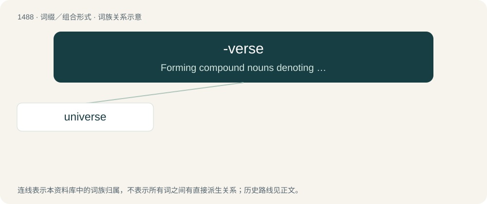

# 1579 · -verse — Forming compound nouns denoting the whole range or totality of what is indicated by the first element.

[总目录](../00_总目录_按常用程度.md)

**类型**：词缀／组合形式　｜　**来源语言**：见词源记录

## 核心含义与来源

- 核心含义：Forming compound nouns denoting the whole range or totality of what is indicated by the first element.
- 英文含义：Forming compound nouns denoting the whole range or totality of what is indicated by the first element.
- 词形：-verse

## 词族图

## 单词速览（常用到不常用）

| 单词 | 音标 | 释义 |
|---|---|---|
| [universe](#w-1) | 英 /ˈjuːnɪˌvɜːs/；美 /ˈjunəˌvɝs/ | n. 宇宙, 星系, (思想等)范围 |

## 逐词详解

### 1. universe

**词性**：名词　｜　**音标**：英 /ˈjuːnɪˌvɜːs/；美 /ˈjunəˌvɝs/

**中文释义**：n. 宇宙, 星系, (思想等)范围

**英文义项**：The sum of everything that exists in the cosmos. / An entity similar to our universe; one component of a larger entity known as the multiverse.

**构词拆分**：uni- + -verse

**词源与演化**：

From Middle English universe, from Old French univers, from Latin universum (“all things, as a whole, the universe”), neuter of universus (“all together, whole, entire, collective, general, literally turned or combined into one”), from uni-, combining form of unus (“one”) + versus (“turned”), perfect passive participle of vertō (“to turn”). Analyzable as uni- + -verse through backformation of -verse.

**例句**：

> In all this universe of possibilities, there is only one feasible option.

该用例对应义项：Everything under consideration.
