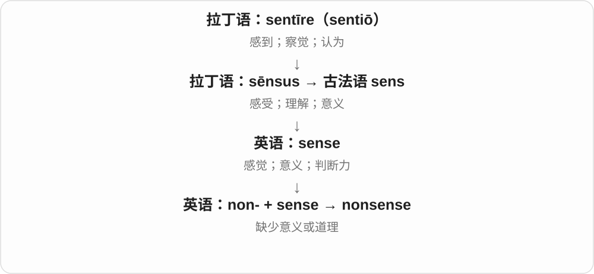

# 1657 · non- — 不、没有；非某类

[逐词精讲目录](../00_逐词精讲目录.md) · [总目录](../00_总目录_按常用程度.md)

## 核心词根与来源

non- 严格说是前缀，主要经法语进入英语，来自拉丁 nōn“不”。英语大量用它与已有词组合；另一些词如 nonchalant 则是把法语整词借进来，不能当作英语现拼。

**NON = NOT / WITHOUT**

给一个分类框画一条边界：在“必需”之外是 nonessential，在“虚构作品”之外是 nonfiction。它常只是说“不属于这一类”，不自动给事物贴上好坏标签。

- **不存在或不具某性质**：nonexistent, nonessential, nonlinear, noninvasive
- **不用某种表达、行动方式**：nonverbal, nonviolent, nonviolence
- **作品、组织和连续性分类**：nonfiction, nonprofit, nonstop
- **不合规范或常理**：nonconformist, nonconformity, nonsense
- **需要记住整条历史的旧词**：nonchalant, nonchalance, nonplus, nonplussed

## 词形与演化规律

non- 通常不改变后面的词形。nonfiction、nonstop 等已有合写形式，本页按要求不列带连字符的词头。none“一个也没有”来自古英语 nān，虽与拉丁 nōn 有可比较的否定构造，也不能写成从拉丁 non- 直接演变。

## 单词速览（按词族由简到繁）

同一基础词的相关扩展放在一起，先读基础形式，再读扩展；各组之间优先读常用的。具体词源关系见各词讲解。

| 单词 | 音标 | 核心意思 |
|---|---|---|
| [nonsense](#w-1) | 英 /ˈnɒnsəns/；美 /ˈnɑːnsens/ | 胡说；无意义的话；荒唐事 |
| [nonprofit](#w-2) | /ˌnɒnˈprɒfɪt/ | 非营利的；非营利组织 |
| [nonstop](#w-3) | 英 /ˌnɒnˈstɒp/；美 /ˌnɑːnˈstɑːp/ | 不停的；中途不停站的；连续不断地 |
| [nonlinear](#w-4) | 英 /ˌnɒnˈlɪniə/；美 /ˌnɑːnˈlɪniər/ | 非线性的；非顺序的 |
| [nonfiction](#w-5) | 英 /ˌnɒnˈfɪkʃən/；美 /ˌnɑːnˈfɪkʃən/ | 非虚构作品；纪实类写作 |
| [nonexistent](#w-6) | 英 /ˌnɒnɪɡˈzɪstənt/；美 /ˌnɑːnɪɡˈzɪstənt/ | 不存在的；几乎没有的 |
| [nonviolent](#w-7) | 英 /ˌnɒnˈvaɪələnt/；美 /ˌnɑːnˈvaɪələnt/ | 非暴力的；不使用暴力的 |
| [nonviolence](#w-9) | 英 /ˌnɒnˈvaɪələns/；美 /ˌnɑːnˈvaɪələns/ | 非暴力；不使用暴力的原则或实践 |
| [nonchalant](#w-8) | 英 /ˈnɒnʃələnt/；美 /ˌnɑːnʃəˈlɑːnt/ | 若无其事的；漫不经心的；从容随意的 |
| [nonchalance](#w-14) | 英 /ˈnɒnʃələns/；美 /ˌnɑːnʃəˈlɑːns/ | 若无其事；漫不经心；从容随意的态度 |
| [nonverbal](#w-10) | 英 /ˌnɒnˈvɜːbəl/；美 /ˌnɑːnˈvɜːrbəl/ | 非言语的；不通过说话表达的 |
| [noninvasive](#w-11) | 英 /ˌnɒnɪnˈveɪsɪv/；美 /ˌnɑːnɪnˈveɪsɪv/ | 非侵入性的；非侵袭性的 |
| [nonconformist](#w-12) | 英 /ˌnɒnkənˈfɔːmɪst/；美 /ˌnɑːnkənˈfɔːrmɪst/ | 不随俗的人；不墨守成规的 |
| [nonessential](#w-13) | 英 /ˌnɒnɪˈsenʃəl/；美 /ˌnɑːnɪˈsenʃəl/ | 非必需的；可省去的 |
| [nonconformity](#w-15) | 英 /ˌnɒnkənˈfɔːmɪti/；美 /ˌnɑːnkənˈfɔːrmɪti/ | 不遵从；不合惯例；不符合要求 |
| [nonplus](#w-17) | 英 /ˌnɒnˈplʌs/；美 /ˌnɑːnˈplʌs/ | 使困惑得不知所措；无计可施的境地〔名词较旧〕 |
| [nonplussed](#w-16) | 英 /ˌnɒnˈplʌst/；美 /ˌnɑːnˈplʌst/ | 困惑得不知所措的；不为所动的〔主要美式新义〕 |

## 逐词讲解

### 1. nonsense — 胡说；无意义的话；荒唐事

**音标**：英 /ˈnɒnsəns/；美 /ˈnɑːnsens/

**先抓住这个画面**

话说了一大堆，却拼不成能成立的意思或理由，听者会把它判断为 nonsense。

**怎么拆**

non-（无、不）+ sense（意义、道理）。

**怎么变成今天的意思**

可以批评荒唐说法，也可指故意玩语言的无意义文学。并不是所有含糊、暂时听不懂的话就一定没有意义。

**常见搭配与例句**

talk nonsense；complete nonsense；nonsense verse；no more nonsense。

> That excuse is complete nonsense.

那个借口完全是胡说。

> The children enjoyed the playful nonsense poem.

孩子们很喜欢那首充满语言游戏的无意义诗。

**别混淆**

nonsense 通常不可数；不说 a nonsense 来泛指一句胡话。a piece of nonsense 更合适。

### 2. nonprofit — 非营利的；非营利组织

**音标**：/ˌnɒnˈprɒfɪt/

**先抓住这个画面**

组织可以收钱、付工资、留下结余，但主要目的和分配规则不以给所有者赚利润为中心，这就是 nonprofit 的基本方向。

**怎么拆**

non-（非）+ profit，英语构词；作名词时指这种组织。

**怎么变成今天的意思**

否定的是营利取向，不是宣称账面永远没有结余。理解具体组织时，还要看其所在地的组织制度。

**常见搭配与例句**

a nonprofit organization；work for a nonprofit。

> She works for a nonprofit that supports local libraries.

她在一家支持本地图书馆的非营利组织工作。

> The nonprofit uses its surplus to expand the programme.

这家非营利组织用结余扩大项目。

**别混淆**

nonprofit 不等于免费，也不等于完全靠志愿者；charity 通常进一步强调慈善目的。

### 3. nonstop — 不停的；中途不停站的；连续不断地

**音标**：英 /ˌnɒnˈstɒp/；美 /ˌnɑːnˈstɑːp/

**先抓住这个画面**

从开始到结束，中间不按暂停键。

**怎么拆**

non-“不” + stop“停止”。

**怎么变成今天的意思**

**拉丁 nōn → 古法语／盎格鲁法语 non- → 英语 non-**  
不、没有；否定后面的性质

↓

**英语 non- + stop → nonstop**  
停止 → 不停、不中断

a nonstop flight 中途不停落；work nonstop 是连续工作。说话中的 nonstop questions 常带夸张，表示问题接连不断，不要求真的每一秒都有声音。

**常见搭配与例句**

a nonstop flight；nonstop service；talk nonstop。

> We booked a nonstop flight to Singapore.

我们订了直飞新加坡、中途不停站的航班。

> The children talked nonstop on the way home.

孩子们在回家的路上说个不停。

**别混淆**

direct flight 强调直达航班安排，可能中停；nonstop 明确突出中途不停站。

### 4. nonlinear — 非线性的；非顺序的

**音标**：英 /ˌnɒnˈlɪniə/；美 /ˌnɑːnˈlɪniər/

**先抓住这个画面**

输入多一点，输出不一定只按相同份量增加；故事也可能前后跳转。

**怎么拆**

non-“非” + linear，英语否定合成。

**怎么变成今天的意思**

**拉丁 līnum → līneus → līnea**  
亚麻 → 亚麻制的 → 麻线、绳、线条

↓

**拉丁 līneāris → 英语 linear**  
线的、线状的 → 直线的、线性的

↓

**英语 non- + linear → nonlinear**  
不符合相应线性关系或顺序的

x² 是简单的非线性函数。nonlinear narrative 会打乱时间顺序；非线性不等于没有规则或完全不可预测。

**常见搭配与例句**

a nonlinear relationship；nonlinear dynamics；a nonlinear narrative。

> The square function is nonlinear.

平方函数是非线性的。

> The film uses a nonlinear narrative, moving between several decades.

电影采用非顺序叙事，在几个年代间切换。

**别混淆**

random 说随机；nonlinear 说不满足线性条件，仍可能非常规律。

### 5. nonfiction — 非虚构作品；纪实类写作

**音标**：英 /ˌnɒnˈfɪkʃən/；美 /ˌnɑːnˈfɪkʃən/

**先抓住这个画面**

作品以真实人物、事件或知识为对象，写作承诺是讲事实。

**怎么拆**

non-“非” + fiction“虚构作品”。

**怎么变成今天的意思**

**拉丁 nōn → 古法语／盎格鲁法语 non- → 英语 non-**  
不、没有；否定后面的性质

↓

**英语 non- + fiction → nonfiction**  
虚构 → 以事实为对象的作品类别

传记、历史、科学普及等都可以是 nonfiction。这个分类说明作品的写作目标，不保证其中每个判断都没有错误；非虚构也完全可以有生动的故事和场景。

**常见搭配与例句**

read nonfiction；a nonfiction book；narrative nonfiction。

> She reads more nonfiction than novels.

她读的非虚构作品比小说多。

> The library has a separate shelf for children’s nonfiction.

图书馆设有专门摆放儿童非虚构读物的书架。

**别混淆**

fiction 可以借真实背景编故事；nonfiction 以事实为主要依据，不等于“没有故事性”。

### 6. nonexistent — 不存在的；几乎没有的

**音标**：英 /ˌnɒnɪɡˈzɪstənt/；美 /ˌnɑːnɪɡˈzɪstənt/

**先抓住这个画面**

找不到那个东西，不是它太少被忽略，而是根本没有。

**怎么拆**

non-“不” + existent“存在的”；existent 接拉丁 exsistere“出现、存在”。

**怎么变成今天的意思**

**拉丁 nōn → 古法语／盎格鲁法语 non- → 英语 non-**  
不、没有；否定后面的性质

↓

**英语 non- + existent → nonexistent**  
存在的 → 不存在的

a nonexistent address 是不存在的地址；customer service was nonexistent 常是夸张说服务几乎等于没有。它否定的是存在，不等于说东西有缺点。

**常见搭配与例句**

a nonexistent problem；virtually nonexistent；almost nonexistent。

> The email was sent to a nonexistent address.

邮件被发到了一个不存在的地址。

> Public transport is almost nonexistent in the village.

村里几乎没有公共交通。

**别混淆**

invisible 是存在但看不见；nonexistent 是不存在。不能把这两个“看不到”混成一回事。

### 7. nonviolent — 非暴力的；不使用暴力的

**音标**：英 /ˌnɒnˈvaɪələnt/；美 /ˌnɑːnˈvaɪələnt/

**先抓住这个画面**

可以坚持反对、积极争取，但不通过伤害或暴力来做。

**怎么拆**

non-“不、非” + violent“暴力的”。

**怎么变成今天的意思**

**拉丁 nōn → 古法语／盎格鲁法语 non- → 英语 non-**  
不、没有；否定后面的性质

↓

**英语 non- + violent → nonviolent**  
暴力的 → 不使用暴力的

a nonviolent protest 可以很坚定、很有组织。这个词否定暴力方式，没有否定行动本身，也不等于所有人意见一致或场面毫无紧张。

**常见搭配与例句**

nonviolent protest；nonviolent resistance；a nonviolent approach。

> The organisers called for a nonviolent protest.

组织者呼吁进行非暴力抗议。

> They sought a nonviolent way to resolve the dispute.

他们寻求用非暴力方式解决争端。

**别混淆**

passive 是被动的；nonviolent 是不用暴力的，积极行动也可以 nonviolent。

### 8. nonviolence — 非暴力；不使用暴力的原则或实践

**音标**：英 /ˌnɒnˈvaɪələns/；美 /ˌnɑːnˈvaɪələns/

**先抓住这个画面**

把不用暴力当作一种做事原则，而不只描述某一次场面很安静。

**怎么拆**

non-“非” + violence“暴力”。

**怎么变成今天的意思**

**拉丁 nōn → 古法语／盎格鲁法语 non- → 英语 non-**  
不、没有；否定后面的性质

↓

**英语 non- + violence → nonviolence**  
暴力 → 不使用暴力的立场、做法

commitment to nonviolence 是坚持非暴力原则。它可以包含抗议、谈判、抵制等积极行动；有没有效果是另一个问题，不能从词本身就推出。

**常见搭配与例句**

a commitment to nonviolence；the principle of nonviolence。

> The movement made a public commitment to nonviolence.

这场运动公开承诺坚持非暴力。

> The lesson explored the difference between nonviolence and inaction.

这堂课探讨了非暴力与不采取行动的区别。

**别混淆**

nonviolent 是形容词，描述行动或人；nonviolence 是名词，谈原则、方法或状态。

### 9. nonchalant — 若无其事的；漫不经心的；从容随意的

**音标**：英 /ˈnɒnʃələnt/；美 /ˌnɑːnʃəˈlɑːnt/

**先抓住这个画面**

别人可能紧张，你却轻轻耸一下肩，像没什么大不了。

**怎么拆**

整体借自法语 nonchalant；non-“不” + chaloir“关心、在意”，后者远接拉丁 calēre“热”。

**怎么变成今天的意思**

**拉丁 nōn“不是” + calēre“热”相关的法语支线**  
热的意象 → 关心、在意

↓

**古法语 non- + chaloir → nonchaloir／nonchalant**  
不关切 → 不慌不忙、漫不经心

↓

**法语 nonchalant → 英语 nonchalant**  
不关切的 → 从容随意、显得不在意的

a nonchalant shrug 是若无其事地耸肩。它可以欣赏一个人的从容，也可以批评他对重要事情太不上心；还可能只是装出来的轻松。

**常见搭配与例句**

a nonchalant smile；a nonchalant shrug；try to look nonchalant。

> He gave a nonchalant shrug and changed the subject.

他若无其事地耸耸肩，换了话题。

> She tried to sound nonchalant, but her hands were shaking.

她努力让声音显得轻松，双手却在发抖。

**别混淆**

calm 主要说平静；nonchalant 常多一层“显得这事不值得太在意”。不要把它当成 nonplussed“困惑”的常规同义词。

### 10. nonchalance — 若无其事；漫不经心；从容随意的态度

**音标**：英 /ˈnɒnʃələns/；美 /ˌnɑːnʃəˈlɑːns/

**先抓住这个画面**

把那种“这有什么”的神态和态度，作为一个特点说出来。

**怎么拆**

整体借自法语 nonchalance；与法语 nonchalant 同族，不能把英语先后顺序简单写成先形容词再造名词。

**怎么变成今天的意思**

**拉丁 nōn“不是” + calēre“热”相关的法语支线**  
热的意象 → 关心、在意

↓

**古法语 non- + chaloir → nonchaloir／nonchalant**  
不关切 → 不慌不忙、漫不经心

↓

**法语 nonchalance → 英语 nonchalance**  
不关切的态度 → 随意、从容或漫不经心

with apparent nonchalance 是表面上若无其事；an air of nonchalance 是一种满不在乎的样子。它强调表现出来的态度，未必反映内心是否紧张。

**常见搭配与例句**

with nonchalance；an air of nonchalance；apparent nonchalance。

> She accepted the news with surprising nonchalance.

她出人意料地平静随意地接受了这个消息。

> His apparent nonchalance hid a great deal of anxiety.

他表面上的若无其事掩盖了内心的强烈焦虑。

**别混淆**

nonchalant 修饰人、神态或动作；nonchalance 直接把这种态度当作名词来谈。

### 11. nonverbal — 非言语的；不通过说话表达的

**音标**：英 /ˌnɒnˈvɜːbəl/；美 /ˌnɑːnˈvɜːrbəl/

**先抓住这个画面**

不靠说出一句话，也能把意思传出去：一个眼神、手势或停顿就够了。

**怎么拆**

non-“非” + verbal“言语的”。

**怎么变成今天的意思**

**拉丁 nōn → 古法语／盎格鲁法语 non- → 英语 non-**  
不、没有；否定后面的性质

↓

**英语 non- + verbal → nonverbal**  
言语的 → 通过言语以外方式表达的

nonverbal communication 包括面部表情、手势等。描述某人 nonverbal 时，通常关注其不使用或很少使用口语表达，不代表他没有想法、不能理解或不能用其他方式交流。

**常见搭配与例句**

nonverbal communication；nonverbal cues；nonverbal expression。

> Her smile was a clear nonverbal sign of approval.

她的微笑是一个明确的非言语赞许信号。

> The course teaches students to recognise nonverbal cues.

这门课教学生识别非言语线索。

**别混淆**

silent 只说没有声音；nonverbal 关注表达方式，拍手、动作等也可以传达信息。

### 12. noninvasive — 非侵入性的；非侵袭性的

**音标**：英 /ˌnɒnɪnˈveɪsɪv/；美 /ˌnɑːnɪnˈveɪsɪv/

**先抓住这个画面**

要了解里面的情况，但不把器械穿过身体表面或伸进身体开口。

**怎么拆**

non-“不” + invasive“侵入的”；invasive 接 invade 所属的拉丁 invadere 词族。

**怎么变成今天的意思**

**拉丁 nōn → 古法语／盎格鲁法语 non- → 英语 non-**  
不、没有；否定后面的性质

↓

**英语 non- + invasive → noninvasive**  
侵入的 → 不侵入的

noninvasive test 常指不把器械侵入身体的检查，例如体表超声。说肿瘤 noninvasive 时，重点则是尚未侵入起源组织之外；同一形容词随对象改变具体意思。

**常见搭配与例句**

a noninvasive test；noninvasive monitoring；a noninvasive procedure。

> The team developed a noninvasive method for monitoring the signal.

团队开发了一种无需侵入身体即可监测该信号的方法。

> The doctor explained that this was a noninvasive test.

医生解释说，这是一项无创检查。

**别混淆**

minimally invasive 是侵入程度较小；noninvasive 是非侵入。两者谈的是检查或治疗怎样接触身体。

### 13. nonconformist — 不随俗的人；不墨守成规的

**音标**：英 /ˌnɒnkənˈfɔːmɪst/；美 /ˌnɑːnkənˈfɔːrmɪst/

**先抓住这个画面**

别人都套同一个模子，他愿意保留自己的做法和判断。

**怎么拆**

non- 否定 conformist。

**怎么变成今天的意思**

普通用法指不按社会惯例生活或思考；英国宗教史中的 Nonconformist 特指不遵从英国国教的某些新教信徒。

**常见搭配与例句**

a nonconformist artist；a nonconformist attitude；Nonconformist churches。

> She admired the artist’s nonconformist approach.

她欣赏这位艺术家不随俗的做法。

> The historian studied Nonconformist communities in Britain.

这位历史学家研究英国不遵从国教的新教社群。

**别混淆**

nonconformist 不等于故意违法；也不是每个行为怪异的人都在独立思考。

### 14. nonessential — 非必需的；可省去的

**音标**：英 /ˌnɒnɪˈsenʃəl/；美 /ˌnɑːnɪˈsenʃəl/

**先抓住这个画面**

有它可能更方便，但当前这件事没有它也能完成。

**怎么拆**

non-“非” + essential“必不可少的”。

**怎么变成今天的意思**

**拉丁 nōn → 古法语／盎格鲁法语 non- → 英语 non-**  
不、没有；否定后面的性质

↓

**英语 non- + essential → nonessential**  
必需的 → 并非必需的

nonessential spending 是可减少的非必要开支；nonessential details 是不影响核心信息的细节。它说的是当前目的下是否必需，不自动等于没价值。

**常见搭配与例句**

nonessential spending；nonessential details；nonessential equipment。

> We cut nonessential spending for three months.

我们连续三个月削减了非必要开支。

> Remove the nonessential details from the summary.

把摘要中非必要的细节删掉。

**别混淆**

unnecessary 更容易表示根本没必要；nonessential 常用于区分必需与可选，语气比较分类化。

### 15. nonconformity — 不遵从；不合惯例；不符合要求

**音标**：英 /ˌnɒnkənˈfɔːmɪti/；美 /ˌnɑːnkənˈfɔːrmɪti/

**先抓住这个画面**

大家沿着同一个模子做，你没有照那个模子来。

**怎么拆**

non-“不” + conformity“遵从、符合”；早期英语与不遵从国教规范的宗教语境密切相关。

**怎么变成今天的意思**

**拉丁 nōn → 古法语／盎格鲁法语 non- → 英语 non-**  
不、没有；否定后面的性质

↓

**英语 non- + conformity → nonconformity**  
遵从既定规范 → 不遵从、不一致

在生活风格里 nonconformity 可以是不随大流；在质量检查里则可能是不符合某项要求。词本身没有固定的赞美或批评，所处场景决定语气。

**常见搭配与例句**

social nonconformity；nonconformity with requirements；religious nonconformity。

> The school encouraged creativity and tolerated some nonconformity.

学校鼓励创造力，也容许一定程度的不循常规。

> The inspection identified nonconformity with the specified requirements.

检查发现了不符合规定要求的情况。

**别混淆**

individuality 是个人特点，不一定违反规则；nonconformity 明确与某种惯例、规范或要求不一致。

### 16. nonplus — 使困惑得不知所措；无计可施的境地〔名词较旧〕

**音标**：英 /ˌnɒnˈplʌs/；美 /ˌnɑːnˈplʌs/

**先抓住这个画面**

被一个问题堵在原地，脑中暂时再拿不出下一句话或下一步。

**怎么拆**

来自拉丁短语 non plus“不再、不能再往前”，先在英语中作境地名词，再转为使人陷入该境地的动词。

**怎么变成今天的意思**

**拉丁 plūs，属格 plūris**  
更多；比较意义上的数量增加

↓

**拉丁短语 non plus“不再更多、不能再前进” → 英语名词 nonplus**  
无话可说、无计可施的境地

↓

**英语名词 nonplus → 动词 nonplus**  
使困惑得不知道如何继续

The question nonplussed him 是问题把他问住了。旧表达 at a nonplus 指无计可施；现代更常碰到形容词 nonplussed。这里并不是简单地“不加分”。

**常见搭配与例句**

nonplus someone；be at a nonplus〔旧〕。

> The unexpected question nonplussed the speaker.

这个意外问题把发言者问住了。

> The contradiction left the investigator at a nonplus.

这个矛盾让调查者一时无计可施。

**别混淆**

puzzle 可泛指使困惑；nonplus 常突出一时不知道说什么、做什么的停顿。

### 17. nonplussed — 困惑得不知所措的；不为所动的〔主要美式新义〕

**音标**：英 /ˌnɒnˈplʌst/；美 /ˌnɑːnˈplʌst/

**先抓住这个画面**

传统画面是思路被堵住，一时接不上；部分现代美式用法却把它理解成没被影响，读时要看上下文。

**怎么拆**

英语 nonplus 的过去分词形容词，-ed 接在 /s/ 后读 /t/。后来的“不受影响”义与传统义方向不同，不能从 non- 字面硬推。

**怎么变成今天的意思**

**拉丁 plūs，属格 plūris**  
更多；比较意义上的数量增加

↓

**拉丁短语 non plus“不再更多、不能再前进” → 英语名词 nonplus**  
无话可说、无计可施的境地

↓

**英语名词 nonplus → 动词 nonplus**  
使困惑得不知道如何继续

↓

**英语 nonplus → nonplussed**  
被问住、弄糊涂；部分美式用法另指泰然不动

学习时先掌握“困惑、措手不及”的传统义。美式报道中也可能表示 unfazed，但这种用法仍有争议；想明确说镇定，可直接用 calm 或 unfazed。

**常见搭配与例句**

look nonplussed；be nonplussed by；leave someone nonplussed。

> She looked nonplussed and asked him to explain the joke.

她一脸困惑，请他解释这个笑话。

> The surprising result left the whole team nonplussed for a moment.

出人意料的结果让整个团队一时不知所措。

**别混淆**

unfazed 明确说不受扰动；传统 nonplussed 则是不知道怎样反应，几乎相反。

## 这一组要分清什么

non- 常用于分类式否定，un- 常形成另一个相对性质，但不能机械互换。nonchalant 常是若无其事；nonplussed 的传统核心义是困惑、不知如何回应。none 的古英语路线与本页的法语、拉丁借入路线分开。

## 串起来练习

The nonfiction section was almost empty. A nonchalant assistant pointed to a note explaining that the books had been moved upstairs.

非虚构读物区几乎空了。一位神态随意的店员指了指通知，上面说书已经搬到楼上。
