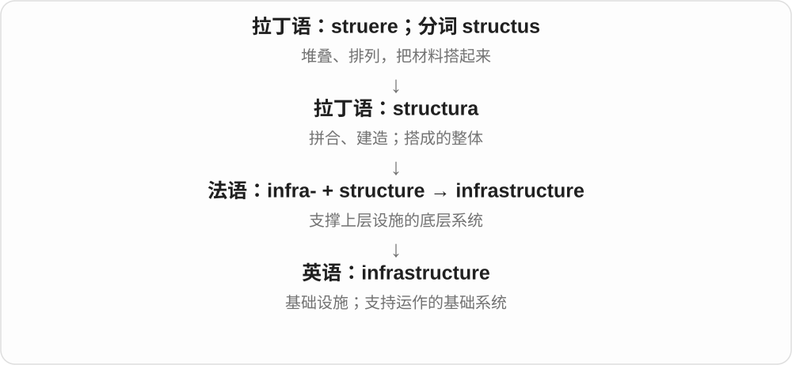
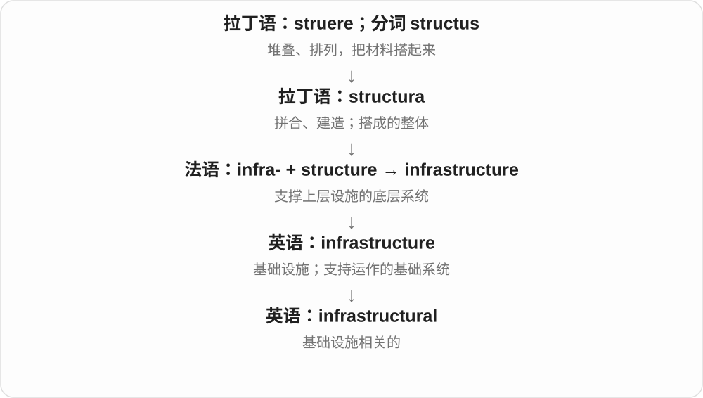

# 1663 · infra- — 在下面；低于

[逐词精讲目录](../00_逐词精讲目录.md) · [总目录](../00_总目录_按常用程度.md)

## 核心词根与来源

从基础设施和红外遥控器出发，这个前缀就不抽象了。基础设施的“底层”常是功能比喻，不等于全部埋在地下；红外、次声的“低”则指频率。

**infra- 是“在下面、低于”。下面可以是支撑上层活动的基础，也可以是低于某条频率界限。先问清楚它在和什么比较。**

支撑生活和工作的底层系统 → infrastructure；低于红光频率 → infrared；低于通常人耳频率下限 → infrasound／infrasonic。

- **支撑系统的基础**：infrastructure, infrastructural
- **可见光红端之外**：infrared
- **通常听觉下限之外**：infrasound, infrasonic

## 词形与演化规律

拉丁 infra 本身是副词、介词，后来作为前缀参与近现代构词。infrastructure 经法语借入，infrared 在英语中由 infra- 与 red 组合，infrasound／infrasonic 属近现代科学命名。

## 单词速览（按词族由简到繁）

同一基础词的相关扩展放在一起，先读基础形式，再读扩展；各组之间优先读常用的。具体词源关系见各词讲解。

| 单词 | 音标 | 核心意思 |
|---|---|---|
| [infrastructure](#w-1) | 英 /ˈɪnfrəstrʌktʃə/；美 /ˈɪnfrəstrʌktʃər/ | 基础设施；支持日常运转的基础系统 |
| [infrastructural](#w-3) | 英 /ˌɪnfrəˈstrʌktʃərəl/；美 /ˌɪnfrəˈstrʌktʃərəl/ | 基础设施方面的 |
| [infrared](#w-2) | 英、美 /ˌɪnfrəˈred/ | 红外线；红外的 |
| [infrasound](#w-4) | /ˈɪnfrəsaʊnd/ | 次声；低于通常人耳下限的声波 |
| [infrasonic](#w-5) | 英 /ˌɪnfrəˈsɒnɪk/；美 /ˌɪnfrəˈsɑːnɪk/ | 次声的；频率低于通常听觉下限的 |

## 逐词讲解

### 1. infrastructure — 基础设施；支持日常运转的基础系统

**音标**：英 /ˈɪnfrəstrʌktʃə/；美 /ˈɪnfrəstrʌktʃər/

**先抓住这个画面**

infrastructure 像城市藏在生活背后的底盘：道路送人，水管送水，电网供电，网络传信息。

**怎么拆**

借自法语 infrastructure；法语由 infra- 在下面 + structure 构成。不是英语先把两个现成词拼起来再传给法语。

**怎么变成今天的意思**

它不只指地下设施；桥梁、学校、通信网络等是否归入，要看讨论范围。公司也可说 digital infrastructure，指支持业务的数字系统。

**常见搭配与例句**

public infrastructure；transport infrastructure；digital infrastructure；invest in infrastructure。

> The flood damaged roads and other essential infrastructure.

洪水损坏了道路和其他重要基础设施。

> The company is improving its digital infrastructure.

公司正在改善数字基础设施。

**别混淆**

infrastructure 强调支持系统运作的基础条件；a structure 可以只是某一座构造物。

### 2. infrastructural — 基础设施方面的

**音标**：英 /ˌɪnfrəˈstrʌktʃərəl/；美 /ˌɪnfrəˈstrʌktʃərəl/

**先抓住这个画面**

infrastructural 把问题指向那套底层支撑：路通不通，电够不够，网络稳不稳。

**怎么拆**

infrastructure + -al，表示与基础设施有关；重音通常转到 struc 音节。

**怎么变成今天的意思**

infrastructural investment 是投向这类支撑系统的投入；infrastructural constraints 则是道路、电力等条件形成的限制。

**常见搭配与例句**

infrastructural development；infrastructural investment；infrastructural constraints。

> The region faces serious infrastructural constraints.

这个地区受到严重的基础设施条件限制。

> The proposal includes several infrastructural improvements.

提案包括几项基础设施改进。

**别混淆**

infrastructural 说明涉及基础设施；structural 的范围更广，可以只是某个组织或物体的内部结构。

### 3. infrared — 红外线；红外的

**音标**：英、美 /ˌɪnfrəˈred/

**先抓住这个画面**

把可见光按频率排开，越过红光的低频一侧，就来到眼睛通常看不见的红外区域。它不是“更深的红色”，而是红光之外的一段电磁波。

**怎么拆**

英语 infra-“低于” + red，19 世纪形成；infra- 来自拉丁 infra“在下面”。这里可以按低于红光的频率理解，不能误记成波长更短：红外波长比红光更长。

**怎么变成今天的意思**

**拉丁 infra**  
在下面、低于

↓

**英语 infra- + red → infrared**  
在可见光红端之外、频率更低的一侧

↓

**现代 infrared**  
红外辐射；探测或使用红外线的

红外线可用于遥控器、天文观测和热成像等。热成像利用特定红外波段反映物体的热辐射；不能反过来把一切红外图像都当作温度照片，也不能把“红外”直接等同于全部热量。

**常见搭配与例句**

infrared radiation；an infrared camera；infrared imaging；an infrared signal。

> The remote control sends an infrared signal to the television.

遥控器向电视发送红外信号。

> The astronomers compared visible and infrared images of the same region.

天文学家比较了同一区域的可见光图像与红外图像。

**别混淆**

ultraviolet 在可见光紫端之外，频率更高；infrared 在红端之外，频率更低。infrasonic 则是声音的低频范围，属于另一种波。

### 4. infrasound — 次声；低于通常人耳下限的声波

**音标**：/ˈɪnfrəsaʊnd/

**先抓住这个画面**

振动慢到通常听不成一个音调，却仍可被仪器记录；“没听到”不等于“没有振动”。

**怎么拆**

infra- 在下、低于 + sound，现代科学词。sound 的声音义仍接拉丁 sonus，经法语进入英语。

**怎么变成今天的意思**

**拉丁 sonus**  
声音

↓

**古法语 son／盎格鲁法语 sun、soun → 中古英语 soun**  
声音

↓

**英语 sound**  
后来增入 d，成为现代拼写

↓

**英语 infra- + sound → infrasound**  
低于通常人耳听觉下限的声波

通常以低于约 20 Hz 作界限。火山、风暴等自然现象可以产生次声，监测站能利用这些信号研究远处事件。这里只需把握频率概念。

**常见搭配与例句**

infrasound monitoring；detect infrasound；an infrasound signal。

> The station detected infrasound from a distant eruption.

监测站探测到了远处喷发产生的次声。

> The graph compares audible sound with infrasound.

图表比较了可听声与次声。

**别混淆**

ultrasound 太高频，infrasound 太低频。两者都不是因为声波“不够快”才听不见。

### 5. infrasonic — 次声的；频率低于通常听觉下限的

**音标**：英 /ˌɪnfrəˈsɒnɪk/；美 /ˌɪnfrəˈsɑːnɪk/

**先抓住这个画面**

给 signal 或 wave 加上 infrasonic，就说明它落在人耳通常听觉范围的低端之外。

**怎么拆**

infra- 低于 + sonic；英语构词也与法语 infra-sonore 的术语背景相呼应。不要把它写成古拉丁已存在的整词。

**怎么变成今天的意思**

**拉丁 sonus**  
声音

↓

**拉丁来源 infra- 低于 + son- 声音；法语有 infra-sonore**  
近现代低频声学命名背景

↓

**英语 infrasonic**  
次声频率的

通常指低于约 20 Hz 的声音频率。传感器能记录 infrasonic signals，并不要求人在现场听见它。

**常见搭配与例句**

infrasonic waves；infrasonic frequencies；an infrasonic signal。

> The instrument recorded an infrasonic signal during the storm.

仪器在风暴期间记录到了一个次声信号。

> The lecture explains why infrasonic waves are usually inaudible to humans.

讲座解释了为什么人类通常听不见次声波。

**别混淆**

infrasound 是名词，infrasonic 是形容词；subsonic 主要比较运动速度。

## 这一组要分清什么

infra- 不等于 intra-“在内部”。infrared 的频率更低、波长更长；infrasonic 不是速度低于声速。infrastructure 可以包括地上的桥梁、通信系统等。

## 串起来练习

Infrastructure supports everyday life. Infrared lies below visible red in frequency. 两句中的“下面”分别是功能上的底层、频率上的低端。
