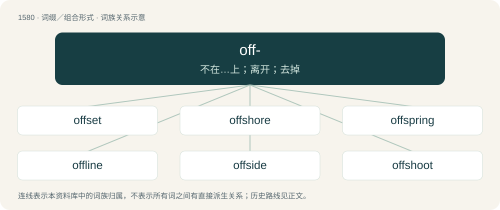

# 1667 · off- — 不在…上；离开；去掉

[总目录](../00_总目录_按常用程度.md)

**类型**：词缀／组合形式　｜　**来源语言**：见词源记录

## 核心含义与来源

- 核心含义：不在…上；离开；去掉
- 英文含义：Away from; off.
- 词形：off-

**来源记录 1**（前缀／前置成分；Away from; off.）

From Middle English of-, from Old English of-, æf- (“off, away, down, un-”), from Proto-Germanic \*aba- (“off, away”), combining form of \*ab(a), from Proto-Indo-European \*h₂epó (“off, away”). Cognate with Dutch af- (“off, away, down”), German ab- (“off, from, down”), Latin ab- (“from, of”), Ancient Greek ἀπο- (apo-, “away from, without”). Doublet of apo- and ab-. Equivalent to off. Compare of.

## 词族图

## 单词速览（常用到不常用）

| 单词 | 音标 | 释义 |
|---|---|---|
| [offset](#w-1) | 英 /ˈɒf.sɛt/；美 /ˈɔf.sɛt/ | n. 抵消, 把...并列, 旁系, 支管, 用胶印法印；vt. 弥补, 抵消, 胶印；vi. 装支管 |
| [offshore](#w-2) | /ɒfˈʃɔː(ɹ)/ | a. 海面的, 吹向海面的, 近海的；adv. 向海面 |
| [offspring](#w-3) | 英 /ˈɒfspɹɪŋ/；美 /ˈɔfspɹɪŋ/ | n. 子孙, 后代, 产物；\[法\] 后辈, 子孙, 后裔 |
| [offline](#w-4) | 英 /ɒfˈlaɪn/；美 /ɔfˈlaɪn/ | \[计\] 挂线, 脱机 |
| [offside](#w-5) | /ɒfˈsaɪd/ | n. 外侧, 越位 |
| [offshoot](#w-6) | 英 /ˈɒf.ʃuːt/；美 /ˈɔf.ʃuːt/ | n. 分支, 旁系, 衍生事物 |
| [offbeat](#w-7) | /ˈɒfbiːt/ | a. 不平常的, 离奇的, 不落俗套的；n. 弱拍 |
| [offload](#w-8) | 美 /ˌɑfˈloʊd/；/ˌɒfˈləʊd/ | v. 卸下, 卸货 |
| [offhand](#w-9) | 美 /ˌɔfˈhænd/ | a. 即时的, 即席的, 无准备的, 随便的, 简慢的, 不友好的；adv. 即时地, 即席地, 随便地 |
| [offal](#w-10) | 英 /ˈɒfəl/；/ˈɔfəl/ | n. 碎屑, 残渣, 下水, 不能吃的部份, 垃圾, 被鄙弃的人；\[化\] 废料; 下角料 |
| [offsite](#w-11) |  | n. 装置外, 厂区外 |

## 逐词详解

### 1. offset

**词性**：名词　｜　**音标**：英 /ˈɒf.sɛt/；美 /ˈɔf.sɛt/

**中文释义**：n. 抵消, 把...并列, 旁系, 支管, 用胶印法印；vt. 弥补, 抵消, 胶印；vi. 装支管

**英文义项**：Anything that acts as counterbalance; a compensating equivalent. / A form of countertrade arrangement, in which the seller agrees to purchase within a set time frame products of a certain value from the buying country. This kind of agreement may be used in large international public sector contracts such as arms sales.

**构词拆分**：off- + set

**词源与演化**：

From off- + set, used to construct the noun form of the verb to set off. Compare Middle English ofsetten (“to encumber, harass, beset, besiege”), from Old English ofsettan (“to press, oppress, overwhelm, crush”).

**例句**：

> There is a small offset between the switch and the indicator which some users found confusing.

该用例对应义项：The distance by which one thing is out of alignment with another.

### 2. offshore

**词性**：形容词　｜　**音标**：/ɒfˈʃɔː(ɹ)/

**中文释义**：a. 海面的, 吹向海面的, 近海的；adv. 向海面

**英文义项**：Moving away from the shore. / Located in the sea away from the coast.

**构词拆分**：From off- + shore.

**词源与演化**：

From off- + shore.

**用法示例／搭配（非完整句）**：

> an offshore oil rig

该用例对应义项：Located in the sea away from the coast.

### 3. offspring

**词性**：名词　｜　**音标**：英 /ˈɒfspɹɪŋ/；美 /ˈɔfspɹɪŋ/

**中文释义**：n. 子孙, 后代, 产物；\[法\] 后辈, 子孙, 后裔

**英文义项**：A person's daughter or son; a person's child. / Any of a person's descendants, including of further generations.

**构词拆分**：off- + spring

**词源与演化**：

From Middle English ofspring, from Old English ofspring (“offspring, descendants, posterity”), equivalent to off- + spring. Compare Icelandic afspringur (“offspring”). More at off, spring.

**例句**：

> Artists often treasure their works as their immortal offspring.

该用例对应义项：Anything produced; the result of an entity's efforts.

### 4. offline

**词性**：形容词　｜　**音标**：英 /ɒfˈlaɪn/；美 /ɔfˈlaɪn/

**中文释义**：\[计\] 挂线, 脱机

**英文义项**：Of a system, currently not connected (generally electrically) to a larger network. For example, a power plant which is not connected to the grid, or a computer which is not connected to the Internet or to any other communications service. / Happening in the physical world (the real world) as opposed to on the internet.

**构词拆分**：off- + line

**词源与演化**：

From off- + line.

**例句**：

> He only had the option to play offline games because there was no Wi-Fi.

该用例对应义项：Of a system, currently not connected (generally electrically) to a larger network. For example, a power plant which is not connected to the grid, or a computer which is not connected to the Internet or to any other communications service.

### 5. offside

**词性**：名词　｜　**音标**：/ɒfˈsaɪd/

**中文释义**：n. 外侧, 越位

**英文义项**：An offside play. / The side of a road vehicle furthest from the kerb: the right side if one drives on the left of the road.

**构词拆分**：off- + side

**词源与演化**：

From off- + side. Compare German Abseite (“remote area, backside”), German abseits (“out of the way, apart, aside”, adverb), Dutch afzijdig (“neutral, impartial”).

**例句**：

> My offside wing mirror got snapped off.

该用例对应义项：The side of a road vehicle furthest from the kerb: the right side if one drives on the left of the road.

### 6. offshoot

**词性**：名词　｜　**音标**：英 /ˈɒf.ʃuːt/；美 /ˈɔf.ʃuːt/

**中文释义**：n. 分支, 旁系, 衍生事物

**英文义项**：Something which shoots off or separates from a main stem or branch of a plant. / Something which develops from something else.

**构词拆分**：off- + shoot

**词源与演化**：

From off- + shoot.

**用法示例／搭配（非完整句）**：

> an offshoot of a criminal organization

该用例对应义项：Something which develops from something else.

### 7. offbeat

**词性**：名词　｜　**音标**：/ˈɒfbiːt/

**中文释义**：a. 不平常的, 离奇的, 不落俗套的；n. 弱拍

**英文义项**：The beats not normally accented in a measure. / An unconventional person, someone who does not follow the beat, who chooses not to conform.

**构词拆分**：off- + beat

**词源与演化**：

From off- + beat; not following the beat (e.g., of a drum that sounds out cadence).

**例句**：

> The congregation clapped along on the offbeat.

该用例对应义项：The beats not normally accented in a measure.

### 8. offload

**词性**：动词　｜　**音标**：美 /ˌɑfˈloʊd/；/ˌɒfˈləʊd/

**中文释义**：v. 卸下, 卸货

**英文义项**：To unload. / To get rid of things, work, or problems by passing them on to someone or something else.

**构词拆分**：From off- + load.

**词源与演化**：

From off- + load.

**例句**：

> The driver of the car carrier offloaded the cars at the dealership.

该用例对应义项：To unload.

### 9. offhand

**词性**：形容词　｜　**音标**：美 /ˌɔfˈhænd/

**中文释义**：a. 即时的, 即席的, 无准备的, 随便的, 简慢的, 不友好的；adv. 即时地, 即席地, 随便地

**英文义项**：Without planning or thinking ahead. / Careless; without sufficient thought or consideration.

**构词拆分**：off- + hand

**词源与演化**：

From Middle English \*ofhande, \*ofhende, from Old English ofhende (“absent, lost”), ultimately from Proto-Germanic \*abahandijaz. Equivalent to (and re-formed as) off- + hand. Cognate with Icelandic afhendur. Compare onhand.

**例句**：

> He doesn't realise how hurtful his offhand remarks can be.

该用例对应义项：Careless; without sufficient thought or consideration.

### 10. offal

**词性**：名词　｜　**音标**：英 /ˈɒfəl/；/ˈɔfəl/

**中文释义**：n. 碎屑, 残渣, 下水, 不能吃的部份, 垃圾, 被鄙弃的人；\[化\] 废料; 下角料

**英文义项**：The internal organs of an animal (entrails or innards), used as food. / A by-product of the grain milling process, which may include bran, husks, etc.

**构词拆分**：off- + fall

**词源与演化**：

From Middle English offal, offall, offalle (“offal, refuse, scrap waste”), equivalent to off- + fall. Cognate with Saterland Frisian Oufal (“offal”), West Frisian ôffal (“offal”), Dutch afval (“waste, refuse”), German Low German Offall (“offal”), German Abfall (“waste, refuse”), Danish affald (“waste, refuse”), Swedish avfall (“waste, refuse”), Old English offeallan (“to cut off”).

**例句**：

> In Mary's butcher shop, you can also find an offal shop.

### 11. offsite

**词性**：名词

**中文释义**：n. 装置外, 厂区外

**英文义项**：A group outing or meeting that takes place outside of the office.

**构词拆分**：off- + site

**词源与演化**：

From off- + site.

**例句**：

> They went bowling for their team offsite.

该用例对应义项：A group outing or meeting that takes place outside of the office.
