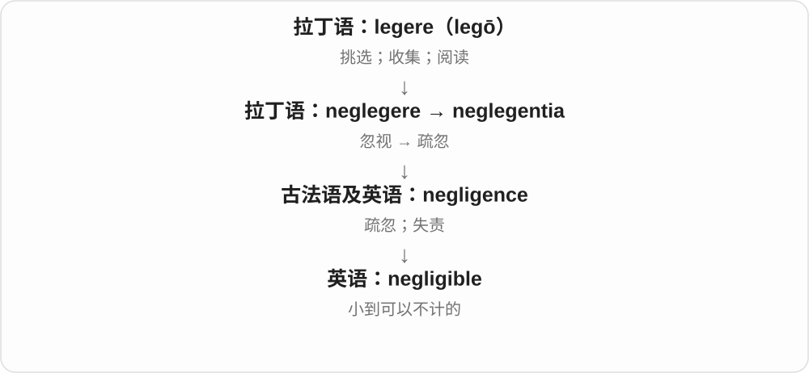
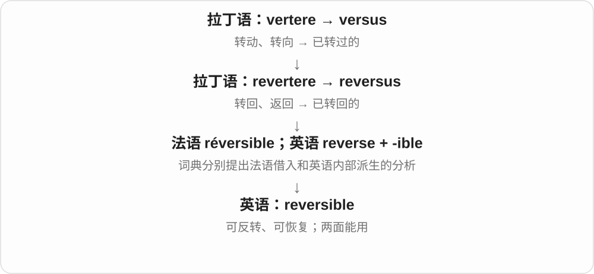
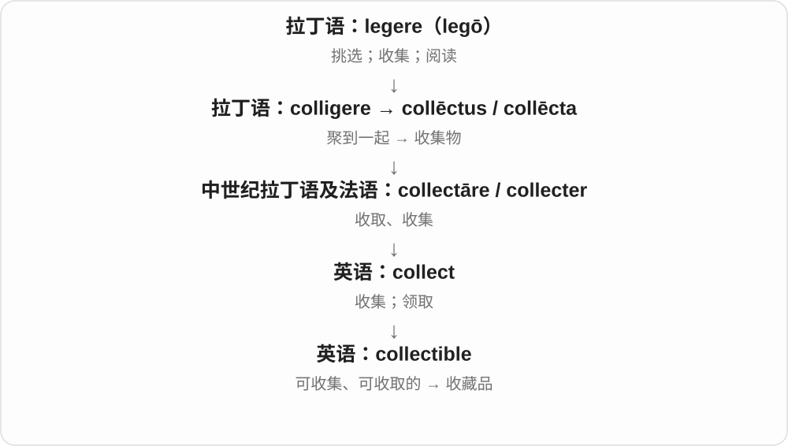
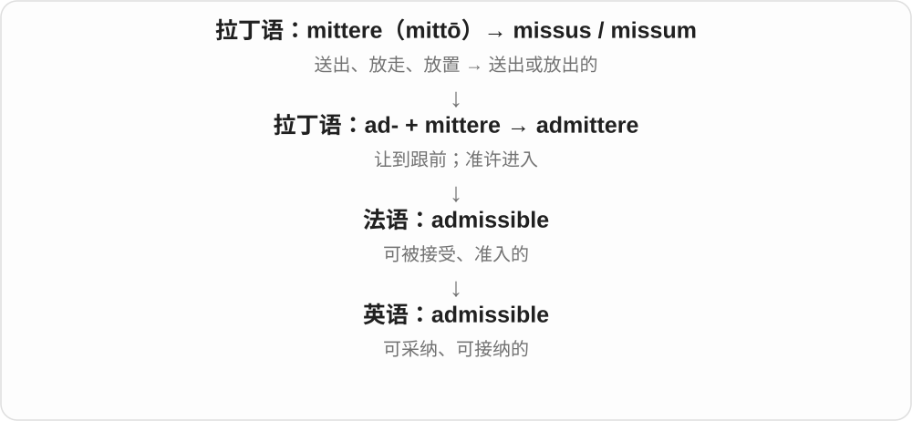
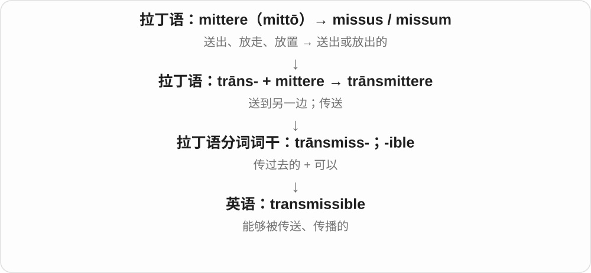
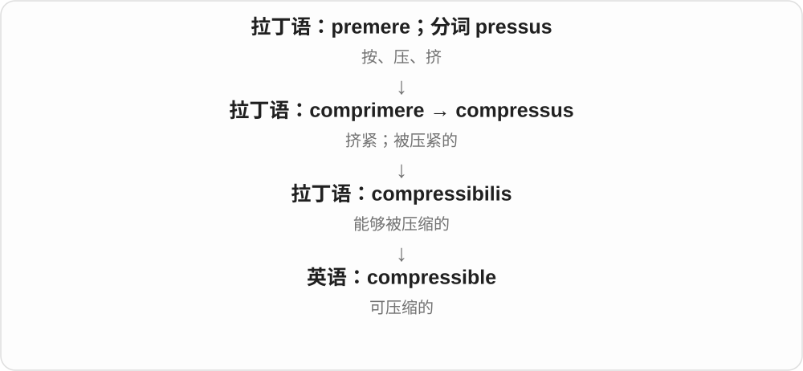
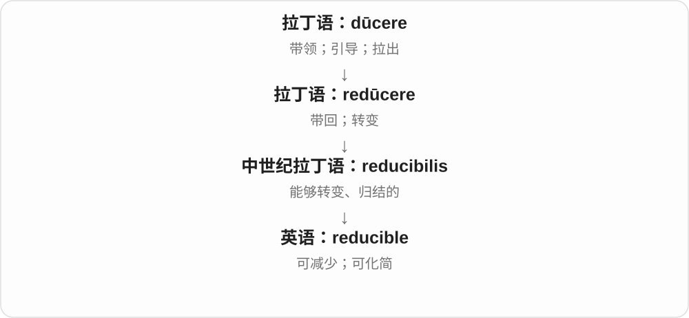

# 1683 · -ible — 能够、可以被……，随词基确定方向

[逐词精讲目录](../00_逐词精讲目录.md) · [总目录](../00_总目录_按常用程度.md)

## 核心词根与来源

有的整词早从拉丁法语借来，有的英语后来接尾；-ible 与 -able 功能近，不能凭中文意思随意换拼法。

**-IBLE：别只背一个能，要看究竟能做什么、被怎样处理**

从常见 accessible、flexible 到 deductible、reproducible、invertible，按具体词基理解；gullible 单列不确定历史。

- **能力、接近与接受**：accessible · admissible · inducible · digestible · gullible
- **变换与反向操作**：convertible · reversible · reproducible · invertible · reducible
- **材料、器具与传递**：flexible · compressible · collapsible · submersible · transmissible
- **评价、辩护和扣除**：deductible · negligible · collectible · reprehensible · forcible · defensible · irascible · fungible

## 词形与演化规律

拉丁 -ibilis、-bilis 等经法语及直接借词 → -ible；现代动词词基继续接尾形成性质形容词。

## 单词速览（按词族由简到繁）

同一基础词的相关扩展放在一起，先读基础形式，再读扩展；各组之间优先读常用的。具体词源关系见各词讲解。

| 单词 | 音标 | 核心意思 |
|---|---|---|
| [accessible](#w-1) | /əkˈsesəbl/ | 可到达、可使用的；无障碍的；易理解的 |
| [flexible](#w-2) | /ˈfleksəbəl/ | 柔韧的；灵活的；可调整的 |
| [convertible](#w-3) | 英 /kənˈvɜːtəbəl/；美 /kənˈvɜːrtəbəl/ | 可转换的；可兑换的；敞篷车 |
| [negligible](#w-4) | /ˈneɡlɪdʒəbəl/ | 小到可忽略的 |
| [deductible](#w-5) | /dɪˈdʌktəbl/ | 可扣除的；免赔额、自负额〔名词，保险语境〕 |
| [reversible](#w-6) | 英 /rɪˈvɜːsəbəl/；美 /rɪˈvɜːrsəbəl/ | 可逆的；两面都能用的 |
| [collectible](#w-7) | /kəˈlektəbəl/ | 值得收藏的；收藏品；可收取的 |
| [gullible](#w-8) | /ˈɡʌləbl/，也有 /ˈɡʌlɪbl/ | 轻信的、容易受骗的 |
| [reprehensible](#w-9) | 英 /ˌreprɪˈhensəbəl/；美 /ˌreprɪˈhensəbəl/ | 应受谴责的 |
| [admissible](#w-10) | /ədˈmɪsəbəl/ | 可接纳的；可采纳的；符合准入条件的 |
| [forcible](#w-11) | 英 /ˈfɔːsəbəl/；美 /ˈfɔːrsəbəl/ | 强制的；使用强力的 |
| [defensible](#w-12) | /dɪˈfensəbəl/ | 可以防守的；有理由支持或辩护的 |
| [submersible](#w-13) | 英 /səbˈmɜːsəbəl/；美 /səbˈmɜːrsəbəl/ | 可潜入水下的；潜水器 |
| [reproducible](#w-14) | 英 /ˌriːprəˈdjuːsəbl/；美 /ˌriːprəˈduːsəbl/ | 可重现的、可复现的；可复制的 |
| [digestible](#w-15) | /daɪˈdʒestəbəl/ | 可消化的；易理解、易吸收的 |
| [collapsible](#w-16) | 英、美 /kəˈlæpsəbəl/ | 可折叠的；可收缩的 |
| [transmissible](#w-17) | /trænzˈmɪsəbəl/ | 可传递的；可传播的 |
| [inducible](#w-18) | 英 /ɪnˈdjuːsəbəl/；美 /ɪnˈduːsəbəl/ | 可诱导的；能够被引发的 |
| [irascible](#w-19) | /ɪˈræsəbəl/ | 易怒的；脾气暴躁的〔正式〕 |
| [compressible](#w-20) | 英 /kəmˈpresəbəl/；美 /kəmˈpresəbəl/ | 可压缩的 |
| [reducible](#w-21) | 英 /rɪˈdjuːsəbəl/；美 /rɪˈduːsəbəl/ | 可减少的；可化简的；可归结为的 |
| [fungible](#w-22) | /ˈfʌndʒɪbəl/ | 可互换的；同等单位可以替代的 |
| [invertible](#w-23) | 英 /ɪnˈvɜːtəbl/；美 /ɪnˈvɜːrtəbl/ | 可倒转的；可逆的、有逆的〔数学等〕 |

## 逐词讲解

### 1. accessible — 可到达、可使用的；无障碍的；易理解的

**音标**：/əkˈsesəbl/

**先抓住这个画面**

路能走到，设施用得上，文章读得懂：共同点是原本隔着的障碍少了。

**怎么拆**

经法语及晚期拉丁 accessibilis，接 accessus 接近、入口；现代可对应 access + -ible。形容词有自己的借入历史。

**怎么变成今天的意思**

**拉丁 ad- + cēdere → accēdere；accessus**  
朝向 + 走 → 接近；接近、入口

↓

**晚期拉丁 accessibilis → 法语 accessible → 英语 accessible**  
能够接近、进入 → 易用、易理解

accessible by bus 公交可达，accessible to everyone 人人可用，an accessible explanation 通俗解释；无障碍设施强调相关使用者确实能用。

**常见搭配与例句**

accessible to；accessible by bus；an accessible explanation；an accessible entrance。

> The museum is accessible by public transport.

博物馆乘公共交通可以到达。

> She gives an accessible explanation of a difficult idea.

她把一个难懂的想法解释得通俗易懂。

**别混淆**

available 有供应、可获得，accessible 能接近、能使用；有一份文件不一定所有人都能打开或读懂。

### 2. flexible — 柔韧的；灵活的；可调整的

**音标**：/ˈfleksəbəl/

**先抓住这个画面**

像一根能弯而不轻易断的软管，也像一个能随实际情况调整的计划。

**怎么拆**

词形可看作 flex- + -ible；历史上拉丁 flexibilis 已是形容词，经法语或直接进入英语。

**怎么变成今天的意思**

**拉丁 flectere；分词 flexus**  
弯曲、使转向

↓

**拉丁 flexibilis → 法语 flexible／直接借入英语**  
能够弯曲、容易顺应

↓

**英语 flexible**  
柔韧的；能调整的、灵活的

flexible material 是材料能弯；a flexible schedule 是时间可以商量调整；a flexible person 愿意换一种办法。共同点是“不被一个固定形状锁死”。它不等于没有规则，而是规则或做法留有调整空间。

**常见搭配与例句**

flexible hours；a flexible approach；be flexible about dates。

> The hose is flexible enough to fit around the corner.

这根软管够柔韧，能绕过拐角。

> We can be flexible about the start date.

开始日期可以灵活安排。

**别混淆**

flexible 侧重能改变形状或安排；elastic 更强调受力变形后能恢复。会弯的材料不一定都有良好弹性。

### 3. convertible — 可转换的；可兑换的；敞篷车

**音标**：英 /kənˈvɜːtəbəl/；美 /kənˈvɜːrtəbəl/

**先抓住这个画面**

一件东西能变换形态或用途。汽车车顶收起来，封闭车厢变敞开，“可变换的车”便成了敞篷车的名称。

**怎么拆**

古法语 convertible 来自后期拉丁语 convertibilis；现代可辨 convert + -ible，但整词的历史早于现代英语这种拆法。

**怎么变成今天的意思**

a convertible sofa 可改成床；convertible currency 是能兑换其他货币的货币。敞篷车名词来自这个形容词的专门化。

**常见搭配与例句**

a convertible car；a convertible sofa；convertible currency。

> The sofa is convertible into a bed.

这张沙发能变成床。

> They rented a convertible for the coastal drive.

他们租了一辆敞篷车沿海岸自驾。

**别混淆**

convertible 强调能变换；reversible 强调能反转或恢复，也可指两面可用。

### 4. negligible — 小到可忽略的

**音标**：/ˈneɡlɪdʒəbəl/

**先抓住这个画面**

negligible 像测量时一个微小尾数，对当前结论影响太小，可以暂时不计。

**怎么拆**

由 negligence 一族加 -ible 形成；可理解为“能够不计入考虑的”。

**怎么变成今天的意思**

通常用于误差、成本、数量或影响。它不是绝对的零，只是相对于当前问题足够小。

**常见搭配与例句**

a negligible effect；negligible costs；a negligible difference。

> The extra weight is negligible.

增加的重量微不足道。

> The change had a negligible effect on the result.

这次改变对结果影响极小。

**别混淆**

negligent 说人或行为疏忽；negligible 说事物小到可忽略。

### 5. deductible — 可扣除的；免赔额、自负额〔名词，保险语境〕

**音标**：/dɪˈdʌktəbl/

**先抓住这个画面**

先有 deduct 从总数扣掉：deductible 说可以扣除；保险名词又指通常先由自己承担、未进入相应赔付的那部分金额。

**怎么拆**

deduct 扣除的词基 + -ible，可扣除；较早词基接拉丁 dēdūcere 等。名词是形容词的专门化，不等于凡能扣除的金额都叫保险免赔额。

**怎么变成今天的意思**

**拉丁 -ibilis 等 → 法语 -ible → 英语 -ible**  
可……、能够被……；关系需结合词基

↓

**借入整词与后来的英语造词**  
有些已有拉丁法语历史，有些英语后来按模式构成

↓

**deduct + -ible → deductible**  
可以扣除

↓

**保险语境的名词化**  
相应条款中的免赔额、自负额

a deductible expense 可扣除费用，a deductible amount 可扣金额，an insurance deductible 保险免赔额。

**常见搭配与例句**

a deductible expense；a deductible amount；an insurance deductible。

> The form asked whether the expense was deductible.

表格问这笔费用是否可以扣除。

> The policy listed the deductible on the first page.

保单在第一页列明了免赔额。

**别混淆**

deductible 形容可扣、名词免赔额，deduction 是扣除行为、扣除额；具体金额与适用范围由实际条款确定。

### 6. reversible — 可逆的；两面都能用的

**音标**：英 /rɪˈvɜːsəbəl/；美 /rɪˈvɜːrsəbəl/

**先抓住这个画面**

做了以后还能转回来，或者翻到另一面照样能用。

**怎么拆**

现代对应 reverse + -ible；词源也常联系法语 réversible。

**怎么变成今天的意思**

衣服 reversible 是两面可穿；a reversible change 是变化能够被逆转。科学领域的“可逆”可能有更严格条件，不能只按日常意思判定。

**常见搭配与例句**

a reversible jacket；a reversible process；fully reversible。

> The jacket is reversible, with blue on one side and grey on the other.

这件夹克两面都能穿，一面蓝色，一面灰色。

> The editor confirmed that the change was reversible.

编辑确认这项修改可以撤回。

**别混淆**

removable 是能拆掉；reversible 是能反转或恢复。拆掉某物后也可能留永久痕迹。

### 7. collectible — 值得收藏的；收藏品；可收取的

**音标**：/kəˈlektəbəl/

**先抓住这个画面**

collectible 常让人想到值得保存的一件小东西，像一枚特别的徽章或旧邮票。

**怎么拆**

collect + -ible。

**怎么变成今天的意思**

作名词多指收藏品；作形容词也能说款项可收取。能收藏不意味着一定会升值。

**常见搭配与例句**

a collectible toy；rare collectibles；collectible debts。

> The shop sells collectible toys.

这家店出售收藏玩具。

> She keeps her collectibles in a glass cabinet.

她把收藏品放在玻璃柜里。

**别混淆**

collectible 强调收藏或可收取；collection 是整组藏品。collectable 是另一拼写。

### 8. gullible — 轻信的、容易受骗的

**音标**：/ˈɡʌləbl/，也有 /ˈɡʌlɪbl/

**先抓住这个画面**

别人说什么就容易信，很少先查证，骗子一牵就跟着走；并不是单纯善良、友好。

**怎么拆**

常联系 gull 欺骗、受骗者与 -ible；也有从较早 gullibility 倒推形容词的分析，具体造词过程不定。不把它解释成海鸥 gull 天生好骗的确定故事。

**怎么变成今天的意思**

**拉丁 -ibilis 等 → 法语 -ible → 英语 -ible**  
可……、能够被……；关系需结合词基

↓

**借入整词与后来的英语造词**  
有些已有拉丁法语历史，有些英语后来按模式构成

↓

**gull 的欺骗、受骗者词族；gullibility 等较早形式**  
具体来源、造词顺序有不同分析

↓

**gullible**  
容易相信而被欺骗的

a gullible customer 轻信顾客，gullible enough to believe 容易轻信到相信，too gullible 太好骗。

**常见搭配与例句**

a gullible customer；too gullible；gullible enough to believe。

> The scam targeted gullible customers.

骗局盯上了容易轻信的顾客。

> He was gullible enough to believe the invented story.

他太轻信，竟相信了编造的故事。

**别混淆**

gullible 容易被骗，trusting 愿意信任可较中性或正面；不轻信也不等于必须怀疑一切。

### 9. reprehensible — 应受谴责的

**音标**：英 /ˌreprɪˈhensəbəl/；美 /ˌreprɪˈhensəbəl/

**先抓住这个画面**

事情不只是做得不够好，而是在道德上错到值得明确责备。

**怎么拆**

经法语或直接借后期拉丁语 reprehensibilis，来自 reprehendere“抓回、制止、责备”的分词词干 reprehens- + -ibilis。

**怎么变成今天的意思**

**拉丁语 prehendere，缩略形 prendere**  
抓住、取得；分词词干 prehens- / prens-

↓

**拉丁语 re- + prehendere → reprehendere**  
抓回来、制止 → 责备

↓

**后期拉丁语 reprehensibilis；法语 reprehensible → 英语 reprehensible**  
值得被责备的

常形容欺骗、虐待、滥权等行为，语气很重。不要拿来形容普通小失误。

**常见搭配与例句**

reprehensible conduct；morally reprehensible；a reprehensible act。

> The report described the deliberate deception as reprehensible.

报告称这种蓄意欺骗应受谴责。

> Taking advantage of the victims was morally reprehensible.

利用受害者在道德上应受谴责。

**别混淆**

regrettable 只是令人遗憾；reprehensible 明确包含应受道德责难。

### 10. admissible — 可接纳的；可采纳的；符合准入条件的

**音标**：/ədˈmɪsəbəl/

**先抓住这个画面**

admissible 像一份材料到了门口，规则检查后允许它进入讨论或证据范围。

**怎么拆**

借自法语 admissible，与拉丁语 admittere 的 admiss- 词干相连；现代对应 admit + -ible 的可接受意义。

**怎么变成今天的意思**

常用于证据、论点或方案是否符合规定。被允许纳入考虑，不等于已经证明内容真实或结论正确。

**常见搭配与例句**

admissible evidence；an admissible argument；admissible under the rules。

> The judge will decide whether the evidence is admissible.

法官将决定这份证据是否可以采纳。

> Only solutions satisfying all the constraints are admissible.

只有满足全部约束的解才符合准入条件。

**别混淆**

credible 是可信；admissible 是准许采纳。两者问的是不同问题。

### 11. forcible — 强制的；使用强力的

**音标**：英 /ˈfɔːsəbəl/；美 /ˈfɔːrsəbəl/

**先抓住这个画面**

不是对方自愿配合，而是靠力量迫使事情发生。

**怎么拆**

借古法语 forcible，接 forcier“用强力迫使”；现代可对照 force + -ible，但不能机械理解为“能够被强迫的”。

**怎么变成今天的意思**

**拉丁 fortis**  
强壮、坚固、勇敢；更早来源有不同分析

↓

**古法语 force → forcier → forcible**  
力量 → 施力 → 以强力完成的

↓

**中古英语／现代英语 forcible**  
强制的；使用武力的

forcible entry 是强行进入，forcible removal 是强制移走。现代常描述动作实施的方式，不只是说某人说话特别有气势。

**常见搭配与例句**

forcible entry；forcible removal；forcible displacement。

> There were signs of forcible entry around the lock.

锁周围有强行进入的痕迹。

> The report describes the forcible removal of residents.

报告描述了居民被强制迁离的情况。

**别混淆**

forceful speech 是有力的讲话；forcible action 是靠强力实施的行动。两者不能只因都含 force 就互换。

### 12. defensible — 可以防守的；有理由支持或辩护的

**音标**：/dɪˈfensəbəl/

**先抓住这个画面**

面对攻击，你有办法挡住；面对质疑，你拿得出站得住的理由。

**怎么拆**

defens- 与 -ible“能够……的”相连；历史上经法语 defensable、拉丁 defensibilis 等形式借入。

**怎么变成今天的意思**

**拉丁复合词中的 -fendere**  
击打、推撞；通常不独立使用

↓

**拉丁 de-“离开” + -fendere → defendere**  
把攻击挡开 → 保护、防卫

↓

**拉丁 defensibilis／法语 defensable**  
可防卫的

↓

**英语 defensible**  
可以防守；也指观点或决定可以合理辩护

a defensible position 可以是容易守住的地点，也可以是有根据的立场。工作中说 a defensible decision，意思是能解释为什么这样决定，经得起合理质疑，不保证所有人最后都同意。

**常见搭配与例句**

a defensible argument；a defensible decision；a defensible position。

> Given the evidence, her conclusion is defensible.

根据这些证据，她的结论有理由成立。

> They chose a defensible position on the hill.

他们在山上选择了一个便于防守的位置。

**别混淆**

defensible 说“能讲得通”；defensive 说“采取防卫姿态”。一个词评价理由，一个词描述应对方式。

### 13. submersible — 可潜入水下的；潜水器

**音标**：英 /səbˈmɜːsəbəl/；美 /səbˈmɜːrsəbəl/

**先抓住这个画面**

先是“能够在水下工作”，再用这个特点直接称呼一台下水作业的设备。

**怎么拆**

submers-，与拉丁 submersus“淹没的”相联 + -ible“能够……的”。

**怎么变成今天的意思**

**拉丁 mergere，分词 mersus**  
浸入、沉下去

↓

**拉丁 sub- + mergere → submergere，分词 submersus**  
使沉到下面、淹没

↓

**英语 submersible**  
可浸没、可潜水的 → 潜水器

a submersible pump 是潜水泵；a research submersible 是科研潜水器。名词可以指载人或无人设备，不能一看到这个词就认定里面一定坐着人。

**常见搭配与例句**

a submersible pump；a research submersible；an unmanned submersible。

> The team used a submersible to inspect the wreck.

团队用一台潜水器检查沉船。

> A submersible pump removed water from the flooded room.

一台潜水泵把积水房间里的水抽走了。

**别混淆**

submarine 可指潜艇，也有水下的形容词义；submersible 常见于科研和作业设备，不能简单等同军用潜艇。

### 14. reproducible — 可重现的、可复现的；可复制的

**音标**：英 /ˌriːprəˈdjuːsəbl/；美 /ˌriːprəˈduːsəbl/

**先抓住这个画面**

给出办法和条件，别人再照着做，也能得到相应结果；软件错误稳定再出现，也说 reproducible。

**怎么拆**

reproduce 重新产生、复制，去 e + -ible。re- 再、produce 产生的现代层次清楚，较早词基有拉丁、法语历史。

**怎么变成今天的意思**

**拉丁 -ibilis 等 → 法语 -ible → 英语 -ible**  
可……、能够被……；关系需结合词基

↓

**借入整词与后来的英语造词**  
有些已有拉丁法语历史，有些英语后来按模式构成

↓

**re- + produce → reproduce；reproduce + -ible → reproducible**  
重新产生 → 能再次得到、复制的

reproducible results 可复现结果，a reproducible bug 可稳定复现的错误，a reproducible example 可复现示例。

**常见搭配与例句**

reproducible results；a reproducible bug；a reproducible example。

> The team published code to make the results reproducible.

团队公开代码，让结果可以复现。

> Please provide a reproducible example of the error.

请提供一个能够复现错误的示例。

**别混淆**

reproducible 重点是再做能得到相应结果；repeatable 在不同领域有自己的约定，不用一句统一定义强分所有学科。

### 15. digestible — 可消化的；易理解、易吸收的

**音标**：/daɪˈdʒestəbəl/

**先抓住这个画面**

把大块内容分成读者处理得了的小块，就像食物变得容易消化一样。

**怎么拆**

拉丁 digestibilis 经古法语 digestible 借入；-ibilis 表示能够被……。今天可对照 digest + -ible，但不是纯现代英语拼接。

**怎么变成今天的意思**

**拉丁 gerere，分词 gestus**  
携带、承担；做、进行

↓

**拉丁 dis- 分开 + gerere → digerere，分词 digestus**  
分开搬置 → 分类安排；消化

↓

**拉丁 digestibilis → 古法语 digestible → 英语 digestible**  
可以消化的；容易理解的

说食物时可以是能够消化，也可以根据上下文强调较易消化；说信息时，通常强调组织得易读、易理解。digestible 并不保证内容完整。

**常见搭配与例句**

easily digestible；digestible pieces；a digestible summary。

> The editor divided the material into digestible sections.

编辑把材料分成容易理解的小节。

> The study compares how digestible the two protein sources are.

研究比较两种蛋白质来源的可消化程度。

**别混淆**

edible 是可食用；digestible 是能消化，判断角度不同。信息的简短也不自动等于好理解。

### 16. collapsible — 可折叠的；可收缩的

**音标**：英、美 /kəˈlæpsəbəl/

**先抓住这个画面**

设计时就让它能缩小、收起来，方便携带或存放。这里的“塌”是可控制的结构变化，不一定是坏掉。

**怎么拆**

英语 collapse + -ible，去掉末尾 e；历史也有 collapsable 的拼法。这个后缀表示能够发生这种变化。

**怎么变成今天的意思**

**拉丁 labi；分词 lapsus**  
滑动、滑落、跌下

↓

**拉丁 com- + labi → collabi；分词 collapsus**  
一起落下、失去支撑而塌下

↓

**英语 collapse**  
坍塌、倒下；也指计划或体系失败，随后用作名词

↓

**英语 collapse + -ible → collapsible**  
可收起、可折叠的

a collapsible chair 可以折起来；a collapsible water bottle 可以压缩后装包。网页的 collapsible section 是能展开、收起的内容区域。

**常见搭配与例句**

a collapsible chair；a collapsible container；a collapsible section。

> The collapsible table fits behind the cupboard.

这张可折叠桌收起来后能放在柜子后面。

> The guide uses collapsible sections for the detailed explanations.

指南把详细说明放在可以展开、收起的分区里。

**别混淆**

collapsed 是现在已经收起或塌了；collapsible 是具备收起能力。foldable 很接近，通常突出折叠动作。

### 17. transmissible — 可传递的；可传播的

**音标**：/trænzˈmɪsəbəl/

**先抓住这个画面**

transmissible 像某种内容、信号或病原体具备从一个载体到另一个载体的条件，重点是“能被传过去”。

**怎么拆**

与拉丁语 trānsmissus“传过去的”及 -ible 相连；现代可按 transmit 的可传递形容词理解。

**怎么变成今天的意思**

它描述可传递性，不说明具体已经传给谁，也不自动说明传播很快或很容易。

**常见搭配与例句**

a transmissible signal；transmissible information；a transmissible disease。

> The information must be encoded in a transmissible form.

信息必须编码成可以传输的形式。

> The study asks whether the organism is transmissible between hosts.

研究考察这种生物能否在宿主之间传播。

**别混淆**

transmitted 说已经传递；transmissible 说能够传递。highly transmissible 才进一步强调易传播。

### 18. inducible — 可诱导的；能够被引发的

**音标**：英 /ɪnˈdjuːsəbəl/；美 /ɪnˈduːsəbəl/

**先抓住这个画面**

inducible 像一盏可以被开关触发的灯：给出合适条件，某种活动或反应就能启动。

**怎么拆**

induce + -ible；去掉末尾 e，表示“能够被引起的”。

**怎么变成今天的意思**

科学文字常用它描述可以受某个信号诱导的过程或系统。它说能被触发，并没有说已经触发，更没有说任何条件都能触发。

**常见搭配与例句**

an inducible response（可诱导反应）；an inducible system（可诱导系统）；an inducible gene（表达可受诱导的基因）。

> The researchers tested whether the response was inducible.

研究人员测试了这种反应能否被诱导。

> The inducible system remained inactive until the signal arrived.

这个可诱导系统一直没有启动，直到信号到来。

**别混淆**

inducible 是可以被诱导；induced 是已经受到诱导。后缀 -ible 标记可能性。

### 19. irascible — 易怒的；脾气暴躁的〔正式〕

**音标**：/ɪˈræsəbəl/

**先抓住这个画面**

像一点就着的火，稍受刺激就容易发脾气。

**怎么拆**

晚期拉丁 irascibilis 来自 irasci“发怒”，经法语或直接拉丁借入英语。irasc- 是历史动词词干，-ible 表示这种倾向；不必把里面的 sc 再拆成一个英语词根。

**怎么变成今天的意思**

**拉丁 ira**  
愤怒、怒火

↓

**拉丁 irasci**  
变得愤怒、发怒

↓

**晚期拉丁 irascibilis**  
容易发怒的

↓

**法语 irascible／直接拉丁借入 → 英语 irascible**  
易怒、脾气暴躁的

它多用来写人的脾气：不是今天偶尔生气，而是有一点不顺心就容易动怒。文学人物即使同时慷慨、可靠，也仍可能是 irascible，几个性格特点可以并存。

**常见搭配与例句**

an irascible person；an irascible temperament；an irascible old man。

> The irascible editor snapped at anyone who interrupted him.

这位脾气暴躁的编辑对每个打断他的人都厉声呵斥。

> The novel’s irascible landlord is surprisingly generous to his neighbours.

小说里那个易怒的房东，对邻居却出人意料地大方。

**别混淆**

irritable 可以是因为累了、饿了而一时烦躁；irascible 更常描述容易动怒的性格，语气也更书面。

### 20. compressible — 可压缩的

**音标**：英 /kəmˈpresəbəl/；美 /kəmˈpresəbəl/

**先抓住这个画面**

外力一挤，体积能明显缩小；在数据里，则是还能换成更省空间的表示。

**怎么拆**

借自拉丁语 compressibilis“可压缩的”，根在 comprimere“挤紧”；现代可按 compress + -ible 理解，借入历史与今天的拆分要分开。

**怎么变成今天的意思**

气体通常比液体容易压缩。文件是否容易压缩，取决于内容和已有编码，不取决于文件名长短。

**常见搭配与例句**

a compressible gas；compressible material；highly compressible data。

> Air is much more compressible than water under ordinary conditions.

在通常条件下，空气比水容易压缩得多。

> Repeated text is often highly compressible.

重复文本通常很容易压缩。

**别混淆**

compressible 是有可能缩小体积；flexible 是容易弯，两者不是同一种性质。

### 21. reducible — 可减少的；可化简的；可归结为的

**音标**：英 /rɪˈdjuːsəbəl/；美 /rɪˈduːsəbəl/

**先抓住这个画面**

reducible 表示可以把一个大问题收拢成更小、更简单的东西。常见的 reducible to 就是“可以归结为”。

**怎么拆**

与 reduce + -ible 对应；这一词形在中世纪拉丁语 reducibilis、古法语 redusible 中已有相关形式。

**怎么变成今天的意思**

说 a problem is reducible to two choices，意思是复杂表面之下，只需处理两个选择。不同专业里的“可约”有各自严格定义。

**常见搭配与例句**

reducible to…（可归结为……）；a reducible fraction（可约分的分数）；reducible costs（可削减的成本）。

> The fraction is reducible to one half.

这个分数可以约成二分之一。

> Human behavior is not always reducible to a single motive.

人的行为并不总能归结为单一动机。

**别混淆**

reducible 说能够化简；reductive 常批评解释把事情过分简单化。可以简化，不代表任何简化都合理。

### 22. fungible — 可互换的；同等单位可以替代的

**音标**：/ˈfʌndʒɪbəl/

**先抓住这个画面**

给你同等的一份就行，不需要一定是原来那一份。

**怎么拆**

中世纪拉丁 fungibilis 接拉丁 fungi“履行”，尤其是 fungi vice“代行位置或作用”；先有代替作用，再有同等物可互换。

**怎么变成今天的意思**

**拉丁 fungi／fungor；分词词干 funct-**  
履行、执行、完成职责

↓

**拉丁 fungi vice → 中世纪拉丁 fungibilis**  
代行某人的位置或作用 → 可互相替代的

↓

**英语 fungible**  
同等单位可互换、无须区分个体的

普通流通的一枚硬币，只要币种和面值相同，通常可以用另一枚替代；带纪念意义的那一枚，对收藏者就未必一样。fungible 关注是否可以不区分个体地互换，取决于比较的用途、规格和价值。

**常见搭配与例句**

fungible goods；fungible units；treat as fungible。

> For ordinary payment, coins of the same currency and denomination are generally fungible.

用于普通支付时，同币种、同面值的硬币一般可以互换。

> The collector did not regard the two signed copies as fungible.

收藏者并不把那两本签名本视为可以随意互换的东西。

**别混淆**

replaceable 只表示能替换；fungible 更强调同等单位可以互换，不必关注是哪一个具体个体。

### 23. invertible — 可倒转的；可逆的、有逆的〔数学等〕

**音标**：英 /ɪnˈvɜːtəbl/；美 /ɪnˈvɜːrtəbl/

**先抓住这个画面**

能把操作倒回来，或能找到相应的逆；数学里 invertible matrix 是有逆矩阵的矩阵，不只是能把纸翻个面。

**怎么拆**

invert 倒转 + -ible；invert 较早接拉丁 in- 向内、进入与 vertere 转的组合，不把此处 in- 先认成否定。

**怎么变成今天的意思**

**拉丁 -ibilis 等 → 法语 -ible → 英语 -ible**  
可……、能够被……；关系需结合词基

↓

**借入整词与后来的英语造词**  
有些已有拉丁法语历史，有些英语后来按模式构成

↓

**invert + -ible → invertible**  
能够倒转、具有逆的

an invertible matrix 可逆矩阵，an invertible function 可逆函数，an invertible transformation 可逆变换。

**常见搭配与例句**

an invertible matrix；an invertible function；an invertible transformation。

> The exercise asked whether the matrix was invertible.

练习要求判断矩阵是否可逆。

> The transformation is invertible.

这个变换可逆。

**别混淆**

invertible 数学对象有相应逆，reversible 一般可逆、可反转范围更广；不是所有能旋转的矩阵图形就有逆矩阵。

## 这一组要分清什么

deductible/deduction 可扣与扣除额；reproducible 看重现条件；invertible 数学逆；gullible 非海鸥故事；-able/-ible 拼法随整词。

## 串起来练习

A reproducible example made the problem easier to understand.

可复现示例让问题更容易理解。
