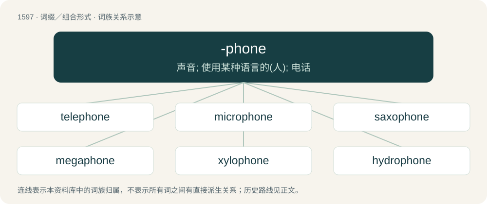

# 1690 · -phone — 声音; 使用某种语言的(人); 电话

[总目录](../00_总目录_按常用程度.md)

**类型**：词缀／组合形式　｜　**来源语言**：见词源记录

## 核心含义与来源

- 核心含义：声音; 使用某种语言的(人); 电话
- 英文含义：A type of sound.
- 词形：-phone

**来源记录 1**（后缀／后置成分；A type of sound.）

From Ancient Greek φωνή (phōnḗ, “sound, voice, speech, language”), from Proto-Indo-European \*bʰoh₂neh₂, from \*bʰeh₂- (“to speak”); related to fame and fable. Some terms ending in phone, such as textphone, are actually compounds made with phone.

## 词族图

## 单词速览（常用到不常用）

| 单词 | 音标 | 释义 |
|---|---|---|
| [telephone](#w-1) | 英 /ˈtɛlɪfəʊn/；美 /ˈtɛləˌfoʊn/ | n. 电话, 电话机；v. 打电话 |
| [microphone](#w-2) | 英 /ˈmaɪ.kɹəˌfəʊn/；美 /ˈmaɪ.kɹəˌfoʊn/ | n. 扩音器, 麦克风；\[医\] 扩音器, 传声器 |
| [saxophone](#w-3) | 英 /ˈsæksəˌfəʊ̯n/；美 /ˈsæksəˌfoʊ̯n/ | n. 萨克斯管；\[电\] 俱有余割平方辐射图案的线性排列天线 |
| [megaphone](#w-4) | 英 /ˈmɛɡ.əˌfəʊn/；美 /ˈmɛɡəˌfoʊn/ | n. 扩音器；\[医\] 反射扩音器 |
| [xylophone](#w-5) | 英 /ˈzaɪ.ləˌfəʊn/；美 /ˈzaɪləˌfoʊn/ | n. 木琴 |
| [hydrophone](#w-6) | /ˈhaidrəfəun/ | n. 水中听音器, 检漏器, 水诊器；\[医\] 隔水听诊器 |

## 逐词详解

### 1. telephone

**词性**：名词　｜　**音标**：英 /ˈtɛlɪfəʊn/；美 /ˈtɛləˌfoʊn/

**中文释义**：n. 电话, 电话机；v. 打电话

**英文义项**：A telecommunication device which converts data or sounds (usually speech) into electrical signals which are then transmitted to enable two or more people to communicate with each other over a distance; now usually a device having a dial or keypad with numerals for entering a number, etc., to connect with a person, and means (such as a sound or vibration) for alerting one to an incoming call or transmission; also, the handset or receiver of such a device. / A means of communicating information from one person to another or others.

**构词拆分**：tele- (prefix meaning ‘from a distance’) + -phone (suffix denoting a device which makes a sound)

**词源与演化**：

The noun is derived from tele- (prefix meaning ‘from a distance’) + -phone (suffix denoting a device which makes a sound), modelled after German Telephon (“early apparatus converting sound into electrical signals”) (dated) (now German Telefon). The word was first used to refer to the modern device in 1876 by the Scottish-born Canadian-American engineer Alexander Graham Bell (1847–1922). The prefix tele- is ultimately derived from Ancient Greek τῆλε (têle, “afar, far away, far off”), from Proto-Indo-European \*kʷelh₁- (“to turn end-over-end; to revolve around; hence, to dwell, sojourn”). The suffix -phone is ultimately from Ancient Greek φωνή (phōnḗ, “sound; voice”), and Proto-Indo-European \*bʰeh₂- (“to say; to speak”). Noun sense 4.4 (“system of communication using musical notes”) is borrowed from French téléphone (“kind of megaphone; system of communication using musical notes”). The verb is derived from the noun.

**例句**：

> Please contact the office by telephone if the website is unavailable.

如果网站无法使用，请通过电话联系办公室。

### 2. microphone

**词性**：名词　｜　**音标**：英 /ˈmaɪ.kɹəˌfəʊn/；美 /ˈmaɪ.kɹəˌfoʊn/

**中文释义**：n. 扩音器, 麦克风；\[医\] 扩音器, 传声器

**英文义项**：A device (transducer) used to convert sound waves into a varying electric current; normally fed into an amplifier and either recorded or transmitted over radio. / A speaking trumpet or hearing trumpet; an acoustic device to concentrate or amplify sound.

**构词拆分**：micro- + -phone

**词源与演化**：

From micro- + -phone.

**例句**：

> You need have a good microphone because we care about sound quality.

### 3. saxophone

**词性**：名词　｜　**音标**：英 /ˈsæksəˌfəʊ̯n/；美 /ˈsæksəˌfoʊ̯n/

**中文释义**：n. 萨克斯管；\[电\] 俱有余割平方辐射图案的线性排列天线

**英文义项**：A single-reed instrument musical instrument of the woodwind family, usually made of brass and with a distinctive loop bringing the bell upwards. / Someone who plays the saxophone; a saxophonist.

**构词拆分**：Sax + -o- + -phone

**词源与演化**：

Borrowed from French saxophone, a combination of the surname of its inventor Adolphe Sax (1814–1894) + -o- + -phone (“something that makes a sound”), from Ancient Greek φωνή (phōnḗ, “sound, voice”). The first element surname is a variant of the German Sachs (“Saxon”). Analyzable as Sax + -o- + -phone.

**例句**：

> The saxophones typically sit behind the flutes in a concert band.

该用例对应义项：Someone who plays the saxophone; a saxophonist.

### 4. megaphone

**词性**：名词　｜　**音标**：英 /ˈmɛɡ.əˌfəʊn/；美 /ˈmɛɡəˌfoʊn/

**中文释义**：n. 扩音器；\[医\] 反射扩音器

**英文义项**：A portable, usually hand-held, funnel-shaped device that is used to amplify a person’s natural voice toward a targeted direction. / Mouthpiece or promoter; one who speaks for or publicizes on behalf of another.

**构词拆分**：mega- + -phone

**词源与演化**：

From mega- + -phone.

**例句**：

> Do you really need a megaphone?

### 5. xylophone

**词性**：名词　｜　**音标**：英 /ˈzaɪ.ləˌfəʊn/；美 /ˈzaɪləˌfoʊn/

**中文释义**：n. 木琴

**英文义项**：Any musical instrument (percussion idiophone) made of wooden slats graduated so as to make the sounds of the scale when struck with a small drumstick-like mallet; the standard Western concert xylophone or one of its derivatives.

**构词拆分**：xylo- (“of wood”) + -phone (“sound”)

**词源与演化**：

From xylo- (“of wood”) + -phone (“sound”).

**例句**：

> All I know how to play on my xylophone is "Mary Had a Little Lamb". Would you like to hear it?

该用例对应义项：Any musical instrument (percussion idiophone) made of wooden slats graduated so as to make the sounds of the scale when struck with a small drumstick-like mallet; the standard Western concert xylophone or one of its derivatives.

### 6. hydrophone

**词性**：名词　｜　**音标**：/ˈhaidrəfəun/

**中文释义**：n. 水中听音器, 检漏器, 水诊器；\[医\] 隔水听诊器

**英文义项**：a transducer that converts underwater sound waves into electrical signals, rather like a microphone

**构词拆分**：hydro- + -phone

**词源与演化**：

From hydro- + -phone.

**例句**：

> A hydrophone is a microphone designed to be used underwater.
