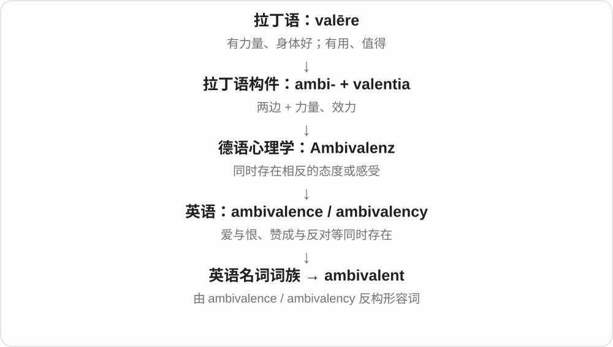
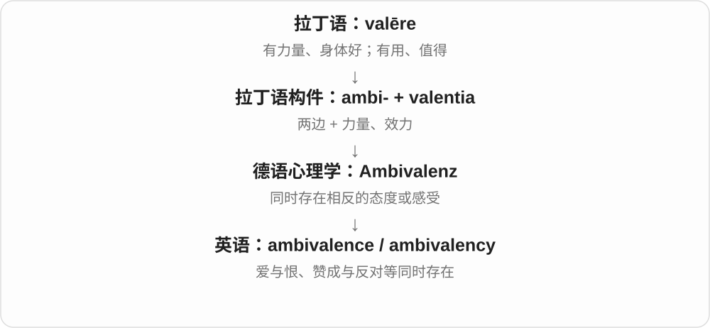

# 1693 · ambi-, am-, amb-, ambo-, an- — 周围；两边、两方面

[逐词精讲目录](../00_逐词精讲目录.md) · [总目录](../00_总目录_按常用程度.md)

## 核心词根与来源

ambition 的历史画面是四处争取支持；ambient 是环绕四周的，ambience 是场所给人的整体气氛。另一支 ambiguous、ambivalent 都与两方面有关，却分别表示意思不清和内心有相反感受。andante 的意大利语来源明确，更远与 ambire 的联系有争议，作为传统关联阅读。

**可以想成绕着一个点走，也可以想成两边都照顾到。环绕着形成环境，两边都能用则形成双手灵巧。**

ambi- 周围、两边 + ire 去 → ambire 绕行 → ambit、ambition、ambient；ambi- + dexter 右手 → ambidextrous。

- **围绕的环境与边界**：ambient, ambience, ambiance, ambit
- **争取成就**：ambition, ambitious, ambitiously
- **两手都灵巧**：ambidextrous, ambidexterity
- **两种解释、两种心情**：ambiguous, ambiguity, ambiguously, unambiguous, ambivalent, ambivalence
- **绕切的历史旁支**：amputation
- **来源有争议的传统关联**：andante

## 词形与演化规律

ambi- 在历史构词中可见 amb-、am-、an- 等形式，但不能看到这些字母就直接认根。ambition 不是现代 ambit 加 -ion 才造出；ambitious、ambidexterity 也有各自的历史路线。

## 单词速览（按词族由简到繁）

同一基础词的相关扩展放在一起，先读基础形式，再读扩展；各组之间优先读常用的。具体词源关系见各词讲解。

| 单词 | 音标 | 核心意思 |
|---|---|---|
| [ambit](#w-12) | /ˈæmbɪt/ | 范围；界限；权限所及之处 |
| [ambitious](#w-1) | /æmˈbɪʃəs/ | 有抱负的；目标宏大的；野心勃勃的 |
| [ambitiously](#w-16) | /æmˈbɪʃəsli/ | 雄心勃勃地；以很高的目标 |
| [ambition](#w-2) | /æmˈbɪʃən/ | 抱负；志向；野心；想实现的目标 |
| [ambient](#w-3) | /ˈæmbiənt/ | 周围环境的；环境氛围式的 |
| [ambience](#w-8) | /ˈæmbiəns/ | 氛围；环境给人的整体感觉 |
| [ambiguous](#w-4) | /æmˈbɪɡjuəs/ | 有歧义的；意思不明确的 |
| [ambiguity](#w-5) | /ˌæmbɪˈɡjuːəti/ | 歧义；不明确之处 |
| [ambiguously](#w-14) | /æmˈbɪɡjuəsli/ | 含糊地；以会产生歧义的方式 |
| [unambiguous](#w-9) | /ˌʌnæmˈbɪɡjuəs/ | 明确无歧义的 |
| [amputation](#w-6) | 英 /ˌæmpjuˈteɪʃən/；美 /ˌæmpjəˈteɪʃən/ | 截肢；肢体等部分的截除或截断 |
| [ambivalent](#w-7) | 英、美 /æmˈbɪvələnt/ | 心情矛盾的；态度摇摆的 |
| [ambivalence](#w-10) | 英、美 /æmˈbɪvələns/ | 矛盾心理；又想要又抗拒的态度 |
| [ambiance](#w-11) | 常用 /ˈæmbiəns/；亦有英 /ˈɒmbiɒns/、美 /ˈɑːmbiɑːns/ | 氛围；情调 |
| [ambidextrous](#w-13) | /ˌæmbɪˈdekstrəs/ | 双手同样灵巧的；左右手都适用的 |
| [andante](#w-15) | /ænˈdænteɪ/ | 行板；以舒缓适中的速度 |
| [ambidexterity](#w-17) | 美 /ˌæmbɪdekˈsterɪti/ | 双手同等灵巧的能力；兼顾两类能力的本领 |

## 逐词讲解

### 1. ambit — 范围；界限；权限所及之处

**音标**：/ˈæmbɪt/

**先抓住这个画面**

想象绕着一个区域走一圈，圈内就是它能覆盖的范围。

**怎么拆**

借拉丁 ambitus 环行、周界、范围，来自动词 ambire；不是 ambition 的现代缩写。

**怎么变成今天的意思**

**拉丁 ambi- / amb- 周围、两边 + ire 去 → ambire**  
在四周走动、绕行

↓

**拉丁 ambitus → 中古英语 ambyte → ambit**  
走一圈、周界 → 权力或讨论所及范围

within the ambit of the law 是在法律涵盖范围内；outside our ambit 是超出我们的职责或讨论范围。较正式，常见于法律、政策和学术文字。

**常见搭配与例句**

within the ambit of；outside the ambit of；the ambit of an inquiry。

> The complaint falls within the ambit of the review.

这项投诉属于本次审查的范围。

> Staffing decisions lie outside the committee’s ambit.

人员配置决策不在该委员会的权限范围内。

**别混淆**

scope 在日常和工作中更常用；ambit 更有边界圈出的范围这一感觉。

### 2. ambitious — 有抱负的；目标宏大的；野心勃勃的

**音标**：/æmˈbɪʃəs/

**先抓住这个画面**

人想走得更远，计划则想做成一件很大的事。

**怎么拆**

接拉丁 ambitiosus，经中古法语等借入；与 ambition 同源，但不能只当成英语名词随意换上 -ous。

**怎么变成今天的意思**

**拉丁 ambi- / amb- 周围、两边 + ire 去 → ambire**  
在四周走动、绕行

↓

**拉丁 ambitio → ambitiosus；中古法语 ambitieus → 英语 ambitious**  
积极争取职位 → 有强烈抱负、目标很高

an ambitious student 是有上进心的学生；an ambitious project 是目标很高、执行可能很难的项目。后者不表示项目本身有情绪。

**常见搭配与例句**

an ambitious plan；ambitious targets；an ambitious young researcher。

> The team set an ambitious target for reducing waste.

团队定下了一个大幅减废的目标。

> She is ambitious, but she is also willing to learn from others.

她很有抱负，也愿意向别人学习。

**别混淆**

aspiring 常说想成为某种人的；ambitious 更强调目标高、想取得大成绩。目标大也未必一定能实现。

### 3. ambitiously — 雄心勃勃地；以很高的目标

**音标**：/æmˈbɪʃəsli/

**先抓住这个画面**

一开始就把想完成的规模或难度定得很高。

**怎么拆**

ambitious + -ly；修饰规划、设计、尝试等动作。

**怎么变成今天的意思**

**拉丁 ambi- / amb- 周围、两边 + ire 去 → ambire**  
在四周走动、绕行

↓

**拉丁 ambitio → ambitiosus；中古法语 ambitieus → 英语 ambitious**  
积极争取职位 → 有强烈抱负、目标很高

↓

**英语 ambitious + -ly → ambitiously**  
目标很高的 → 以雄心和高目标去做

ambitiously designed 说设计追求很高；plan ambitiously 是大手笔地规划。它评价目标，并不自动保证方案可靠。

**常见搭配与例句**

ambitiously designed；ambitiously conceived；plan ambitiously。

> The exhibition ambitiously combines science, music, and visual art.

展览颇有雄心地把科学、音乐和视觉艺术结合起来。

> They planned ambitiously but underestimated the cost.

他们把计划定得很宏大，却低估了成本。

**别混淆**

carefully 说细致程度；ambitiously 说目标的高度。一个计划可以兼有两者，也可以只有其中一个。

### 4. ambition — 抱负；志向；野心；想实现的目标

**音标**：/æmˈbɪʃən/

**先抓住这个画面**

心里有个想达到的位置或成果，并很想为它努力。

**怎么拆**

来自拉丁 ambitio，源于 ambire 四处走动；早期连着候选人四处争取支持的活动。经法语进入英语，不是现代 ambit 加 -ion 才造出的词。

**怎么变成今天的意思**

**拉丁 ambi- / amb- 周围、两边 + ire 去 → ambire**  
在四周走动、绕行

↓

**拉丁 ambitio → 古法语 ambition → 中古英语 ambicioun → ambition**  
四处争取选票 → 争取职位、成就的强烈愿望

an ambition to write a book 是想写一本书的志向；political ambition 是政治抱负或野心。褒贬由目标和手段决定，不一定是坏事。

**常见搭配与例句**

achieve an ambition；an ambition to do；have ambitions；political ambition。

> Her ambition is to design affordable homes.

她的志向是设计人们负担得起的住房。

> Personal ambition began to interfere with their teamwork.

个人野心开始妨碍他们的团队合作。

**别混淆**

wish 可能只是希望；ambition 通常更强，也更指向个人成就或地位。

### 5. ambient — 周围环境的；环境氛围式的

**音标**：/ˈæmbiənt/

**先抓住这个画面**

不用专门把它送到你面前，它就已经在周围了。

**怎么拆**

拉丁 ambiens 是 ambire 绕行的现在分词；从环绕着，发展为周围环境中的。

**怎么变成今天的意思**

**拉丁 ambi- / amb- 周围、两边 + ire 去 → ambire**  
在四周走动、绕行

↓

**拉丁 ambiens → 英语 ambient**  
在周围的 → 周围环境中的

ambient temperature 是周围环境温度，不是设备内部温度；ambient noise 是背景环境声。ambient music 常指营造氛围、弱化鲜明节拍和旋律主导的音乐。

**常见搭配与例句**

ambient temperature；ambient light；ambient noise；ambient music。

> The sensor measures the ambient temperature outside the machine.

传感器测量机器外部的环境温度。

> Soft ambient music played in the waiting room.

候诊室里播放着柔和的氛围音乐。

**别混淆**

room temperature 特指室温；ambient temperature 随所在环境变化，户外也能用。

### 6. ambience — 氛围；环境给人的整体感觉

**音标**：/ˈæmbiəns/

**先抓住这个画面**

灯光、声音、布局混在一起，让一个地方显得温暖、紧张或冷清。

**怎么拆**

通常联系法语 ambiance，来自 ambiant 环绕的；也有英语 ambient + -ence 的构词解释，两路都接拉丁 ambiens。

**怎么变成今天的意思**

**拉丁 ambi- / amb- 周围、两边 + ire 去 → ambire**  
在四周走动、绕行

↓

**拉丁 ambiens → 法语 ambiant → ambiance；英语 ambience**  
围绕着 → 一个地方给人的整体气氛；也有 ambient + -ence 的分析

the ambience of a café 是咖啡馆的整体氛围；create a relaxed ambience 是营造轻松气氛。不是单独一件装饰品，而是所有细节加起来的感受。

**常见搭配与例句**

a relaxed ambience；create an ambience；the ambience of a place。

> Warm lighting gives the restaurant a welcoming ambience.

暖色灯光让餐厅显得亲切宜人。

> We liked the food, but the noisy ambience made conversation difficult.

我们喜欢那里的食物，但嘈杂的氛围让交谈很困难。

**别混淆**

environment 可以说具体环境条件；ambience 更突出人在场所里感受到的气氛。ambiance 是同词另一拼写。

### 7. ambiguous — 有歧义的；意思不明确的

**音标**：/æmˈbɪɡjuəs/

**先抓住这个画面**

ambiguous 像一句话前面出现两条岔路，读者不知道该沿哪一条理解。

**怎么拆**

来自拉丁语 ambi-（两边、周围）+ agere，形成 ambigere，再到 ambiguus。这里不是把现代单词随意拆成 ambi + guous。

**怎么变成今天的意思**

常指一句话、信号或证据可以有不止一种解释。说话者未必故意含糊，有时只是表达没写清。

**常见搭配与例句**

an ambiguous answer；ambiguous wording；an ambiguous signal。

> The instructions are ambiguous about when to start.

说明没有明确交代什么时候开始，存在多种理解。

> Her smile gave an ambiguous signal.

她的笑容让人猜不准是什么意思。

**别混淆**

vague 是缺少细节或边界；ambiguous 是可能通向多种解释，区别在“少信息”与“有岔路”。

### 8. ambiguity — 歧义；不明确之处

**音标**：/ˌæmbɪˈɡjuːəti/

**先抓住这个画面**

ambiguity 是理解岔路本身：同一句话，有人走到这个意思，有人走到另一个意思。

**怎么拆**

现代对应 ambiguous + -ity；历史经法语来自拉丁语 ambiguitās，名词有自己的借入路线。

**怎么变成今天的意思**

不可数时指不明确的状态，可数时是一处具体歧义。文学可以有意保留 ambiguity，操作说明则通常应减少。

**常见搭配与例句**

remove ambiguity；an ambiguity in the wording；leave room for ambiguity。

> The revised sentence removes the ambiguity.

修改后的句子消除了歧义。

> The ending leaves room for ambiguity.

这个结尾保留了多种解释的空间。

**别混淆**

uncertainty 泛指不确定；ambiguity 常关乎同一表达或情形存在多种解释。

### 9. ambiguously — 含糊地；以会产生歧义的方式

**音标**：/æmˈbɪɡjuəsli/

**先抓住这个画面**

ambiguously 描述表达留下了岔路：听者可以按不止一种意思理解。

**怎么拆**

ambiguous + -ly。

**怎么变成今天的意思**

通常修饰 worded、phrased、answered 等表达行为。不明确可能出于策略，也可能只是措辞不佳。

**常见搭配与例句**

ambiguously worded；answer ambiguously；phrase something ambiguously。

> The question was ambiguously worded.

这个问题的措辞有歧义。

> He answered ambiguously, leaving both options open.

他回答得含糊，没有排除任何一种选项。

**别混淆**

ambiguously 说表达方式；ambiguity 是表达中留下的不明确之处。

### 10. unambiguous — 明确无歧义的

**音标**：/ˌʌnæmˈbɪɡjuəs/

**先抓住这个画面**

unambiguous 像把岔路口的标牌写清，让读者朝同一个意思走。

**怎么拆**

un-（不）+ ambiguous。

**怎么变成今天的意思**

常说指令、证据、承诺或支持很明确。并不代表内容简单，只表示意思没有歧义。

**常见搭配与例句**

unambiguous instructions；an unambiguous answer；unambiguous evidence。

> The rule needs an unambiguous definition.

这条规则需要一个没有歧义的定义。

> She gave an unambiguous yes.

她明确回答了“是”。

**别混淆**

clear 可泛指清楚；unambiguous 更具体地强调不会产生另一种解释。

### 11. amputation — 截肢；肢体等部分的截除或截断

**音标**：英 /ˌæmpjuˈteɪʃən/；美 /ˌæmpjəˈteɪʃən/

**先抓住这个画面**

这条词源保留“剪去一部分”的具体动作：从树枝的剪除，发展到身体一部分被截除的名称。

**怎么拆**

拉丁 am(bi)- 周围 + putare 修剪 → amputare；其名词 amputatio 经法语 amputation 或直接拉丁借入。英语名词早于 amputate，不能画成先有英语动词再有名词。

**怎么变成今天的意思**

**拉丁 putare**  
修剪、清理；计算、考虑、判断

↓

**拉丁 am(bi)- 周围 + putare → amputare**  
剪除、截去

↓

**拉丁 amputatio → 法语 amputation／直接拉丁借入**  
截除行为

↓

**英语 amputation**  
截肢、身体一部分的截除或截断

现代常指通过手术移除全部或部分肢体等组织，也见 traumatic amputation 指创伤导致的截断。这里说的是事件或处理名称，并不限定必须整条手臂或腿。

**常见搭配与例句**

limb amputation；partial amputation；traumatic amputation。

> The article discusses rehabilitation after amputation.

文章讨论了截肢后的康复。

> The report distinguishes surgical amputation from traumatic loss of a limb.

报告区分了手术截肢与创伤造成的肢体丧失。

**别混淆**

excision 泛指切除组织；amputation 特别常用于肢体或突出身体部分的截除，不等于所有外科切除。

### 12. ambivalent — 心情矛盾的；态度摇摆的

**音标**：英、美 /æmˈbɪvələnt/

**先抓住这个画面**

嘴上说“我还没决定”，心里却不是空白，而是赞成和反对的理由都在用力。

**怎么拆**

英语从 ambivalence / 较早的 ambivalency 这组名词反构出形容词；更早来源是德语 Ambivalenz。

**怎么变成今天的意思**

常用 ambivalent about 或 towards。一个人可以对升职感到 ambivalent：想要机会，也担心更大的工作压力。

**常见搭配与例句**

feel ambivalent about；remain ambivalent；an ambivalent attitude。

> I’m ambivalent about the offer: the work is exciting, but the hours are long.

我对这个机会心情矛盾：工作很有意思，但工时很长。

> The review is ambivalent rather than wholly negative.

这篇评论的态度有褒有贬，并非全盘否定。

**别混淆**

uncertain 可能只是信息不足；ambivalent 更强调同时存在相反的感受或态度。

### 13. ambivalence — 矛盾心理；又想要又抗拒的态度

**音标**：英、美 /æmˈbɪvələns/

**先抓住这个画面**

同一件事把你往两个方向拉：想接受它带来的好处，又放不下它带来的损失。

**怎么拆**

借自德语心理学词 Ambivalenz，由 ambi-“两边”与 valentia“力量、效力”组成。英语还曾用 ambivalency；这不是普通英语 ambi- + valence 临时拼出的词。

**怎么变成今天的意思**

可以同时期待与害怕搬家，同时欣赏又怨恨一个人。ambivalence 不是完全没有态度，而是几种相反态度同时存在。

**常见搭配与例句**

ambivalence about a decision；ambivalence towards someone；a sense of ambivalence。

> She felt ambivalence about leaving a secure job to travel.

她对放弃稳定工作去旅行心情矛盾，既向往又舍不得。

> The novel captures his ambivalence towards his hometown.

小说写出了他对故乡既亲近又抗拒的复杂感情。

**别混淆**

indifference 是不在乎；ambivalence 是在乎，却同时被相反感受拉扯。

### 14. ambiance — 氛围；情调

**音标**：常用 /ˈæmbiəns/；亦有英 /ˈɒmbiɒns/、美 /ˈɑːmbiɑːns/

**先抓住这个画面**

走进一个地方，声音、光线和布置一起给你的感觉。

**怎么拆**

直接保留法语 ambiance 的拼写；英语也用 ambience。法语这一名词接 ambiant 环绕的，而非一个不同意思的新词。

**怎么变成今天的意思**

**拉丁 ambi- / amb- 周围、两边 + ire 去 → ambire**  
在四周走动、绕行

↓

**拉丁 ambiens → 法语 ambiant → ambiance → 英语 ambiance**  
围绕的 → 场所的整体气氛

a romantic ambiance 是浪漫氛围；a quiet ambiance 是安静的环境气氛。两种拼写通常可对应，不能规定 ambiance 只用于高档餐厅。

**常见搭配与例句**

a pleasant ambiance；the ambiance of the room；create ambiance。

> Candles created a peaceful ambiance in the room.

蜡烛让房间有了宁静的氛围。

> The hotel’s appeal lies in its relaxed ambiance.

这家酒店的吸引力在于它轻松的氛围。

**别混淆**

ambience 与 ambiance 主要是拼写差异；不需要为两者编造严格的意思区别。

### 15. ambidextrous — 双手同样灵巧的；左右手都适用的

**音标**：/ˌæmbɪˈdekstrəs/

**先抓住这个画面**

两只手都能熟练完成原本惯用手做的事。

**怎么拆**

中古拉丁 ambidexter 由 ambi- 两边 + dexter 右手、灵巧构成，英语接 -ous；字面是两边都像右手。

**怎么变成今天的意思**

**拉丁 ambi- 两边 + dexter 右手、灵巧 → 中古拉丁 ambidexter**  
两边都像惯用的右手一样好用

↓

**中古拉丁 ambidexter；英语加 -ous → ambidextrous**  
两边都灵巧 → 两手都能熟练使用

an ambidextrous person 两手都能熟练使用；an ambidextrous mouse 是左右手都适用的鼠标。词源里的右手反映旧有语言习惯，不说明左手实际低一等。

**常见搭配与例句**

an ambidextrous player；an ambidextrous design；be naturally ambidextrous。

> She is ambidextrous and can write clearly with either hand.

她左右手都很灵巧，用哪只手都能写得清楚。

> The mouse has an ambidextrous shape.

这款鼠标的外形适合左右手使用。

**别混淆**

left-handed 是左撇子，right-handed 是右撇子；ambidextrous 强调两手都能熟练使用。

### 16. andante — 行板；以舒缓适中的速度

**音标**：/ænˈdænteɪ/

**先抓住这个画面**

音乐像不急不慢地走路，有向前的流动感。

**怎么拆**

直接借意大利语 andante，是 andare 去、走的现在分词；andare 的更早来源有争议，联系 ambire 的说法不能当成确定链。

**怎么变成今天的意思**

**意大利语 andare 去、走 → andante**  
正在走的；更远来源未定

↓

**音乐术语 andante → 英语 andante**  
如步行般适中地演奏；这种速度的乐章

play andante 是按行板速度演奏；the andante 可指行板乐章。实际速度由作品、时代和上下文决定，不宜只背一个绝对节拍数。

**常见搭配与例句**

play andante；an andante movement；the andante section。

> The pianist played the opening phrase andante.

钢琴家以行板速度演奏开头乐句。

> The andante gave the symphony a moment of calm.

行板乐章为这部交响曲带来了一段宁静。

**别混淆**

allegro 通常较快；andante 通常从容适中。这里保留它作传统关联词，不把有争议的远源写成事实。

### 17. ambidexterity — 双手同等灵巧的能力；兼顾两类能力的本领

**音标**：美 /ˌæmbɪdekˈsterɪti/

**先抓住这个画面**

两只手都派得上用场，转到比喻里就是两种不同要求也能兼顾。

**怎么拆**

ambidexter + -ity；接中古拉丁 ambidexter 两边都灵巧，不必先经过现代 ambidextrous 才形成。

**怎么变成今天的意思**

**拉丁 ambi- 两边 + dexter 右手、灵巧 → 中古拉丁 ambidexter**  
两边都像惯用的右手一样好用

↓

**英语 ambidexter + -ity → ambidexterity**  
两边都能熟练使用 → 这种能力

hand ambidexterity 说两手能力；organizational ambidexterity 在管理学中常说既做好现有业务、又探索新方向的能力。比喻义要看具体领域。

**常见搭配与例句**

develop ambidexterity；manual ambidexterity；organizational ambidexterity。

> The task tested the participants’ ambidexterity.

这项任务测试了参与者双手同等灵巧的能力。

> The paper links organizational ambidexterity to balancing efficiency and experimentation.

论文把组织的双重能力与兼顾效率和试验探索联系起来。

**别混淆**

dexterity 是灵巧，不限定两手；ambidexterity 多了两边都行的要求。

## 这一组要分清什么

ambiguous 是信息不清楚，ambivalent 是心里同时有相反感受；ambience 与 ambiance 通常是同词不同拼写。ambition 可褒可贬，不能一律译为有恶意的野心。

## 串起来练习

比较 an ambitious plan 与 an ambiguous plan；用 ambient temperature 和 ambience 各说一句话；用 ambidextrous 描写一种左右手都适用的物品。
