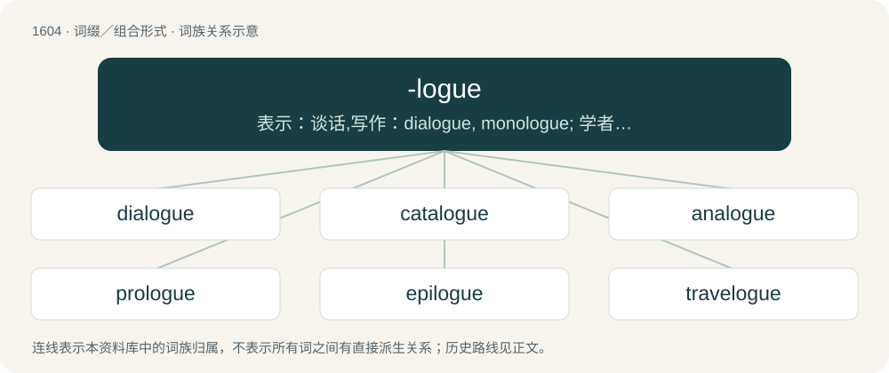

# 1700 · -logue — 表示：谈话,写作：dialogue, monologue; 学者,专家：Sinologue

[总目录](../00_总目录_按常用程度.md)

**类型**：词缀／组合形式　｜　**来源语言**：见词源记录

## 核心含义与来源

- 核心含义：表示：谈话,写作：dialogue, monologue; 学者,专家：Sinologue
- 英文含义：Speech, or a way of speaking, a narrative, logical discourse.
- 词形：-logue

**多个词源／构词路径**：同一拼写可能有不同来源；以下按词性和含义分别列出。

**来源记录 1**（后缀／后置成分；Speech, or a way of speaking, a narrative, logical discourse.）

Unadapted borrowing from Middle French -logue, from Classical Latin -logus, from Ancient Greek -λόγος (-lógos, “a student of or specialist in a field; type of discourse”).

**来源记录 2**（后缀／后置成分；A correspondent (homologue or analogue).）

Back-formation from analogue or homologue.

## 词族图

## 单词速览（常用到不常用）

| 单词 | 音标 | 释义 |
|---|---|---|
| [dialogue](#w-1) | 英 /ˈdaɪəlɒɡ/；美 /ˈdaɪəˌlɑɡ/ | n. 对话；vi. 对话；vt. 用对话表达 |
| [catalogue](#w-2) | 英 /ˈkæt.əˌlɒɡ/；美 /ˈkæt.əˌlɔɡ/ | n. 目录, 大学情况一览；vt. 编入目录 |
| [analogue](#w-3) | /ˈænəlɒg/ | n. 类似物, 相似情况；\[医\] 类似物, 同型物, 相似器官, 同功异质体 |
| [prologue](#w-4) | 英 /ˈpɹəʊlɒɡ/；美 /ˈpɹoʊlɔɡ/ | n. 开场白, 序言, 序幕；vt. 为...作序, 加上...前言 |
| [epilogue](#w-5) | 英 /ˈɛp.ɪ.lɒɡ/；美 /ˈɛpɪlɔɡ/ | n. 结语, 尾声, 收场白；\[计\] 收尾程序 |
| [travelogue](#w-6) | 英 /ˈtɹavə(l)lɒɡ/；美 /ˈtɹvvəˌlɔɡ/ | n. 旅行见闻讲座 |

## 逐词详解

### 1. dialogue

**词性**：名词　｜　**音标**：英 /ˈdaɪəlɒɡ/；美 /ˈdaɪəˌlɑɡ/

**中文释义**：n. 对话；vi. 对话；vt. 用对话表达

**英文义项**：A conversation or other form of discourse between two or more individuals. / In a dramatic or literary presentation, the verbal parts of the script or text; the verbalizations of the actors or characters.

**构词拆分**：dia- (“between”) + -logue；di- (“two”) + -alogue

**词源与演化**：

Inherited from Middle English dialog, from Old French dialoge (French dialogue), from Late Latin dialogus, from Ancient Greek διάλογος (diálogos, “conversation, discourse”), from διά (diá, “through, inter”) + λόγος (lógos, “speech, oration, discourse”), from διαλέγομαι (dialégomai, “to converse”), from διά (diá) + λέγειν (légein, “to speak”), equivalent to dia- (“between”) + -logue. Also analyzable as di- (“two”) + -alogue.

**例句**：

> A literary historian, she specialized in the dialogues of ancient Greek philosophers.

该用例对应义项：A literary form, where the presentation resembles a conversation.

### 2. catalogue

**词性**：名词　｜　**音标**：英 /ˈkæt.əˌlɒɡ/；美 /ˈkæt.əˌlɔɡ/

**中文释义**：n. 目录, 大学情况一览；vt. 编入目录

**英文义项**：A systematic list of books, names, pictures, etc. / A complete (usually alphabetical or chronological) list of items.

**构词拆分**：cata- + -logue

**词源与演化**：

From Middle English cathaloge, from Old French catalogue, from Late Latin catalogus, itself from Ancient Greek κατάλογος (katálogos, “enrollment, register”), from καταλέγω (katalégō, “to recount, make a list”), from κατα- (kata-, “downwards, towards”) + λέγω (légō, “to say, to speak, to tell”). Equivalent to cata- + -logue.

**例句**：

> The accident followed a catalogue of errors.

该用例对应义项：A series of unwelcome or unpleasant things, often similar.

### 3. analogue

**词性**：名词　｜　**音标**：/ˈænəlɒg/

**中文释义**：n. 类似物, 相似情况；\[医\] 类似物, 同型物, 相似器官, 同功异质体

**英文义项**：Something that bears an analogy to something else. / An organ or structure that is similar in function to one in another kind of organism but is of dissimilar evolutionary origin.

**构词拆分**：ana- (“functionally similar”) + -logue

**词源与演化**：

Equivalent to ana- (“functionally similar”) + -logue. See analog.

**例句**：

> This hyperbola is important to us. It's the relativistic analogue of a circle.

### 4. prologue

**词性**：名词　｜　**音标**：英 /ˈpɹəʊlɒɡ/；美 /ˈpɹoʊlɔɡ/

**中文释义**：n. 开场白, 序言, 序幕；vt. 为...作序, 加上...前言

**英文义项**：A speech or section used as an introduction, especially to a play or novel. / One who delivers a prologue.

**构词拆分**：pro- + -logue

**词源与演化**：

From Middle English prologue, prologe, from Old French prologue, from Latin prologus, from Ancient Greek πρόλογος (prólogos). Equivalent to pro- + -logue.

**例句**：

> A book without a prologue is like a body without a soul.

### 5. epilogue

**词性**：名词　｜　**音标**：英 /ˈɛp.ɪ.lɒɡ/；美 /ˈɛpɪlɔɡ/

**中文释义**：n. 结语, 尾声, 收场白；\[计\] 收尾程序

**英文义项**：A short speech, spoken directly at the audience at the end of a play / The performer who gives this speech

**构词拆分**：epi- + -logue

**词源与演化**：

Borrowed from Middle French epilogue, from Latin epilogus, from Ancient Greek ἐπίλογος (epílogos, “a conclusion, peroration of a speech, epilogue of a play”), from ἐπιλέγω (epilégō, “to say in addition”). Eclipsed Middle English lenvoie (“epilogue”) borrowed ultimately from Old French. Equivalent to epi- + -logue.

**例句**：

> In the play’s epilogue, the actor addressed the audience directly.

该用例对应义项：A short speech, spoken directly at the audience at the end of a play

### 6. travelogue

**词性**：名词　｜　**音标**：英 /ˈtɹavə(l)lɒɡ/；美 /ˈtɹvvəˌlɔɡ/

**中文释义**：n. 旅行见闻讲座

**英文义项**：A description of someone's travels, given in the form of narrative, public lecture, slide show or motion picture.

**构词拆分**：travel + -logue

**词源与演化**：

Blend of travel + -logue, after monologue. Coined by Dr. John Bowker in 1898 (see the quotation), and popularized by the American traveler and filmmaker Burton Holmes (1870–1958) in 1903.
