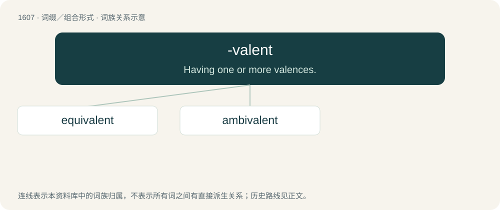

# 1704 · -valent — Having one or more valences.

[总目录](../00_总目录_按常用程度.md)

**类型**：词缀／组合形式　｜　**来源语言**：见词源记录

## 核心含义与来源

- 核心含义：Having one or more valences.
- 英文含义：Having one or more valences.
- 词形：-valent

**来源记录 1**（后缀／后置成分；Having one or more valences.）

Back-formation from valence.

## 词族图

## 单词速览（常用到不常用）

| 单词 | 音标 | 释义 |
|---|---|---|
| [equivalent](#w-1) | /ɪˈkwɪvələnt/ | n. 同等物, 等价物, 相等物；a. 相等的, 相当的, 同意义的；\[计\] 等价的 |
| [ambivalent](#w-2) | 英 /æmˈbɪv.ə.lənt/ | a. 矛盾的, 模棱两可的；\[医\] 矛盾情绪的 |

## 逐词详解

### 1. equivalent

**词性**：形容词　｜　**音标**：/ɪˈkwɪvələnt/

**中文释义**：n. 同等物, 等价物, 相等物；a. 相等的, 相当的, 同意义的；\[计\] 等价的

**英文义项**：Similar or identical in value, meaning or effect; virtually equal. / Of two sets, having a one-to-one correspondence.

**构词拆分**：By surface analysis, equi- + -valent

**词源与演化**：

From Latin aequivalentem, accusative singular of aequivalēns, present active participle of aequivaleō (“to be equivalent, have equal power”). By surface analysis, equi- + -valent. Mostly displaced native Middle English efenmete (See evenmete).

**例句**：

> To burn calories, a thirty-minute jog is equivalent to a couple of hamburgers.

该用例对应义项：Similar or identical in value, meaning or effect; virtually equal.

### 2. ambivalent

**词性**：形容词　｜　**音标**：英 /æmˈbɪv.ə.lənt/

**中文释义**：a. 矛盾的, 模棱两可的；\[医\] 矛盾情绪的

**英文义项**：Simultaneously experiencing or expressing opposing or contradictory feelings, beliefs, motivations, or meanings. / Alternately being or having one opinion or feeling, and then the opposite.

**构词拆分**：ambi- + -valent

**词源与演化**：

Back-formation from ambivalence, from German Ambivalenz, from Latin ambi- (“in two ways”) + valeō (“be strong”); equivalent to ambi- + -valent. Compare ambivert.

**例句**：

> His feelings toward his parents are ambivalent.

该用例对应义项：Alternately being or having one opinion or feeling, and then the opposite.
