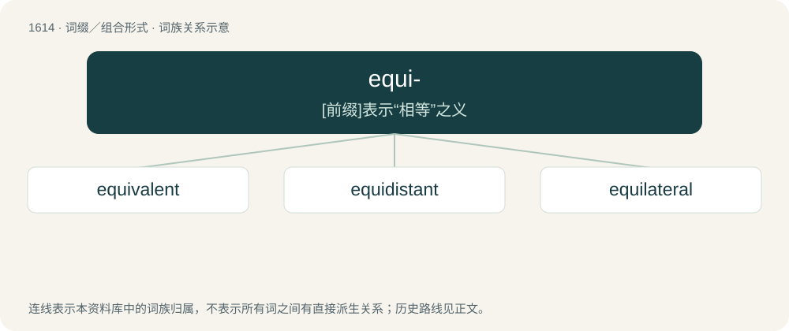

# 1711 · equi- — \[前缀\]表示“相等”之义

[总目录](../00_总目录_按常用程度.md)

**类型**：词缀／组合形式　｜　**来源语言**：见词源记录

## 核心含义与来源

- 核心含义：\[前缀\]表示“相等”之义
- 英文含义：Equal, equally.
- 词形：equi-

**来源记录 1**（前缀／前置成分；Equal, equally.）

From Latin aequi-, from aequus. See also equ-.

## 词族图

## 单词速览（常用到不常用）

| 单词 | 音标 | 释义 |
|---|---|---|
| [equivalent](#w-1) | /ɪˈkwɪvələnt/ | n. 同等物, 等价物, 相等物；a. 相等的, 相当的, 同意义的；\[计\] 等价的 |
| [equidistant](#w-2) | 英 /ˌɛk.wɪˈdɪs.tənt/；美 /ˌi.kwəˈdɪs.tənt/ | a. 距离相等的, 等距的 |
| [equilateral](#w-3) | /.iːkwiˈlætərəl/ | n. 等边形；a. 等边的 |

## 逐词详解

### 1. equivalent

**词性**：形容词　｜　**音标**：/ɪˈkwɪvələnt/

**中文释义**：n. 同等物, 等价物, 相等物；a. 相等的, 相当的, 同意义的；\[计\] 等价的

**英文义项**：Similar or identical in value, meaning or effect; virtually equal. / Of two sets, having a one-to-one correspondence.

**构词拆分**：By surface analysis, equi- + -valent

**词源与演化**：

From Latin aequivalentem, accusative singular of aequivalēns, present active participle of aequivaleō (“to be equivalent, have equal power”). By surface analysis, equi- + -valent. Mostly displaced native Middle English efenmete (See evenmete).

**例句**：

> To burn calories, a thirty-minute jog is equivalent to a couple of hamburgers.

该用例对应义项：Similar or identical in value, meaning or effect; virtually equal.

### 2. equidistant

**词性**：形容词　｜　**音标**：英 /ˌɛk.wɪˈdɪs.tənt/；美 /ˌi.kwəˈdɪs.tənt/

**中文释义**：a. 距离相等的, 等距的

**英文义项**：Occupying a position midway between two ends or sides. / Occupying a position that is an equal distance between several points. Note that in a one-dimensional space this position can be identified with two points, in a two-dimensional space with three points (not on the same straight line), and in a three-dimensional space with four points (not in the same plane).

**构词拆分**：By surface analysis, equi- + distant

**词源与演化**：

From Middle French équidistant, from Late Latin aequidistantem, from aequī (“equal”) + distantem (“distant”). By surface analysis, equi- + distant.

### 3. equilateral

**词性**：形容词　｜　**音标**：/.iːkwiˈlætərəl/

**中文释义**：n. 等边形；a. 等边的

**英文义项**：Having all the sides equal. / Having all the faces equal.

**构词拆分**：equi- + lateral

**词源与演化**：

From equi- + lateral.

**例句**：

> An equilateral triangle has three equal length sides and three equal size angles.
