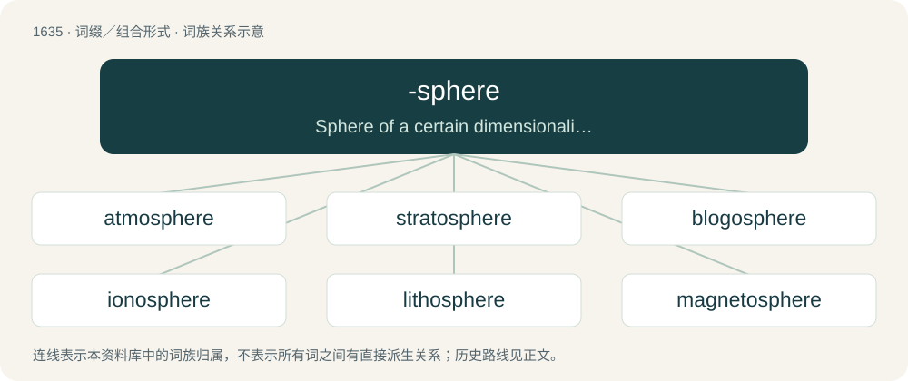

# 1734 · -sphere — Sphere of a certain dimensionality.

[总目录](../00_总目录_按常用程度.md)

**类型**：词缀／组合形式　｜　**来源语言**：见词源记录

## 核心含义与来源

- 核心含义：Sphere of a certain dimensionality.
- 英文含义：Sphere of a certain dimensionality.
- 词形：-sphere

**来源记录 1**（后缀／后置成分；Sphere of a certain dimensionality.）

From sphere.

## 词族图

## 单词速览（常用到不常用）

| 单词 | 音标 | 释义 |
|---|---|---|
| [atmosphere](#w-1) | 英 /ˈætməsˌfɪə/；美 /ˈætməsˌfɪɹ/ | n. 大气, 空气, 气氛；\[医\] 大气; 大气压 |
| [stratosphere](#w-2) | 英 /ˈstɹætəsfɪə/；美 /ˈstɹætəsfɪɚ/ | n. 同温层, 最上层, 尖端的学科领域；\[医\] 同温层, 平流层 |
| [blogosphere](#w-3) | /ˈblɒɡ.əʊˌsfɪɚ/ | 博客世界 |
| [ionosphere](#w-4) | /aiˈɒnə.sfiə/ | n. 电离层；\[化\] 电离层 |
| [lithosphere](#w-5) | /ˈliθəu.sfiə/ | n. 岩石圈, 陆界；\[化\] 岩石圈 |
| [magnetosphere](#w-6) | /mæɡˈni.təˌsfɪr/ | n. 磁层；\[电\] 磁动层 |
| [troposphere](#w-7) | 英 /ˈtɹɒpəsfɪə/；美 /ˈtɹoʊpəsfɪɚ/ | n. 对流层；\[医\] 对流层 |
| [photosphere](#w-8) | /ˈfəutəu.sfiə/ | n. 光球, 发光球体；\[电\] 光球 |

## 逐词详解

### 1. atmosphere

**词性**：名词　｜　**音标**：英 /ˈætməsˌfɪə/；美 /ˈætməsˌfɪɹ/

**中文释义**：n. 大气, 空气, 气氛；\[医\] 大气; 大气压

**英文义项**：The gases surrounding the Earth or any astronomical body. / The air in a particular place.

**构词拆分**：atmo- + -sphere

**词源与演化**：

Borrowed from French atmosphère, from New Latin atmosphaera, from Ancient Greek ἀτμός (atmós, “steam”) + σφαῖρα (sphaîra, “sphere”); corresponding to atmo- + -sphere.

**例句**：

> The atmosphere for the football match was great.

该用例对应义项：The apparent mood felt in an environment.

### 2. stratosphere

**词性**：名词　｜　**音标**：英 /ˈstɹætəsfɪə/；美 /ˈstɹætəsfɪɚ/

**中文释义**：n. 同温层, 最上层, 尖端的学科领域；\[医\] 同温层, 平流层

**英文义项**：The region of the uppermost atmosphere where the temperature increases along with the altitude due to the absorption of solar ultraviolet radiation by ozone. / Collectively, those layers of the Earth’s crust which primarily comprise stratified deposits.

**构词拆分**：strato- + -sphere

**词源与演化**：

From French stratosphère, a word coined by its discoverer, meteorologist Léon Teisserenc de Bort. From strato- + -sphere.

**例句**：

> Ozone in the stratosphere absorbs some of the sun’s harmful ultraviolet radiation.

### 3. blogosphere

**词性**：名词　｜　**音标**：/ˈblɒɡ.əʊˌsfɪɚ/

**中文释义**：博客世界

**英文义项**：The totality of blogs, especially the unique jargon, cultures and shared interests created by their interconnection.

**构词拆分**：blog + -o- + -sphere

**词源与演化**：

From blog + -o- + -sphere. Possibly under the influence of biosphere, atmosphere, etc.

**例句**：

> Mary studies social psychology, and is currently researching the evolution of the European blogosphere.

### 4. ionosphere

**词性**：名词　｜　**音标**：/aiˈɒnə.sfiə/

**中文释义**：n. 电离层；\[化\] 电离层

**英文义项**：The part of the Earth's atmosphere beginning at an altitude of about 50 kilometers (31 miles) and extending outward 500 kilometers (310 miles) or more. / The similar region of the atmosphere of another planet.

**构词拆分**：iono- + -sphere

**词源与演化**：

From iono- + -sphere.

**例句**：

> Solar radiation is what ionizes the ionosphere.

### 5. lithosphere

**词性**：名词　｜　**音标**：/ˈliθəu.sfiə/

**中文释义**：n. 岩石圈, 陆界；\[化\] 岩石圈

**英文义项**：The rigid, mechanically strong, outer layer of the Earth, which is divided into twelve major tectonic plates. / Any similar layer of an exoplanet.

**构词拆分**：litho- + -sphere

**词源与演化**：

From litho- + -sphere.

**例句**：

> The earth's crust can also be called the lithosphere.

### 6. magnetosphere

**词性**：名词　｜　**音标**：/mæɡˈni.təˌsfɪr/

**中文释义**：n. 磁层；\[电\] 磁动层

**英文义项**：The comet-shaped region around Earth or another planet in which charged particles are trapped or deflected. Shaped by the solar wind and the planet's magnetic field.

**构词拆分**：magneto- + -sphere

**词源与演化**：

From magneto- + -sphere.

**例句**：

> Earth’s magnetosphere is created by the constantly moving molten metal inside Earth.

### 7. troposphere

**词性**：名词　｜　**音标**：英 /ˈtɹɒpəsfɪə/；美 /ˈtɹoʊpəsfɪɚ/

**中文释义**：n. 对流层；\[医\] 对流层

**英文义项**：The lower levels of the atmosphere extending from the surface of the Earth or another celestial body up to the tropopause. It is characterized by convective air movements and a large vertical temperature change.

**构词拆分**：tropo- + -sphere

**词源与演化**：

Borrowed from French troposphère. Equivalent to tropo- + -sphere.

**例句**：

> The troposphere contains three-quarters of the mass of the entire atmosphere.

### 8. photosphere

**词性**：名词　｜　**音标**：/ˈfəutəu.sfiə/

**中文释义**：n. 光球, 发光球体；\[电\] 光球

**英文义项**：A visible surface layer of a star, and especially that of a sun. / A 360-degree panoramic photograph that provides a full view of a scene from all angles.

**构词拆分**：photo- + -sphere

**词源与演化**：

From photo- + -sphere.
