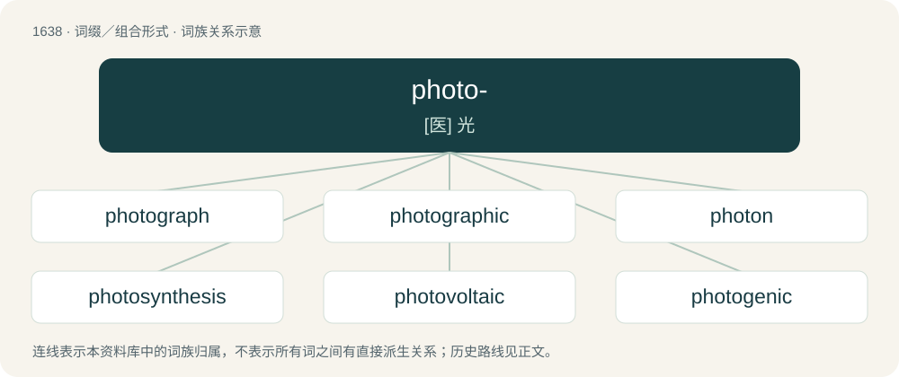

# 1737 · photo- — \[医\] 光

[总目录](../00_总目录_按常用程度.md)

**类型**：词缀／组合形式　｜　**来源语言**：见词源记录

## 核心含义与来源

- 核心含义：\[医\] 光
- 英文含义：light, electromagnetic radiation
- 词形：photo-

**来源记录 1**（前缀／前置成分；light, electromagnetic radiation）

From Ancient Greek φωτο- (phōto-), the combining form of φῶς (phôs, “light”).

## 词族图

## 单词速览（常用到不常用）

| 单词 | 音标 | 释义 |
|---|---|---|
| [photograph](#w-1) | 英 /ˈfəʊ.təˌɡɹɑːf/；美 /ˈfoʊ.təˌɡɹæf/ | n. 相片, 照片, 逼真的描绘；v. 照相, 摄影 |
| [photographic](#w-2) | 英 /ˌfəʊtəˈɡɹæfɪk/ | a. 照相的, 摄影用的, 详细记录的, 逼真的, 酷似的 |
| [photon](#w-3) | /ˈfəʊtɒn/ | n. 光子, 光量子, 光度；\[化\] 光量子; 光子 |
| [photosynthesis](#w-4) | 英 /ˌfəʊ.təʊˈsɪn.θə.sɪs/；美 /ˌfoʊ.toʊˈsɪn.θə.sɪs/ | n. 光合作用；\[化\] 光合作用 |
| [photovoltaic](#w-5) | /,fəutəuvɔlˈteiik/ | \[电\] 光电伏打 |
| [photogenic](#w-6) | 英 /ˌfəʊ.təʊˈd͡ʒɛn.ɪk/；美 /ˌfoʊ.toʊˈd͡ʒɛn.ɪk/ | a. 发光的, 由于光而产生的, 适宜于拍照的, 拍照效果好的, 特别上镜的, 上照的；\[医\] 光所致的, 光原性的, 发光的 |
| [photojournalist](#w-7) |  | n. 新闻摄影记者 |
| [photocopy](#w-8) | /ˈfəʊtəˌkɒpi/ | n. 影印, 复印件；v. 影印 |
| [photosynthetic](#w-9) | /,fəutəusinˈθetik/ | a. 光合的；\[医\] 光合的 |
| [photometric](#w-10) | /ˌfoʊ.təˈmɛt.ɹɪk/ | a. 光度学的, 光度计的, 光度测定的 |
| [photojournalism](#w-11) | 英 /ˌfəʊ̯.təʊ̯ˈd͡ʒɜːn(ə)lɪzəm/；美 /ˌfoʊ̯.toʊ̯ˈd͡ʒɝn(ə)lɪzəm/ | n. 摄影新闻工作, 摄影报道 |
| [photoelectric](#w-12) | /.fəutəuiˈlektrik/ | a. 光电的, 灯光摄影装置的；\[电\] 光电的 |
| [photosensitive](#w-13) | /.fəutəuˈsensitiv/ | a. 感光性的, 对光敏感的；\[医\] 对光敏感的, 感光的 |
| [photochemical](#w-14) | /.fəutəuˈkemikl/ | a. 光化学的, 光化作用的；\[医\] 光化学的 |
| [photoreceptor](#w-15) | /,fəutəuriˈseptə/ | n. 光感受器；\[医\] 光感受器 |
| [photometry](#w-16) | /fəuˈtɒmitri/ | n. 光度学, 光度测定, 测光法；\[化\] 光度学; 光度滴定法 |
| [photorealistic](#w-17) | /ˌfoʊ.toʊˌɹiː.əlˈɪs.tɪk/ | n. 逼真；adj. 相片般真实的 |
| [photosphere](#w-18) | /ˈfəutəu.sfiə/ | n. 光球, 发光球体；\[电\] 光球 |
| [photoelectron](#w-19) | /ˈfəutəuiˈlektrɒn/ | n. 光电子；\[化\] 光电子 |
| [photoresist](#w-20) | /,fəutəuriˈzist/ | \[计\] 感光保护膜；\[化\] 光刻胶; 光致抗蚀剂 |

## 逐词详解

### 1. photograph

**词性**：名词　｜　**音标**：英 /ˈfəʊ.təˌɡɹɑːf/；美 /ˈfoʊ.təˌɡɹæf/

**中文释义**：n. 相片, 照片, 逼真的描绘；v. 照相, 摄影

**英文义项**：A picture created by projecting an image onto a photosensitive surface such as a chemically treated plate or film, CCD receptor, etc.

**构词拆分**：photo- + -graph

**词源与演化**：

From photo- + -graph.

**例句**：

> This photograph shows the town before the railway was built.

这张照片展示了铁路建成之前的小镇。

### 2. photographic

**词性**：形容词　｜　**音标**：英 /ˌfəʊtəˈɡɹæfɪk/

**中文释义**：a. 照相的, 摄影用的, 详细记录的, 逼真的, 酷似的

**英文义项**：Pertaining to photographs or photography. / Synonym of accurate.

**构词拆分**：photo- + -graphic + photograph + -ic；photo- + -graphic；photograph + -ic

**词源与演化**：

From photo- + -graphic or photograph + -ic.

**例句**：

> This shop stocks all the latest photographic equipment.

该用例对应义项：Pertaining to photographs or photography.

### 3. photon

**词性**：名词　｜　**音标**：/ˈfəʊtɒn/

**中文释义**：n. 光子, 光量子, 光度；\[化\] 光量子; 光子

**英文义项**：The quantum of light and other electromagnetic energy, regarded as a discrete particle having zero rest mass, no electric charge, and an indefinitely long lifetime. It is a gauge boson.

**构词拆分**：photo- + -on

**词源与演化**：

From photo- + -on. Coined by American physicist Leonard Troland in 1916 as a unit of light hitting the retina, and later popularized in a more modern sense by Gilbert N. Lewis, with the term gaining acceptance in the physics community by the late 1920s.

**例句**：

> A photon is its own antiparticle.

### 4. photosynthesis

**词性**：名词　｜　**音标**：英 /ˌfəʊ.təʊˈsɪn.θə.sɪs/；美 /ˌfoʊ.toʊˈsɪn.θə.sɪs/

**中文释义**：n. 光合作用；\[化\] 光合作用

**英文义项**：Principally, oxygenic photosynthesis, any process by which plants and algae convert water and carbon dioxide into carbohydrates and waste oxygen using solar energy. / Also, nonoxygenic photosynthesis, used by purple and green bacteria, heliobacteria, and acidobacteria.

**构词拆分**：photo- + synthesis

**词源与演化**：

From photo- + synthesis.

**例句**：

> Trees use photosynthesis to turn sunlight, carbon dioxide and water into sugars.

### 5. photovoltaic

**词性**：形容词　｜　**音标**：/,fəutəuvɔlˈteiik/

**中文释义**：\[电\] 光电伏打

**英文义项**：Producing a voltage when exposed to light.

**构词拆分**：photo- + voltaic

**词源与演化**：

From photo- + voltaic.

**例句**：

> Tom is a solar photovoltaic panel installer.

### 6. photogenic

**词性**：形容词　｜　**音标**：英 /ˌfəʊ.təʊˈd͡ʒɛn.ɪk/；美 /ˌfoʊ.toʊˈd͡ʒɛn.ɪk/

**中文释义**：a. 发光的, 由于光而产生的, 适宜于拍照的, 拍照效果好的, 特别上镜的, 上照的；\[医\] 光所致的, 光原性的, 发光的

**英文义项**：Generated or caused by light. / Producing or emitting light; luminescent.

**构词拆分**：photo- + -genic

**词源与演化**：

From photo- + -genic.

**例句**：

> The company hired the spokesperson for his photogenic face.

该用例对应义项：Looking good when photographed.

### 7. photojournalist

**词性**：名词

**中文释义**：n. 新闻摄影记者

**英文义项**：A journalist who uses photojournalism.

**构词拆分**：photo- + journalist

**词源与演化**：

From photo- + journalist.

### 8. photocopy

**词性**：名词　｜　**音标**：/ˈfəʊtəˌkɒpi/

**中文释义**：n. 影印, 复印件；v. 影印

**英文义项**：A copy made using a photocopier.

**构词拆分**：photo- + copy

**词源与演化**：

From photo- + copy.

**例句**：

> Please send in the original document, and keep a photocopy for your records.

### 9. photosynthetic

**词性**：形容词　｜　**音标**：/,fəutəusinˈθetik/

**中文释义**：a. 光合的；\[医\] 光合的

**英文义项**：Of, relating to, or employing photosynthesis.

**构词拆分**：photo- + synthetic

**词源与演化**：

From photo- + synthetic.

**例句**：

> When we look at other places in the universe, it could very well be that photosynthetic life is the exception.

### 10. photometric

**词性**：形容词　｜　**音标**：/ˌfoʊ.təˈmɛt.ɹɪk/

**中文释义**：a. 光度学的, 光度计的, 光度测定的

**英文义项**：Of or relating to photometry or to photometers. / Adjusting position with respect to light.

**构词拆分**：photo- + -metric

**词源与演化**：

From photo- + -metric.

### 11. photojournalism

**词性**：名词　｜　**音标**：英 /ˌfəʊ̯.təʊ̯ˈd͡ʒɜːn(ə)lɪzəm/；美 /ˌfoʊ̯.toʊ̯ˈd͡ʒɝn(ə)lɪzəm/

**中文释义**：n. 摄影新闻工作, 摄影报道

**英文义项**：A form of journalism in which a story is told primarily through photographs and other images.

**构词拆分**：photo- + journalism

**词源与演化**：

From photo- + journalism.

### 12. photoelectric

**词性**：形容词　｜　**音标**：/.fəutəuiˈlektrik/

**中文释义**：a. 光电的, 灯光摄影装置的；\[电\] 光电的

**英文义项**：Of or relating to the electric effects of electromagnetic radiation, especially the ejection of an electron from a surface by a photon.

**构词拆分**：photo- + electric

**词源与演化**：

From photo- + electric.

**例句**：

> Einstein won the Nobel Prize for Physics in 1921 for his work on the photoelectric effect.

### 13. photosensitive

**词性**：形容词　｜　**音标**：/.fəutəuˈsensitiv/

**中文释义**：a. 感光性的, 对光敏感的；\[医\] 对光敏感的, 感光的

**英文义项**：Having a reaction to, or able to be affected by, light.

**构词拆分**：photo- + sensitive

**词源与演化**：

From photo- + sensitive.

### 14. photochemical

**词性**：形容词　｜　**音标**：/.fəutəuˈkemikl/

**中文释义**：a. 光化学的, 光化作用的；\[医\] 光化学的

**英文义项**：Of, relating to, or produced by photochemistry or by photochemical reactions.

**构词拆分**：photo- + chemical

**词源与演化**：

From photo- + chemical.

**例句**：

> The air was infected with photochemical smog.

### 15. photoreceptor

**词性**：名词　｜　**音标**：/,fəutəuriˈseptə/

**中文释义**：n. 光感受器；\[医\] 光感受器

**英文义项**：A specialized neuron or other structure able to detect and react to light.

**构词拆分**：photo- + receptor

**词源与演化**：

From photo- + receptor.

### 16. photometry

**词性**：名词　｜　**音标**：/fəuˈtɒmitri/

**中文释义**：n. 光度学, 光度测定, 测光法；\[化\] 光度学; 光度滴定法

**英文义项**：The measurement of various aspects of light, especially its intensity. / The measurement of the intensity and spectrum of light from stars.

**构词拆分**：photo- + -metry

**词源与演化**：

From photo- + -metry.

### 17. photorealistic

**词性**：形容词　｜　**音标**：/ˌfoʊ.toʊˌɹiː.əlˈɪs.tɪk/

**中文释义**：n. 逼真；adj. 相片般真实的

**英文义项**：Of or pertaining to photorealism.

**构词拆分**：photo- + realistic

**词源与演化**：

From photo- + realistic.

### 18. photosphere

**词性**：名词　｜　**音标**：/ˈfəutəu.sfiə/

**中文释义**：n. 光球, 发光球体；\[电\] 光球

**英文义项**：A visible surface layer of a star, and especially that of a sun. / A 360-degree panoramic photograph that provides a full view of a scene from all angles.

**构词拆分**：photo- + -sphere

**词源与演化**：

From photo- + -sphere.

### 19. photoelectron

**词性**：名词　｜　**音标**：/ˈfəutəuiˈlektrɒn/

**中文释义**：n. 光电子；\[化\] 光电子

**英文义项**：An electron ejected from the surface of a material by the photoelectric effect.

**构词拆分**：photo- + electron

**词源与演化**：

From photo- + electron.

### 20. photoresist

**词性**：名词　｜　**音标**：/,fəutəuriˈzist/

**中文释义**：\[计\] 感光保护膜；\[化\] 光刻胶; 光致抗蚀剂

**英文义项**：A light-sensitive film used in photolithography and photoengraving.

**构词拆分**：photo- + resist

**词源与演化**：

From photo- + resist.
