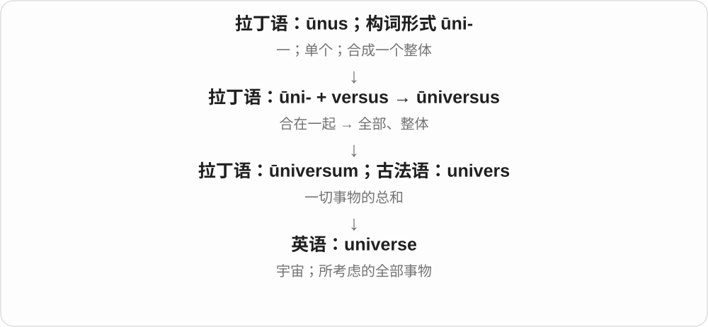
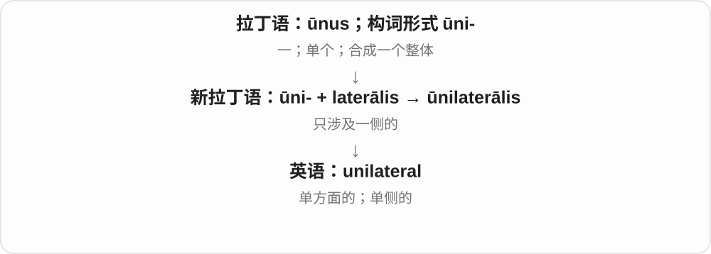
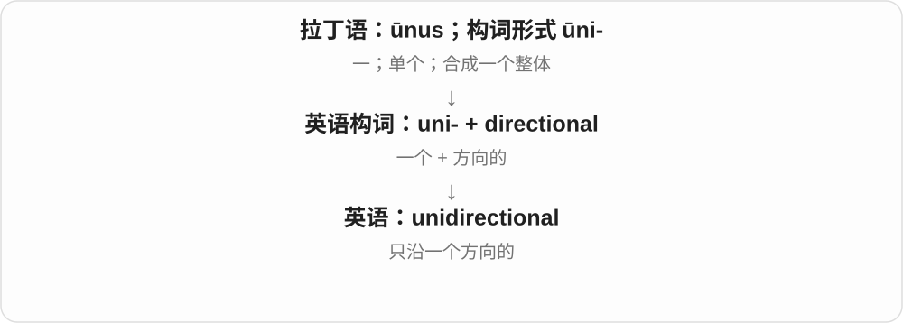

# 1748 · uni- — 一个、单一、统一方向或整体

[逐词精讲目录](../00_逐词精讲目录.md) · [总目录](../00_总目录_按常用程度.md)

## 核心词根与来源

uni- 一不是否定 un-，也不是所有 uni- 都只在数实体一件；universe 和统一整体的历史构词较复杂，见该词。

**UNI-：先问一个的是什么，再看后半词**

unibrow 一条连续眉；unicycle 一个轮；unilateral 单侧；unidirectional 单向；不同对象共同用单一概念。

- **整体、方向与侧面**：universe · unilateral · unidirectional · unipolar
- **外观、轮子与身体**：unibrow · unicycle · unibody
- **科学、制度与通用类别**：unicellular · univariate · unicameral · unisex

## 词形与演化规律

拉丁 unus 一及相应组合词干 → uni-；接 brow、cycle、lateral 等不同词基；有些整词早已从拉丁借入。

## 单词速览（按词族由简到繁）

同一基础词的相关扩展放在一起，先读基础形式，再读扩展；各组之间优先读常用的。具体词源关系见各词讲解。

| 单词 | 音标 | 核心意思 |
|---|---|---|
| [universe](#w-1) | 英 /ˈjuːnɪvɜːs/；美 /ˈjuːnəvɜːrs/ | 宇宙；某一范围内的全部事物 |
| [unilateral](#w-2) | /ˌjuːnɪˈlætərəl/ | 单方面的；单侧的 |
| [unisex](#w-3) | /ˈjuːnɪseks/ | 不分性别的；各性别通用的 |
| [unidirectional](#w-4) | /ˌjuːnɪdɪˈrekʃənəl/，也读 /ˌjuːnɪdaɪˈrekʃənəl/ | 单向的 |
| [unicycle](#w-5) | /ˈjuːnɪsaɪkəl/ | 独轮车；骑独轮车 |
| [unicellular](#w-6) | 英 /ˌjuːnɪˈseljʊlə/；美 /ˌjuːnəˈseljələr/ | 单细胞的 |
| [univariate](#w-7) | 英 /ˌjuːnɪˈveəriɪt/；美 /ˌjuːnɪˈveriɪt/ | 单变量的；一元的 |
| [unibody](#w-8) | 英 /ˈjuːnɪbɒdi/；美 /ˈjuːnɪbɑːdi/ | 承载式整体车身；一体式主体结构 |
| [unipolar](#w-9) | 英 /ˌjuːnɪˈpəʊlə/；美 /ˌjuːnəˈpoʊlər/ | 单极的；单一中心主导的 |
| [unicameral](#w-10) | /ˌjuːnɪˈkæmərəl/ | 一院制的；有一个室的 |
| [unibrow](#w-11) | /ˈjuːnɪbraʊ/，美式也弱读 /ˈjuːnəbraʊ/ | 连心眉、左右连成一条的眉毛 |

## 逐词讲解

### 1. universe — 宇宙；某一范围内的全部事物

**音标**：英 /ˈjuːnɪvɜːs/；美 /ˈjuːnəvɜːrs/

**先抓住这个画面**

universe 是把一切星系、物质和空间放进一个最大范围；也能把某个故事世界或讨论范围当作一个完整天地。

**怎么拆**

拉丁语 ūni-（一）+ versus（转向、合向）形成 ūniversus“全部、整体”；其中性形式 ūniversum 经法语进入英语。

**怎么变成今天的意思**

“合成一个整体”的说法变成“一切事物的总和”。词尾 verse 在这里不是英语 poem 那种诗句。

**常见搭配与例句**

the universe；the observable universe；a fictional universe。

> The book explores how scientists study the universe.

这本书介绍科学家怎样研究宇宙。

> All three novels are set in the same fictional universe.

这三部小说都发生在同一个虚构世界里。

**别混淆**

world 可指地球、人类社会或个人环境；universe 通常范围更大，也可指虚构作品的完整世界。

### 2. unilateral — 单方面的；单侧的

**音标**：/ˌjuːnɪˈlætərəl/

**先抓住这个画面**

unilateral 像一张谈判桌旁只有一方作了决定，没有等待另一方共同同意；在身体描述里也可以只指一侧。

**怎么拆**

新拉丁语 ūnilaterālis，含 ūnus（一）+ laterālis（侧面的）；现代可按 uni- + lateral 理解。

**怎么变成今天的意思**

“一边”可以是空间的一侧，也可以是参与关系中的一方。词本身不自动判断该决定合理或不合理。

**常见搭配与例句**

unilateral action；a unilateral decision；unilateral changes。

> The manager made a unilateral decision to change the schedule.

经理单方面决定更改日程。

> The report describes the change as unilateral rather than mutual.

报告把这项变更描述为单方面的，而非双方共同作出的。

**别混淆**

bilateral 是双方或两侧；unilateral 是一方或一侧。独自作决定与大家一致同意不是一回事。

### 3. unisex — 不分性别的；各性别通用的

**音标**：/ˈjuːnɪseks/

**先抓住这个画面**

unisex 像同一款帽子不按男女分两套，设计时就准备给不同性别的人共同使用。

**怎么拆**

uni-（一、共同）+ sex（性别）。

**怎么变成今天的意思**

现代常用义是不同性别通用，不是“只供一种性别使用”。具体适不适合某个人，仍由尺寸、功能和个人偏好决定。

**常见搭配与例句**

unisex clothing；a unisex name；a unisex design。

> The shop sells a range of unisex jackets.

这家店销售一系列不分性别的夹克。

> They chose a unisex name for the character.

他们为这个角色选了一个不分性别的名字。

**别混淆**

unisexual 在生物学中常指单性的；unisex 在现代商品和名称语境中通常是不分性别通用。

### 4. unidirectional — 单向的

**音标**：/ˌjuːnɪdɪˈrekʃənəl/，也读 /ˌjuːnɪdaɪˈrekʃənəl/

**先抓住这个画面**

unidirectional 像箭头只朝一边：信息从甲流向乙，却不沿同一通道反过来；材料纤维也可以都朝同一方向。

**怎么拆**

uni-（一）+ directional（方向的）。

**怎么变成今天的意思**

“单向”可以说流动方向，也可以说结构的排列方向。它并不表示只有一个物体在移动。

**常见搭配与例句**

unidirectional flow；unidirectional communication；unidirectional fibres。

> The diagram shows a unidirectional flow of information.

图示展示了信息的单向流动。

> The panel contains unidirectional fibres.

这块板材含有沿同一方向排列的纤维。

**别混淆**

unilateral 看参与方或侧别；unidirectional 看运动、传递或排列的方向。两者不能仅因都有“单”就互换。

### 5. unicycle — 独轮车；骑独轮车

**音标**：/ˈjuːnɪsaɪkəl/

**先抓住这个画面**

unicycle 就是一只轮子承载骑手，需要靠身体不断调整平衡。

**怎么拆**

uni-（一）+ cycle（轮、自行车），用古典成分形成的现代英语词。

**怎么变成今天的意思**

一直接落在车轮数量上。cycle 的远源来自希腊语“圆、轮”，这是一种跨古典来源的现代组合。

**常见搭配与例句**

ride a unicycle；learn to unicycle；balance on a unicycle。

> She practises riding a unicycle in the empty courtyard.

她在空院子里练习骑独轮车。

> The performer crossed the stage on a unicycle.

表演者骑独轮车穿过舞台。

**别混淆**

bicycle 有两个轮；tricycle 有三个轮；unicycle 有一个轮，前缀在这里真的数轮子。

### 6. unicellular — 单细胞的

**音标**：英 /ˌjuːnɪˈseljʊlə/；美 /ˌjuːnəˈseljələr/

**先抓住这个画面**

unicellular 像把一个完整生命体的基本活动都装在一个细胞里：这个个体本身只有一个细胞。

**怎么拆**

uni-（一）+ cellular（细胞的）。

**怎么变成今天的意思**

它描述个体的细胞数量，不是显微镜下只看见了一个细胞。许多单细胞个体可以同时生活在一起。

**常见搭配与例句**

a unicellular organism；unicellular life；unicellular algae。

> The diagram shows a unicellular organism.

图示展示了一个单细胞生物。

> The lesson compares unicellular and multicellular forms of life.

这节课比较了单细胞与多细胞生命形式。

**别混淆**

multicellular 是多细胞；unicellular 是单细胞。单细胞并不等于没有复杂的细胞内部活动。

### 7. univariate — 单变量的；一元的

**音标**：英 /ˌjuːnɪˈveəriɪt/；美 /ˌjuːnɪˈveriɪt/

**先抓住这个画面**

一次集中研究一个变量本身，比如只看一组人的身高分布。

**怎么拆**

uni-“一个” + variate“变量”；近现代数学、统计构词。

**怎么变成今天的意思**

**拉丁语 varius**  
不同的、多样的；带不同颜色的

↓

**拉丁语 variare → variatus → 英语 variate**  
变化 → 变过的；统计学中的变量或变量取值

↓

**英语 uni- + variate → univariate**  
只涉及一个变量或一个响应量

univariate distribution 描述一个随机变量。回归语境中也可强调只有一个响应变量，因此不能单凭该词断言模型里只有一个预测因素。

**常见搭配与例句**

univariate analysis；a univariate distribution；a univariate model。

> We began with a univariate analysis of age.

我们先对年龄作了单变量分析。

> A histogram can display a univariate distribution.

直方图可以展示一个单变量分布。

**别混淆**

bivariate 常处理两个量的共同关系；univariate 常先看单个量的分布、中心与分散程度。

### 8. unibody — 承载式整体车身；一体式主体结构

**音标**：英 /ˈjuːnɪbɒdi/；美 /ˈjuːnɪbɑːdi/

**先抓住这个画面**

不把承力框架与外壳完全看作两套分离东西，而让主体壳体参与整体支撑。

**怎么拆**

uni-（一、统一）+ body，汽车中常指车身与承力结构结合；电子产品又用一体式机身等用法。不是机械保证从一个原料块造出所有零件。

**怎么变成今天的意思**

**古英语 bodiġ → 中古英语 body / bodi**  
身体、躯干

↓

**英语 body**  
身体；主体、实体；群体

↓

**uni- + body → unibody**  
结合为整体的主体、承力结构

汽车资料中 unibody construction 可说承载式结构；电脑、设备外壳语境里也见 unibody design。具体工艺要看产品，不从词名推断焊点、部件数。

**常见搭配与例句**

unibody construction；a unibody design；a unibody shell。

> The article compares unibody construction with a separate frame design.

文章比较了承载式整体结构与独立车架设计。

> The laptop has a rigid unibody shell.

笔记本电脑采用坚固的一体式机身外壳。

**别混淆**

unibody 强调主体的承力结构，bodywork 常说车身及相关制造维修工作；外壳怎么造型、车体怎样承力不是同一个问题。

### 9. unipolar — 单极的；单一中心主导的

**音标**：英 /ˌjuːnɪˈpəʊlə/；美 /ˌjuːnəˈpoʊlər/

**先抓住这个画面**

unipolar 把重点放在“一极”：电子信号可以只用一种极性，国际关系讨论也可以只有一个占主导的力量中心。

**怎么拆**

uni-（一）+ polar（极的）。

**怎么变成今天的意思**

不同学科对 pole 的具体定义不同。这里的“一”要跟领域一起理解，不能把一切 unipolar 都想成一根独立磁极。

**常见搭配与例句**

a unipolar signal；a unipolar system；a unipolar world order。

> The diagram compares unipolar and bipolar signals.

图示比较了单极性与双极性信号。

> The article examines the idea of a unipolar international system.

文章考察了单极国际体系这一概念。

**别混淆**

bipolar 是两极；multipolar 是多极。国际关系里的极是主要力量中心，不是地理南北极。

### 10. unicameral — 一院制的；有一个室的

**音标**：/ˌjuːnɪˈkæmərəl/

**先抓住这个画面**

整个立法机构只有一个院，不再分成上下两院。

**怎么拆**

uni-“一” + cameral“室的、议院的”；cameral 最终接拉丁 camera。

**怎么变成今天的意思**

**古希腊语 kamara → 拉丁语 camera**  
有拱顶的空间、房间；更早来源未定

↓

**uni- + cameral → 英语 unicameral**  
一个议院的 → 一院制的

a unicameral legislature 只描述组织结构。它不自动意味着议员更少、程序更快，或政治上只允许一个政党；这些需要另外的信息。

**常见搭配与例句**

a unicameral parliament；a unicameral legislature。

> The country has a unicameral parliament.

这个国家实行一院制议会。

> The report compares unicameral and bicameral legislatures.

报告比较了一院制与两院制立法机构。

**别混淆**

unicameral 是一个院；unilateral 是单方面的，涉及参与决策的一方而非议院数。

### 11. unibrow — 连心眉、左右连成一条的眉毛

**音标**：/ˈjuːnɪbraʊ/，美式也弱读 /ˈjuːnəbraʊ/

**先抓住这个画面**

左右眉在中间接到一起，看上去是一条连续的眉；uni- 抓住连成一体，不是只剩左边一条。

**怎么拆**

uni- 一、单一 + brow 眉毛，现代外观名称。brow 本身还可前额，但在这里明确取眉。

**怎么变成今天的意思**

**拉丁一的词基 → uni-；英语 brow 眉**  
单一、连续 + 眉部

↓

**uni- + brow → unibrow**  
两侧连成一条的眉毛

a thick unibrow 浓连心眉，a distinctive unibrow 鲜明连心眉，draw a unibrow 画连心眉。

**常见搭配与例句**

a thick unibrow；a distinctive unibrow；draw a unibrow。

> The portrait shows a distinctive unibrow.

肖像画出了一条鲜明的连心眉。

> The cartoonist drew the character with a thick unibrow.

漫画家给角色画上了浓连心眉。

**别混淆**

unibrow 说眉连成一体，unilateral 说单侧；uni- 的一个究竟指数量、方向还是整体要看后半词。

## 这一组要分清什么

uni-/un- 单一与否定；unibrow 非失去一边眉；unilateral/unidirectional 单侧单向；unisex 男女通用等非无性别身份断言。

## 串起来练习

The unicycle has one wheel, and the arrow indicates unidirectional movement.

独轮车有一个轮子，箭头表示单向运动。
