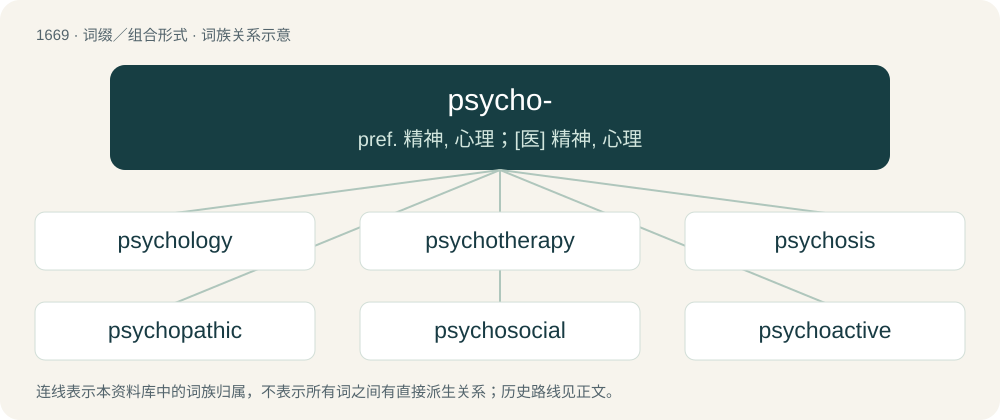

# 1769 · psycho- — pref. 精神, 心理；\[医\] 精神, 心理

[总目录](../00_总目录_按常用程度.md)

**类型**：词缀／组合形式　｜　**来源语言**：见词源记录

## 核心含义与来源

- 核心含义：pref. 精神, 心理；\[医\] 精神, 心理
- 英文含义：Relating to the soul, the mind, or to psychology.
- 词形：psycho-

**来源记录 1**（前缀／前置成分；Relating to the soul, the mind, or to psychology.）

From Ancient Greek ψῡχο- (psūkho-), combining form of ψυχή (psukhḗ, “soul”).

## 词族图

## 单词速览（常用到不常用）

| 单词 | 音标 | 释义 |
|---|---|---|
| [psychology](#w-1) | 英 /saɪˈkɒl.ə.d͡ʒɪ/；美 /saɪˈkɑ.lə.d͡ʒi/ | n. 心理学, 心理状态；\[医\] 心理学 |
| [psychotherapy](#w-2) | /ˌsaɪkoʊˈθɛɹəpi/ | n. 精神疗法, 心理疗法；\[医\] 精神疗法, 心理疗法 |
| [psychosis](#w-3) | 英 /saɪˈkəʊsɪs/；美 /saɪˈkoʊsɪs/ | n. 精神病, 精神不正常；\[医\] 精神病 |
| [psychopathic](#w-4) | 美 /ˌsaɪkoʊˈpæθɪk/ | a. 精神病的, 精神变态的；n. 精神变态者, 精神病患者 |
| [psychosocial](#w-5) | 英 /ˌsaɪ̯.kəʊ̯ˈsəʊ̯.ʃəl/；美 /ˌsaɪ̯.koʊ̯ˈsoʊ̯.ʃəl/ | 社会心理的(指社会环境影响下的个人心理变化) |
| [psychoactive](#w-6) | 美 /ˌsaɪkoʊˈæktɪv/ | a. 对神经起显著作用的, 对神经起特殊作用的 |
| [psychoanalytic](#w-7) | /ˈpsaikəj,ænəˈlitik/ | a. 精神分析的；\[医\] 精神分析的 |
| [psychotherapist](#w-8) | /.saikəuˈθerəpist/ | n. 精神治疗医生 |
| [psychosomatic](#w-9) | 英 /ˌsaɪkəʊsəˈmætɪk/；美 /ˌsaɪkoʊsəˈmædɪk/ | a. 身心的, 身心失调的；\[医\] 身心的, 心身的 |
| [psychotropic](#w-10) | /ˌsaɪkəˈtɹɒpɪk/ | a. 治疗精神病的 |
| [psychoanalyst](#w-11) | /.saikəuˈænəlist/ | n. 心理分析学家；\[医\] 精神分析家 |
| [psychopathy](#w-12) | 英 /saɪˈkɒpəθi/；美 /saɪˈkɑpəθi/ | n. 精神病, 精神变态, 精神疗法；\[医\] 精神变态, 变态人格, 病态人格 |
| [psychopathology](#w-13) | 英 /ˌsaɪ̯kɒpəˈθɒlədʒɪ/ | n. 精神病理学；\[医\] 精神病理学, 病理心理学 |
| [psychometric](#w-14) | 英 /ˌsaɪ.kəˈmɛt.ɹɪk/ | a. 心理测量的,心理测量学的 |
| [psychodynamic](#w-15) | /,saikəudaiˈnæmik/ | a. 心理动力的；\[医\] 精神动力学的 |
| [psychogenic](#w-16) | /ˌsaɪkɒˈd͡ʒɛnɪk/ | \[医\] 精神性的, 心理性的 |
| [psychopharmacology](#w-17) | /,saikəu,fɑːməˈkɔlədʒi/ | \[医\] 精神药理学 |
| [psychosexual](#w-18) | /,saikəuˈsekʃuəl/ | \[医\] 精神性欲的 |
| [psychodrama](#w-19) | /ˈsaikəu.drɑːmə/ | n. 心理剧；\[医\] 精神表演疗法 |
| [psychomotor](#w-20) | /.saikəˈməutə/ | a. 精神运动的；\[医\] 精神性运动的 |
| [psychoanalytical](#w-21) |  | a. 精神分析的 |
| [psychotherapeutic](#w-22) | /ˈpsaikəu,θerəˈpjuːtik/ | 精神疗法药 |

## 逐词详解

### 1. psychology

**词性**：名词　｜　**音标**：英 /saɪˈkɒl.ə.d͡ʒɪ/；美 /saɪˈkɑ.lə.d͡ʒi/

**中文释义**：n. 心理学, 心理状态；\[医\] 心理学

**英文义项**：The study of the human mind. / The study of human or animal behavior.

**构词拆分**：psycho- + -logy

**词源与演化**：

From French psychologie, from Renaissance Latin psychologia, from Ancient Greek ψυχή (psukhḗ, “soul”) + -λογία (-logía, “study of”), equivalent to psycho- + -logy. The Latin term is believed by some to have been coined in a lost treatise by Croatian humanist Marko Marulić (1450–1524), but this is disputed by other scholars. It is first attested in the 1570s, at which time it was apparently already current, and may be a Hellenization of the established expression dē animā (“on the soul”) in titles.

**例句**：

> Psychology findings suggest that conservatives are usually less intelligent than progressives are.

### 2. psychotherapy

**词性**：名词　｜　**音标**：/ˌsaɪkoʊˈθɛɹəpi/

**中文释义**：n. 精神疗法, 心理疗法；\[医\] 精神疗法, 心理疗法

**英文义项**：The treatment of people diagnosed with mental and emotional disorders using dialogue and a variety of psychological techniques.

**构词拆分**：psycho- + therapy

**词源与演化**：

From psycho- + therapy.

**例句**：

> The show's about a New Jersey mob boss who's in psychotherapy.

### 3. psychosis

**词性**：名词　｜　**音标**：英 /saɪˈkəʊsɪs/；美 /saɪˈkoʊsɪs/

**中文释义**：n. 精神病, 精神不正常；\[医\] 精神病

**英文义项**：A severe mental disorder, sometimes with physical damage to the brain, marked by a deranged personality and a distorted view of reality.

**构词拆分**：psych- + -osis

**词源与演化**：

From psych- + -osis. Not descended from Ancient Greek ψύχωσις (psúkhōsis, “animation, principle of life”), which is a piecewise cognate.

**例句**：

> Fortunately, I have never succumbed to the psychosis they call love.

### 4. psychopathic

**词性**：形容词　｜　**音标**：美 /ˌsaɪkoʊˈpæθɪk/

**中文释义**：a. 精神病的, 精神变态的；n. 精神变态者, 精神病患者

**英文义项**：Exhibiting the behaviors and personality traits of a psychopath.

**构词拆分**：psycho- + -pathic

**词源与演化**：

From psycho- + -pathic.

**例句**：

> A psychopathic killer is on the loose.

该用例对应义项：Exhibiting the behaviors and personality traits of a psychopath.

### 5. psychosocial

**词性**：形容词　｜　**音标**：英 /ˌsaɪ̯.kəʊ̯ˈsəʊ̯.ʃəl/；美 /ˌsaɪ̯.koʊ̯ˈsoʊ̯.ʃəl/

**中文释义**：社会心理的(指社会环境影响下的个人心理变化)

**英文义项**：Having both psychological and social aspects.

**构词拆分**：psycho- + social

**词源与演化**：

From psycho- + social.

**例句**：

> Once the children are rescued, they receive psychosocial counseling to help them overcome their trauma.

### 6. psychoactive

**词性**：形容词　｜　**音标**：美 /ˌsaɪkoʊˈæktɪv/

**中文释义**：a. 对神经起显著作用的, 对神经起特殊作用的

**英文义项**：Affecting the mind or mental processes.

**构词拆分**：psycho- + active

**词源与演化**：

From psycho- + active.

**例句**：

> LSD and DMT are psychoactive drugs.

该用例对应义项：Affecting the mind or mental processes.

### 7. psychoanalytic

**词性**：形容词　｜　**音标**：/ˈpsaikəj,ænəˈlitik/

**中文释义**：a. 精神分析的；\[医\] 精神分析的

**英文义项**：Of or relating to psychoanalysis.

**构词拆分**：psycho- + analytic

**词源与演化**：

From psycho- + analytic.

### 8. psychotherapist

**词性**：名词　｜　**音标**：/.saikəuˈθerəpist/

**中文释义**：n. 精神治疗医生

**英文义项**：Someone who practices psychotherapy.

**构词拆分**：psycho- + therapist + psychotherapy + -ist

**词源与演化**：

From psycho- + therapist, or from psychotherapy + -ist.

**例句**：

> We ought to consult a psychotherapist about our marital problems.

### 9. psychosomatic

**词性**：形容词　｜　**音标**：英 /ˌsaɪkəʊsəˈmætɪk/；美 /ˌsaɪkoʊsəˈmædɪk/

**中文释义**：a. 身心的, 身心失调的；\[医\] 身心的, 心身的

**英文义项**：Pertaining to physical diseases, symptoms, etc. which have mental causes.

**构词拆分**：psycho- + somatic

**词源与演化**：

From psycho- + somatic.

**例句**：

> After thoroughly examining Mary, the doctor could find no physical reason for her condition, and concluded that the cause was psychosomatic.

### 10. psychotropic

**词性**：形容词　｜　**音标**：/ˌsaɪkəˈtɹɒpɪk/

**中文释义**：a. 治疗精神病的

**英文义项**：Affecting the mind or mental processes.

**构词拆分**：psycho- + -tropic

**词源与演化**：

From psycho- + -tropic.

### 11. psychoanalyst

**词性**：名词　｜　**音标**：/.saikəuˈænəlist/

**中文释义**：n. 心理分析学家；\[医\] 精神分析家

**英文义项**：A practitioner of psychoanalysis.

**构词拆分**：psycho- + analyst

**词源与演化**：

From psycho- + analyst.

**例句**：

> Tom convinced Mary to see a psychoanalyst.

### 12. psychopathy

**词性**：名词　｜　**音标**：英 /saɪˈkɒpəθi/；美 /saɪˈkɑpəθi/

**中文释义**：n. 精神病, 精神变态, 精神疗法；\[医\] 精神变态, 变态人格, 病态人格

**英文义项**：A personality disorder characterized by impaired empathy and remorse, and bold, disinhibited, and egocentric traits masked by superficial charm and the outward presence of apparent normality. Violent and criminal offenses may be indicative of this disorder. / A mental illness; insanity.

**构词拆分**：psycho- + -pathy

**词源与演化**：

From psycho- + -pathy.

**例句**：

> Tinder is cultivating psychopathy in young people.

### 13. psychopathology

**词性**：名词　｜　**音标**：英 /ˌsaɪ̯kɒpəˈθɒlədʒɪ/

**中文释义**：n. 精神病理学；\[医\] 精神病理学, 病理心理学

**英文义项**：The study of the origin, development, diagnosis and treatment of mental and behavioural disorders. / A mental or behavioral disorder.

**构词拆分**：psycho- + pathology

**词源与演化**：

From psycho- + pathology.

**例句**：

> The MMPI-A is designed to measure characteristics of personality and psychopathology among adolescents.

### 14. psychometric

**词性**：形容词　｜　**音标**：英 /ˌsaɪ.kəˈmɛt.ɹɪk/

**中文释义**：a. 心理测量的,心理测量学的

**英文义项**：Of or pertaining to psychometrics.

**构词拆分**：psycho- + metric

**词源与演化**：

From psycho- + metric.

### 15. psychodynamic

**词性**：形容词　｜　**音标**：/,saikəudaiˈnæmik/

**中文释义**：a. 心理动力的；\[医\] 精神动力学的

**英文义项**：Of or pertaining to psychodynamics, the dynamic interplay between forces that govern human behavior, or the study of this

**构词拆分**：psycho- + dynamic

**词源与演化**：

From psycho- + dynamic.

### 16. psychogenic

**词性**：形容词　｜　**音标**：/ˌsaɪkɒˈd͡ʒɛnɪk/

**中文释义**：\[医\] 精神性的, 心理性的

**英文义项**：Originating from or caused by state of mind; having a psychological rather than a physiological cause.

**构词拆分**：psycho- + -genic

**词源与演化**：

From psycho- + -genic.

**例句**：

> Both nocebo and placebo effects are presumably psychogenic.

### 17. psychopharmacology

**词性**：名词　｜　**音标**：/,saikəu,fɑːməˈkɔlədʒi/

**中文释义**：\[医\] 精神药理学

**英文义项**：The branch of pharmacology which pertains to the psychoactive aspects of drugs.

**构词拆分**：psycho- + pharmacology

**词源与演化**：

From psycho- + pharmacology.

### 18. psychosexual

**词性**：形容词　｜　**音标**：/,saikəuˈsekʃuəl/

**中文释义**：\[医\] 精神性欲的

**英文义项**：Of or relating to the psychological aspect or aspects of sexuality.

**构词拆分**：psycho- + sexual

**词源与演化**：

From psycho- + sexual.

### 19. psychodrama

**词性**：名词　｜　**音标**：/ˈsaikəu.drɑːmə/

**中文释义**：n. 心理剧；\[医\] 精神表演疗法

**英文义项**：A form of psychotherapy in which a patient acts a role in a context devised by a psychotherapist. / A drama in this form

**构词拆分**：psycho- + drama

**词源与演化**：

From psycho- + drama.

### 20. psychomotor

**词性**：形容词　｜　**音标**：/.saikəˈməutə/

**中文释义**：a. 精神运动的；\[医\] 精神性运动的

**英文义项**：Of or pertaining to the function of muscles under the control of the mind

**构词拆分**：psycho- + motor

**词源与演化**：

From psycho- + motor.

### 21. psychoanalytical

**词性**：形容词

**中文释义**：a. 精神分析的

**英文义项**：Of or pertaining to psychoanalysis.

**构词拆分**：psycho- + analytical

**词源与演化**：

From psycho- + analytical.

### 22. psychotherapeutic

**词性**：形容词　｜　**音标**：/ˈpsaikəu,θerəˈpjuːtik/

**中文释义**：精神疗法药

**英文义项**：Of or pertaining to psychotherapeutics (psychotherapy) / Cathartic

**构词拆分**：psycho- + therapeutic

**词源与演化**：

From psycho- + therapeutic.
