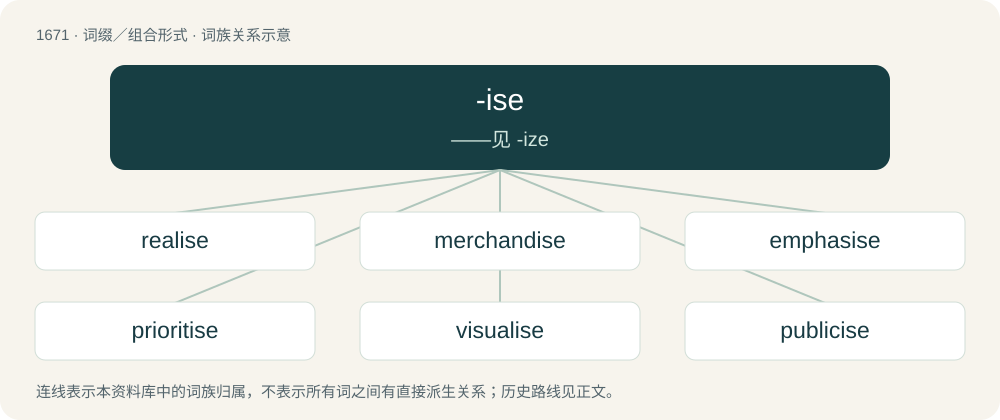

# 1770 · -ise — ——见 -ize

[总目录](../00_总目录_按常用程度.md)

**类型**：词缀／组合形式　｜　**来源语言**：见词源记录

## 核心含义与来源

- 核心含义：——见 -ize
- 英文含义：Suffix used in loanwords from French to form abstract nouns of quality or function.
- 词形：-ise

**来源记录 1**（后缀／后置成分；Suffix used in loanwords from French to form abstract nouns of quality or function.）

From Middle English -ise, from Old French -ise, borrowed from Latin -itia.

## 词族图

## 单词速览（常用到不常用）

| 单词 | 音标 | 释义 |
|---|---|---|
| [realise](#w-1) | /ˈriəlaiz,ˈriː-/ | vt. 实现, 认识到, 体会到, 了解, 认清, 使显得逼真, 变卖财产为现钱 |
| [merchandise](#w-2) | 英 /ˈmɜː.t͡ʃənˌdaɪs/；美 /ˈmɝ.t͡ʃənˌdaɪs/ | n. 商品, 货物；v. 交易, 买卖 |
| [emphasise](#w-3) |  | vt. 强调, 重读, 加强...的语气, 着重 |
| [prioritise](#w-4) | /praɪˈɒrəˌtaɪz/ | vt. 给予…优先权; 按优先顺序处理; 出轻重缓急；vi. 把事情按优先顺序排好（等于prioritize） |
| [visualise](#w-5) | /ˈvizjjəlaiz, -ʒjə-/ | vt. 使可见, 使具体化, 使具形象；vt.vi. 设想, 想象；vi. 显现 |
| [publicise](#w-6) | /ˈpʌblɪ(ˌ)saɪz/ | vt. 公布, 为...做广告, 宣传 |
| [revolutionise](#w-7) | /,revəˈljuːʃənaiz/ | vt. 使革命化, 彻底改革, 彻底改变 |
| [revitalise](#w-8) |  | vt. 使有新的活力, 使新生, 使恢复元气 |
| [scrutinise](#w-9) | /ˈskɹuːtɪnaɪz/ | vt.vi. 细看, 仔细检查, 审查, 细阅；\[经\] 详细检查, 细细地看 |
| [energise](#w-10) | /ˈenədʒaiz/ | vt. 供给…能量；使精力充沛（等于energize） |
| [standardise](#w-11) |  | vt. 使与标准比较, 用标准校验, 使符合标准, 使统一, 使标准化 |

## 逐词详解

### 1. realise

**词性**：动词　｜　**音标**：/ˈriəlaiz,ˈriː-/

**中文释义**：vt. 实现, 认识到, 体会到, 了解, 认清, 使显得逼真, 变卖财产为现钱

**英文义项**：Non-Oxford British standard spelling of realize.

**构词拆分**：real + -ise

**词源与演化**：

From real + -ise, possibly from French réaliser and Middle French réaliser (“to make real; to convert (something) into assets or cash”). See realize.

**例句**：

> You do realise that I won't be able to come, don't you?

### 2. merchandise

**词性**：名词　｜　**音标**：英 /ˈmɜː.t͡ʃənˌdaɪs/；美 /ˈmɝ.t͡ʃənˌdaɪs/

**中文释义**：n. 商品, 货物；v. 交易, 买卖

**英文义项**：Goods which are or were offered or intended for sale. / Commercial goods connected (branded) with an entity such as a team, band, company, charity, work of fiction, festival, or meme. (Commonly shortened to merch.)

**构词拆分**：merchant + -ise

**词源与演化**：

From Middle English marchaundise (“commerce, trading; buying; business transaction, deal; merchandise, goods, wares; possessions”), from Anglo-Norman marchaundise and Old French marcheandise (modern French marchandise), from Old French marcheant (“seller, vendor”) (ultimately from Latin mercātus (“buying and selling, trade, traffic; market; marketplace”), possibly originally Etruscan) + -ise (suffix forming feminine nouns, often denoting a quality or state). The English word is analysable as merchant + -ise.

**例句**：

> Good business depends on having good merchandise.

该用例对应义项：Goods which are or were offered or intended for sale.

### 3. emphasise

**词性**：动词

**中文释义**：vt. 强调, 重读, 加强...的语气, 着重

**英文义项**：UK standard spelling of emphasize.

**构词拆分**：From emphasis + -ise.

**词源与演化**：

From emphasis + -ise.

**例句**：

> I would like to emphasise that I will not agree to that.

### 4. prioritise

**词性**：动词　｜　**音标**：/praɪˈɒrəˌtaɪz/

**中文释义**：vt. 给予…优先权; 按优先顺序处理; 出轻重缓急；vi. 把事情按优先顺序排好（等于prioritize）

**英文义项**：UK standard spelling of prioritize.

**构词拆分**：From priority + -ise.

**词源与演化**：

From priority + -ise.

**例句**：

> My Government will prioritise tackling climate change and ensuring that all girls have access to twelve years of quality education.

### 5. visualise

**词性**：动词　｜　**音标**：/ˈvizjjəlaiz, -ʒjə-/

**中文释义**：vt. 使可见, 使具体化, 使具形象；vt.vi. 设想, 想象；vi. 显现

**英文义项**：Non-Oxford British spelling of visualize.

**构词拆分**：visual + -ise

**词源与演化**：

From visual + -ise (a variant of -ize (suffix forming verbs denoting the doing or making of what is denoted by the adjectives or nouns to which it is attached)).

**例句**：

> Can you visualise how the garden will look once the flowers are in bloom?

### 6. publicise

**词性**：动词　｜　**音标**：/ˈpʌblɪ(ˌ)saɪz/

**中文释义**：vt. 公布, 为...做广告, 宣传

**英文义项**：To make widely known to the public. / To advertise, create publicity for.

**构词拆分**：From public + -ise.

**词源与演化**：

From public + -ise.

### 7. revolutionise

**词性**：动词　｜　**音标**：/,revəˈljuːʃənaiz/

**中文释义**：vt. 使革命化, 彻底改革, 彻底改变

**英文义项**：To change radically or significantly, as in a revolution.

**构词拆分**：From revolution + -ise.

**词源与演化**：

From revolution + -ise.

### 8. revitalise

**词性**：动词

**中文释义**：vt. 使有新的活力, 使新生, 使恢复元气

**英文义项**：To give new life, energy, activity or success to something. / To rouse from a state of inactivity or quiescence.

**构词拆分**：re- + vital + -ise

**词源与演化**：

From re- + vital + -ise.

**例句**：

> We must collaborate to revitalise our relationship.

### 9. scrutinise

**词性**：动词　｜　**音标**：/ˈskɹuːtɪnaɪz/

**中文释义**：vt.vi. 细看, 仔细检查, 审查, 细阅；\[经\] 详细检查, 细细地看

**英文义项**：To examine something with great care. / To audit accounts etc in order to verify them.

**构词拆分**：From scrutiny + -ise.

**词源与演化**：

From scrutiny + -ise.

**例句**：

> When writing a dissertation, it is important to heavily scrutinise your secondary sources.

### 10. energise

**词性**：动词　｜　**音标**：/ˈenədʒaiz/

**中文释义**：vt. 供给…能量；使精力充沛（等于energize）

**英文义项**：Non-Oxford British standard spelling of energize.

**构词拆分**：energy + -ise

**词源与演化**：

From energy + -ise.

### 11. standardise

**词性**：动词

**中文释义**：vt. 使与标准比较, 用标准校验, 使符合标准, 使统一, 使标准化

**英文义项**：To establish a standard consisting of regulations for how something is to be done across an organization. / To make to conform to a standard.

**构词拆分**：standard + -ise

**词源与演化**：

From standard + -ise.
