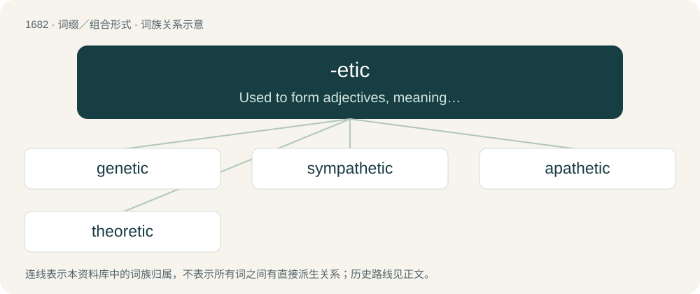

# 1779 · -etic — Used to form adjectives, meaning "pertaining to", derived from nouns, most of which end in -esis and -esy.

[总目录](../00_总目录_按常用程度.md)

**类型**：词缀／组合形式　｜　**来源语言**：见词源记录

## 核心含义与来源

- 核心含义：Used to form adjectives, meaning "pertaining to", derived from nouns, most of which end in -esis and -esy.
- 英文含义：Used to form adjectives, meaning "pertaining to", derived from nouns, most of which end in -esis and -esy.
- 词形：-etic

**来源记录 1**（后缀／后置成分；Used to form adjectives, meaning "pertaining to", derived from nouns, most of which end in -esis and -esy.）

Ultimately from Ancient Greek -ητικός (-ētikós).

## 词族图

## 单词速览（常用到不常用）

| 单词 | 音标 | 释义 |
|---|---|---|
| [genetic](#w-1) | /d͡ʒəˈnɛt.ɪk/ | a. 创始的, 遗传的, 起源的, 遗传学的；\[医\] 生殖的, 遗传的 |
| [sympathetic](#w-2) | /ˌsɪm.pəˈθɛt.ɪk/ | a. 有同情心的, 合意的, 赞成的；n. 交感神经, 容易感受的人 |
| [apathetic](#w-3) | 英 /ˌæpəˈθɛtɪk/；美 /ˌæpəˈθɛtɪk/ | a. 缺乏感情的, 无动于衷的, 缺乏兴趣的；\[医\] 无情\[感\]的, 淡漠的 |
| [theoretic](#w-4) | /ˌθiːəˈɹɛtɪk/ | a. 理论上的, 好理论的 |

## 逐词详解

### 1. genetic

**词性**：形容词　｜　**音标**：/d͡ʒəˈnɛt.ɪk/

**中文释义**：a. 创始的, 遗传的, 起源的, 遗传学的；\[医\] 生殖的, 遗传的

**英文义项**：Relating to genetics or genes. / Caused by genes.

**构词拆分**：By surface analysis, gene + -tic；gen(esis) + -etic

**词源与演化**：

Coined from genesis, similarly to antithesis, antithetic. Reflects Ancient Greek γενετικός (genetikós), from γένεσις (génesis) + -κός (-kós). Ultimately from Ancient Greek γίγνομαι (gígnomai, “I come into being”). By surface analysis, gene + -tic or gen(esis) + -etic.

**例句**：

> Chinese has borrowed several words from English, but it does not have a genetic relationship to English.

该用例对应义项：Based on shared membership in a linguistic family.

### 2. sympathetic

**词性**：形容词　｜　**音标**：/ˌsɪm.pəˈθɛt.ɪk/

**中文释义**：a. 有同情心的, 合意的, 赞成的；n. 交感神经, 容易感受的人

**英文义项**：Of, related to, feeling, showing, or characterized by sympathy. / Showing approval of or favor towards an idea or action.

**构词拆分**：By surface analysis, sympathy + -etic (“pertaining to”)

**词源与演化**：

Mid 17th century in the sense “relating to an affinity or paranormal influence”, from Latin sympathēticus. By surface analysis, sympathy + -etic (“pertaining to”); compare pathetic. Displaced native Old English efnþrōwiende.

**例句**：

> Sympathetic magic is based on imitation or correspondence.

该用例对应义项：Relating to, producing, or denoting an effect which arises through an affinity, interdependence, or mutual association.

### 3. apathetic

**词性**：形容词　｜　**音标**：英 /ˌæpəˈθɛtɪk/；美 /ˌæpəˈθɛtɪk/

**中文释义**：a. 缺乏感情的, 无动于衷的, 缺乏兴趣的；\[医\] 无情\[感\]的, 淡漠的

**英文义项**：Void of feeling; not susceptible of deep emotion. / Of, or pertaining to apatheism.

**构词拆分**：From apathy + -etic.

**词源与演化**：

From apathy + -etic.

**例句**：

> A woman who became active rather than apathetic as she grew older.

该用例对应义项：showing little or no emotion or animation

### 4. theoretic

**词性**：形容词　｜　**音标**：/ˌθiːəˈɹɛtɪk/

**中文释义**：a. 理论上的, 好理论的

**英文义项**：Concerned with theories or hypotheses rather than with practical matters. / Existing only in theory, not proven in reality.

**构词拆分**：theory + -etic

**词源与演化**：

English theory + -etic, from Latin theōrēticus, from Ancient Greek θεωρητικός (theōrētikós).
