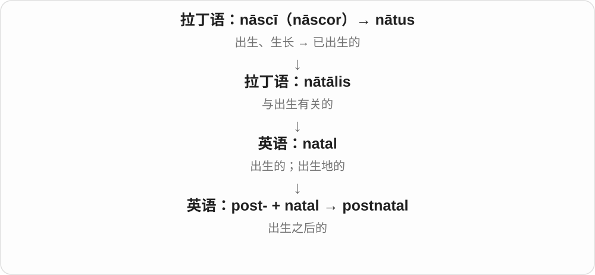

# 1785 · post- — 之后；后面

[逐词精讲目录](../00_逐词精讲目录.md) · [总目录](../00_总目录_按常用程度.md)

## 核心词根与来源

来自拉丁 post，既可说时间上的之后，也可说位置上的后面。posterior、posterity、posthumous 通过各自的拉丁词形进入英语；postwar、postdoctoral 等则利用前缀组成现代英语词。看起来透明的现代拆分，不一定就是全部历史。

**POST = AFTER / BEHIND**

画一条时间轴，给事件插上标记，再看标记后面的事；若换成空间，就表示某物的后部。

- **空间后部、后世与身后**：posterior, posterity, posthumous, posthumously
- **安排、写作与战争之后**：postpone, postponement, postponed, postscript, postwar
- **教育阶段之后**：postsecondary, postgraduate, postdoctoral, postdoc
- **手术、分娩及创伤之后**：postoperative, postpartum, postnatal, posttraumatic
- **比赛、文化与付费**：postgame, postseason, postmodern, postmodernism, postcolonial, postpaid

## 词形与演化规律

post- 常加事件或阶段词：war 战争、doctoral 博士、operative 手术相关。postscript 接拉丁“写在后面”；posthumous 的 h 是后加的词源联想。postpaid 的手机义用“之后”前缀，邮寄义的 post 却是邮件，不可混解。

## 单词速览（常用到不常用）

| 单词 | 音标 | 核心意思 |
|---|---|---|
| [postponed](#w-1) | 英 /pəˈspəʊnd/；美 /poʊˈspoʊnd/ | 被推迟的；已经延期的 |
| [postpone](#w-2) | 英 /pəʊstˈpəʊn/；美 /poʊstˈpoʊn/ | 推迟；延期 |
| [postseason](#w-3) | 英 /ˌpəʊstˈsiːzən/；美 /ˌpoʊstˈsiːzən/ | 季后赛阶段；季后赛的 |
| [posterior](#w-4) | 英 /pɒˈtɪəriə/；美 /pɑˈtɪriər/ | 后面的；后部的；臀部〔委婉说法〕；后验的 |
| [postwar](#w-5) | 英 /ˈpəʊstwɔː/；美 /ˈpoʊstwɔr/ | 战后的 |
| [postgraduate](#w-6) | 英 /ˌpəʊstˈɡrædʒuət/；美 /ˌpoʊstˈɡrædʒuət/ | 研究生；本科毕业后的 |
| [postdoctoral](#w-7) | 英 /ˌpəʊstˈdɒktərəl/；美 /ˌpoʊstˈdɑktərəl/ | 博士后的 |
| [postmodern](#w-8) | 英 /ˌpəʊstˈmɒdən/；美 /ˌpoʊstˈmɑːdərn/ | 后现代的 |
| [postponement](#w-9) | 英 /pəʊstˈpəʊnmənt/；美 /poʊstˈpoʊnmənt/ | 延期；推迟 |
| [postpartum](#w-10) | 英 /ˌpəʊstˈpɑːtəm/；美 /ˌpoʊstˈpɑrtəm/ | 产后的；分娩之后 |
| [posterity](#w-11) | 英 /pɒˈsterəti/；美 /pɑˈsterəti/ | 后世；后代；子孙 |
| [posthumous](#w-12) | 英 /ˈpɒstʃʊməs/；美 /ˈpɑstʃəməs/ | 死后发生的；身后出版或授予的；遗腹的 |
| [posthumously](#w-13) | 英 /ˈpɒstʃʊməsli/；美 /ˈpɑstʃəməsli/ | 在死后；于身后 |
| [postsecondary](#w-14) | 英 /ˌpəʊstˈsekəndəri/；美 /ˌpoʊstˈsekənderi/ | 中学后的；中等教育之后的 |
| [postscript](#w-15) | 英 /ˈpəʊstskrɪpt/；美 /ˈpoʊstskrɪpt/ | 附言；补记；后续补充 |
| [postoperative](#w-16) | 英 /ˌpəʊstˈɒpərətɪv/；美 /ˌpoʊstˈɑpərətɪv/ | 手术后的；术后的 |
| [postgame](#w-17) | 英 /ˈpəʊstɡeɪm/；美 /ˈpoʊstɡeɪm/ | 赛后的 |
| [postmodernism](#w-18) | 英 /ˌpəʊstˈmɒdənɪzəm/；美 /ˌpoʊstˈmɑdərnɪzəm/ | 后现代主义 |
| [postcolonial](#w-19) | 英 /ˌpəʊstkəˈləʊniəl/；美 /ˌpoʊstkəˈloʊniəl/ | 殖民统治结束后的；后殖民研究的 |
| [postnatal](#w-20) | 英 /ˌpəʊstˈneɪtəl/；美 /ˌpoʊstˈneɪtəl/ | 出生后的；产后的 |
| [postdoc](#w-21) | 英 /ˈpəʊstdɒk/；美 /ˈpoʊstdɑk/ | 博士后研究人员；博士后职位或阶段 |
| [postpaid](#w-22) | 英 /ˌpəʊstˈpeɪd/；美 /ˌpoʊstˈpeɪd/ | 后付费的；邮资已付的〔另一构词〕 |
| [posttraumatic](#w-23) | 英 /ˌpəʊsttrɔːˈmætɪk/；美 /ˌpoʊsttrəˈmætɪk/ | 创伤后的；创伤所致的 |

## 逐词讲解

### 1. postponed — 被推迟的；已经延期的

**音标**：英 /pəˈspəʊnd/；美 /poʊˈspoʊnd/

**先抓住这个画面**

把日历上的安排从现在这格移到后面的某一格。

**怎么拆**

postpone + -ed；postpone 接拉丁 postponere，post 后面 + ponere 放，把事情往后放。

**怎么变成今天的意思**

**拉丁 post**  
在……之后；在后面

↓

**拉丁 postponere → 英语 postpone**  
放到后面 → 推迟

↓

**postpone + -ed → postponed**  
已经推迟

The meeting was postponed 是会议延期了；postponed until Friday 是推到星期五。这个词说明原时间不再举行，但不表示事情永远取消。

**常见搭配与例句**

be postponed until；be postponed because of；a postponed meeting。

> The concert was postponed until next month.

音乐会被推迟到下个月。

> The meeting was postponed because several members could not attend.

因为几位成员无法参加，会议延期了。

**别混淆**

postponed 是推后，canceled 是取消。postponed indefinitely 表示新时间未定，也不必自动理解为永不举行。

### 2. postpone — 推迟；延期

**音标**：英 /pəʊstˈpəʊn/；美 /poʊstˈpoʊn/

**先抓住这个画面**

原本排在今天的事，搬到后面的日子再做。

**怎么拆**

直接借拉丁 postponere：post-“在后” + pōnere“放”。不是 post + phone。

**怎么变成今天的意思**

**拉丁语 pōnere；过去分词 positus**  
放、安置；已经放好的

↓

**拉丁 post- + pōnere → postponere → 英语 postpone**  
放到后面 → 把时间往后推

通常推迟原来计划做的活动。接动作时用 postpone doing；若事情彻底不做，则常用 cancel。

**常见搭配与例句**

postpone the meeting；postpone doing；postpone until…。

> They postponed the match until Sunday.

他们把比赛推迟到了星期日。

> We postponed buying a new car.

我们推迟了买新车的计划。

**别混淆**

delay 可以泛指变慢、耽搁；postpone 常强调主动改到以后。

### 3. postseason — 季后赛阶段；季后赛的

**音标**：英 /ˌpəʊstˈsiːzən/；美 /ˌpoʊstˈsiːzən/

**先抓住这个画面**

常规赛排完次序后，比赛还没有全结束，部分队伍继续争夺更高名次或冠军。

**怎么拆**

post- 在后 + season，英语体育构词；这里通常是常规赛之后，而非所有活动都停止后的休息时间。

**怎么变成今天的意思**

**拉丁语 serere，分词 satus**  
播种、栽种

↓

**拉丁语 satio，宾格 sationem**  
播种行为 → 播种时节

↓

**古法语 seison / saison**  
时节；适当时候

↓

**中古英语 sesoun → season**  
季节；某项活动的固定时期

↓

**英语 post- + season → postseason**  
常规赛之后的比赛阶段

常与 playoffs 相连，但具体赛事结构随联赛而不同。make the postseason 是取得进入季后赛阶段的资格。

**常见搭配与例句**

reach the postseason；postseason games。

> The club reached the postseason for the first time in years.

俱乐部多年来首次进入季后赛阶段。

> Postseason games attracted larger crowds.

季后赛吸引了更多观众。

**别混淆**

offseason 是通常没有正式赛季比赛的休赛期；postseason 往往还有关键比赛。

### 4. posterior — 后面的；后部的；臀部〔委婉说法〕；后验的

**音标**：英 /pɒˈtɪəriə/；美 /pɑˈtɪriər/

**先抓住这个画面**

先确定一个前面，再沿着身体、时间或推理过程找后面。

**怎么拆**

借自拉丁 posterior，posterus 后来的的比较级，上接 post；不是英语 poster 海报加 -ior。

**怎么变成今天的意思**

**拉丁 post**  
在……之后；在后面

↓

**拉丁 posterus → posterior**  
后来的 → 更后面的

↓

**英语 posterior**  
后部的；臀部；后验的

the posterior part 是后部；在解剖中常与 anterior 前部的相对。作名词可委婉指臀部；统计学中的 posterior probability 是获得相关证据后更新的概率，重点是信息顺序。

**常见搭配与例句**

the posterior surface；the posterior part；a posterior probability；land on one’s posterior。

> The diagram labels the anterior and posterior surfaces.

图中标出了前表面和后表面。

> He slipped on the ice and landed on his posterior.

他在冰上滑倒，一屁股坐到了地上。

**别混淆**

posterior 不是 poster 海报的比较级。人体的前后方向、时间先后和统计后验要按语境分别理解。

### 5. postwar — 战后的

**音标**：英 /ˈpəʊstwɔː/；美 /ˈpoʊstwɔr/

**先抓住这个画面**

战争结束是时间轴上的一道分界，之后的重建、生活和文化都可以用这个词描述。

**怎么拆**

post- 之后 + war 战争；属于英语用拉丁前缀与日常词组成的新词，不是古罗马整词。

**怎么变成今天的意思**

**拉丁 post**  
在……之后；在后面

↓

**英语 post- + war → postwar**  
战争结束之后的

postwar reconstruction 是战后重建；the postwar generation 是战后的一代人。不加说明时，某些历史文本常指第二次世界大战后，但具体是哪场战争仍由上下文决定。

**常见搭配与例句**

postwar reconstruction；postwar Europe；the postwar economy；the postwar generation。

> The museum documents postwar reconstruction in the city.

博物馆记录了这座城市的战后重建。

> Her research focuses on postwar housing design.

她的研究集中在战后住宅设计。

**别混淆**

postwar 不等于 after every war，也不是“下一场战争”。它相对于谈论中的那场战争，表示之后的时期。

### 6. postgraduate — 研究生；本科毕业后的

**音标**：英 /ˌpəʊstˈɡrædʒuət/；美 /ˌpoʊstˈɡrædʒuət/

**先抓住这个画面**

已经走完第一个学位阶段，继续往后读。

**怎么拆**

post-“在……之后” + graduate；结尾按名词、形容词读 /uət/。

**怎么变成今天的意思**

**拉丁 gradus；gradī / gradior**  
一步、台阶、等级；走、迈步

↓

**中古拉丁 graduāre → graduātus → 中古英语 graduat**  
授予学位 → 已获学位的

↓

**中古英语 graduat；由此形成动词 graduaten → 英语 graduate**  
毕业生；毕业、授予学位、分刻度

↓

**英语 post- + graduate → postgraduate**  
取得首个学位后继续学习的；相应学生

英国英语常见 postgraduate student/course；美国更常说 graduate student/school。它不自动等于博士生。

**常见搭配与例句**

postgraduate study；a postgraduate degree；a postgraduate student。

> She applied for a postgraduate course in linguistics.

她申请了语言学研究生课程。

> The seminar is open to postgraduates from several departments.

研讨课向几个院系的研究生开放。

**别混淆**

undergraduate 通常尚在攻读首个本科学位；postgraduate 位于此后。

### 7. postdoctoral — 博士后的

**音标**：英 /ˌpəʊstˈdɒktərəl/；美 /ˌpoʊstˈdɑktərəl/

**先抓住这个画面**

博士学位已经取得，再往后进入一段进一步研究和训练的阶段。

**怎么拆**

post- 之后 + doctoral 博士的；doctoral 上接 doctor 及学位用法，不是说医生下班以后。

**怎么变成今天的意思**

**拉丁 post**  
在……之后；在后面

↓

**英语 post- + doctoral → postdoctoral**  
获得博士学位后的研究或训练相关

a postdoctoral researcher 是博士后研究人员；a postdoctoral fellowship 是相应研究职位或资助。它通常不是比博士更高一级的另一个学位，而是取得博士后的研究阶段。

**常见搭配与例句**

postdoctoral research；a postdoctoral researcher；a postdoctoral fellowship。

> She began a postdoctoral fellowship in molecular biology.

她开始了一项分子生物学博士后研究工作。

> The laboratory is recruiting two postdoctoral researchers.

实验室正在招聘两名博士后研究人员。

**别混淆**

doctoral 是博士阶段的，postdoctoral 是取得博士后的。postgraduate 范围较广，通常包括本科毕业后的硕士、博士等学习。

### 8. postmodern — 后现代的

**音标**：英 /ˌpəʊstˈmɒdən/；美 /ˌpoʊstˈmɑːdərn/

**先抓住这个画面**

接在现代主义之后，并且常常反过来质疑它的规则：为什么只能有一种风格、一种讲法？

**怎么拆**

post- 在……之后 + modern。是英语构词；在艺术、思想等领域发展出专门含义，不能只按日历理解。

**怎么变成今天的意思**

**拉丁语：modus**  
尺度、分寸；方式

↓

**拉丁语：modo → 后期拉丁语 modernus**  
modo 作副词表示刚刚、如今 → 当今的

↓

**法语及拉丁语 → 英语 modern**  
现代的；符合当时新方式的

↓

**英语 post- + modern → postmodern**  
现代之后的；后现代风格或思想的

建筑可能混用不同年代的样式；文学可能暴露故事正在被编写的过程。不同学科对后现代的界定并不完全一样。

**常见搭配与例句**

postmodern architecture；a postmodern novel。

> The essay examines irony in postmodern fiction.

这篇文章考察后现代小说中的反讽。

> The building combines historical references in a postmodern style.

这座建筑以后现代风格混合了不同历史样式。

**别混淆**

modern 是现代的；postmodern 通常含对现代主义某些前提的反思或回应。

### 9. postponement — 延期；推迟

**音标**：英 /pəʊstˈpəʊnmənt/；美 /poʊstˈpoʊnmənt/

**先抓住这个画面**

一项活动还保留着，只是原定日期被往后挪。

**怎么拆**

postpone + -ment，动词变成表示行为或结果的名词。

**怎么变成今天的意思**

**拉丁语 pōnere；过去分词 positus**  
放、安置；已经放好的

↓

**拉丁 post- + pōnere → postponere → 英语 postpone**  
放到后面 → 把时间往后推

↓

**英语 postpone + -ment → postponement**  
把安排推后这件事

通常讨论某场活动或某项决定的推迟；可数时一次 postponement 就是一次延期。

**常见搭配与例句**

the postponement of；request a postponement；a further postponement。

> Heavy snow forced the postponement of the concert.

大雪迫使音乐会延期。

> They requested a brief postponement to review the documents.

他们请求短暂延期，以便审阅文件。

**别混淆**

cancellation 是取消；postponement 通常仍打算以后进行。

### 10. postpartum — 产后的；分娩之后

**音标**：英 /ˌpəʊstˈpɑːtəm/；美 /ˌpoʊstˈpɑrtəm/

**先抓住这个画面**

以分娩为时间点，描述母亲接下来的身体、照护或生活阶段。

**怎么拆**

来自拉丁短语 post partum，post 之后 + partum 分娩，是 partus 的格变化；不是英语 part 部分加尾巴。

**怎么变成今天的意思**

**拉丁 post**  
在……之后；在后面

↓

**拉丁 post partum**  
分娩以后

↓

**英语 postpartum**  
产后的；在产后

postpartum care 是产后护理；three weeks postpartum 是分娩后三周。postpartum depression 是产后抑郁这一完整词组，但 postpartum 单独并不等于抑郁。

**常见搭配与例句**

postpartum care；the postpartum period；three weeks postpartum。

> The clinic provides postpartum care and family support.

这家诊所提供产后护理和家庭支持。

> The interview took place six weeks postpartum.

访谈在分娩后六周进行。

**别混淆**

postnatal 常说出生后的，范围可涉及母婴；postpartum 更直接以分娩及产妇为中心。两者在部分场合重叠。

### 11. posterity — 后世；后代；子孙

**音标**：英 /pɒˈsterəti/；美 /pɑˈsterəti/

**先抓住这个画面**

想象时间轴继续向前走，我们之后还会有一代代人来到这里。

**怎么拆**

来自法语 posterité、拉丁 posteritas，上接 posterus 后来的；不从英语 posterior 再直接加 -ity。

**怎么变成今天的意思**

**拉丁 post**  
在……之后；在后面

↓

**拉丁 posterus → posteritas**  
后来的 → 后代、未来世代

↓

**法语 posterité → 英语 posterity**  
后世；后人

preserve something for posterity 是把东西保留下来给后人；posterity will judge us 是说后世会评价我们。它可指一个人的后代，也常泛指未来世代。

**常见搭配与例句**

for posterity；preserve for posterity；leave something to posterity。

> The recordings were preserved for posterity.

这些录音被保存下来，留给后人。

> He hoped his letters would help posterity understand the period.

他希望自己的书信能帮助后人理解那个时代。

**别混淆**

posterity 是后世的人，prosperity 是繁荣；两者形近，但一个关乎时间，一个关乎兴旺。

### 12. posthumous — 死后发生的；身后出版或授予的；遗腹的

**音标**：英 /ˈpɒstʃʊməs/；美 /ˈpɑstʃəməs/

**先抓住这个画面**

人已经不在，作品、荣誉或孩子却在之后来到世上。

**怎么拆**

来自拉丁 postumus 最后的、最后出生的；后期受 humare 埋葬或 humus 土的联想加 h。不是原本就由 post + humus 规则合成。

**怎么变成今天的意思**

**拉丁 post**  
在……之后；在后面

↓

**拉丁 posterus → postumus**  
后来的 → 最后的、最后出生的

↓

**后期拉丁 posthumus → 英语 posthumous**  
与身后发生、父死后出生相联系

a posthumous award 是去世后授予的奖；a posthumous novel 是作者去世后出版的小说，通常不是说作者死后才写作。posthumous child 可指父亲去世后出生的孩子。

**常见搭配与例句**

a posthumous award；a posthumous publication；a posthumous album；a posthumous child。

> The writer received a posthumous award for her contribution to literature.

这位作家去世后因文学贡献获得了追授奖项。

> His posthumous novel was edited from an unfinished manuscript.

他身后出版的小说由一份未完成的手稿编辑而成。

**别混淆**

posthumous 中的 h 有后来的词源联想背景，不能据现代拼写编成最初就是“埋进土后”。重音在第一音节。

### 13. posthumously — 在死后；于身后

**音标**：英 /ˈpɒstʃʊməsli/；美 /ˈpɑstʃəməsli/

**先抓住这个画面**

把时间点标在某人去世之后，说明出版、授奖或认可发生得更晚。

**怎么拆**

posthumous + -ly；形容词的历史接 postumus 与后来的 h 拼写变化。

**怎么变成今天的意思**

**拉丁 post**  
在……之后；在后面

↓

**拉丁 postumus／posthumus → posthumous**  
最后的 → 身后的

↓

**posthumous + -ly → posthumously**  
在身后发生

published posthumously 是死后出版；awarded posthumously 是追授。副词通常修饰这些动作，告诉你动作发生在谁去世之后。

**常见搭配与例句**

published posthumously；awarded posthumously；honored posthumously。

> The collection of poems was published posthumously.

这部诗集在作者去世后出版。

> The medal was awarded posthumously to the rescue worker.

这枚奖章被追授给了那位救援人员。

**别混淆**

a posthumous award 用形容词修饰奖项，receive an award posthumously 用副词说明授奖时间；意思相通，句法不同。

### 14. postsecondary — 中学后的；中等教育之后的

**音标**：英 /ˌpəʊstˈsekəndəri/；美 /ˌpoʊstˈsekənderi/

**先抓住这个画面**

高中或其他中等教育阶段结束，接着走向大学、专科或其他后续教育。

**怎么拆**

post- 之后 + secondary 中等教育的；不是“第二次之后”，这里 secondary 属于教育阶段名称。

**怎么变成今天的意思**

**拉丁 post**  
在……之后；在后面

↓

**英语 post- + secondary → postsecondary**  
中等教育完成之后的

postsecondary education 包括中等教育以后的多种教育形式；postsecondary institutions 可包括大学、学院和部分职业教育机构，范围依具体教育体系而定。

**常见搭配与例句**

postsecondary education；postsecondary institutions；postsecondary training。

> The scholarship helps students enter postsecondary education.

这项奖学金帮助学生接受中学后的教育。

> The survey includes universities and other postsecondary institutions.

调查涵盖大学和其他中等教育之后的教育机构。

**别混淆**

postsecondary 不等于 postgraduate。前者以中等教育为分界，后者通常以本科毕业为分界。

### 15. postscript — 附言；补记；后续补充

**音标**：英 /ˈpəʊstskrɪpt/；美 /ˈpoʊstskrɪpt/

**先抓住这个画面**

信已经写完签名了，忽然想起一件事，于是在末尾再补几句。

**怎么拆**

接拉丁 post scriptum 写在后面的内容，post 之后 + scriptum 已写的；现代可对应 post- + script。

**怎么变成今天的意思**

**拉丁 post**  
在……之后；在后面

↓

**拉丁 post scriptum → postscriptum**  
写完之后补写的内容

↓

**英语 postscript**  
信末附言；后来的补充

a postscript to a letter 是信末附言，常用 P.S. 引出。a postscript to the story 也可指主要故事结束后的补充，让听者知道后来又发生了什么。

**常见搭配与例句**

add a postscript；in a postscript；a postscript to the story；P.S.。

> She added a postscript asking me to bring the photographs.

她在信末加了附言，让我把照片带来。

> The final chapter serves as a postscript to the main story.

最后一章相当于主线故事的补记。

**别混淆**

postscript 不等于文章前面的 preface。它位于主要内容之后，可能只是几句话，不一定是一整章。

### 16. postoperative — 手术后的；术后的

**音标**：英 /ˌpəʊstˈɒpərətɪv/；美 /ˌpoʊstˈɑpərətɪv/

**先抓住这个画面**

手术完成是一道时间线，接下来的观察、护理和恢复都在这条线后面。

**怎么拆**

post- 之后 + operative 与手术相关的；operative 在这里接 operation 的外科手术义。

**怎么变成今天的意思**

**拉丁 post**  
在……之后；在后面

↓

**英语 post- + operative → postoperative**  
发生或安排在手术之后的

postoperative care 是术后护理；a postoperative appointment 是术后复诊。单词只给出与手术的时间关系，不说明手术类型，也不自动意味着有并发症。

**常见搭配与例句**

postoperative care；postoperative recovery；a postoperative appointment。

> The nurse explained the postoperative care plan.

护士解释了术后护理计划。

> A postoperative appointment was arranged before she left the hospital.

她离院前已经安排好了术后复诊。

**别混淆**

preoperative 是术前，postoperative 是术后。operative 在此不是泛指“工作有效”，而是手术相关。

### 17. postgame — 赛后的

**音标**：英 /ˈpəʊstɡeɪm/；美 /ˈpoʊstɡeɪm/

**先抓住这个画面**

终场哨已经响了，球员采访、教练总结和电视点评随后开始。

**怎么拆**

post- 之后 + game 比赛；英语合成，常放在名词前。

**怎么变成今天的意思**

**拉丁 post**  
在……之后；在后面

↓

**英语 post- + game → postgame**  
比赛之后的

a postgame interview 是赛后采访；postgame analysis 是赛后分析。它表示单场比赛之后，不是整个赛季结束后的阶段。

**常见搭配与例句**

a postgame interview；postgame analysis；a postgame press conference。

> The coach answered questions at the postgame press conference.

教练在赛后新闻发布会上回答了问题。

> The channel devoted an hour to postgame analysis.

频道用一个小时进行了赛后分析。

**别混淆**

postgame 对应一场 game 之后；postseason 指常规赛之后的赛事阶段，例如季后赛，时间范围不同。

### 18. postmodernism — 后现代主义

**音标**：英 /ˌpəʊstˈmɒdənɪzəm/；美 /ˌpoʊstˈmɑdərnɪzəm/

**先抓住这个画面**

可以先想象作品把不同年代、不同风格拼在一起，连“必须只有一种正确讲法”也拿来追问。

**怎么拆**

post- 之后 + modernism 现代主义；是现代文化与思想语境中的名称，不能只当作“现在之后”。

**怎么变成今天的意思**

**拉丁 post**  
在……之后；在后面

↓

**英语 post- + modernism → postmodernism**  
对现代主义及现代思想某些主张的后续回应

在艺术、文学、建筑与哲学中，postmodernism 的范围不完全相同。拼贴、戏仿、混用风格可帮助理解部分艺术作品；思想讨论则常涉及对统一解释和确定性的质疑。这是一组相关倾向，不是一个简单口号。

**常见搭配与例句**

postmodernism in literature；debates about postmodernism；modernism and postmodernism。

> The course explores postmodernism in literature and architecture.

这门课探讨文学与建筑中的后现代主义。

> The essay compares different interpretations of postmodernism.

这篇文章比较了对后现代主义的不同理解。

**别混淆**

postmodernism 不表示所有今天的新作品，也不等于作者只是在胡说。具体含义要看讨论的领域与理论背景。

### 19. postcolonial — 殖民统治结束后的；后殖民研究的

**音标**：英 /ˌpəʊstkəˈləʊniəl/；美 /ˌpoʊstkəˈloʊniəl/

**先抓住这个画面**

形式上的殖民统治结束了，但历史留下的问题仍在眼前。

**怎么拆**

post-“之后” + colonial。

**怎么变成今天的意思**

**拉丁 colere；分词 cultus**  
耕作、照料；居住；尊敬、崇奉

↓

**拉丁 colōnus → colōnia**  
耕作者、定居者 → 定居点

↓

**中古英语 colane / colonye → 英语 colony**  
殖民地；定居群体；生物群体

↓

**英语 colony + -al → colonial**  
殖民地的、殖民统治的；群居的

↓

**英语 post- + colonial → postcolonial**  
殖民时期之后；研究殖民影响及其延续的

postcolonial history 可以说独立后的历史；postcolonial literature、theory 常研究殖民经历与延续影响，并非宣称所有殖民结构已经消失。

**常见搭配与例句**

postcolonial literature；postcolonial society；postcolonial theory。

> The novel explores identity in a postcolonial society.

小说探讨后殖民社会中的身份问题。

> She studies postcolonial literature from several regions.

她研究多个地区的后殖民文学。

**别混淆**

precolonial 是殖民统治之前；postcolonial 不一定等于“与殖民历史毫无关系”。

### 20. postnatal — 出生后的；产后的

**音标**：英 /ˌpəʊstˈneɪtəl/；美 /ˌpoʊstˈneɪtəl/

**先抓住这个画面**

postnatal 把出生当作时间分界线，指它之后的阶段，可以围绕母亲或婴儿来谈。

**怎么拆**

post-（之后）+ natal（出生的）。

**怎么变成今天的意思**

搭配 care 时是产后或出生后的照护；搭配 development 时是出生后的发育。

**常见搭配与例句**

postnatal care；postnatal development；the postnatal period。

> The booklet explains the centre’s postnatal services.

小册子介绍了这个中心的产后服务。

> The study follows postnatal development in young birds.

研究跟踪幼鸟出生后的发育。

**别混淆**

prenatal 在出生前，postnatal 在出生后；neonatal 特别指新生儿阶段。

### 21. postdoc — 博士后研究人员；博士后职位或阶段

**音标**：英 /ˈpəʊstdɒk/；美 /ˈpoʊstdɑk/

**先抓住这个画面**

学术圈把长长的 postdoctoral 缩短，聊天时直接说 postdoc。

**怎么拆**

postdoctoral 的缩略形式；可进一步指相应的人、岗位或研究经历，具体看句子。

**怎么变成今天的意思**

**拉丁 post**  
在……之后；在后面

↓

**post- + doctoral → postdoctoral**  
博士后的

↓

**postdoctoral → postdoc**  
缩略为研究阶段、岗位或人员名称

She is a postdoc 说她是博士后研究人员；do a postdoc 说从事一段博士后研究；a postdoc position 是博士后职位。它不是普通学生对老师的称呼。

**常见搭配与例句**

do a postdoc；a postdoc position；a postdoc in a laboratory。

> He is a postdoc in the astronomy department.

他是天文学系的一名博士后研究人员。

> She did a postdoc abroad before joining the university.

加入这所大学前，她在国外做过博士后研究。

**别混淆**

postdoc 是日常学术交流中的缩写，正式职位名称常用 postdoctoral researcher 或 fellow；不同机构的具体称谓可能不同。

### 22. postpaid — 后付费的；邮资已付的〔另一构词〕

**音标**：英 /ˌpəʊstˈpeɪd/；美 /ˌpoʊstˈpeɪd/

**先抓住这个画面**

手机服务是先用后付；邮购说明则可能说邮费已经算进价钱，两条线要分开看。

**怎么拆**

后付费义是 post- 之后 + paid 已付；邮资义则是 post 邮政 + paid。这里两个 post 来源和作用不同。

**怎么变成今天的意思**

**后付费义：拉丁 post → 英语 post- + paid**  
服务之后再付款

↓

**邮资义：英语 post〔邮件〕+ paid**  
邮费已付或已包含

a postpaid mobile plan 是按账单后付费的手机套餐；The book costs ten dollars postpaid 可以表示书价十美元且包含邮资。不能把后一种说明误读成收书以后再交钱。

**常见搭配与例句**

a postpaid plan；postpaid customers；sent postpaid；a price quoted postpaid。

> She switched from a prepaid plan to a postpaid plan.

她从预付费套餐改成了后付费套餐。

> The booklet is available for five dollars postpaid.

这本小册子售价五美元，含邮资。

**别混淆**

postpaid 在通信套餐里与 prepaid 预付费相对；在邮寄语境里却可能强调已经付了邮费。只按前缀记忆会在这里误判。

### 23. posttraumatic — 创伤后的；创伤所致的

**音标**：英 /ˌpəʊsttrɔːˈmætɪk/；美 /ˌpoʊsttrəˈmætɪk/

**先抓住这个画面**

受伤或经历创伤性事件之后，描述接下来出现的相关状态。

**怎么拆**

post- 之后 + traumatic 创伤相关的；traumatic 接希腊 trauma 伤。可涉及身体或心理创伤。

**怎么变成今天的意思**

**拉丁 post**  
在……之后；在后面

↓

**post- + traumatic → posttraumatic**  
创伤以后发生的，或由创伤引起的

posttraumatic symptoms 是创伤后的症状；posttraumatic stress disorder 是创伤后应激障碍，缩写 PTSD。posttraumatic 只是形容词，不能把任何创伤后的反应都直接等同于完整的疾病名称。

**常见搭配与例句**

posttraumatic symptoms；posttraumatic stress；posttraumatic recovery。

> The article discusses posttraumatic symptoms after serious accidents.

文章讨论了严重事故后的创伤相关症状。

> Her research focuses on posttraumatic recovery.

她的研究关注创伤后的恢复。

**别混淆**

traumatic 描述创伤性或与创伤有关，posttraumatic 多了之后发生这一关系。PTSD 中的 disorder 不能在翻译时凭空省掉。

## 这一组要分清什么

postsecondary 以中等教育为分界，postgraduate 通常以本科为分界，postdoctoral 以博士学位为分界。postgame 是单场赛后，postseason 是常规赛后的赛事阶段。

## 串起来练习

The postdoctoral researcher added a postscript explaining why the lecture had been postponed.

这位博士后研究人员在末尾加了附言，解释讲座为什么延期。
