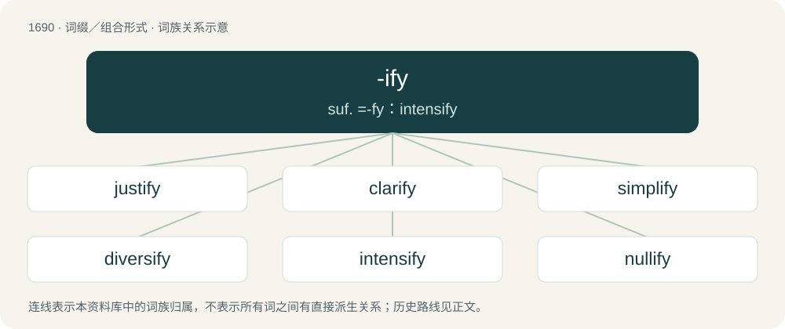

# 1787 · -ify — suf. =-fy：intensify

[总目录](../00_总目录_按常用程度.md)

**类型**：词缀／组合形式　｜　**来源语言**：见词源记录

## 核心含义与来源

- 核心含义：suf. =-fy：intensify
- 英文含义：Forms transitive verbs meaning "to make" from adjectives and nouns.
- 词形：-ify

**来源记录 1**（后缀／后置成分；Forms transitive verbs meaning "to make" from adjectives and nouns.）

From Middle English -ifien, from Old French -ifier, from Latin -ificāre, from -ficus, from faciō (“to make, do”). For example, purify from purificare, from purificus.

## 词族图

## 单词速览（常用到不常用）

| 单词 | 音标 | 释义 |
|---|---|---|
| [justify](#w-1) | /ˈd͡ʒʌstɪfaɪ/ | vt. 替...辩护, 证明；vi. 证明合法；\[计\] 段落重排, 两端对齐 |
| [clarify](#w-2) | 英 /ˈklæɹ.ɪ.faɪ/；美 /ˈklɛɹ.ɪ.faɪ/ | vi. 澄清, 阐明；vt. 使明晰 |
| [simplify](#w-3) | /ˈsɪmplɪfaɪ/ | vt. 单一化, 简单化 |
| [diversify](#w-4) | 英 /daɪˈvɜː.sɪ.faɪ/；美 /daɪˈvɝ.sə.faɪ/ | vt. 使多样化, 使变化 |
| [intensify](#w-5) | /ɪnˈtɛnsɪfaɪ/ | vt. 加强；vi. 强化 |
| [nullify](#w-6) | /ˈnʌlɪfaɪ/ | vt. 使无效, 废弃, 取消；\[化\] 使等于零; 作废 |
| [indemnify](#w-7) | /ɪnˈdɛm.nɪ.faɪ/ | vt. 赔偿, 补偿, 保护, 保障；\[经\] 赔偿 |
| [falsify](#w-8) | /ˈfɒlsɪfaɪ/ | vt. 伪造, 歪曲；vi. 说谎 |
| [vilify](#w-9) | /ˈvɪl.ɪ.faɪ/ | vt. 诽谤, 贬低；\[法\] 诋毁, 中伤, 诽谤 |
| [codify](#w-10) | 英 /ˈkəʊ.dɪˌfaɪ/；美 /ˈkɑ.dɪˌfaɪ/ | vt. 编成法典；\[法\] 使成文法化, 编成法典, 编纂 |
| [objectify](#w-11) | /əbˈd͡ʒɛktɪˌfaɪ/ | vt. 使客观化 |
| [personify](#w-12) | /pə(ɹ)ˈsɒnɪfaɪ/ | vt. 看做人, 赋与人性, 使人格化, 体现, 是...的化身 |
| [detoxify](#w-13) | /diːˈtɒksifai/ | vt. 使解毒；\[医\] 解毒, 去毒 |
| [horrify](#w-14) | 英 /ˈhɒɹɪfaɪ/；美 /ˈhɔɹəfaɪ/ | vt. 使恐惧, 使震惊 |

## 逐词详解

### 1. justify

**词性**：动词　｜　**音标**：/ˈd͡ʒʌstɪfaɪ/

**中文释义**：vt. 替...辩护, 证明；vi. 证明合法；\[计\] 段落重排, 两端对齐

**英文义项**：To provide an acceptable explanation for. / To be a good reason behind a normally-unacceptable action; to warrant.

**构词拆分**：just + -ify

**词源与演化**：

From Middle English justifien, from Old French justifier, from Late Latin justificare (“make just”), from Latin justus, iustus (“just”) + ficare (“make”), from facere, equivalent to just + -ify.

**例句**：

> She felt no need to justify herself for deciding not to invite him.

该用例对应义项：To give reasons for one’s actions; to make an argument to prove that one is in the right.

### 2. clarify

**词性**：动词　｜　**音标**：英 /ˈklæɹ.ɪ.faɪ/；美 /ˈklɛɹ.ɪ.faɪ/

**中文释义**：vi. 澄清, 阐明；vt. 使明晰

**英文义项**：To make or become clear or bright by freeing from impurities or turbidity. / To make or become clear or easily understood; to explain or resolve in order to remove doubt or obscurity.

**构词拆分**：clear + -ify

**词源与演化**：

From Middle English clarifien, from Old French clarifiier, from Latin clārificō, clārificāre; clārus (“clear”) + faciō, facere (“make”). Semantically clear + -ify.

**例句**：

> Leave the wine for 24 hours and it will clarify.

该用例对应义项：To make or become clear or bright by freeing from impurities or turbidity.

### 3. simplify

**词性**：动词　｜　**音标**：/ˈsɪmplɪfaɪ/

**中文释义**：vt. 单一化, 简单化

**英文义项**：To make simpler, either by reducing in complexity, reducing to component parts, or making easier to understand. / To become simpler.

**构词拆分**：simple + -ify

**词源与演化**：

From the French simplifier, equivalent to simple + -ify.

**例句**：

> We had to simplify the instructions.

该用例对应义项：make simpler or easier or reduce in complexity or extent

### 4. diversify

**词性**：动词　｜　**音标**：英 /daɪˈvɜː.sɪ.faɪ/；美 /daɪˈvɝ.sə.faɪ/

**中文释义**：vt. 使多样化, 使变化

**英文义项**：To make (something) diverse or varied in form or quality; to give variety to (something) to distinguish by numerous aspects or differences. / To make the scope of (business, investments, etc.) diverse, especially so as to balance and mitigate risks.

**构词拆分**：diverse + -ify

**词源与演化**：

Borrowed from Middle French diversifier, equivalent to diverse + -ify.

**例句**：

> Diversify a course of study.

该用例对应义项：make (more) diverse

### 5. intensify

**词性**：动词　｜　**音标**：/ɪnˈtɛnsɪfaɪ/

**中文释义**：vt. 加强；vi. 强化

**英文义项**：To render more intense. / To become intense, or more intense; to act with increasing power or energy.

**构词拆分**：intense + -ify

**词源与演化**：

From intense + -ify. Compare French intensifier.

**用法示例／搭配（非完整句）**：

> to intensify a photographic negative

该用例对应义项：To render more intense.

### 6. nullify

**词性**：动词　｜　**音标**：/ˈnʌlɪfaɪ/

**中文释义**：vt. 使无效, 废弃, 取消；\[化\] 使等于零; 作废

**英文义项**：To make legally invalid. / To prevent from happening.

**构词拆分**：null + -ify

**词源与演化**：

From null + -ify.

**例句**：

> You'll nullify the contract if you move out before the lease period is up.

### 7. indemnify

**词性**：动词　｜　**音标**：/ɪnˈdɛm.nɪ.faɪ/

**中文释义**：vt. 赔偿, 补偿, 保护, 保障；\[经\] 赔偿

**英文义项**：To secure against loss or damage; to insure. / To compensate or reimburse someone for some expense or injury.

**构词拆分**：indemn (“unhurt”) + -ify (forming verbs)

**词源与演化**：

From indemn (“unhurt”) + -ify (forming verbs)

**例句**：

> The insurer will indemnify the policyholder against loss of or damage to the motor car.

### 8. falsify

**词性**：动词　｜　**音标**：/ˈfɒlsɪfaɪ/

**中文释义**：vt. 伪造, 歪曲；vi. 说谎

**英文义项**：To alter so as to make false; especially when done with intent to deceive. / To misrepresent.

**构词拆分**：false + -ify

**词源与演化**：

From French falsifier, from Late Latin falsificāre (“make false, corrupt, counterfeit, falsify”), from Latin falsificus, from falsus (“false”), corresponding to false + -ify.

**用法示例／搭配（非完整句）**：

> to falsify a record or document

该用例对应义项：To alter so as to make false; especially when done with intent to deceive.

### 9. vilify

**词性**：动词　｜　**音标**：/ˈvɪl.ɪ.faɪ/

**中文释义**：vt. 诽谤, 贬低；\[法\] 诋毁, 中伤, 诽谤

**英文义项**：To say defamatory things about someone or something; to speak ill of. / To belittle through speech; to put down.

**构词拆分**：vile + -ify

**词源与演化**：

From Late Latin vīlificāre (“vilify”). Equivalent to vile + -ify. Compare vilipend.

**例句**：

> It was an unwise decision to try to vilify the beloved singer.

### 10. codify

**词性**：动词　｜　**音标**：英 /ˈkəʊ.dɪˌfaɪ/；美 /ˈkɑ.dɪˌfaɪ/

**中文释义**：vt. 编成法典；\[法\] 使成文法化, 编成法典, 编纂

**英文义项**：To reduce to a code, to arrange into a code. / To collect and arrange in a systematic form.

**构词拆分**：code + -ify

**词源与演化**：

From code + -ify.

**例句**：

> In a rare break from the party line, twelve Republican senators voted to codify same-sex marriage rights.

### 11. objectify

**词性**：动词　｜　**音标**：/əbˈd͡ʒɛktɪˌfaɪ/

**中文释义**：vt. 使客观化

**英文义项**：To make (something, such as an abstract idea) possible to be perceived by the senses. / To treat (something) as objectively real.

**构词拆分**：object + -ify

**词源与演化**：

From object + -ify.

### 12. personify

**词性**：动词　｜　**音标**：/pə(ɹ)ˈsɒnɪfaɪ/

**中文释义**：vt. 看做人, 赋与人性, 使人格化, 体现, 是...的化身

**英文义项**：To be an example of; to have all the attributes of. / To create a representation of (an abstract quality) in the form of a character or persona.

**构词拆分**：person + -ify

**词源与演化**：

From person + -ify, after French personnifier.

**例句**：

> Mozart could be said to personify musical genius.

该用例对应义项：To be an example of; to have all the attributes of.

### 13. detoxify

**词性**：动词　｜　**音标**：/diːˈtɒksifai/

**中文释义**：vt. 使解毒；\[医\] 解毒, 去毒

**英文义项**：To remove foreign and harmful substances from something. / To make something that is harmful more benign.

**构词拆分**：de- + tox- + -ify

**词源与演化**：

Attested since 1905 (twelve years earlier than toxify), from de- + tox- + -ify. (Detoxicate is attested one year earlier, since 1904.)

**例句**：

> In order to detoxify from staying up late and partying, my cousin drinks apricot smoothies.

### 14. horrify

**词性**：动词　｜　**音标**：英 /ˈhɒɹɪfaɪ/；美 /ˈhɔɹəfaɪ/

**中文释义**：vt. 使恐惧, 使震惊

**英文义项**：To cause to feel extreme apprehension or unease; to cause to experience horror.

**构词拆分**：horror + -ify

**词源与演化**：

From horror + -ify, or borrowed from Latin horrificare (cf. French horrifier). 1791, in form horrifying.

**例句**：

> The announcement was intended to horrify the audience.
