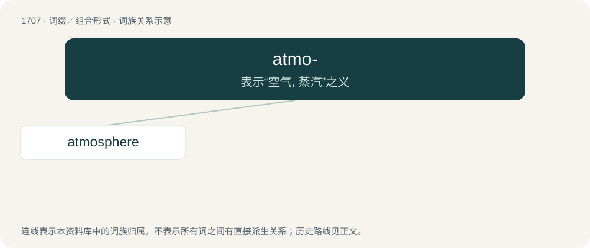

# 1805 · atmo- — 表示“空气, 蒸汽”之义

[总目录](../00_总目录_按常用程度.md)

**类型**：词缀／组合形式　｜　**来源语言**：见词源记录

## 核心含义与来源

- 核心含义：表示“空气, 蒸汽”之义
- 英文含义：Related to air or vapor.
- 词形：atmo-

**来源记录 1**（前缀／前置成分；Related to air or vapor.）

Borrowed from Ancient Greek ἀτμός (atmós, “vapor, smoke, steam”).

## 词族图

## 单词速览（常用到不常用）

| 单词 | 音标 | 释义 |
|---|---|---|
| [atmosphere](#w-1) | 英 /ˈætməsˌfɪə/；美 /ˈætməsˌfɪɹ/ | n. 大气, 空气, 气氛；\[医\] 大气; 大气压 |

## 逐词详解

### 1. atmosphere

**词性**：名词　｜　**音标**：英 /ˈætməsˌfɪə/；美 /ˈætməsˌfɪɹ/

**中文释义**：n. 大气, 空气, 气氛；\[医\] 大气; 大气压

**英文义项**：The gases surrounding the Earth or any astronomical body. / The air in a particular place.

**构词拆分**：atmo- + -sphere

**词源与演化**：

Borrowed from French atmosphère, from New Latin atmosphaera, from Ancient Greek ἀτμός (atmós, “steam”) + σφαῖρα (sphaîra, “sphere”); corresponding to atmo- + -sphere.

**例句**：

> The atmosphere for the football match was great.

该用例对应义项：The apparent mood felt in an environment.
