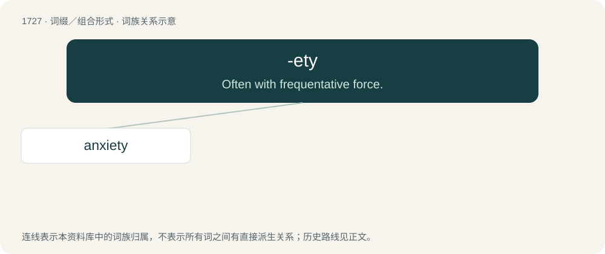

# 1827 · -ety — Often with frequentative force.

[总目录](../00_总目录_按常用程度.md)

**类型**：词缀／组合形式　｜　**来源语言**：见词源记录

## 核心含义与来源

- 核心含义：Often with frequentative force.
- 英文含义：Often with frequentative force.
- 词形：-ety

**多个词源／构词路径**：同一拼写可能有不同来源；以下按词性和含义分别列出。

**来源记录 1**（后缀／后置成分；Often with frequentative force.）

In some uses, apparently an alteration of -edy, as seen in jaggedy, raggedy, scaredy, etc.; equivalent to -ed + -y. The alteration of -d- to -t- is perhaps due to Scottish influence, where it is common for the past participle of Scots verbs to end in -et/-it rather than -ed as in English. In other usage, perhaps imitative of repeated action, equivalent to -et + -y. In any case, it is used almost exclusively in sound-symbolic or expressive words.

**来源记录 2**（后缀／后置成分；Used to indicate qualities or states.）

Cognate of -ity, ultimately from Latin -(i)tās. See more at -ity.

## 词族图

## 单词速览（常用到不常用）

| 单词 | 音标 | 释义 |
|---|---|---|
| [anxiety](#w-1) | 英 /æŋˈzaɪ.əti/；美 /æŋˈzaɪ.əti/ | n. 焦虑, 忧虑, 令人焦虑的事；\[医\] 焦虑 |

## 逐词详解

### 1. anxiety

**词性**：名词　｜　**音标**：英 /æŋˈzaɪ.əti/；美 /æŋˈzaɪ.əti/

**中文释义**：n. 焦虑, 忧虑, 令人焦虑的事；\[医\] 焦虑

**英文义项**：An unpleasant state of mental uneasiness, nervousness, apprehension and obsession or concern about some uncertain event. / An uneasy or distressing desire (for something). Endeavor (to please).

**构词拆分**：anxious + -ety

**词源与演化**：

Borrowed from Latin ānxietās, from ānxius (“anxious, solicitous, distressed, troubled”), from angō (“to distress, trouble”), akin to Ancient Greek ἄγχω (ánkhō, “to choke”). Equivalent to anxious + -ety. See anger; angst.

**例句**：

> She felt a wave of anxiety before the interview.

该用例对应义项：An unpleasant state of mental uneasiness, nervousness, apprehension and obsession or concern about some uncertain event.
