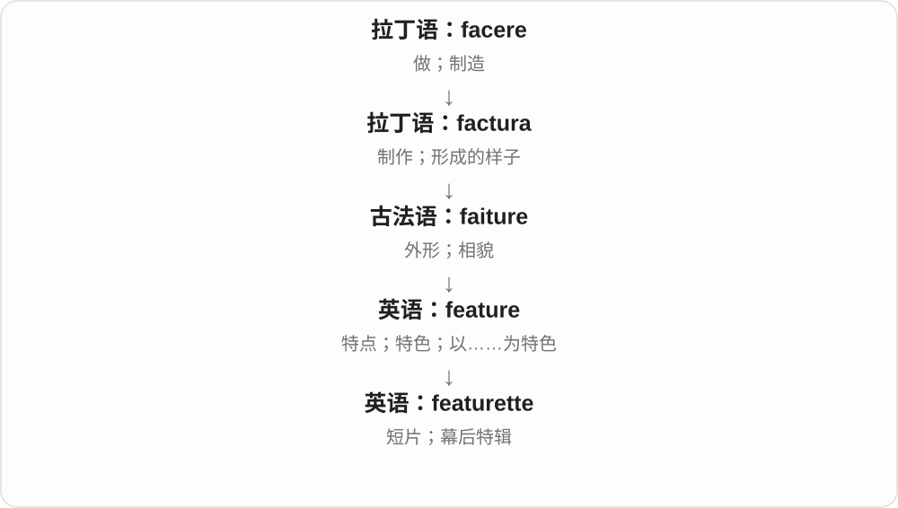

# 1828 · -ette — 小称、人物或仿制品等命名材料

[逐词精讲目录](../00_逐词精讲目录.md) · [总目录](../00_总目录_按常用程度.md)

## 核心词根与来源

来自古法语 -ette 等小称材料，经借词和英语新构词扩展。现代商品、人物名称等各有特定用法，不都表示同一大小或性别关系。

**-ETTE：小物件、女性称呼、仿制材料，要看整词**

kitchenette 是小厨房，barrette 原是小横条；bachelorette 指未婚女性，leatherette 则是仿皮材料。不能只背成一种小。

- **小空间、短片与小物件**：kitchenette · featurette · barrette · diskette
- **人物、材料的特定扩展**：bachelor · bachelorette · leatherette
- **cigar → cigarette：法语小称与整词借入**：cigar · cigarette
- **cigarette → cigarettes：法语指小名称的现代复数**：cigarette · cigarettes

## 词形与演化规律

barre + -ette 在法语形成 barrette；disk + -ette 在英语形成 diskette；bachelor + -ette 形成女性人物称呼。

cigarette 在法语中由 cigare 加 -ette 形成；英语借入整词，不说英语使用者直接把 cigar 加任意字母变成香烟。

法语 cigare 加 ette 后整词借入，现代复数 s 不属于指小词尾。

## 单词速览（按词族由简到繁）

同一基础词的相关扩展放在一起，先读基础形式，再读扩展；各组之间优先读常用的。具体词源关系见各词讲解。

| 单词 | 音标 | 核心意思 |
|---|---|---|
| [cigar](#w-9) | 英 /sɪˈɡɑː/；美 /sɪˈɡɑːr/ | 雪茄 |
| [cigarette](#w-8) | 英 /ˌsɪɡəˈret/；美常 /ˈsɪɡəret/ | 香烟、纸烟 |
| [cigarettes](#w-10) | 英 /ˌsɪɡəˈrets/；美常 /ˈsɪɡərets/ | 香烟、纸烟〔复数〕 |
| [bachelor](#w-7) | 英 /ˈbætʃələ/；美 /ˈbætʃələr/ | 未婚男子；学士、学士学位 |
| [bachelorette](#w-1) | 英 /ˌbætʃələˈret/；美 /ˌbætʃələˈret/ | 未婚女子；准新娘婚前聚会相关称呼〔尤北美〕 |
| [featurette](#w-2) | /ˌfiːtʃəˈret/ | 短片；幕后特辑 |
| [kitchenette](#w-3) | /ˌkɪtʃəˈnet/ | 小厨房、简易厨房区 |
| [barrette](#w-4) | /bəˈret/ | 发夹〔尤北美〕 |
| [diskette](#w-5) | /dɪˈsket/ | 软盘 |
| [leatherette](#w-6) | /ˌleðəˈret/ | 人造革、仿皮材料 |

## 逐词讲解

### 1. cigar — 雪茄

**音标**：英 /sɪˈɡɑː/；美 /sɪˈɡɑːr/

**先抓住这个画面**

它通常是一卷烟草，外层也用烟叶包裹。先抓住卷成一支的烟草这个实物，再与纸卷香烟 cigarette 区分。

**怎么拆**

英语借自西班牙 cigarro；更早来源有争议，包括美洲语言吸烟词的解释及与西班牙昆虫名称有关的解释，不能只选一个写成定论。法语 cigare 是 cigarette 的直接底词。

**怎么变成今天的意思**

**西班牙 cigarro → 英语 cigar、法语 cigare**  
雪茄名称；更早来源不定

↓

**法语 cigare + -ette → cigarette**  
小称形式发展为纸卷香烟名

a cigar 一支雪茄；a cigar box 雪茄盒；a cigar case 雪茄盒、套；cigar smoke 雪茄烟。重音在后面。

**常见搭配与例句**

a box of cigars；an unlit cigar。

> The museum displayed an old wooden cigar box.

博物馆展出了一只旧木雪茄盒。

> He placed the unlit cigar back in its case.

他把未点燃的雪茄放回了盒里。

**别混淆**

cigar 常见烟叶外包，cigarette 常见纸外包。close, but no cigar 是差一点、仍未成功的口语说法，不是在讨论一支真的雪茄。

### 2. cigarette — 香烟、纸烟

**音标**：英 /ˌsɪɡəˈret/；美常 /ˈsɪɡəret/

**先抓住这个画面**

常见的是把细烟丝卷进薄纸里，形成细长的一支。这个纸卷烟草的成品叫 cigarette。

**怎么拆**

经法语 cigarette 借入，法语 cigare 雪茄加指小词尾 -ette。英语通常把它当完整名称；现代 cigarette 与 cigar 的区别涉及制作和包装，不只是同一物体大小不同。

**怎么变成今天的意思**

**西班牙 cigarro → 法语 cigare**  
雪茄名借入法语

↓

**法语 cigare + -ette → cigarette → 英语**  
小称名称 → 香烟、纸烟

a cigarette 一支香烟；a packet of cigarettes 一包香烟〔英式常见〕；a pack of cigarettes 一包香烟〔美式常见〕；a cigarette butt 烟头。

**常见搭配与例句**

cigarette smoke；a cigarette packet。

> There were cigarette butts beside the bench.

长椅旁有几个烟头。

> The artist painted a cigarette packet on the table.

画家画了桌上的一包香烟。

**别混淆**

英式常重读最后 /ret/，美式也常重读前面。构词上的小称是历史线索，不表示今天可把任何小烟草制品都叫 cigarette。

### 3. cigarettes — 香烟、纸烟〔复数〕

**音标**：英 /ˌsɪɡəˈrets/；美常 /ˈsɪɡərets/

**先抓住这个画面**

一支支用纸卷成的烟，是 cigarettes。它借来了法语的小称名字，但今天的名称已经固定，不能只靠大小和 cigar 雪茄区分。

**怎么拆**

西班牙 cigarro 借入法语为 cigare，再加指小后缀 -ette 成 cigarette，英语整词借入。现代最后再加复数 -s，/t/ 后读 /s/。

**怎么变成今天的意思**

**西班牙 cigarro → 法语 cigare + -ette → cigarette**  
雪茄名称 → 小称的纸烟名

↓

**英语 cigarette + -s → cigarettes**  
多支香烟

a packet of cigarettes 一包香烟；cigarettes in a shop 商店里的香烟；a cigarette case 烟盒。

**常见搭配与例句**

two cigarettes 两支香烟；cigarettes and matches 香烟与火柴。

> The old advertisement showed a packet of cigarettes.

那张旧广告里画着一包香烟。

> The character leaves two cigarettes on the table.

那个角色把两支香烟留在桌上。

**别混淆**

-ette 是法语构词时已有的部分；末尾 -s 才是现代英语复数。不要把 cigarettes 的所有结尾一股脑当成一个后缀。

### 4. bachelor — 未婚男子；学士、学士学位

**音标**：英 /ˈbætʃələ/；美 /ˈbætʃələr/

**先抓住这个画面**

说婚姻状况时是未婚男子；说教育经历时是学士。两种常用义来自旧的人物、身份称呼发展，今天读完整搭配最清楚。

**怎么拆**

中古英语借自古法语 bacheler 等，旧义有年轻人、初级骑士及大学头衔，更远来源有争议。未婚男子与大学初级学位义分别固定，不宜编成未婚才能毕业的故事。

**怎么变成今天的意思**

**古法语 bacheler 等 → 中古英语 bachelor**  
年轻、初级身份及大学头衔

↓

**英语两组常用义**  
未婚男子；学士及学位名称

a confirmed bachelor 坚定不婚的单身汉；a bachelor’s degree 学士学位；Bachelor of Arts 文学学士。学位名称不限定持有者性别。

**常见搭配与例句**

an eligible bachelor；a bachelor’s degree in history。

> He remained a bachelor throughout his life.

他终身未婚。

> She has a bachelor’s degree in history.

她拥有历史学学士学位。

**别混淆**

bachelor 的未婚男子义明确男性；学士义可以属于任何性别的人。bachelorette 是另一个婚姻、聚会人物称呼。

### 5. bachelorette — 未婚女子；准新娘婚前聚会相关称呼〔尤北美〕

**音标**：英 /ˌbætʃələˈret/；美 /ˌbætʃələˈret/

**先抓住这个画面**

bachelor 的未婚男子方向换成女性，形成 bachelorette；日常很常见于 bachelorette party，即为准新娘举办的婚前聚会。

**怎么拆**

英语 bachelor + 法语来源人物词尾 -ette，在近代形成女性称呼。这里不取小东西的意思，不能译成小单身汉。

**怎么变成今天的意思**

**bachelor + -ette**  
从未婚人物名称形成女性称呼

↓

**现代常见搭配**  
未婚女子；bachelorette party 婚前聚会

a bachelorette party 准新娘婚前聚会；an eligible bachelorette 条件优越、适合婚配的单身女子。聚会场景中这位人物通常即将结婚。

**常见搭配与例句**

a bachelorette weekend；a bachelorette party。

> Her friends organised a bachelorette party.

朋友们为她安排了婚前聚会。

> The story follows a young bachelorette living in the city.

故事讲述了一位在城里生活的年轻未婚女子。

**别混淆**

bachelorette 不是女性学士的普通学位名称；女性持有学士学位，仍可说 bachelor’s degree。英式婚前聚会常另说 hen party。

### 6. featurette — 短片；幕后特辑

**音标**：/ˌfiːtʃəˈret/

**先抓住这个画面**

一部长片旁边附上一段介绍拍摄过程的小影片，这种较短的专题影像常叫 featurette。

**怎么拆**

feature + -ette（小的、较短的），英语派生。

**怎么变成今天的意思**

feature 可以指故事长片，指小后缀把规模缩小。现代影碟和宣传资料里常见幕后特辑用法。

**常见搭配与例句**

a behind-the-scenes featurette；a short featurette。

> The disc includes a featurette about the costumes.

光盘附有一段介绍服装设计的短片。

> We watched a short featurette on how the film was made.

我们看了一段介绍电影拍摄过程的短片。

**别混淆**

trailer 主要是预告、宣传剪辑；featurette 常多讲背景、拍摄过程或专题内容。

### 7. kitchenette — 小厨房、简易厨房区

**音标**：/ˌkɪtʃəˈnet/

**先抓住这个画面**

小公寓、旅馆房间里只配一小片做饭设施的区域；-ette 在这里让厨房缩小，不表示厨房里的女工作人员。

**怎么拆**

kitchen + 小称后缀 -ette，末尾重音。实际设备多少因房间而异，词本身只给小型、简易厨房范围。

**怎么变成今天的意思**

**拉丁 coquina、cocina 等，经日耳曼语早期借用 → 古英语 cycene → kitchen**  
烹调处、厨房

↓

**kitchen + -ette → kitchenette**  
小型、简易厨房或厨房区

a room with a kitchenette 带小厨房的房间，a compact kitchenette 紧凑小厨房，a kitchenette area 简易厨房区域。

**常见搭配与例句**

a room with a kitchenette；a compact kitchenette；a kitchenette area。

> The studio apartment has a small kitchenette.

这套开间公寓有一处小厨房。

> They prepared breakfast in the kitchenette.

他们在简易厨房里准备早饭。

**别混淆**

kitchenette 强调小厨房，kitchenware 是器具总称；-ette 在本词是小称，不是所有 -ette 都固定指女性。

### 8. barrette — 发夹〔尤北美〕

**音标**：/bəˈret/

**先抓住这个画面**

把头发拢住、扣住的一小条夹子，叫 barrette。它的旧字面就是一小根横条，很贴合形状。

**怎么拆**

借自法语 barrette，barre 横条、杆 + 小称 -ette。英语固定为常见发夹名称，保留法语来源的重音特点。

**怎么变成今天的意思**

**法语 barre + -ette → barrette**  
小横条、小杆状物

↓

**英语 barrette**  
夹住、固定头发的发夹

a silver barrette 银色发夹；fasten a barrette 扣好发夹；hold the hair with a barrette 用发夹固定头发。

**常见搭配与例句**

a decorative barrette；clip on a barrette。

> She pinned back her hair with a silver barrette.

她用一枚银色发夹把头发别到后面。

> The barrette matched the colour of her dress.

发夹和她连衣裙的颜色很配。

**别混淆**

hair clip 是较广的发夹通称；barrette 在北美很常用，英国不少场景可说 hair slide。

### 9. diskette — 软盘

**音标**：/dɪˈsket/

**先抓住这个画面**

老式电脑里可拿出来保存、交换文件的小磁盘，就是 diskette；今天读旧资料或看保存图标的来源，还能遇到它。

**怎么拆**

disk 磁盘 + 小称 -ette，近代名称也受到 cassette 等形式类比影响。它成为特定存储介质名称，不能用来泛叫所有小型磁盘。

**怎么变成今天的意思**

**disk + -ette → diskette**  
以小磁盘的形式命名

↓

**计算机存储名称固定**  
软盘，一种可移动磁存储介质

save a file to a diskette 把文件存到软盘；a diskette drive 软盘驱动器；an old diskette 旧软盘。

**常见搭配与例句**

insert a diskette；a box of diskettes。

> The old program was supplied on a diskette.

那个旧程序是用软盘提供的。

> She found a box of diskettes in the cupboard.

她在柜子里发现了一盒软盘。

**别混淆**

disk 是更广的盘、磁盘名称；diskette 特指软盘。今天的小型硬盘、存储卡不因此自动叫 diskette。

### 10. leatherette — 人造革、仿皮材料

**音标**：/ˌleðəˈret/

**先抓住这个画面**

远看像皮革，实际用别的材料做出皮革外观，就是 leatherette。记住这个词尾在这里表示替代、仿制。

**怎么拆**

leather + -ette；-ette 在本词里表示仿制品、替代品。原为商标名，后来成为通用材料名称，不拆成小皮革。

**怎么变成今天的意思**

**古英语 leþer／leðer → 中古英语 lether**  
处理过的兽皮材料

↓

**英语 leather**  
皮革；由皮革制成的物品

↓

**leather + -ette → leatherette**  
模仿皮革外观的替代材料

a leatherette cover 仿皮封面，leatherette upholstery 人造革软包面料。常见塑料或涂层织物等做法，具体材质仍看产品说明。

**常见搭配与例句**

a leatherette cover；leatherette upholstery。

> The notebook has a black leatherette cover.

这本笔记本有黑色仿皮封面。

> The seats were covered in red leatherette.

座椅包着红色人造革。

**别混淆**

leatherette 属仿皮材料；leather 本身通常说皮革。-ette 不只表示小，这里也不是女性人物后缀。

## 这一组要分清什么

bachelorette 不是小男学士，也不是所有女性学位名称；leatherette 的重点是仿皮，不是小皮革。

## 串起来练习

She left a barrette beside the old diskette in the kitchenette.

她把一枚发夹放在小厨房里那张旧软盘旁边。
