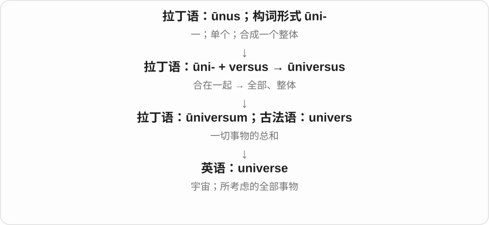

# 1832 · -verse — 转；成为一个整体〔历史词干〕

[逐词精讲目录](../00_逐词精讲目录.md) · [总目录](../00_总目录_按常用程度.md)

## 核心词根与来源

本条 -verse 实际关联拉丁 vertere 转的过去分词词干，universe 来自 universus 整体的、全部的。不能把现代 universe 说成 uni- 随意加一个独立英语 verse 诗句。

**VERSE：在 universe 内保留“转向”的古典形态**

从相关的拉丁整体名称，理解宇宙这一完整借词。

- **整体与宇宙**：universe

## 词形与演化规律

universus 内有 unus 一与 versus 转向的历史构词。词根画面可辅助记忆，但现代 universe 已是固定词。

## 单词速览（按词族由简到繁）

同一基础词的相关扩展放在一起，先读基础形式，再读扩展；各组之间优先读常用的。具体词源关系见各词讲解。

| 单词 | 音标 | 核心意思 |
|---|---|---|
| [universe](#w-1) | 英 /ˈjuːnɪvɜːs/；美 /ˈjuːnəvɜːrs/ | 宇宙；某一范围内的全部事物 |

## 逐词讲解

### 1. universe — 宇宙；某一范围内的全部事物

**音标**：英 /ˈjuːnɪvɜːs/；美 /ˈjuːnəvɜːrs/

**先抓住这个画面**

universe 是把一切星系、物质和空间放进一个最大范围；也能把某个故事世界或讨论范围当作一个完整天地。

**怎么拆**

拉丁语 ūni-（一）+ versus（转向、合向）形成 ūniversus“全部、整体”；其中性形式 ūniversum 经法语进入英语。

**怎么变成今天的意思**

“合成一个整体”的说法变成“一切事物的总和”。词尾 verse 在这里不是英语 poem 那种诗句。

**常见搭配与例句**

the universe；the observable universe；a fictional universe。

> The book explores how scientists study the universe.

这本书介绍科学家怎样研究宇宙。

> All three novels are set in the same fictional universe.

这三部小说都发生在同一个虚构世界里。

**别混淆**

world 可指地球、人类社会或个人环境；universe 通常范围更大，也可指虚构作品的完整世界。

## 这一组要分清什么

verse 诗句的英语用法也有拉丁转行背景，却不是现代 universe 直接使用的“诗句”义。

## 串起来练习

解释为什么 universe 不能按“一首诗”翻译。
