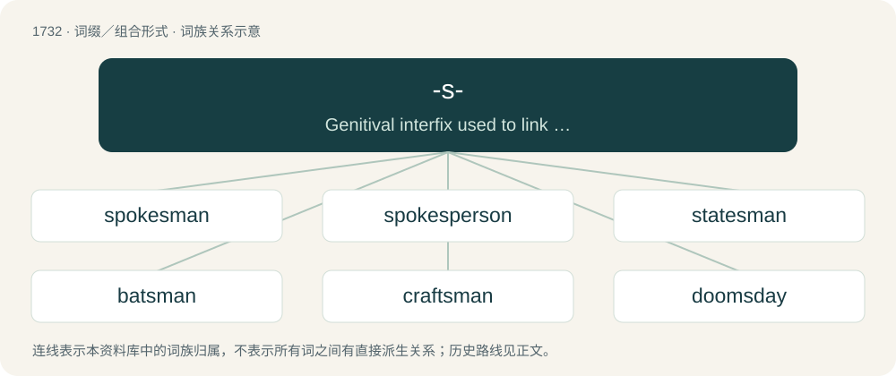

# 1833 · -s- — Genitival interfix used to link elements in some compounds, equivalent to the possessive clitic -'s.

[总目录](../00_总目录_按常用程度.md)

**类型**：词缀／组合形式　｜　**来源语言**：见词源记录

## 核心含义与来源

- 核心含义：Genitival interfix used to link elements in some compounds, equivalent to the possessive clitic -'s.
- 英文含义：Genitival interfix used to link elements in some compounds, equivalent to the possessive clitic -'s.
- 词形：-s-

**来源记录 1**（interfix；Genitival interfix used to link elements in some compounds, equivalent to the possessive clitic -'s.）

From Middle English -s, -es, from Old English -es (“-'s”, masculine and neuter genitive singular ending), which survives in many old compounds. In more recent coinage, from contraction of the derived clitic -'s in compounds. For more, see -'s.

## 词族图

## 单词速览（常用到不常用）

| 单词 | 音标 | 释义 |
|---|---|---|
| [spokesman](#w-1) | /ˈspəuksmən/ | n. 发言人, 代言者 |
| [spokesperson](#w-2) | 英 /ˈspəʊkspɜːɹsən/；美 /ˈspoʊksˌpɝsən/ | n. 发言人, 代言人 |
| [statesman](#w-3) | /ˈsteɪtsmən/ | n. 政治家 |
| [batsman](#w-4) | /ˈbætsmən/ | n. 击球手 |
| [craftsman](#w-5) | 英 /ˈkɹɑːftsmən/；美 /ˈkɹæftsmən/ | n. 工匠, 技工, 手艺人 |
| [doomsday](#w-6) | /ˈduːmz.deɪ/ | n. 世界末日 |
| [spokeswoman](#w-7) | /ˈspəuks,wumən/ | n. 女发言人, 女代言人 |
| [bridesmaid](#w-8) | /ˈbɹaɪdzˌmeɪd/ | n. 女傧相 |
| [huntsman](#w-9) | /ˈhʌntsmən/ | n. 猎人, 管猎犬者 |
| [menswear](#w-10) | 美 /ˈmɛnz.wɛɚ/ | n. 男服 |
| [marksman](#w-11) | 美 /ˈmɑɹksmən/ | n. 射手, 狙击兵, 神射手；\[法\] 按手印者, 不能用笔署名者 |
| [swordsman](#w-12) | 英 /ˈsɔːdsmən/；美 /ˈsɔɹdsmən/ | n. 剑术家, 剑客, 武士 |
| [kinsman](#w-13) | /ˈkinzmən/ | n. 男亲戚, 亲属 |
| [beeswax](#w-14) | /ˈbiːzwæks/ | n. 蜂蜡, 蜜蜡；vt. 用蜡上光 |
| [tradesman](#w-15) | /ˈtreidzmən/ | n. 零售商, 工匠；\[经\] 商人, 店主, 零售商 |
| [linesman](#w-16) | /ˈlainzmən/ | n. 常备步兵, 线路保养工, 边线裁判员 |
| [townsfolk](#w-17) |  | n. 镇民, 市民, 城里生长的人, 城镇居民 |
| [guardsman](#w-18) | /ˈgɑːdzmən/ | n. 卫兵, (英)近卫兵, (美)国民警卫队士兵 |
| [draftsman](#w-19) | /ˈdræftsmən/ | n. 起草者, 制图员, 图案工；\[机\] 绘图员 |
| [helmsman](#w-20) | /ˈhɛlmz.mən/ | n. 舵手 |
| [draughtsman](#w-21) | 英 /ˈdɹɑːftsmən/ | n. 起草人, 打样人, 制图员, (正式)制图能手 |
| [kingsman](#w-22) |  | 【英文】The lowest enlisted rank in the Duke of Lancaster's Regiment of the British Army, equivalent to private in the rest of the British Army. |
| [womenswear](#w-23) |  | n. 妇女服装 |
| [bondsman](#w-24) | 英 /ˈbɒndzmən/；美 /ˈbɑndzmən/ | n. 奴隶；\[经\] 保证人 |
| [herdsman](#w-25) | /ˈhəːdzmən/ | n. 牧人, 牧主 |
| [tribesman](#w-26) | /ˈtraibzmən/ | n. 部落男子 |
| [yachtsman](#w-27) | /ˈjɒtsmən/ | n. 游艇驾驶者, 游艇所有者 |
| [gamesmanship](#w-28) | /ˈgeimzmənʃip/ | n. 搅乱战术 |
| [landsman](#w-29) | /ˈlændzmən/ | n. 同胞, 未出过海的人 |
| [houndstooth](#w-30) | 英 /ˈhaʊndstuːθ/ | n. & adj.\[纺\]犬牙织纹(的), 犬牙花纹(的) |
| [sheepshead](#w-31) | /ˈʃiːpshed/ | n. 羊头, 蠢人 |

## 逐词详解

### 1. spokesman

**词性**：名词　｜　**音标**：/ˈspəuksmən/

**中文释义**：n. 发言人, 代言者

**英文义项**：One who speaks as the voice of another person or a group of people.

**构词拆分**：spoke (“past participle of speak”) + -s- + man

**词源与演化**：

From spoke (“past participle of speak”) + -s- + man.

**例句**：

> Tom wasn't sure why he was considered the spokesman for the group.

### 2. spokesperson

**词性**：名词　｜　**音标**：英 /ˈspəʊkspɜːɹsən/；美 /ˈspoʊksˌpɝsən/

**中文释义**：n. 发言人, 代言人

**英文义项**：A person who acts as the voice of another person or a group of people.

**构词拆分**：spoke (“past participle of speak”) + -s- + person

**词源与演化**：

From spoke (“past participle of speak”) + -s- + person.

**例句**：

> Tom's voluble enthusiasm for the company's product made him a natural spokesperson.

### 3. statesman

**词性**：名词　｜　**音标**：/ˈsteɪtsmən/

**中文释义**：n. 政治家

**英文义项**：A man who is a leader in national or international affairs. / A male political leader who promotes the public good or who is recognized for probity, leadership, or the qualities necessary to govern a state.

**构词拆分**：state + -s- + -man

**词源与演化**：

From state + -s- + -man, modelled after French homme d'État.

**例句**：

> In addition to being a great statesman, Churchill was a great writer.

### 4. batsman

**词性**：名词　｜　**音标**：/ˈbætsmən/

**中文释义**：n. 击球手

**英文义项**：A player of the batting side now on the field. / The player now receiving strike; the striker.

**构词拆分**：bat + -s- + -man

**词源与演化**：

From bat + -s- + -man.

**例句**：

> Bangladesh national cricket team batsman Nasir Hossain said this.

### 5. craftsman

**词性**：名词　｜　**音标**：英 /ˈkɹɑːftsmən/；美 /ˈkɹæftsmən/

**中文释义**：n. 工匠, 技工, 手艺人

**英文义项**：One who is highly skilled at one's trade; an artisan or artificer. / A person who makes or creates material objects partly or entirely by hand.

**构词拆分**：craft + -s- + -man

**词源与演化**：

From craft + -s- + -man.

**例句**：

> Tom composed sentences like a master craftsman building furniture for a king.

### 6. doomsday

**词性**：名词　｜　**音标**：/ˈduːmz.deɪ/

**中文释义**：n. 世界末日

**英文义项**：The day when God is expected to judge the world; the end times. / Judgement day; the day of the Final Judgment; any day of decisive judgement or final dissolution.

**构词拆分**：doom + -s- + day

**词源与演化**：

From Middle English domes + dai, from Old English dom (“judgment”) + dæg (“day”). Equivalent to doom + -s- + day. Compare Old Norse dómsdagr (“judgement day, doomsday”).

**例句**：

> Why are so many of his movies about doomsday scenarios?

### 7. spokeswoman

**词性**：名词　｜　**音标**：/ˈspəuks,wumən/

**中文释义**：n. 女发言人, 女代言人

**英文义项**：A woman who speaks as the voice of a group of people.

**构词拆分**：spoke (“past participle of speak”) + -s- + woman

**词源与演化**：

From spoke (“past participle of speak”) + -s- + woman.

**例句**：

> The high commissioner’s spokeswoman said the government had shown some willingness to initiate reforms.

### 8. bridesmaid

**词性**：名词　｜　**音标**：/ˈbɹaɪdzˌmeɪd/

**中文释义**：n. 女傧相

**英文义项**：A woman who attends a bride during her wedding ceremony, as part of the main wedding party. / A person or team that perennially finishes well, but never first.

**构词拆分**：bride + -s- + maid

**词源与演化**：

From bride + -s- + maid. In the sports and entertainment sense: in reference to the saying always a bridesmaid, never a bride.

**例句**：

> I'd love to be your bridesmaid at the wedding.

该用例对应义项：A woman who attends a bride during her wedding ceremony, as part of the main wedding party.

### 9. huntsman

**词性**：名词　｜　**音标**：/ˈhʌntsmən/

**中文释义**：n. 猎人, 管猎犬者

**英文义项**：A hunter. / A fox hunter.

**构词拆分**：hunt + -s- + -man

**词源与演化**：

From hunt + -s- + -man.

**例句**：

> He was the kind of huntsman who could never successfully catch even a single animal.

### 10. menswear

**词性**：名词　｜　**音标**：美 /ˈmɛnz.wɛɚ/

**中文释义**：n. 男服

**英文义项**：Men's clothing (and accessories), particularly in a retail context.

**构词拆分**：men + -s- + -wear

**词源与演化**：

From men + -s- + -wear.

**例句**：

> Shirts can be found in the menswear department.

### 11. marksman

**词性**：名词　｜　**音标**：美 /ˈmɑɹksmən/

**中文释义**：n. 射手, 狙击兵, 神射手；\[法\] 按手印者, 不能用笔署名者

**英文义项**：A man or person skilled at hitting targets, as with a firearm, bow, or thrown object. / Goalscorer.

**构词拆分**：mark + -s- + man

**词源与演化**：

From mark + -s- + man.

**例句**：

> At that instant Holmes sprang like a tiger on to the marksman’s back, and hurled him flat upon his face.

### 12. swordsman

**词性**：名词　｜　**音标**：英 /ˈsɔːdsmən/；美 /ˈsɔɹdsmən/

**中文释义**：n. 剑术家, 剑客, 武士

**英文义项**：A person skilled at using swords in sport or combat; a fencer. / A person who fights with a sword.

**构词拆分**：sword + -s- + man

**词源与演化**：

From sword + -s- + man.

**例句**：

> Archers attempted to take down an unknown swordsman.

该用例对应义项：A person who fights with a sword.

### 13. kinsman

**词性**：名词　｜　**音标**：/ˈkinzmən/

**中文释义**：n. 男亲戚, 亲属

**英文义项**：A male relative.

**构词拆分**：kin + -s- + -man

**词源与演化**：

From Middle English kynnesman, equivalent to kin + -s- + -man.

**例句**：

> And he let his kinsman depart: and he returned and went into his own country.

### 14. beeswax

**词性**：名词　｜　**音标**：/ˈbiːzwæks/

**中文释义**：n. 蜂蜡, 蜜蜡；vt. 用蜡上光

**英文义项**：A wax secreted by bees from which they make honeycomb; or, the processed form of this wax used in the manufacture of various goods. / Business.

**构词拆分**：bee + -s- + wax

**词源与演化**：

From bee + -s- + wax.

**例句**：

> She polished the furniture with beeswax to give it a shine.

该用例对应义项：A wax secreted by bees from which they make honeycomb; or, the processed form of this wax used in the manufacture of various goods.

### 15. tradesman

**词性**：名词　｜　**音标**：/ˈtreidzmən/

**中文释义**：n. 零售商, 工匠；\[经\] 商人, 店主, 零售商

**英文义项**：A skilled manual worker (implied male). / A manual worker (implied male) who visits private premises to perform his job.

**构词拆分**：trade + -s- + -man

**词源与演化**：

From trade + -s- + -man.

**例句**：

> The tradesman has the same religion all over the world.

### 16. linesman

**词性**：名词　｜　**音标**：/ˈlainzmən/

**中文释义**：n. 常备步兵, 线路保养工, 边线裁判员

**英文义项**：An assistant referee. / A male line judge.

**构词拆分**：From line + -s- + -man.

**词源与演化**：

From line + -s- + -man.

**例句**：

> Neither the referee nor linesman saw the ball cross the goal line.

### 17. townsfolk

**词性**：名词

**中文释义**：n. 镇民, 市民, 城里生长的人, 城镇居民

**英文义项**：The people who live in a town, especially the lower and middle classes.

**构词拆分**：From town + -s- + folk.

**词源与演化**：

From town + -s- + folk.

**例句**：

> "Have you seen my pencil?" asked the alien to the flabbergasted townsfolk.

### 18. guardsman

**词性**：名词　｜　**音标**：/ˈgɑːdzmən/

**中文释义**：n. 卫兵, (英)近卫兵, (美)国民警卫队士兵

**英文义项**：A person, especially a soldier, who is on guard; especially, a masculine one. / A member of the National Guard; especially, a masculine one.

**构词拆分**：From guard + -s- + -man.

**词源与演化**：

From guard + -s- + -man.

**例句**：

> The guardsman was assaulted by a robber.

### 19. draftsman

**词性**：名词　｜　**音标**：/ˈdræftsmən/

**中文释义**：n. 起草者, 制图员, 图案工；\[机\] 绘图员

**英文义项**：A person who drafts legal documents.

**构词拆分**：draft + -s- + -man

**词源与演化**：

From draft + -s- + -man.

**例句**：

> We got a draftsman to design our house instead of an architect.

### 20. helmsman

**词性**：名词　｜　**音标**：/ˈhɛlmz.mən/

**中文释义**：n. 舵手

**英文义项**：A member of a ship's crew who is responsible for steering. / A leader.

**构词拆分**：helm + -s- + man

**词源与演化**：

From helm + -s- + man.

**例句**：

> You only get to know a good helmsman in a storm.

### 21. draughtsman

**词性**：名词　｜　**音标**：英 /ˈdɹɑːftsmən/

**中文释义**：n. 起草人, 打样人, 制图员, (正式)制图能手

**英文义项**：A person skilled at drawing engineering or architectural plans.

**构词拆分**：draught + -s- + -man

**词源与演化**：

From draught + -s- + -man.

**例句**：

> Tom asked his friend, who is a draughtsman, to draw up some plans for his extension.

### 22. kingsman

**词性**：名词

**英文义项**：The lowest enlisted rank in the Duke of Lancaster's Regiment of the British Army, equivalent to private in the rest of the British Army.

**构词拆分**：king + -s- + man

**词源与演化**：

From king + -s- + man.

### 23. womenswear

**词性**：名词

**中文释义**：n. 妇女服装

**英文义项**：Women's clothing (and accessories), particularly in a retail context.

**构词拆分**：women + -s- + -wear

**词源与演化**：

From women + -s- + -wear.

### 24. bondsman

**词性**：名词　｜　**音标**：英 /ˈbɒndzmən/；美 /ˈbɑndzmən/

**中文释义**：n. 奴隶；\[经\] 保证人

**英文义项**：A male slave. / A male indentured servant.

**构词拆分**：bond + -s- + -man

**词源与演化**：

From bond + -s- + -man.

### 25. herdsman

**词性**：名词　｜　**音标**：/ˈhəːdzmən/

**中文释义**：n. 牧人, 牧主

**英文义项**：A person who tends livestock, especially cows and sheep; especially, the foreman among a group of such farmworkers, usually with more knowledge and experience.

**构词拆分**：From herd + -s- + -man.

**词源与演化**：

From herd + -s- + -man.

**例句**：

> After inspecting the farm, he went to see the goats and their young herdsman.

### 26. tribesman

**词性**：名词　｜　**音标**：/ˈtraibzmən/

**中文释义**：n. 部落男子

**英文义项**：A (usually male) member of a tribe.

**构词拆分**：tribe + -s- + -man

**词源与演化**：

From tribe + -s- + -man.

**例句**：

> Tom explains to the Amazonian tribesman that jars, bottles, and cans are different containers for preserving food.

### 27. yachtsman

**词性**：名词　｜　**音标**：/ˈjɒtsmən/

**中文释义**：n. 游艇驾驶者, 游艇所有者

**英文义项**：A man who sails a yacht.

**构词拆分**：yacht + -s- + -man

**词源与演化**：

From yacht + -s- + -man.

### 28. gamesmanship

**词性**：名词　｜　**音标**：/ˈgeimzmənʃip/

**中文释义**：n. 搅乱战术

**英文义项**：The use of legal but unsporting tactics to gain an advantage over one’s opponent.

**构词拆分**：game + -s- + -manship；gamesman + -ship

**词源与演化**：

From game + -s- + -manship or gamesman + -ship.

**例句**：

> They kept the other team waiting on the field until the last possible moment – that was a clear case of gamesmanship.

该用例对应义项：The use of legal but unsporting tactics to gain an advantage over one’s opponent.

### 29. landsman

**词性**：名词　｜　**音标**：/ˈlændzmən/

**中文释义**：n. 同胞, 未出过海的人

**英文义项**：A person who does not go to sea, who lacks the skills of a sailor or who is uncomfortable on ships or boats. / A person who negotiates leases, contracts and other business deals between producers and landowners.

**构词拆分**：land + -s- + man

**词源与演化**：

From land + -s- + man. In meanings 3 and 4, influenced by Yiddish לאַנדסמאַן (landsman). Compare also German Landsmann, Norwegian landsmann. Doublet of lantzman.

### 30. houndstooth

**词性**：名词　｜　**音标**：英 /ˈhaʊndstuːθ/

**中文释义**：n. & adj.\[纺\]犬牙织纹(的), 犬牙花纹(的)

**英文义项**：A two-colour fabric pattern of broken checks. / Fabric with a houndstooth pattern; an item of clothing made with such fabric.

**构词拆分**：hound + -s- + tooth

**词源与演化**：

From hound + -s- + tooth, from its appearance. Although the pattern itself is archaeologically found from time immemorial, the modern term is first attested in 1936.

### 31. sheepshead

**词性**：名词　｜　**音标**：/ˈʃiːpshed/

**中文释义**：n. 羊头, 蠢人

**英文义项**：A fish of the species Archosargus probatocephalus. / A trick-taking card game.

**构词拆分**：sheep + -s- + head

**词源与演化**：

From sheep + -s- + head.
