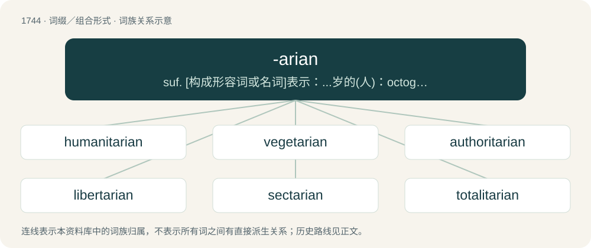

# 1843 · -arian — suf. \[构成形容词或名词\]表示：...岁的(人)：octogenarian, centenarian; ...派的(人);...主义的(人)：Unitarian,utilitarian; 从事...工作(或职业)的(人)：argarian,antiquarian; 制定(或做出)...的(人)：disciplinarian

[总目录](../00_总目录_按常用程度.md)

**类型**：词缀／组合形式　｜　**来源语言**：见词源记录

## 核心含义与来源

- 核心含义：suf. \[构成形容词或名词\]表示：...岁的(人)：octogenarian, centenarian; ...派的(人);...主义的(人)：Unitarian,utilitarian; 从事...工作(或职业)的(人)：argarian,antiquarian; 制定(或做出)...的(人)：disciplinarian
- 英文含义：A believer in something.
- 词形：-arian

**多个词源／构词路径**：同一拼写可能有不同来源；以下按词性和含义分别列出。

**来源记录 1**（后缀／后置成分；A believer in something.）

Back-formation from various words ending in “arian”, some directly derived from Classical or Medieval Latin words ending in -arius by adding -an to the stem, other indirectly via Old French words ending in "arien(ne)" or "erien(ne)" or from English words ending in “ary” to which -an was suffixed; note the same phenomenon in -ary. Equivalent to -ary + -an.

**来源记录 2**（后缀／后置成分；Used to form an adjective meaning "of or pertaining to" from nouns ending in -arium.）

By surface analysis, -ari(um) + -an and -ari(a) + -an.

## 词族图

## 单词速览（常用到不常用）

| 单词 | 音标 | 释义 |
|---|---|---|
| [humanitarian](#w-1) | 英 /hjʊˌmæ.nɪˈtɛː.ɹɪ.ən/；美 /hjuˌmæ.nəˈtɛ.ɹi.ən/ | n. 人道主义者, 博爱者, 基督凡人论者；a. 人道主义的, 博爱的, 凡人论的 |
| [vegetarian](#w-2) | 英 /vɛ.d͡ʒɪˈtɛə.ɹi.ən/；美 /vɛ.d͡ʒɪˈtɛ.ɹi.ən/ | n. 素食者, 食草动物；a. 素食的 |
| [authoritarian](#w-3) | 英 /ɔːˌθɒɹ.ɪˈtɛə̯.ɹɪən/；美 /əˌθɔɹ.əˈtɛɹ.i.ən/ | a. 独裁的, 独裁主义的 |
| [libertarian](#w-4) | 英 /ˌlɪbəˈtɛə̯ɹi.ən/；美 /ˌlɪbɚˈtɛə̯ɹi.ən/ | n. 自由意志主义支持者, 行动自由者；a. 自由意志主义支持者的, 主张个人思想的 |
| [sectarian](#w-5) | 英 /sɛkˈtɛəɹi.ən/；美 /sɛkˈtɛɹi.ən/ | a. 宗派的, 党派的, 偏狭的；n. 宗派成员, 闹宗派的人 |
| [totalitarian](#w-6) | 英 /ˌtəʊtalɪˈtɛəɹiən/；美 /ˌtoʊtəlɪˈtɛɹiən/ | a. 极权主义的；n. 极权主义者 |
| [utilitarian](#w-7) | 英 /juːˌtɪlɪˈtɛəɹi.ən/；/juˌtɪləˈtɛɹi.ən/ | a. 有效用的, 实利主义的, 功利主义的；n. 功利主义者 |
| [parliamentarian](#w-8) | 英 /ˌpɑːləmənˈtɛəɹiən/；美 /ˌpɑɹləmənˈtɛɹiən/ | n. 议会法规专家, 国会议员, 熟悉议会法规而又有经验的议员 |
| [disciplinarian](#w-9) | 英 /dɪsɪplɪˈnɛəɹɪən/ | a. 惩戒性的, 纪律的；n. 执行纪律者, 厉行纪律的人 |
| [documentarian](#w-10) | 英 /ˌdɒk.jʊ.mənˈtɛəɹi.ən/；美 /ˌdɑ.kjʊ.mənˈtɛɹi.ən/ | n. 记实小说作者, 记录影片导演(或制片人) |
| [communitarian](#w-11) | 英 /kəˌmjuː.nɪˈtɛəɹi.ən/；美 /kəˌmju.nəˈtɛɹi.ən/ | a. 公有社会的, 鼓吹公有社会的 |
| [majoritarian](#w-12) | 英 /məˈd͡ʒɒɹ.ɪ.tɛə.ɹi.ən/；美 /məˈd͡ʒɑ.ɹɪ.tɛɹ.i.ən/ | n. 多数主义者 |

## 逐词详解

### 1. humanitarian

**词性**：形容词　｜　**音标**：英 /hjʊˌmæ.nɪˈtɛː.ɹɪ.ən/；美 /hjuˌmæ.nəˈtɛ.ɹi.ən/

**中文释义**：n. 人道主义者, 博爱者, 基督凡人论者；a. 人道主义的, 博爱的, 凡人论的

**英文义项**：Relating to people's welfare. / Being compassionate or humane.

**构词拆分**：humanity + -arian (suffix indicating an advocate of or believer in something)

**词源与演化**：

From humanity + -arian (suffix indicating an advocate of or believer in something), possibly modelled after Unitarian (“Christian who does not believe in the doctrine of the Trinity; pertaining to Unitarianism”) (see noun sense 2 and verb sense 2).

**例句**：

> Released the prisoner for humanitarian reasons.

该用例对应义项：marked by humanistic values and devotion to human welfare

### 2. vegetarian

**词性**：形容词　｜　**音标**：英 /vɛ.d͡ʒɪˈtɛə.ɹi.ən/；美 /vɛ.d͡ʒɪˈtɛ.ɹi.ən/

**中文释义**：n. 素食者, 食草动物；a. 素食的

**英文义项**：Of or relating to the type of diet eaten by vegetarians (in all senses). / Without meat.

**构词拆分**：vegetable + -arian

**词源与演化**：

From vegetable + -arian; popularized following the foundation of the British Vegetarian Society in 1847.

**用法示例／搭配（非完整句）**：

> I have a vegetarian brother

该用例对应义项：That does not eat meat.

### 3. authoritarian

**词性**：形容词　｜　**音标**：英 /ɔːˌθɒɹ.ɪˈtɛə̯.ɹɪən/；美 /əˌθɔɹ.əˈtɛɹ.i.ən/

**中文释义**：a. 独裁的, 独裁主义的

**英文义项**：Of, or relating to, or exhibiting strict obedience to an authority; favoring authoritarianism over civic and individual liberties. / Demanding obedience to authority; marked by authoritarianism; dictatorial, tyrannical.

**构词拆分**：authority + -arian

**词源与演化**：

From authority + -arian, circa 1880.

**例句**：

> The authoritarian government was demanding stricter laws for low-wage peasants.

该用例对应义项：Demanding obedience to authority; marked by authoritarianism; dictatorial, tyrannical.

### 4. libertarian

**词性**：名词　｜　**音标**：英 /ˌlɪbəˈtɛə̯ɹi.ən/；美 /ˌlɪbɚˈtɛə̯ɹi.ən/

**中文释义**：n. 自由意志主义支持者, 行动自由者；a. 自由意志主义支持者的, 主张个人思想的

**英文义项**：One who advocates liberty, either generally or in relation to a specific issue. / A believer in the freedom of thinking beings to choose their own destiny (the doctrine of free will) as opposed to those who believe the future is predetermined (the doctrine of necessity).

**构词拆分**：liber(ty) + -arian (suffix denoting an advocate of or believer in something)

**词源与演化**：

The noun is derived from liber(ty) + -arian (suffix denoting an advocate of or believer in something). The adjective is derived from the noun. sense development The word was first attested in English in 1789 in William Belsham’s Essays: see the quotation. This was contrasted with necessitarian, in the context of free will, and was not used in the more frequently encountered modern sense. Compare French libertaire (“person with extreme left-wing beliefs, anarchist”), from liberté (“freedom”) + -aire (suffix forming nouns). Libertaire is derived from Latin libertas. The French word was first attested in a May 1857 letter by the French anarcho-communist Joseph Déjacque (1821–1865) to the anarchist philosopher Pierre-Joseph Proudhon (1809–1865), reading: “Anarchiste juste-milieu, libéral et non LIBERTAIRE \[A centrist anarchist, liberal and not LIBERTARIAN\] \[…\]”. It was popularized as a euphemism for anarchiste in the 1890s, following the French lois scélérates (literally “villainous laws”) under which anarchist publications were banned. Sense 3.2 (“believer in right-libertarianism”) developed in the United States in the 1940s and was popularized in the 1950s. In the 1940s, Leonard Read (1898–1983), the founder of the Foundation for Economic Education, a free-market think tank, began calling himself “libertarian” in contrast with a “classical liberal”. In 1955, Dean Russell also promoted the use of the word, writing: “Let those of us who love liberty trade-mark and reserve for our own use the good and honorable word ‘libertarian’.”

**用法示例／搭配（非完整句）**：

> cultural libertarian

该用例对应义项：One who advocates liberty, either generally or in relation to a specific issue.

### 5. sectarian

**词性**：形容词　｜　**音标**：英 /sɛkˈtɛəɹi.ən/；美 /sɛkˈtɛɹi.ən/

**中文释义**：a. 宗派的, 党派的, 偏狭的；n. 宗派成员, 闹宗派的人

**英文义项**：Of, relating to, or partial to a sect. / Dogmatic or partisan.

**构词拆分**：Medieval Latin sectarius + -an；sect + -arian

**词源与演化**：

From Medieval Latin sectarius + -an. Its corresponding etymology per the first sense is sect + -arian.

**例句**：

> We were discussing solutions to the sectarian violence between Sunnis and Shias.

该用例对应义项：Of, relating to, or partial to a sect.

### 6. totalitarian

**词性**：形容词　｜　**音标**：英 /ˌtəʊtalɪˈtɛəɹiən/；美 /ˌtoʊtəlɪˈtɛɹiən/

**中文释义**：a. 极权主义的；n. 极权主义者

**英文义项**：Of or relating to a system of government where the people have virtually no authority and the state wields absolute control of every aspect of the country, socially, financially, and politically.

**构词拆分**：totality + -arian

**词源与演化**：

From Italian totalitario (“complete, absolute, totalitarian”) + -an. Equivalent to totality + -arian.

**例句**：

> The divine truth is stronger than totalitarian falsehoods.

该用例对应义项：Of or relating to a system of government where the people have virtually no authority and the state wields absolute control of every aspect of the country, socially, financially, and politically.

### 7. utilitarian

**词性**：形容词　｜　**音标**：英 /juːˌtɪlɪˈtɛəɹi.ən/；/juˌtɪləˈtɛɹi.ən/

**中文释义**：a. 有效用的, 实利主义的, 功利主义的；n. 功利主义者

**英文义项**：Of or relating to utility. / Pertaining to utilitarianism.

**构词拆分**：utility + -arian

**词源与演化**：

From utility + -arian. Coined by English philosopher Jeremy Bentham as early as 1781, and popularized by his student John Stuart Mill, who mistakenly attributed the term to John Galt.

**例句**：

> The study of history offers to individuals major utilitarian learning outcomes.

### 8. parliamentarian

**词性**：形容词　｜　**音标**：英 /ˌpɑːləmənˈtɛəɹiən/；美 /ˌpɑɹləmənˈtɛɹiən/

**中文释义**：n. 议会法规专家, 国会议员, 熟悉议会法规而又有经验的议员

**英文义项**：Of or relating to a parliament; favouring the establishment of a parliament.

**构词拆分**：parliament + -arian

**词源与演化**：

From parliament + -arian.

**用法示例／搭配（非完整句）**：

> a parliamentarian democracy; the parliamentarian movement

该用例对应义项：Of or relating to a parliament; favouring the establishment of a parliament.

### 9. disciplinarian

**词性**：名词　｜　**音标**：英 /dɪsɪplɪˈnɛəɹɪən/

**中文释义**：a. 惩戒性的, 纪律的；n. 执行纪律者, 厉行纪律的人

**英文义项**：One who exercises discipline. / One who believes in discipline as a tool for regulation or control.

**构词拆分**：discipline + -arian；disciplinary + -an

**词源与演化**：

From discipline + -arian or disciplinary + -an.

**例句**：

> He is the chief disciplinarian in the school.

该用例对应义项：One who exercises discipline.

### 10. documentarian

**词性**：名词　｜　**音标**：英 /ˌdɒk.jʊ.mənˈtɛəɹi.ən/；美 /ˌdɑ.kjʊ.mənˈtɛɹi.ən/

**中文释义**：n. 记实小说作者, 记录影片导演(或制片人)

**英文义项**：A person whose profession is to create documentary films. / A person who writes software documentation.

**构词拆分**：documentary + -an；document + -arian

**词源与演化**：

From documentary + -an. From document + -arian.

### 11. communitarian

**词性**：形容词　｜　**音标**：英 /kəˌmjuː.nɪˈtɛəɹi.ən/；美 /kəˌmju.nəˈtɛɹi.ən/

**中文释义**：a. 公有社会的, 鼓吹公有社会的

**英文义项**：Considering the community to be of central importance. / Of or pertaining to the philosophy of communitarianism.

**构词拆分**：community + -arian

**词源与演化**：

From community + -arian, c. 1910.

**例句**：

> Prior to the modern age, most human societies were communitarian.

该用例对应义项：Considering the community to be of central importance.

### 12. majoritarian

**词性**：形容词　｜　**音标**：英 /məˈd͡ʒɒɹ.ɪ.tɛə.ɹi.ən/；美 /məˈd͡ʒɑ.ɹɪ.tɛɹ.i.ən/

**中文释义**：n. 多数主义者

**英文义项**：Supporting the dominance of the majority over the minority.

**构词拆分**：majority + -arian

**词源与演化**：

From majority + -arian.
