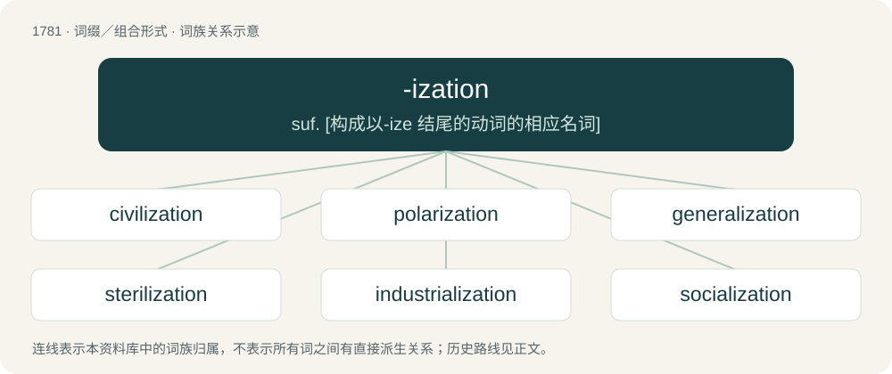

# 1882 · -ization — suf. \[构成以-ize 结尾的动词的相应名词\]

[总目录](../00_总目录_按常用程度.md)

**类型**：词缀／组合形式　｜　**来源语言**：见词源记录

## 核心含义与来源

- 核心含义：suf. \[构成以-ize 结尾的动词的相应名词\]
- 英文含义：Forms nouns denoting the act, process, or result of doing/making what is denoted by the noun/adjective.
- 词形：-ization

**来源记录 1**（后缀／后置成分；Forms nouns denoting the act, process, or result of doing/making what is denoted by the noun/adjective.）

From -ize + -ation.

## 词族图

## 单词速览（常用到不常用）

| 单词 | 音标 | 释义 |
|---|---|---|
| [civilization](#w-1) | 英 /ˌsɪv.ɪ.laɪˈzeɪ.ʃən/；美 /ˌsɪv.ə.laɪˈzeɪ.ʃən/ | n. 文明, 教化；\[法\] 文明, 文化, 文明国家的总称 |
| [polarization](#w-2) | /ˌpoʊlərɪˈzeɪʃən/ | n. 极化, 极化强度, 偏振, 两极分化；\[计\] 定位; 对位 |
| [generalization](#w-3) | /,dʒenərəlaiˈzeiʃən/ | n. 一般化, 普遍化, 概括；\[化\] 推广; 普适化 |
| [sterilization](#w-4) | /.sterəlaiˈzeiʃən/ | n. 使成不毛, 无用状态, 杀菌, 绝育；\[化\] 消毒 |
| [industrialization](#w-5) | 英 /ɪnˌdʌstɹɪəlaɪˈzeɪʃən/；美 /ɪnˌdʌstɹɪəlɪˈzeɪʃən/ | n. 工业化, 产业化；\[经\] 工业化 |
| [socialization](#w-6) | /.səuʃəlaiˈzeiʃən/ | n. 社会化, 社会主义化 |
| [immunization](#w-7) | /.imjuːnaiˈzeiʃən/ | n. 免疫；\[医\] 免疫法 |
| [normalization](#w-8) | 美 /ˌnɔɹ.mə.ləˈzeɪ.ʃən/ | n. 常态化, 正常化, 正规化；\[化\] 归一化; 正态化; 正火; 正火处理 |
| [commercialization](#w-9) | 英 /kəˌmɜːʃəlaɪˈzeɪʃən/；美 /kəˌmɝʃəlaɪˈzeɪʃən/ | \[计\] 商业化 |
| [liberalization](#w-10) | /.libərəlaiˈzeiʃən/ | n. 自由主义化, 宽大；\[法\] 自由化 |
| [hybridization](#w-11) | 英 /haɪ.bɹɪd.aɪˈzeɪ.ʃən/ | n. 杂交, 配种, 杂种培殖；\[化\] 杂化; 杂交 |
| [victimization](#w-12) | /ˌvɪk.tɪ.maɪˈzeɪ.ʃən/ | n. 牺牲, 欺骗 |
| [virtualization](#w-13) |  | \[计\] 虚拟化 |
| [democratization](#w-14) | 英 /dɪˌmɒkɹətaɪˈzeɪʃən/；美 /dɪˌmɑkɹətəˈzeɪʃən/ | n. 民主化；\[法\] 民主化 |
| [nationalization](#w-15) | /.næʃənəlaiˈzeiʃən/ | n. 同化, 归化, 国有化；\[经\] 国有化 |
| [rationalization](#w-16) | 英 /ˌræʃ(ə)n(ə)laɪˈzeɪʃn̩/；美 /ˌræʃənəlaɪˈzeɪʃən/ | n. 合理化；\[计\] 有理化 |
| [centralization](#w-17) | 英 /ˌsɛntɹəˌlaɪˈzeɪʃən/；美 /ˌsɛntɹələˈzeɪʃən/ | n. 集中, 中央集权化；\[计\] 集中式; 集中化 |
| [marginalization](#w-18) | /ˌmɑː(ɹ)dʒɪnəlaɪˈzeɪʃən/ | \[医\]边缘化 |
| [crystallization](#w-19) | 美 /ˌkɹɪstəlaɪˈzeɪʃən/ | n. 结晶, 定形, 明朗化, 具体化；\[化\] 结晶 |
| [radicalization](#w-20) | /,rædikəlaiˈzeiʃən/ | n. 激进化 |
| [unionization](#w-21) | /ˌjuːnjənaɪˈzeɪʃən/ | n. 联合；结合；工会化 |
| [internationalization](#w-22) | 英 /ɪntəˌnæʃ(ə)n(ə)ləˈzeɪʃən/；美 /ɪntɚˌnæʃ(ə)n(ə)ləˈzeɪʃən/ | n. 国际化, 国际共管；\[经\] 国际化 |
| [criminalization](#w-23) | /ˌkɹɪmɪnəlaɪzˈeɪʃən/ | \[法\] 定罪, 宣布犯有罪行 |
| [mineralization](#w-24) | /ˌmɪ.nə.ɹə.laɪˈzeɪ.ʃən/ | n. 矿化, 使含矿物；\[化\] 矿化 |
| [randomization](#w-25) | 英 /ˌɹændəməˈzeɪt͡ʃən/；美 /ˌɹændəməˈzeɪt͡ʃən/ | \[计\] 随机性；\[化\] 随机化; 无规则分布 |
| [catheterization](#w-26) | /-raiˈzeiʃən/ | n. 导管插入(术)；\[医\] 导管插入\[术\] |
| [institutionalization](#w-27) | /ˌɪnstɪˌtjuːʃnəlaɪˈzeɪʃən/ | \[法\] 制度化 |
| [dehumanization](#w-28) | 英 /diːˌhjuːmənaɪˈzeɪʃən/ | n. 使失人性, 非人化, 灭绝人性, 使成兽性 |
| [internalization](#w-29) | /in,t\\\\ːnəlaiˈzeiʃən;-liˈz-/ | n. 成为主观, 内在化 |
| [pressurization](#w-30) | /,preʃəraiˈzeiʃən/ | n. 压力输送, 挤压, 气密, 密封, 增压, 加压；\[化\] 高压密封法; 加压法 |
| [collectivization](#w-31) | /kəˌlɛk.tɪv.aɪˈzeɪ.ʃən/ | n. 集体化 |
| [miniaturization](#w-32) |  | n. 微型化；\[化\] 微型化 |
| [regularization](#w-33) | /,re^juləraiˈzeiʃən/ | n. 规则化, 调整 |
| [vaporization](#w-34) | /.veipəraiˈzeiʃən/ | n. 蒸发, 汽化；\[化\] 汽化 |
| [demonization](#w-35) | /,diːmənaiˈzeiʃən, -niˈz-/ | n. 妖魔化 |
| [popularization](#w-36) |  | n. 通俗化, 平易化, 普及 |
| [sexualization](#w-37) | /,sɛʃʊəlaɪˈzeʃən/ | \[医\]雌雄鉴别（家禽的）, 性化（作用） |
| [formalization](#w-38) | /.fɒːməlaiˈzeiʃən/ | n. 定型, 形式化, 礼仪化 |
| [novelization](#w-39) | /,nɔvəlaiˈzeiʃən/ | n. novelize（使小说化）的变形 |
| [westernization](#w-40) | /,westənaiˈzeiʃən;-niˈz-/ | n. \[亦作W-\]西方化,欧美化 |
| [digitalization](#w-41) | 英 /ˌdɪdʒɪtəlaɪˈzeɪʃən/ | n. \[药\]洋地黄丸 |
| [familiarization](#w-42) |  | n. 亲密, 精通, 熟悉 |
| [periodization](#w-43) | /,piəriədaiˈzeiʃən;-diˈz-/ | \[计\] 周期化 |
| [dimerization](#w-44) | /,daiməriˈzeiʃən/ | n. \[化\]二聚(作用) |

## 逐词详解

### 1. civilization

**词性**：名词　｜　**音标**：英 /ˌsɪv.ɪ.laɪˈzeɪ.ʃən/；美 /ˌsɪv.ə.laɪˈzeɪ.ʃən/

**中文释义**：n. 文明, 教化；\[法\] 文明, 文化, 文明国家的总称

**英文义项**：An organized culture encompassing many communities, often on the scale of a nation or a people; a stage or system of social, political, or technical development. / Human society, particularly civil society.

**构词拆分**：civilize + -ation；civil + -ization

**词源与演化**：

Borrowed from French civilisation, equivalent to civilize + -ation or civil + -ization.

**例句**：

> Modern civilization is a product of industrialization and globalization.

该用例对应义项：An organized culture encompassing many communities, often on the scale of a nation or a people; a stage or system of social, political, or technical development.

### 2. polarization

**词性**：名词　｜　**音标**：/ˌpoʊlərɪˈzeɪʃən/

**中文释义**：n. 极化, 极化强度, 偏振, 两极分化；\[计\] 定位; 对位

**英文义项**：The production or the condition of polarity. / The grouping of opinions into two extremes.

**构词拆分**：polar + -ization

**词源与演化**：

Borrowed from French polarisation. By surface analysis, polarize + -ation or polar + -ization.

**例句**：

> The film was alarmingly prescient about political polarization.

### 3. generalization

**词性**：名词　｜　**音标**：/,dʒenərəlaiˈzeiʃən/

**中文释义**：n. 一般化, 普遍化, 概括；\[化\] 推广; 普适化

**英文义项**：An act or instance of generalizing; concluding that something true of a subclass is true of the entire class. / The formulation of general concepts from specific instances by abstracting common properties.

**构词拆分**：general + -ization

**词源与演化**：

From general + -ization.

**例句**：

> A hypersphere is a generalization of a sphere across more than three dimensions.

该用例对应义项：A proof, axiom, problem, or definition that includes another's cases, and also some additional cases; a conclusion reached by inferring from specific cases to more general cases or principles.

### 4. sterilization

**词性**：名词　｜　**音标**：/.sterəlaiˈzeiʃən/

**中文释义**：n. 使成不毛, 无用状态, 杀菌, 绝育；\[化\] 消毒

**英文义项**：The process of treating something to kill or inactivate microorganisms. / A procedure to permanently prevent an organism from reproducing.

**构词拆分**：sterile + -ization；sterilize + -ation

**词源与演化**：

From sterile + -ization or sterilize + -ation.

**例句**：

> Heat sterilization is used during canning so the food can be safely stored for long periods.

该用例对应义项：The process of treating something to kill or inactivate microorganisms.

### 5. industrialization

**词性**：名词　｜　**音标**：英 /ɪnˌdʌstɹɪəlaɪˈzeɪʃən/；美 /ɪnˌdʌstɹɪəlɪˈzeɪʃən/

**中文释义**：n. 工业化, 产业化；\[经\] 工业化

**英文义项**：A process of social and economic change whereby a human society is transformed from a preindustrial to an industrial state.

**构词拆分**：industrial + -ization；industrialize + -ation

**词源与演化**：

From French industrialisation. Analyzable as industrial + -ization or industrialize + -ation.

**例句**：

> Industrialization had a great influence on the development of the economy in Japan.

### 6. socialization

**词性**：名词　｜　**音标**：/.səuʃəlaiˈzeiʃən/

**中文释义**：n. 社会化, 社会主义化

**英文义项**：The process of learning how to live in a way acceptable to one's own society, said especially about children. / The act of interacting with others, of being social.

**构词拆分**：socialize + -ation；social + -ization

**词源与演化**：

From socialize + -ation or social + -ization.

**例句**：

> Forced socialization rarely creates strong friendships, but there are exceptions.

该用例对应义项：The act of interacting with others, of being social.

### 7. immunization

**词性**：名词　｜　**音标**：/.imjuːnaiˈzeiʃən/

**中文释义**：n. 免疫；\[医\] 免疫法

**英文义项**：The process by which a person is safely exposed in a controlled manner to a material that is designed to prime their immune system against that material. / One such exposure.

**构词拆分**：immunize + -ation；immune + -ization

**词源与演化**：

From French immunisation. Coined by Albert Calmette. Equivalent to immunize + -ation or immune + -ization.

**例句**：

> Immunization against influenza is important for all child-care workers.

该用例对应义项：The process by which a person is safely exposed in a controlled manner to a material that is designed to prime their immune system against that material.

### 8. normalization

**词性**：名词　｜　**音标**：美 /ˌnɔɹ.mə.ləˈzeɪ.ʃən/

**中文释义**：n. 常态化, 正常化, 正规化；\[化\] 归一化; 正态化; 正火; 正火处理

**英文义项**：Any process that makes something more normal or regular, which typically means conforming to some regularity or rule, or returning from some state of abnormality. / Standardization, act of imposing standards or norms or rules or regulations.

**构词拆分**：normal + -ization；normalize + -ation

**词源与演化**：

From normal + -ization or normalize + -ation.

**例句**：

> Let us ensure that hate speech and its normalization are never tolerated.

### 9. commercialization

**词性**：名词　｜　**音标**：英 /kəˌmɜːʃəlaɪˈzeɪʃən/；美 /kəˌmɝʃəlaɪˈzeɪʃən/

**中文释义**：\[计\] 商业化

**英文义项**：The act of commercializing.

**构词拆分**：commercialize + -ation；commercial + -ization

**词源与演化**：

From commercialize + -ation or commercial + -ization.

**例句**：

> My father considered the commercialization of Christmas to be a sacrilege.

该用例对应义项：the act of commercializing something; involving something in commerce

### 10. liberalization

**词性**：名词　｜　**音标**：/.libərəlaiˈzeiʃən/

**中文释义**：n. 自由主义化, 宽大；\[法\] 自由化

**英文义项**：The process or act of making more liberal. / The lessening of government regulations and restrictions in an economy in exchange for greater participation by private entities.

**构词拆分**：liberalize + -ation；liberal + -ization

**词源与演化**：

From liberalize + -ation or liberal + -ization.

**例句**：

> It will be four years before the definite result of beef liberalization emerges.

### 11. hybridization

**词性**：名词　｜　**音标**：英 /haɪ.bɹɪd.aɪˈzeɪ.ʃən/

**中文释义**：n. 杂交, 配种, 杂种培殖；\[化\] 杂化; 杂交

**英文义项**：The linear combination of atomic orbitals in a molecule to form hybrid orbitals. / The process of breeding a mixed offspring from two different strains or species of animal or plant

**构词拆分**：hybrid + -ization

**词源与演化**：

\* hybrid + -ization

### 12. victimization

**词性**：名词　｜　**音标**：/ˌvɪk.tɪ.maɪˈzeɪ.ʃən/

**中文释义**：n. 牺牲, 欺骗

**英文义项**：An act that victimizes or exploits someone. / Adversity as a result of being a victim.

**构词拆分**：victim + -ization；victimize + -ation

**词源与演化**：

From victim + -ization or victimize + -ation.

**例句**：

> Paying Blacks less and charging them more is a form of victimization.

该用例对应义项：an act that exploits or victimizes someone (treats them unfairly)

### 13. virtualization

**词性**：名词

**中文释义**：\[计\] 虚拟化

**英文义项**：The act of virtualizing. / Creating a virtual version of common computing hardware at the same abstraction level.

**构词拆分**：virtual + -ization

**词源与演化**：

From virtual + -ization.

**用法示例／搭配（非完整句）**：

> storage virtualization

该用例对应义项：Creating a virtual version of common computing hardware at the same abstraction level.

### 14. democratization

**词性**：名词　｜　**音标**：英 /dɪˌmɒkɹətaɪˈzeɪʃən/；美 /dɪˌmɑkɹətəˈzeɪʃən/

**中文释义**：n. 民主化；\[法\] 民主化

**英文义项**：The introduction of democracy, its functions or principles, to an area or country which did not have democracy previously. / The spread of democracy as a concept.

**构词拆分**：democratiz(e) + -ation；democrat(ic) + -ization

**词源与演化**：

From democratiz(e) + -ation or democrat(ic) + -ization.

**例句**：

> Tebboune is working for the democratization of Algeria but he's facing daunting challenges.

### 15. nationalization

**词性**：名词　｜　**音标**：/.næʃənəlaiˈzeiʃən/

**中文释义**：n. 同化, 归化, 国有化；\[经\] 国有化

**英文义项**：American and Oxford British English standard spelling of nationalisation.

**构词拆分**：national + -ization

**词源与演化**：

From national + -ization.

### 16. rationalization

**词性**：名词　｜　**音标**：英 /ˌræʃ(ə)n(ə)laɪˈzeɪʃn̩/；美 /ˌræʃənəlaɪˈzeɪʃən/

**中文释义**：n. 合理化；\[计\] 有理化

**英文义项**：A statement of one's motives, or of the causes of some event. / The reorganization of a company or organization in order to improve its efficiency through the reallocation of resources and changes in its workforce.

**构词拆分**：rational + -ization；rationalize + -ation

**词源与演化**：

First attested in 1831. From French rationalisation, equivalent to rational + -ization or rationalize + -ation.

**例句**：

> It began with the familiar political motives of civil service rationalization and downsizing.

该用例对应义项：The reorganization of a company or organization in order to improve its efficiency through the reallocation of resources and changes in its workforce.

### 17. centralization

**词性**：名词　｜　**音标**：英 /ˌsɛntɹəˌlaɪˈzeɪʃən/；美 /ˌsɛntɹələˈzeɪʃən/

**中文释义**：n. 集中, 中央集权化；\[计\] 集中式; 集中化

**英文义项**：The act or process of centralizing, or the state of being centralized; the act or process of combining or reducing several parts into a whole

**构词拆分**：central + -ization；centralize + -ation

**词源与演化**：

From French centralisation, equivalent to central + -ization or centralize + -ation.

**用法示例／搭配（非完整句）**：

> the centralization of power in the general government

该用例对应义项：The act or process of centralizing, or the state of being centralized; the act or process of combining or reducing several parts into a whole

### 18. marginalization

**词性**：名词　｜　**音标**：/ˌmɑː(ɹ)dʒɪnəlaɪˈzeɪʃən/

**中文释义**：\[医\]边缘化

**英文义项**：The act of marginalizing.

**构词拆分**：marginal + -ization

**词源与演化**：

From marginal + -ization.

**例句**：

> This policy will lead to the marginalization of millions of people.

### 19. crystallization

**词性**：名词　｜　**音标**：美 /ˌkɹɪstəlaɪˈzeɪʃən/

**中文释义**：n. 结晶, 定形, 明朗化, 具体化；\[化\] 结晶

**英文义项**：The act or process by which a substance in solidifying assumes the form and structure of a crystal, or becomes crystallized. / The body formed by crystallizing.

**构词拆分**：crystal + -ization

**词源与演化**：

From crystal + -ization.

**例句**：

> Silver on precipitation forms arborescent crystallizations.

该用例对应义项：The body formed by crystallizing.

### 20. radicalization

**词性**：名词　｜　**音标**：/,rædikəlaiˈzeiʃən/

**中文释义**：n. 激进化

**英文义项**：The process of radicalizing.

**构词拆分**：radical + -ization

**词源与演化**：

From radical + -ization.

**例句**：

> Is it radicalization if you know you're being radical?

### 21. unionization

**词性**：名词　｜　**音标**：/ˌjuːnjənaɪˈzeɪʃən/

**中文释义**：n. 联合；结合；工会化

**英文义项**：The act of forming a trade union.

**构词拆分**：union + -ization

**词源与演化**：

From union + -ization.

**例句**：

> The issue underlying the strike was unionization.

该用例对应义项：act of forming labor unions

### 22. internationalization

**词性**：名词　｜　**音标**：英 /ɪntəˌnæʃ(ə)n(ə)ləˈzeɪʃən/；美 /ɪntɚˌnæʃ(ə)n(ə)ləˈzeɪʃən/

**中文释义**：n. 国际化, 国际共管；\[经\] 国际化

**英文义项**：The conversion of something in order to make it international. / The act or process of making a product suitable for international markets, typically by making text messages easily translatable and ensuring support of non-Latin character sets, languages, and regions.

**构词拆分**：international + -ization

**词源与演化**：

From international + -ization.

**例句**：

> If "internationalization" means putting every little thing into English, then I think "internationalization" is a load of shit.

### 23. criminalization

**词性**：名词　｜　**音标**：/ˌkɹɪmɪnəlaɪzˈeɪʃən/

**中文释义**：\[法\] 定罪, 宣布犯有罪行

**英文义项**：The act of making a previously legal activity illegal, the act of making something a criminal offence. / The act of turning someone into a criminal by making their activities illegal.

**构词拆分**：criminal + -ization；criminalize + -ation

**词源与演化**：

From criminal + -ization or criminalize + -ation.

**例句**：

> The criminalization of marijuana.

该用例对应义项：legislation that makes something illegal

### 24. mineralization

**词性**：名词　｜　**音标**：/ˌmɪ.nə.ɹə.laɪˈzeɪ.ʃən/

**中文释义**：n. 矿化, 使含矿物；\[化\] 矿化

**英文义项**：A form of fossilization in which the organic parts of an organism are replaced by minerals. / The breakdown of organic matter in the soil to form soluble inorganic compounds.

**构词拆分**：mineral + -ization

**词源与演化**：

From mineral + -ization.

### 25. randomization

**词性**：名词　｜　**音标**：英 /ˌɹændəməˈzeɪt͡ʃən/；美 /ˌɹændəməˈzeɪt͡ʃən/

**中文释义**：\[计\] 随机性；\[化\] 随机化; 无规则分布

**英文义项**：The process of making random.

**构词拆分**：random + -ization

**词源与演化**：

From random + -ization.

### 26. catheterization

**词性**：名词　｜　**音标**：/-raiˈzeiʃən/

**中文释义**：n. 导管插入(术)；\[医\] 导管插入\[术\]

**英文义项**：The procedure of introducing a catheter.

**构词拆分**：catheter + -ization

**词源与演化**：

From catheter + -ization.

**例句**：

> Since the development of fiber optics, treatments utilizing catheterization have replaced some former surgical procedures.

该用例对应义项：The procedure of introducing a catheter.

### 27. institutionalization

**词性**：名词　｜　**音标**：/ˌɪnstɪˌtjuːʃnəlaɪˈzeɪʃən/

**中文释义**：\[法\] 制度化

**英文义项**：The process of establishing a practice as a norm. / The process of committing a person to a facility where their freedom to leave will be restrained, usually a mental hospital.

**构词拆分**：institutional + -ization

**词源与演化**：

From institutional + -ization.

**例句**：

> The government began the institutionalization of background checks for internet users.

该用例对应义项：The process of establishing a practice as a norm.

### 28. dehumanization

**词性**：名词　｜　**音标**：英 /diːˌhjuːmənaɪˈzeɪʃən/

**中文释义**：n. 使失人性, 非人化, 灭绝人性, 使成兽性

**英文义项**：The act or process of dehumanizing.

**构词拆分**：de- + humanization；dehumanize + -ation；de- + human + -ization

**词源与演化**：

From de- + humanization or dehumanize + -ation or de- + human + -ization.

**例句**：

> Science has been blamed for the dehumanization of modern life.

该用例对应义项：the act of degrading people with respect to their best qualities

### 29. internalization

**词性**：名词　｜　**音标**：/in,t\\\\ːnəlaiˈzeiʃən;-liˈz-/

**中文释义**：n. 成为主观, 内在化

**英文义项**：The process of internalizing something.

**构词拆分**：internal + -ization

**词源与演化**：

From internal + -ization.

### 30. pressurization

**词性**：名词　｜　**音标**：/,preʃəraiˈzeiʃən/

**中文释义**：n. 压力输送, 挤压, 气密, 密封, 增压, 加压；\[化\] 高压密封法; 加压法

**英文义项**：The act or process of increasing pressure within a volume of space.

**构词拆分**：pressure + -ization

**词源与演化**：

From pressure + -ization.

### 31. collectivization

**词性**：名词　｜　**音标**：/kəˌlɛk.tɪv.aɪˈzeɪ.ʃən/

**中文释义**：n. 集体化

**英文义项**：The act of collectivizing / The process of abolishing privately-owned farmland organizing all its workers into large, publicly-owned collectives.

**构词拆分**：collective + -ization

**词源与演化**：

From collective + -ization.

### 32. miniaturization

**词性**：名词

**中文释义**：n. 微型化；\[化\] 微型化

**英文义项**：The act or process of miniaturizing or making smaller. / Something that has been miniaturized or made smaller.

**构词拆分**：miniature + -ization

**词源与演化**：

From miniature + -ization.

### 33. regularization

**词性**：名词　｜　**音标**：/,re^juləraiˈzeiʃən/

**中文释义**：n. 规则化, 调整

**英文义项**：The act of making regular, of regularizing. / a process that simplifies results, often used to obtain results for ill-posed problems or to prevent overfitting.

**构词拆分**：regular + -ization

**词源与演化**：

From regular + -ization.

### 34. vaporization

**词性**：名词　｜　**音标**：/.veipəraiˈzeiʃən/

**中文释义**：n. 蒸发, 汽化；\[化\] 汽化

**英文义项**：A conversion of a solid or a liquid into a gas. / A destruction of something by turning it into vapor.

**构词拆分**：vapor + -ization

**词源与演化**：

From vapor + -ization.

**例句**：

> The friction that occurs during the violent vaporization process generates the flare.

### 35. demonization

**词性**：名词　｜　**音标**：/,diːmənaiˈzeiʃən, -niˈz-/

**中文释义**：n. 妖魔化

**英文义项**：The act of demonizing. / Something demonized.

**构词拆分**：demon + -ization

**词源与演化**：

From demon + -ization.

**例句**：

> Some people, when they want to make some money, start making videos about the demonization of Islam.

### 36. popularization

**词性**：名词

**中文释义**：n. 通俗化, 平易化, 普及

**英文义项**：The act of making something popular to the general public.

**构词拆分**：popular + -ization

**词源与演化**：

From popular + -ization.

### 37. sexualization

**词性**：名词　｜　**音标**：/,sɛʃʊəlaɪˈzeʃən/

**中文释义**：\[医\]雌雄鉴别（家禽的）, 性化（作用）

**英文义项**：The act or process of sexualizing.

**构词拆分**：sexual + -ization；sexualize + -ation

**词源与演化**：

From sexual + -ization or sexualize + -ation.

**例句**：

> We oppose the sexualization of children and children's TV shows.

### 38. formalization

**词性**：名词　｜　**音标**：/.fɒːməlaiˈzeiʃən/

**中文释义**：n. 定型, 形式化, 礼仪化

**英文义项**：The act of formalizing something.

**构词拆分**：formal + -ization

**词源与演化**：

From formal + -ization.

### 39. novelization

**词性**：名词　｜　**音标**：/,nɔvəlaiˈzeiʃən/

**中文释义**：n. novelize（使小说化）的变形

**英文义项**：The writing of a novel based on fact; fictionalization / A text novel that is an adaptation of a story from a visual medium such as film

**构词拆分**：novel + -ization

**词源与演化**：

From novel + -ization.

### 40. westernization

**词性**：名词　｜　**音标**：/,westənaiˈzeiʃən;-niˈz-/

**中文释义**：n. \[亦作W-\]西方化,欧美化

**英文义项**：The process of assimilation, by a society, of the customs and practices of western culture.

**构词拆分**：western + -ization

**词源与演化**：

From western + -ization.

**例句**：

> In most cases, modernization is identified with Westernization.

### 41. digitalization

**词性**：名词　｜　**音标**：英 /ˌdɪdʒɪtəlaɪˈzeɪʃən/

**中文释义**：n. \[药\]洋地黄丸

**英文义项**：Synonym of digitization.

**构词拆分**：digitalize + -ation；digital + -ization

**词源与演化**：

From digitalize + -ation or digital + -ization.

**例句**：

> Have humans become slaves to digitalization?

### 42. familiarization

**词性**：名词

**中文释义**：n. 亲密, 精通, 熟悉

**英文义项**：The act, process or result of familiarizing.

**构词拆分**：familiar + -ization；familiarize + -ation

**词源与演化**：

From familiar + -ization or familiarize + -ation.

### 43. periodization

**词性**：名词　｜　**音标**：/,piəriədaiˈzeiʃən;-diˈz-/

**中文释义**：\[计\] 周期化

**英文义项**：The process of categorizing something (e.g. history) into named periods. / Training in segments of a few weeks or months, so that training begins at lower intensity and is gradually increased to high intensity.

**构词拆分**：period + -ization

**词源与演化**：

From period + -ization.

**例句**：

> The classical periodization of history studies in Ancient times, the Middle Ages and Modern Era is based on a Eurocentrist world view.

### 44. dimerization

**词性**：名词　｜　**音标**：/,daiməriˈzeiʃən/

**中文释义**：n. \[化\]二聚(作用)

**英文义项**：Any chemical reaction in which two monomers react to form a dimer.

**构词拆分**：dimer + -ization；dimerize + -ation

**词源与演化**：

From dimer + -ization or dimerize + -ation.
