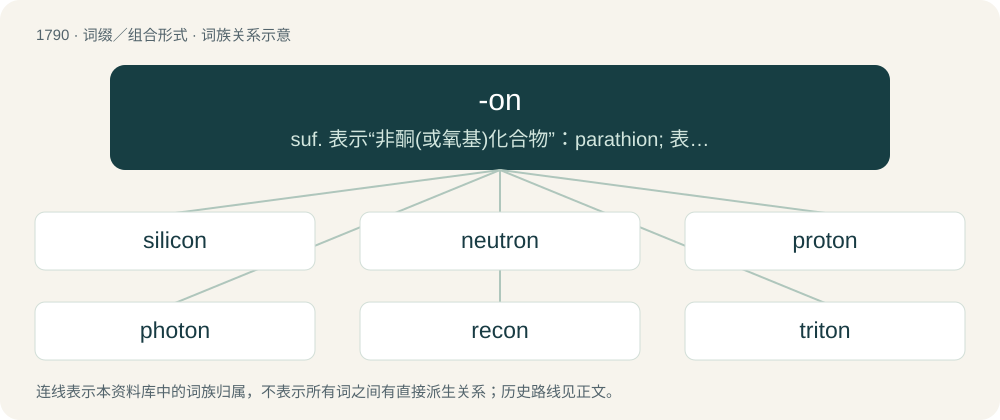

# 1892 · -on — suf. 表示“非酮(或氧基)化合物”：parathion; 表示：\[生物学\]“…子(指基本遗传成分)”; \[物理学\]“…子(指基本粒子或量子)”; \[化学\]表示“惰性气体”：neon

[总目录](../00_总目录_按常用程度.md)

**类型**：词缀／组合形式　｜　**来源语言**：见词源记录

## 核心含义与来源

- 核心含义：suf. 表示“非酮(或氧基)化合物”：parathion; 表示：\[生物学\]“…子(指基本遗传成分)”; \[物理学\]“…子(指基本粒子或量子)”; \[化学\]表示“惰性气体”：neon
- 英文含义：Forming nouns denoting subatomic particles and quanta.
- 词形：-on

**多个词源／构词路径**：同一拼写可能有不同来源；以下按词性和含义分别列出。

**来源记录 1**（后缀／后置成分；Forming nouns denoting subatomic particles and quanta.）

Back-formation from electron, influenced by Ancient Greek -ον (-on).

**来源记录 2**（后缀／后置成分；Forming names of noble gases and certain nonmetal elements.）

Back-formation from carbon, first applied to boron and then to silicon.

**来源记录 3**（后缀／后置成分；Forms names for chemical compounds, often proprietary.）

From the combining form of -one, as in sulfon-ic. Compare also -thion.

## 词族图

## 单词速览（常用到不常用）

| 单词 | 音标 | 释义 |
|---|---|---|
| [silicon](#w-1) | 英 /ˈsɪlɪkən/；美 /ˈsɪləˌkɑn/ | n. 硅；\[化\] 硅Si |
| [neutron](#w-2) | 英 /ˈn(j)uː.tɹɒn/；美 /ˈnu.tɹɑn/ | n. 中子；\[化\] 中子 |
| [proton](#w-3) | 英 /ˈpɹəʊ.tɒn/；美 /ˈpɹoʊ.tɑn/ | n. 质子；\[化\] 质子 |
| [photon](#w-4) | /ˈfəʊtɒn/ | n. 光子, 光量子, 光度；\[化\] 光量子; 光子 |
| [recon](#w-5) | 英 /ɹɪˈkɒn/；美 /ˈɹikɑn/ | 【英文】The smallest genetic unit that is capable of undergoing recombination. |
| [triton](#w-6) |  | 【英文】the nucleus of a tritium atom, consisting of a proton and two neutrons. |
| [boron](#w-7) | /ˈbɔːˌɹɒn/ | n. 硼；\[化\] 硼B |
| [xenon](#w-8) | 英 /ˈziːnɒn/；美 /ˈzinɑn/ | n. 氙；\[化\] 氙Xe |
| [argon](#w-9) | 美 /ˈɑːɹɡɒn/ | n. 氩；\[化\] 氩Ar |
| [krypton](#w-10) | /ˈkɹɪptɒn/ | n. 氪；\[化\] 氪Kr |
| [boson](#w-11) | 英 /ˈbəʊ.zɒn/；美 /ˈboʊ.zɑn/ | n. 玻色子；\[化\] 玻色子 |
| [interferon](#w-12) | 英 /ˌɪn.təˈfɪːˌɒn/；美 /ˌɪn.təɹˈfɪɹˌɑn/ | n. 干扰素；\[化\] 干扰素 |
| [hadron](#w-13) | 英 /ˈhæd.ɹɒn/；美 /ˈhæd.ɹɑn/ | \[化\] 强子(强相互作用粒子) |
| [codon](#w-14) | 英 /ˈkəʊ.dɒn/；美 /ˈkoʊ.dɑn/ | 【英文】A sequence of three adjacent nucleotides, which encode for a specific amino acid during protein synthesis or translation. |
| [freon](#w-15) | /ˈfɹiːɒn/ | n. 氟利昂；\[计\] 氟里昂 |
| [graviton](#w-16) | /ˈɡɹavɪtɒn/ | n. \[核\]引力子 |
| [phonon](#w-17) | 美 /ˈfoʊ.nɑn/ | n. 声子；\[计\] 声子 |
| [tachyon](#w-18) | 英 /ˈtæk.i.ɒn/；美 /ˈtæ.kiˌɑn/ | n. \[核\]超光速粒子 |
| [gluon](#w-19) | 英 /ˈɡluː.ɒn/；美 /ˈɡlu.ɑn/ | n. \[核\]胶子(一种理论上假设的无质量的粒子) |
| [magnon](#w-20) | /ˈmæ^nɔn/ | \[化\] 磁振子; 磁子 |
| [meson](#w-21) | /ˈmiːzɒn/ | 【英文】An elementary particle that is composed of a quark and an antiquark, such as a kaon or pion. (Mesons composed of rarer quarks are much heavier.) |
| [nucleon](#w-22) | /ˈn(j)uːkliɒn/ | n. 核子；\[化\] 核子 |
| [plasmon](#w-23) | 英 /ˈplazmɒn/ | (细)胞质基因(组) |
| [operon](#w-24) | /ˈɔpə,rɔn/ | n. \[生\]操纵子 |
| [penton](#w-25) | /ˈpentɔn/ | n. \[微\](在完整的病毒颗粒中由5个外壳包围而成的)腺病毒亚单位 |
| [fermion](#w-26) | /ˈfɜːmɪɒn/ | \[化\] 费米子 |
| [pion](#w-27) | /ˈpaɪɒn/ | \[化\] π介子 |
| [baryon](#w-28) | /ˈbɛəɹiɒn/ | n. 重子；\[化\] 重子 |

## 逐词详解

### 1. silicon

**词性**：名词　｜　**音标**：英 /ˈsɪlɪkən/；美 /ˈsɪləˌkɑn/

**中文释义**：n. 硅；\[化\] 硅Si

**英文义项**：A nonmetallic element (symbol Si) with an atomic number of 14 and atomic weight of 28.0855. / A single atom of this element.

**构词拆分**：silicium + -on

**词源与演化**：

Coined by Scottish chemist Thomas Thomson as a modification of the earlier name silicium, from the stem of Latin silex (“flint, silica”) + -on from carbon.

**例句**：

> Electronic City near Bengaluru, Karnataka is considered the Silicon Valley of India.

### 2. neutron

**词性**：名词　｜　**音标**：英 /ˈn(j)uː.tɹɒn/；美 /ˈnu.tɹɑn/

**中文释义**：n. 中子；\[化\] 中子

**英文义项**：A subatomic particle forming part of the nucleus of an atom and having no charge; it is a combination of an up quark and two down quarks.

**构词拆分**：neutral + -on

**词源与演化**：

From neutral + -on; by surface analysis, neutr(o)- + -on. Coined by Scottish-Australian physicist William Sutherland in 1899 in a paper in the Philosophical Magazine. Subsequent usage was sporadic and theoretical, sometimes referring to neutrinos rather than neutrons, and the modern sense was reintroduced alongside proton by Ernest Rutherford in 1920.

**例句**：

> The strong force is responsible for 99% of proton and neutron mass.

### 3. proton

**词性**：名词　｜　**音标**：英 /ˈpɹəʊ.tɒn/；美 /ˈpɹoʊ.tɑn/

**中文释义**：n. 质子；\[化\] 质子

**英文义项**：A positively charged subatomic particle forming part of the nucleus of an atom and determining the atomic number of an element, composed of two up quarks and a down quark. / The atomic nucleus of protium (hydrogen-1)

**构词拆分**：proto- + -on

**例句**：

> The strong force is responsible for 99% of proton and neutron mass.

### 4. photon

**词性**：名词　｜　**音标**：/ˈfəʊtɒn/

**中文释义**：n. 光子, 光量子, 光度；\[化\] 光量子; 光子

**英文义项**：The quantum of light and other electromagnetic energy, regarded as a discrete particle having zero rest mass, no electric charge, and an indefinitely long lifetime. It is a gauge boson.

**构词拆分**：photo- + -on

**词源与演化**：

From photo- + -on. Coined by American physicist Leonard Troland in 1916 as a unit of light hitting the retina, and later popularized in a more modern sense by Gilbert N. Lewis, with the term gaining acceptance in the physics community by the late 1920s.

**例句**：

> A photon is its own antiparticle.

### 5. recon

**词性**：名词　｜　**音标**：英 /ɹɪˈkɒn/；美 /ˈɹikɑn/

**英文义项**：The smallest genetic unit that is capable of undergoing recombination.

**构词拆分**：recombination + -on

**词源与演化**：

Contracted form of recombination + -on, coined by American molecular biologist Seymour Benzer in 1957 as " \[…\] the smallest element in the one-dimensional array that is interchangeable (but not divisible) by genetic recombination."

### 6. triton

**词性**：名词

**英文义项**：the nucleus of a tritium atom, consisting of a proton and two neutrons.

**构词拆分**：trit- + -on

**词源与演化**：

From trit- + -on. From tritium, from Ancient Greek τρίτος (trítos, “third”).

**例句**：

> The rugged rover on Neptune's Triton travelled on a plateau of nitrogen ice.

### 7. boron

**词性**：名词　｜　**音标**：/ˈbɔːˌɹɒn/

**中文释义**：n. 硼；\[化\] 硼B

**英文义项**：The chemical element (symbol B) with an atomic number of 5, which is a metalloid found in its pure form as a dark amorphous powder. / An atom of this element.

**构词拆分**：boro- + -on

**词源与演化**：

From the stem of borax (boro-) + -on (based on carbon). Coined by British chemist Humphry Davy as a modification of his earlier word boracium.

**例句**：

> How many moles of boron are there in this solution?

### 8. xenon

**词性**：名词　｜　**音标**：英 /ˈziːnɒn/；美 /ˈzinɑn/

**中文释义**：n. 氙；\[化\] 氙Xe

**英文义项**：The chemical element (symbol Xe) with an atomic number of 54. It is a colorless, odorless, unreactive noble gas, used notably in camera flash technology.

**词源与演化**：

From Ancient Greek ξένος (xénos, “foreign, strange”) + -on, used for all noble gases.

**例句**：

> Xenon is the 54th chemical element. It is colorless, odorless and tasteless.

### 9. argon

**词性**：名词　｜　**音标**：美 /ˈɑːɹɡɒn/

**中文释义**：n. 氩；\[化\] 氩Ar

**英文义项**：The chemical element (symbol Ar) with an atomic number of 18. The third most abundant gas in the Earth's atmosphere, it is a colourless, odourless, inert noble gas. / An atom of this element.

**词源与演化**：

From Ancient Greek ἀργός (argós, “idle, lazy”), because of its inertness, + -on, used for all noble gases.

**例句**：

> Mars has a very thin atmosphere made of carbon dioxide, nitrogen, and argon.

### 10. krypton

**词性**：名词　｜　**音标**：/ˈkɹɪptɒn/

**中文释义**：n. 氪；\[化\] 氪Kr

**英文义项**：The chemical element (symbol Kr) with an atomic number of 36. It is a colourless, odourless noble gas that only reacts with fluorine. It is one of the rarest gases in the Earth's atmosphere. / An atom of this element.

**词源与演化**：

From Ancient Greek κρυπτός (kruptós, “hidden”) + -on, used for all noble gases.

**例句**：

> Krypton is an element 36 on the periodic table with symbol Kr.

### 11. boson

**词性**：名词　｜　**音标**：英 /ˈbəʊ.zɒn/；美 /ˈboʊ.zɑn/

**中文释义**：n. 玻色子；\[化\] 玻色子

**英文义项**：A particle with totally symmetric composite quantum states, which exempts them from the Pauli exclusion principle, and that hence obeys Bose-Einstein statistics. They have integer spin. Among them are many elementary particles, and some (gauge bosons) are known to carry the fundamental forces.

**构词拆分**：Bose + -on

**词源与演化**：

From Bose + -on. Named after Indian physicist Satyendra Nath Bose (1894–1974); coined by English physicist Paul Dirac in 1945 in a lecture titled Developments in Atomic Theory.

**例句**：

> Tom is expected to be back in Boson by October 20th.

### 12. interferon

**词性**：名词　｜　**音标**：英 /ˌɪn.təˈfɪːˌɒn/；美 /ˌɪn.təɹˈfɪɹˌɑn/

**中文释义**：n. 干扰素；\[化\] 干扰素

**英文义项**：Any of a group of glycoproteins, produced by the immune system, that prevent viral replication in infected cells.

**构词拆分**：interfere + -on (suffix: chemical compound)

**词源与演化**：

From interfere + -on (suffix: chemical compound), from its role interfering with viral replication.

### 13. hadron

**词性**：名词　｜　**音标**：英 /ˈhæd.ɹɒn/；美 /ˈhæd.ɹɑn/

**中文释义**：\[化\] 强子(强相互作用粒子)

**英文义项**：A composite particle that comprises two or more quarks held together by the strong force and (consequently) can interact with other particles via said force; a meson or a baryon.

**词源与演化**：

From Ancient Greek ἁδρός (hadrós, “thick”) + English -on. Coined by Russian physicist Lev Okun in 1962 in a plenary talk at the International Conference on High Energy Physics.

**例句**：

> The Large Hadron Collider is the world's largest particle accelerator.

### 14. codon

**词性**：名词　｜　**音标**：英 /ˈkəʊ.dɒn/；美 /ˈkoʊ.dɑn/

**英文义项**：A sequence of three adjacent nucleotides, which encode for a specific amino acid during protein synthesis or translation.

**构词拆分**：code + -on

**词源与演化**：

From code + -on.

### 15. freon

**词性**：名词　｜　**音标**：/ˈfɹiːɒn/

**中文释义**：n. 氟利昂；\[计\] 氟里昂

**英文义项**：Any of several nonflammable refrigerants based on halogenated hydrocarbon including R-12, R-22, and R-23. / A gaseous ozone-depleting refrigerant.

**词源与演化**：

A genericization of the Chemours trademark "Freon." According to Flood, the name was formed from freeze and the arbitrary suffix -on.

### 16. graviton

**词性**：名词　｜　**音标**：/ˈɡɹavɪtɒn/

**中文释义**：n. \[核\]引力子

**英文义项**：A hypothetical gauge boson that regulates the gravitational force. It would have a spin of 2 and zero rest mass.

**构词拆分**：gravity + -on

**词源与演化**：

From gravity + -on. Coined by Russian physicists Dmitrii Blokhintsev and F. M. Gal'perin in 1934, and reintroduced by English physicist Paul Dirac in 1959 in a lecture to the American Physical Society.

### 17. phonon

**词性**：名词　｜　**音标**：美 /ˈfoʊ.nɑn/

**中文释义**：n. 声子；\[计\] 声子

**英文义项**：The quantum of acoustic or vibrational energy (sound), considered a discrete particle rather than a wave.

**构词拆分**：phono- + -on

**词源与演化**：

From phono- + -on. From Ancient Greek φωνή (phōnḗ, “sound”). Modelled after photon.

### 18. tachyon

**词性**：名词　｜　**音标**：英 /ˈtæk.i.ɒn/；美 /ˈtæ.kiˌɑn/

**中文释义**：n. \[核\]超光速粒子

**英文义项**：A hypothetical particle that travels faster than the speed of light. / A flaw in a physical theory that predicts the existence of tachyons or similar paradoxical results. Compare with ghost.

**构词拆分**：tachy- + -on

**词源与演化**：

Formed as: tachy- + -on, from ταχύς (takhús, “swift”, “rapid”). Coined by American physicist Gerald Feinberg in 1967.

### 19. gluon

**词性**：名词　｜　**音标**：英 /ˈɡluː.ɒn/；美 /ˈɡlu.ɑn/

**中文释义**：n. \[核\]胶子(一种理论上假设的无质量的粒子)

**英文义项**：A massless gauge boson that binds quarks together to form baryons, mesons and other hadrons and is associated with the strong nuclear force.

**构词拆分**：glue + -on

**词源与演化**：

From glue + -on. From being a particle (suffix "-on") that "glues" (attracts) together particles that feel the force carried by the gluon. Coined by American physicist Murray Gell-Mann in 1962.

### 20. magnon

**词性**：名词　｜　**音标**：/ˈmæ^nɔn/

**中文释义**：\[化\] 磁振子; 磁子

**英文义项**：A quantum of a spin wave.

**构词拆分**：magnet + -on

**词源与演化**：

From magn(et) + -on.

### 21. meson

**词性**：名词　｜　**音标**：/ˈmiːzɒn/

**英文义项**：An elementary particle that is composed of a quark and an antiquark, such as a kaon or pion. (Mesons composed of rarer quarks are much heavier.)

**构词拆分**：meso- + -on

**词源与演化**：

From meso- + -on. Coined by Indian physicist Homi Bhabha in 1939, as a modification of the earlier suggestion mesotron.

### 22. nucleon

**词性**：名词　｜　**音标**：/ˈn(j)uːkliɒn/

**中文释义**：n. 核子；\[化\] 核子

**英文义项**：A proton (uud) or a neutron (udd).

**构词拆分**：nucleus + -on

**词源与演化**：

From nucleus + -on.

**例句**：

> The binding energy between quarks in a nucleon is equal to its mass times the speed of light squared.

### 23. plasmon

**词性**：名词　｜　**音标**：英 /ˈplazmɒn/

**中文释义**：(细)胞质基因(组)

**英文义项**：The quantum of waves produced by the collective effects of large numbers of electrons when disturbed from equilibrium.

**构词拆分**：plasma + -on

**词源与演化**：

From plasma + -on, modelled after electron.

### 24. operon

**词性**：名词　｜　**音标**：/ˈɔpə,rɔn/

**中文释义**：n. \[生\]操纵子

**英文义项**：A unit of genetic material that functions in a coordinated manner by means of an operator, a promoter, and structural genes that are transcribed together.

**构词拆分**：From operator + -on.

**词源与演化**：

From operator + -on.

### 25. penton

**词性**：名词　｜　**音标**：/ˈpentɔn/

**中文释义**：n. \[微\](在完整的病毒颗粒中由5个外壳包围而成的)腺病毒亚单位

**英文义项**：A pentagonal capsomere of an adenovirus capsid.

**构词拆分**：pent- + -on

**词源与演化**：

From pent- + -on.

### 26. fermion

**词性**：名词　｜　**音标**：/ˈfɜːmɪɒn/

**中文释义**：\[化\] 费米子

**英文义项**：Any elementary or composite particle that has half-integer spin and thus obeys Fermi–Dirac statistics and the Pauli exclusion principle (equivalently, a particle for which the wavefunction of any system of identical such particles changes sign whenever two are swapped); a baryon, a lepton or a quark; / any such particle or any composite particle composed of fermions.

**构词拆分**：Fermi + -on

**词源与演化**：

From Fermi + -on. Named after Italian-American physicist Enrico Fermi. Coined by English physicist Paul Dirac in 1945 in a lecture titled "Developments in Atomic Theory".

**例句**：

> The fermions treated by the Standard Model are the (composite) baryons and the (elementary) leptons and quarks.

该用例对应义项：Any elementary or composite particle that has half-integer spin and thus obeys Fermi–Dirac statistics and the Pauli exclusion principle (equivalently, a particle for which the wavefunction of any system of identical such particles changes sign whenever two are swapped); a baryon, a lepton or a quark;

### 27. pion

**词性**：名词　｜　**音标**：/ˈpaɪɒn/

**中文释义**：\[化\] π介子

**英文义项**：Any of three semistable mesons, having positive, negative or neutral charge, composed of up and down quarks/antiquarks.

**构词拆分**：pi + -on

**词源与演化**：

From pi + -on, as alteration of pi-meson.

### 28. baryon

**词性**：名词　｜　**音标**：/ˈbɛəɹiɒn/

**中文释义**：n. 重子；\[化\] 重子

**英文义项**：A heavy subatomic particle created by the binding of quarks by gluons; a hadron containing three quarks. Baryons have half-odd integral spin and are thus fermions. This category includes the common proton and neutron of the atomic nucleus.

**构词拆分**：baryo- + -on

**词源与演化**：

From Ancient Greek βαρύς (barús, “heavy”) + English -on. Coined by Dutch-American physicist Abraham Pais in 1953. Equivalent to baryo- + -on.
