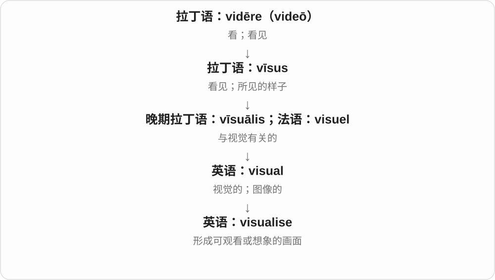

# 1903 · -ise — 形成动作、使成为、按某性质行动的动词词尾变体

[逐词精讲目录](../00_逐词精讲目录.md) · [总目录](../00_总目录_按常用程度.md)

## 核心词根与来源

这组让名词、形容词材料转到动作。英美拼写是习惯，不是每个以 ise 结尾的单词都能按使成为拆；merchandise 商品尤其别套错。

**-ISE：常与 -ize 对应，但先确认真是这个后缀**

realise、revolutionise、scrutinise 等接动作；许多词有 -ize 拼法；merchandise 则是旧法语名词借词的对照。

- **认识、核查与根本改变**：realise · scrutiny · scrutinise · revolutionise
- **强调、排序、展示和宣传**：emphasise · prioritise · visualise · publicise
- **恢复、激活和统一**：revitalise · energise · standardise
- **同形结尾对照**：merchandise

## 词形与演化规律

希腊 -izein 等经拉丁、法语和英语构词 → -ise/-ize；scrutiny → scrutinise；revolution + -ise；merchandise 名词接法语 marchandise，单独分支。

## 单词速览（按词族由简到繁）

同一基础词的相关扩展放在一起，先读基础形式，再读扩展；各组之间优先读常用的。具体词源关系见各词讲解。

| 单词 | 音标 | 核心意思 |
|---|---|---|
| [realise](#w-1) | /ˈrɪəlaɪz/ | 意识到；实现〔realize 的常见英式拼写〕 |
| [merchandise](#w-2) | 名词：英 /ˈmɜːtʃəndaɪs/，美 /ˈmɜːrtʃəndaɪs/；动词：英 /ˈmɜːtʃəndaɪz/，美 /ˈmɜːrtʃəndaɪz/ | 商品；销售、陈列推广商品 |
| [scrutiny](#w-12) | /ˈskruːtəni/ | 仔细检查、审视、审查 |
| [scrutinise](#w-9) | /ˈskruːtɪnaɪz/ | 仔细审查、逐项检查〔也拼 scrutinize〕 |
| [emphasise](#w-3) | /ˈemfəsaɪz/ | 强调；突出〔常见英式拼法〕 |
| [prioritise](#w-4) | 英 /praɪˈɒrətaɪz/；美 /praɪˈɔːrətaɪz/ | 安排优先顺序；优先处理〔英式常见拼法〕 |
| [visualise](#w-5) | /ˈvɪʒuəlaɪz/ | 想象出画面；使可视化 |
| [publicise](#w-6) | /ˈpʌblɪsaɪz/ | 宣传；使广为人知 |
| [revolutionise](#w-7) | /ˌrevəˈluːʃənaɪz/ | 彻底改变、使发生革命性变化〔revolutionize 的常见英式拼写〕 |
| [revitalise](#w-8) | /riːˈvaɪtəlaɪz/ | 使恢复活力；振兴〔常见英式拼写〕 |
| [energise](#w-10) | 英 /ˈenədʒaɪz/；美 /ˈenərdʒaɪz/ | 使振奋；给……通电 |
| [standardise](#w-11) | 英 /ˈstændədaɪz/；美 /ˈstændərdaɪz/ | 标准化〔standardize 的拼写变体〕 |

## 逐词讲解

### 1. realise — 意识到；实现〔realize 的常见英式拼写〕

**音标**：/ˈrɪəlaɪz/

**先抓住这个画面**

看到 s 不必重新猜义，它和 realize 是同一个常用动词的两种拼写。

**怎么拆**

real + -ise；-ise 与 -ize 是这一类动词的拼写变体。法语 réaliser 也是相关形式；这里不是再接一个独立词 ise。

**怎么变成今天的意思**

**拉丁 rēs → 晚期拉丁 reālis**  
事物 → 实际的

↓

**古法语 reel → 英语 real**  
真实的、实际存在的

↓

**real + -ise → realise**  
与 realize 对应的拼写形式

realise 常用于英式英语，realize 在美式普遍，也用于部分英式编辑规范。两者用法和读音基本相同，一篇文章里保持所选拼写习惯即可。

**常见搭配与例句**

realise that；realise the importance；realise an ambition。

> I did not realise how late it was.

我没意识到已经这么晚了。

> The project helped her realise a long-held ambition.

这个项目帮助她实现了长久以来的抱负。

**别混淆**

realise 和 release“释放”拼写相近，但词源和含义不同；意识到错误用 realise a mistake，不能写 release a mistake。

### 2. merchandise — 商品；销售、陈列推广商品

**音标**：名词：英 /ˈmɜːtʃəndaɪs/，美 /ˈmɜːrtʃəndaɪs/；动词：英 /ˈmɜːtʃəndaɪz/，美 /ˈmɜːrtʃəndaɪz/

**先抓住这个画面**

看商店里那批准备卖给顾客的货；作动词时则是想办法把这批货摆好、包装好、卖出去。

**怎么拆**

英语名词借自盎格鲁法语 marchaundise、古法语 marcheandise；法语内部由商人词加后缀形成。英语动词后来由名词转用。

**怎么变成今天的意思**

**拉丁语 merx，属格 mercis**  
货物、商品

↓

**拉丁语 mercari**  
做买卖、交易

↓

**古法语 marcheant → marcheandise；盎格鲁法语 marchaundise**  
商人 → 货物、买卖

↓

**英语 merchandise〔名词 → 动词〕**  
商品 → 销售和推广商品

常作不可数名词，some merchandise 可以是一整批货。乐队、影视和球队语境中常指带品牌或形象的周边产品；并非这个词的唯一意思。

**常见搭配与例句**

display merchandise；official merchandise。

> The shop keeps expensive merchandise behind the counter.

店里把贵重商品放在柜台后面。

> The team sells official merchandise at every game.

球队在每场比赛时销售官方周边商品。

**别混淆**

product 可数，指一种或一件产品；merchandise 把待售商品整体看。名词也有末音 /z/ 的变读。

### 3. scrutiny — 仔细检查、审视、审查

**音标**：/ˈskruːtəni/

**先抓住这个画面**

不是扫一眼就过，而是把细节翻出来，一项项问有没有问题；under scrutiny 就是在被这种目光细看。

**怎么拆**

借法语、晚期拉丁相关形式，上接 scrūtārī 搜查。更早常被联系到翻找破烂、刮切材料，但具体来源有讨论；不把一个生动垃圾堆故事当定论。

**怎么变成今天的意思**

**拉丁 scrūtārī → scrūtīnium**  
搜寻、检查 → 调查、审查

↓

**法语、拉丁相关名词 → 英语 scrutiny**  
审查；细密检查、审视

under scrutiny 受到审视，come under scrutiny 开始受审查，close scrutiny 仔细检查，public scrutiny 公众监督审视。通常不可数。

**常见搭配与例句**

under scrutiny；come under scrutiny；close scrutiny；public scrutiny。

> The proposal came under close scrutiny.

提案受到仔细审查。

> Public spending should be open to scrutiny.

公共支出应接受审视监督。

**别混淆**

scrutiny 是细看、审查的过程，criticism 是批评；被审查不等于已发现错误，也不一定有人在责骂。

### 4. scrutinise — 仔细审查、逐项检查〔也拼 scrutinize〕

**音标**：/ˈskruːtɪnaɪz/

**先抓住这个画面**

把 scrutiny 的细看真正做出来：合同、数据、证据都不放过细节。不是只看看外表。

**怎么拆**

scrutiny 去末尾 y 接 -ise 的动词对应；-ize 拼法也常见。历史英语 scrutinize 从 scrutiny 派生，不随意把词根切成 screw 螺丝 + tin 罐。

**怎么变成今天的意思**

**拉丁 scrūtārī → scrūtīnium**  
搜寻、检查 → 调查、审查

↓

**法语、拉丁相关名词 → 英语 scrutiny**  
审查；细密检查、审视

↓

**scrutiny → scrutinise/scrutinize**  
细密检查这一名词对应为动词

scrutinise the evidence 仔细审查证据，scrutinise a document 仔细核查文书，scrutinise the figures 逐项检查数字。

**常见搭配与例句**

scrutinise the evidence；scrutinise a document；scrutinise the figures。

> The editor scrutinised every quotation.

编辑仔细核查了每一处引文。

> They scrutinised the figures before publishing the report.

发布报告前，他们仔细核查了数字。

**别混淆**

scrutinise 后直接接检查对象，scrutiny 常见 under scrutiny；scan 有时快扫、有时细扫，不能只按一个扫字替换。

### 5. emphasise — 强调；突出〔常见英式拼法〕

**音标**：/ˈemfəsaɪz/

**先抓住这个画面**

把你希望别人记住的那个点，专门亮出来。

**怎么拆**

emphasis 的动词化形式，使用 -ise 拼法；与 emphasize 同一个词，不是另一套词源。

**怎么变成今天的意思**

**希腊 phaínein／phaínesthai**  
使显现、显现出来；与光亮有关

↓

**希腊 en- + phaínein → émphasis**  
把含义显出来；意味、突出

↓

**拉丁 emphasis → 英语 emphasis**  
突出某一点；强调、重视

↓

**英语 emphasis → emphasise／emphasize**  
给某一点更多分量，使之突出

可以强调截止日期，也可以用设计突出某个部位。后面通常直接接要强调的内容：emphasise the difference；名词结构才常说 put emphasis on。

**常见搭配与例句**

emphasise a point；emphasise the importance of；emphasise that…。

> The guide emphasised the need to stay on the marked path.

向导强调必须沿着标记好的小路走。

> The contrasting colours emphasise the shape of the roof.

对比鲜明的颜色突出了屋顶的形状。

**别混淆**

emphasise 和 emphasize 的意义、读音相同；英式常见 -ise，英式也用 -ize，美式通常用 -ize。

### 6. prioritise — 安排优先顺序；优先处理〔英式常见拼法〕

**音标**：英 /praɪˈɒrətaɪz/；美 /praɪˈɔːrətaɪz/

**先抓住这个画面**

和 prioritize 一样，是把更重要的事放到前面；这里变化的是拼写习惯。

**怎么拆**

priority + -ise；与 prioritize 对应的 -ise 拼法。

**怎么变成今天的意思**

**古拉丁 pri；拉丁 prior**  
在前 → 较早的、居前的

↓

**中世纪拉丁 priōritās → 古法语 priorite → 英语 priority**  
居前的状态 → 优先地位、优先事项

↓

**英语 priority + -ise → prioritise**  
安排优先次序；prioritize 的另一拼法

英国等地区常用 prioritise，英国也有采用 -ize 的规范。它不是比 prioritize 更轻或更重的动作。

**常见搭配与例句**

prioritise health；prioritise urgent repairs。

> We should prioritise repairs to the main entrance.

我们应优先维修正门。

> She learned to prioritise her time more carefully.

她学会了更认真地安排时间的轻重缓急。

**别混淆**

prioritise 与 prioritize 发音、核心意思相同；写作时选定一种拼写规范并保持一致。

### 7. visualise — 想象出画面；使可视化

**音标**：/ˈvɪʒuəlaɪz/

**先抓住这个画面**

visualise 就是让东西在脑中或图表上有一个能看见的样子，与 visualize 做的是同一件事。

**怎么拆**

visual + -ise；-ise 是 -ize 的常见拼写变体。

**怎么变成今天的意思**

拼写差别不改变词义。英式文本常见 visualise，英式英语也会用 visualize。

**常见搭配与例句**

visualise a scene；visualise the result；visualise data。

> Close your eyes and visualise a quiet beach.

闭上眼睛，想象一片安静的海滩。

> This diagram helps readers visualise the flow of water.

这张图帮助读者直观看出水的流向。

**别混淆**

visualise 和 visualize 通常只差拼写惯例；同一篇文章保持一致更清楚。

### 8. publicise — 宣传；使广为人知

**音标**：/ˈpʌblɪsaɪz/

**先抓住这个画面**

把消息放到更多人面前，让公众知道。

**怎么拆**

public + 动词后缀 -ise；与 publicize 是同词的拼写变体。英式常见 -ise，美式通常写 -ize，英式也可使用 -ize。

**怎么变成今天的意思**

**拉丁语 pūblicus → 法语、英语 public**  
与人民、共同体有关；公共的

↓

**英语 public 词族**  
公共、公开；宣传、公众相关职业及否定形式

↓

**public + -ise → publicise**  
公开、公众相关 → 向公众传播消息

publicise an event 宣传活动；publicise the results 让结果广为人知。可通过报道、通知等，不只限于付费广告。

**常见搭配与例句**

publicise an event；widely publicised；publicise the findings。

> The library used posters to publicise the reading festival.

图书馆用海报宣传阅读节。

> The researchers decided to publicise their findings.

研究人员决定让研究结果广为人知。

**别混淆**

publicise 让人知道，publish 正式发布、出版；publicise a book 可以是宣传一本已出版的书。

### 9. revolutionise — 彻底改变、使发生革命性变化〔revolutionize 的常见英式拼写〕

**音标**：/ˌrevəˈluːʃənaɪz/

**先抓住这个画面**

改的不只是边角，而是让一整套做法变样；交通方式、工作流程都可以被 revolutionised。

**怎么拆**

revolution 革命、巨变 + -ise 动词材料，与 -ize 是这一词中的拼写对应。不是每个英式规范都必须用 s，也不是词尾 se 在此读 /s/。

**怎么变成今天的意思**

**revolution 巨变、革命**  
同族远源有翻滚、转动材料

↓

**revolution + -ise → revolutionise**  
使之发生根本变革；词尾读 /aɪz/

revolutionise travel 彻底改变出行，revolutionise an industry 改造行业，revolutionise the way people work 彻底改变工作方式。

**常见搭配与例句**

revolutionise travel；revolutionise an industry；revolutionise the way。

> The railway revolutionised travel between the cities.

铁路彻底改变了城市之间的出行。

> The new method could revolutionise the way the material is produced.

新方法可能彻底改变这种材料的生产方式。

**别混淆**

revolutionise 强调变化程度很大，improve 只说改善；不是每个小更新都自然配 revolutionise。

### 10. revitalise — 使恢复活力；振兴〔常见英式拼写〕

**音标**：/riːˈvaɪtəlaɪz/

**先抓住这个画面**

给已经疲弱的组织或地方重新注入活动、参与和生机。

**怎么拆**

与 revitalize 同词，采用 -ise 拼写：re- + vital + -ise。拼写区别不造成意义区别。

**怎么变成今天的意思**

**拉丁 vīta；与 vīvere“活着”同族**  
生命

↓

**拉丁 vītālis → 古法语 vital，亦直接拉丁借入**  
与生命有关的；维系生命的

↓

**英语 vital**  
生命所必需；至关重要；充满活力

↓

**英语 re- + vital + -ise → revitalise**  
重新赋予活力，常见英式拼写

在英式文章中常见 revitalise，过去式 revitalised。既可说城市更新带来活力，也可说新成员让一个社团重新有干劲。

**常见搭配与例句**

revitalise a community；revitalise a club；revitalise an industry。

> New members helped revitalise the debating club.

新成员帮助辩论社恢复了活力。

> The festival aims to revitalise the old shopping street.

这个节庆活动旨在让老商业街重新热闹起来。

**别混淆**

revitalise 与 revitalize 是拼写变体；revise 是修改，不能因开头相近而混淆。

### 11. energise — 使振奋；给……通电

**音标**：英 /ˈenədʒaɪz/；美 /ˈenərdʒaɪz/

**先抓住这个画面**

把活力或电能加进去，让人或设备进入更有动力的状态。

**怎么拆**

energy + -ise，是 energize 的常见英式拼写；两者不代表不同强度。

**怎么变成今天的意思**

**希腊语 ergon**  
工作、行动、做出的事

↓

**希腊语 energeia → 后期拉丁语 energia；法语 énergie**  
活动、发挥作用

↓

**英语 energy**  
起初也指表达的力量，后来用于精力与物理能量

↓

**英语 energy + -ise → energise**  
与 energize 同义的拼写

英国文字中很常见，但英式也可用 energize。技术手册中的 energise the motor 是给电动机供电。

**常见搭配与例句**

energise the audience；energise a motor；feel energised。

> The success energised the volunteers.

这次成功鼓舞了志愿者，让他们更有干劲。

> The instructions explain when to energise the motor.

说明书解释了何时给电动机通电。

**别混淆**

energise 与 energize 是拼写选择；recharge 则特别强调重新充能或恢复。

### 12. standardise — 标准化〔standardize 的拼写变体〕

**音标**：英 /ˈstændədaɪz/；美 /ˈstændərdaɪz/

**先抓住这个画面**

换成 s，仍是在说统一规则、尺寸或格式；不用再学一套新意思。

**怎么拆**

standard + -ise，与 standardize 同族同义；-ise 广见于英式用法，但不是所有英式文本都只用这一种。

**怎么变成今天的意思**

**standard 的历史旗帜、标杆义 → 通行参照**  
已有基础词精讲，现代作为统一要求或形式

↓

**standard + -ize／-ise；non- + standard**  
使统一到标准；非标准形式

↓

**standard + -ise → standardise**  
标准化动词的另一常见拼写

standardise spelling 统一拼写，standardise the process 规范流程。同一项目选择一套拼写习惯，读者更好跟。

**常见搭配与例句**

standardise spelling；standardise the process；standardise equipment。

> The editor helped standardise spelling throughout the report.

编辑帮助统一了整份报告的拼写。

> The school plans to standardise its assessment forms.

学校计划统一评估表格。

**别混淆**

standardise 与 standardize 主要是拼写差异，不是一个更严格、另一个更宽松；读音相同。

## 这一组要分清什么

-ise/-ize 常是拼写变体，不由 s/z 决定义；英式规范也有 -ize；merchandise 的结尾不按这一使成为词尾强拆。

## 串起来练习

They scrutinised the plan before trying to revolutionise the process.

他们仔细审查计划后，才尝试彻底改造流程。
