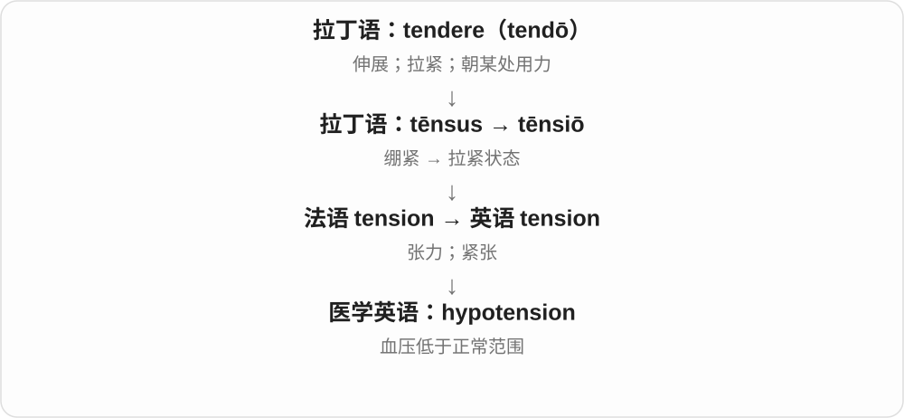

# 1904 · hyp-, hypo- — 下面；低于；不足

[逐词精讲目录](../00_逐词精讲目录.md) · [总目录](../00_总目录_按常用程度.md)

## 核心词根与来源

最直观的是下面与不足两支：hypothalamus 说脑区位置，hypoglycemia 说血糖水平，hypoallergenic 说较低的致敏可能性。hyphen 的历史则是作为一个整体来读。hypocrisy 的虚伪和 hypothesis 的假设都有中间语义，不能直接翻成不足。

**先有位置在下面，再把某个水平低于通常范围的关系表达出来。**

希腊 hypo 在下 → hypothalamus 下丘脑、hypodermic 皮下；现代低水平命名 → hypoglycemia、hypothermia；hypo + hen 在一起 → hyphen；hypothesis 与 hypocrisy 则经过各自的古典语义路线。

- **位置在下**：hypothalamus, hypodermic
- **低于通常水平**：hypoglycemia, hypothyroidism, hypothermia, hypothermic, hypotension, hypoxia, hypoxic
- **材料和化学命名**：hypoallergenic, hypochlorite
- **连在一起的书写**：hyphen, hyphenate, hyphenated
- **需要经过历史中间步骤的抽象义**：hypocrisy, hypocrite, hypocritical, hypothesis, hypothetical

## 词形与演化规律

hypo- 常读 /haɪpəʊ/、/haɪpoʊ/，一些词弱化成 /haɪpə/；hypocrisy 却常以 /hɪ/ 开头。hypo- 与 hyper- 方向不同，读词时先确认前缀。

## 单词速览（常用到不常用）

| 单词 | 音标 | 核心意思 |
|---|---|---|
| [hypothesis](#w-1) | 英 /haɪˈpɒθəsɪs/；美 /haɪˈpɑːθəsɪs/ | 假说；假设 |
| [hypocrisy](#w-2) | 英 /hɪˈpɒkrəsi/；美 /hɪˈpɑːkrəsi/ | 虚伪；伪善；言行不一 |
| [hypothetical](#w-3) | 英 /ˌhaɪpəˈθetɪkəl/；美 /ˌhaɪpəˈθetɪkəl/ | 假设的；假想的 |
| [hypocrite](#w-4) | 英、美 /ˈhɪpəkrɪt/ | 伪君子；虚伪的人 |
| [hypocritical](#w-5) | 英、美 /ˌhɪpəˈkrɪtɪkəl/ | 虚伪的；伪善的 |
| [hypothermia](#w-6) | 英 /ˌhaɪpəˈθɜːmiə/；美 /ˌhaɪpəˈθɜːrmiə/ | 低体温症；失温 |
| [hypoxia](#w-7) | 英 /haɪˈpɒksiə/；美 /haɪˈpɑːksiə/ | 缺氧；低氧状态 |
| [hypoglycemia](#w-8) | 英 /ˌhaɪpəʊɡlaɪˈsiːmiə/；美 /ˌhaɪpoʊɡlaɪˈsiːmiə/ | 低血糖；低血糖症 |
| [hypothyroidism](#w-9) | 英 /ˌhaɪpəʊˈθaɪrɔɪdɪzəm/；美 /ˌhaɪpoʊˈθaɪrɔɪdɪzəm/ | 甲状腺功能减退；甲减 |
| [hypothalamus](#w-10) | /ˌhaɪpəˈθæləməs/ | 下丘脑 |
| [hyphen](#w-11) | /ˈhaɪfən/ | 连字符 |
| [hypotension](#w-12) | 英 /ˌhaɪpəʊˈtenʃən/；美 /ˌhaɪpoʊˈtenʃən/ | 低血压 |
| [hypodermic](#w-13) | 英 /ˌhaɪpəˈdɜːmɪk/；美 /ˌhaɪpəˈdɜːrmɪk/ | 皮下的；注射用的；皮下注射器〔名词〕 |
| [hypoxic](#w-14) | 英 /haɪˈpɒksɪk/；美 /haɪˈpɑːksɪk/ | 缺氧的；低氧的 |
| [hyphenated](#w-15) | /ˈhaɪfəneɪtɪd/〔hyphenate 的规则派生读法〕 | 带连字符的；用连字符连接的 |
| [hypoallergenic](#w-16) | 英 /ˌhaɪpəʊˌæləˈdʒenɪk/；美 /ˌhaɪpoʊˌælərˈdʒenɪk/ | 不易引起过敏的；低致敏性的 |
| [hypochlorite](#w-17) | 英 /ˌhaɪpəˈklɔːraɪt/；美 /ˌhaɪpoʊˈklɔːraɪt/ | 次氯酸盐；次氯酸酯 |
| [hypothermic](#w-18) | 英 /ˌhaɪpəʊˈθɜːmɪk/；美 /ˌhaɪpoʊˈθɜːrmɪk/ | 低体温的；失温的；低温处理相关的 |
| [hyphenate](#w-19) | /ˈhaɪfəneɪt/ | 用连字符连接；加连字符分行 |

## 逐词讲解

### 1. hypothesis — 假说；假设

**音标**：英 /haɪˈpɒθəsɪs/；美 /haɪˈpɑːθəsɪs/

**先抓住这个画面**

先垫一个可能的解释在下面，再看推论和证据能否站得住。

**怎么拆**

希腊 hypo-“在下” + thesis“放置”，形成作为论证基础的 hypothesis，经拉丁及法语进入英语。

**怎么变成今天的意思**

**古希腊语 tithenai，词典形 tithemi**  
放、安置、设定

↓

**希腊语 hypo- + thesis → hypothesis**  
放在下面作基础 → 作为论证基础的设想

↓

**晚期拉丁语 hypothesis／法语 hypothese → 英语 hypothesis**  
假定、假说

科学中的 hypothesis 常是可用证据检验的解释；数学、逻辑中也可指推理时暂时接受的条件。它不等于随口猜测，但也还不是仅凭提出就已证实的结论。

**常见搭配与例句**

test a hypothesis；support a hypothesis；a working hypothesis。

> The researchers designed an experiment to test the hypothesis.

研究者设计了实验来检验这个假说。

> For now, we will use that explanation as a working hypothesis.

目前我们会把这个解释作为工作假说。

**别混淆**

a theory 在科学中可以是有广泛证据支撑的解释框架，不是 hypothesis 随便升级的等级名称。假说需看具体如何检验。

### 2. hypocrisy — 虚伪；伪善；言行不一

**音标**：英 /hɪˈpɒkrəsi/；美 /hɪˈpɑːkrəsi/

**先抓住这个画面**

公开摆出一副坚持原则的样子，自己做事时却把这套原则放下了。

**怎么拆**

希腊语 hypokrisis 与扮演角色、假装有关，经晚期拉丁语 hypocrisis、古法语 ypocrisie 进入英语；更早的 hypokrinesthai 有回答、扮演等意思。不能硬拆成“在下面批评”。

**怎么变成今天的意思**

**希腊语 krinein**  
分开、辨别、判断

↓

**希腊语 hypokrinesthai**  
回答、扮演角色

↓

**希腊语 hypokrisis**  
表演、假装

↓

**晚期拉丁语 hypocrisis → 古法语 ypocrisie → 英语 hypocrisy**  
假装某种品质 → 虚伪、伪善

重点是宣称的标准和实际做法相冲突，尤其故意把自己装得更正直。承认自己改了观点，不一定是 hypocrisy；用同一标准坦诚评价自己也不是。

**常见搭配与例句**

accuse someone of hypocrisy；political hypocrisy；expose hypocrisy。

> They accused him of hypocrisy for preaching restraint while wasting public money.

他一边宣扬节制一边浪费公款，因此被指责虚伪。

> The novel exposes the hypocrisy behind the family’s respectable image.

小说揭露了这个家庭体面形象背后的虚伪。

**别混淆**

hypocrisy 指虚伪行为或性质；hypocrite 指表现虚伪的人。

### 3. hypothetical — 假设的；假想的

**音标**：英 /ˌhaɪpəˈθetɪkəl/；美 /ˌhaɪpəˈθetɪkəl/

**先抓住这个画面**

先把一个情形临时摆出来，说“如果这样，会怎样”，暂不声称它真的发生。

**怎么拆**

接希腊 hypothetikos 的拉丁化形容词支线；与 hypothesis 同族，但英语形容词的借入不能简单排在名词后面。

**怎么变成今天的意思**

**古希腊语 tithenai，词典形 tithemi**  
放、安置、设定

↓

**希腊语 hypothesis → hypothetikos 的拉丁化形容词支线**  
假说 → 以假说为基础的

↓

**英语 hypothetical**  
假设的、假想的

a hypothetical situation 是为讨论而设的情形；a hypothetical explanation 还未确定是真实解释。讨论假想情况也可以很严谨，并不等于内容毫无价值。

**常见搭配与例句**

a hypothetical case；a hypothetical question；a hypothetical scenario。

> Let us consider a hypothetical town with no private cars.

我们来考虑一座假想的、没有私家车的城镇。

> The question is hypothetical; no decision has been made.

这个问题是假设性的，尚未作出决定。

**别混淆**

hypothetical 表暂时设想；false 表错误。尚未确定的设想，不能仅凭词义判成假的。

### 4. hypocrite — 伪君子；虚伪的人

**音标**：英、美 /ˈhɪpəkrɪt/

**先抓住这个画面**

要求别人遵守一套道德标准，却把自己悄悄放在例外位置的人。

**怎么拆**

希腊语 hypokritēs 原有演员、扮演者之义，经教会拉丁语 hypocrita、古法语 ypocrite 进入英语；它与 hypocrisy 是同族的不同借词。

**怎么变成今天的意思**

**希腊语 krinein**  
分开、辨别、判断

↓

**希腊语 hypokrinesthai**  
回答、扮演角色

↓

**希腊语 hypokritēs → 拉丁语 hypocrita → 古法语 ypocrite → 英语 hypocrite**  
扮演者 → 装作有某种美德的人

这是明显的贬义词。通常需要有口头原则与行为的矛盾作依据，不是任何犯错或改变想法的人都适合这样叫。

**常见搭配与例句**

call someone a hypocrite；a complete hypocrite；a moral hypocrite。

> He called her a hypocrite after discovering that she had broken the same rule.

发现她也违反了同一条规定后，他指责她虚伪。

> I would be a hypocrite if I condemned them for a mistake I refuse to admit myself.

如果我谴责他们，却不肯承认自己犯了同样的错，那我就是个伪君子。

**别混淆**

liar 重点是说假话；hypocrite 重点是装出自己并不实践的原则或品德。

### 5. hypocritical — 虚伪的；伪善的

**音标**：英、美 /ˌhɪpəˈkrɪtɪkəl/

**先抓住这个画面**

嘴上摆出的原则很好听，行动却显示自己根本没照着做。

**怎么拆**

英语较早的 hypocritic + -al；hypocritic 来自希腊语 hypokritikos“扮演、假装的”。可与 hypocrite 联想，但历史不必经过英语名词再派生。

**怎么变成今天的意思**

**希腊语 krinein**  
分开、辨别、判断

↓

**希腊语 hypokrinesthai**  
回答、扮演角色

↓

**希腊语 hypokritēs → hypokritikos → 英语 hypocritic + -al → hypocritical**  
装样子的 → 虚伪的

a hypocritical apology 表面认错，实际可能毫无悔意；It is hypocritical to... 指某做法与自己声称的原则矛盾。它不是“批评太多”。

**常见搭配与例句**

hypocritical behaviour；a hypocritical attitude；be hypocritical to do。

> It would be hypocritical to demand honesty while hiding the evidence.

一边要求诚实一边隐瞒证据，是虚伪的。

> She rejected what she saw as a hypocritical apology.

她认为那是虚伪的道歉，因此没有接受。

**别混淆**

critical 可以是有判断力；hypocritical 专门说表里不一，含贬义。

### 6. hypothermia — 低体温症；失温

**音标**：英 /ˌhaɪpəˈθɜːmiə/；美 /ˌhaɪpəˈθɜːrmiə/

**先抓住这个画面**

身体流失热量太多，核心体温降到了异常低的水平。

**怎么拆**

近代医学拉丁词，以希腊 hypo-“低于”+ thermē“热”+ -ia“状态”构成，进入英语。不是普通的“天气冷”，而是身体状态的名称。

**怎么变成今天的意思**

**希腊 hypo- + thermē + -ia**  
低于 + 热 + 状态

↓

**近代医学拉丁 hypothermia → 英语 hypothermia**  
异常低体温

↓

**现代医学及户外报道**  
低体温症、失温

报道说 someone was treated for hypothermia，是说此人因低体温症接受治疗。医学上通常指核心体温低于 35°C；它是需要及时处理的身体异常，不只是主观觉得凉。

**常见搭配与例句**

suffer from hypothermia；the risk of hypothermia；be treated for hypothermia。

> The rescued hiker was treated for hypothermia.

获救的徒步者因失温接受了治疗。

> The training session explained the difference between feeling cold and hypothermia.

培训解释了感觉冷与低体温症之间的区别。

**别混淆**

hypo- 是过低，hyper- 是过高。hypothermia 与 hyperthermia 方向相反，拼写只差一点，含义不可混用。

### 7. hypoxia — 缺氧；低氧状态

**音标**：英 /haɪˈpɒksiə/；美 /haɪˈpɑːksiə/

**先抓住这个画面**

有氧，但供给或可利用的量不足以满足需要。

**怎么拆**

现代 hypo-“低于、不足” + oxygen 的 ox- + -ia“状态”构成。它不是古希腊人已在使用的完整现代医学名词。

**怎么变成今天的意思**

**希腊 oxýs**  
尖锐的；酸的

↓

**近代法语 oxygène**  
用希腊来源成分造出“产酸者”名称

↓

**英语 oxygen**  
氧元素；通常也指氧气

↓

**现代 hypo- + ox(ygen) + -ia → hypoxia**  
氧不足的状态

医学里常说组织得不到足够氧；环境科学里也用来讨论水体氧不足。不要只凭呼吸急促这一种表现去替代词语的完整含义。

**常见搭配与例句**

tissue hypoxia；hypoxia in coastal waters；a response to hypoxia。

> The experiment examined how cells respond to hypoxia.

实验考察细胞如何应对缺氧。

> Researchers measured hypoxia in the deeper water.

研究人员测量了深层水域的低氧状况。

**别混淆**

hypoxemia 专指血液中氧偏低；hypoxia 关注组织或环境的氧不足，范围并不完全一样。

### 8. hypoglycemia — 低血糖；低血糖症

**音标**：英 /ˌhaɪpəʊɡlaɪˈsiːmiə/；美 /ˌhaɪpoʊɡlaɪˈsiːmiə/

**先抓住这个画面**

血液里的葡萄糖水平过低；这里低的是血糖，不是体温或血压。

**怎么拆**

hypo- 低于正常 + glyc- 糖 + -emia 血液状态，近代医学构词；英式常写 hypoglycaemia。

**怎么变成今天的意思**

**希腊 hypo 在下面 → hypo- / hyp-**  
可表示位置在下，也可表示水平不足

↓

**近代 hypo- + glyc- + -emia → hypoglycemia / hypoglycaemia**  
低血糖这一状态的名称

an episode of hypoglycemia 是一次低血糖发作；severe hypoglycemia 是严重低血糖。它是具体的血糖状态，不是只要感觉饿或累就可以这样命名。

**常见搭配与例句**

an episode of hypoglycemia；severe hypoglycemia；the risk of hypoglycemia。

> The leaflet explains the symptoms of hypoglycemia.

这份资料解释了低血糖的症状。

> The study recorded episodes of hypoglycemia during treatment.

这项研究记录了治疗期间发生的低血糖情况。

**别混淆**

hyperglycemia 是高血糖。hypo- 与 hyper- 改变方向；后面的糖和血液成分没有变。

### 9. hypothyroidism — 甲状腺功能减退；甲减

**音标**：英 /ˌhaɪpəʊˈθaɪrɔɪdɪzəm/；美 /ˌhaɪpoʊˈθaɪrɔɪdɪzəm/

**先抓住这个画面**

甲状腺这套分泌系统产出的激素不够，重点是功能不足。

**怎么拆**

hypo- 不足 + thyroid 甲状腺 + -ism 状态；近代医学名称，不是甲状腺在身体里的位置偏低。

**怎么变成今天的意思**

**希腊 hypo 在下面 → hypo- / hyp-**  
可表示位置在下，也可表示水平不足

↓

**近代 hypo- + thyroid + -ism → hypothyroidism**  
形成甲状腺功能不足的疾病名称

be diagnosed with hypothyroidism 是被诊断为甲减。阅读时可以抓住 underactive thyroid 这个更直白的对应说法；不能把它误解成甲状腺不存在。

**常见搭配与例句**

be diagnosed with hypothyroidism；treatment for hypothyroidism；an underactive thyroid。

> She was diagnosed with hypothyroidism after a series of tests.

一系列检查后，她被诊断为甲状腺功能减退。

> The article compares hypothyroidism with an overactive thyroid.

这篇文章比较了甲状腺功能减退与甲状腺功能亢进。

**别混淆**

hyperthyroidism 是甲状腺功能亢进。hypothyroidism 与 hypothalamus 虽开头相似，却分别指甲状腺功能状态和脑部结构。

### 10. hypothalamus — 下丘脑

**音标**：/ˌhaɪpəˈθæləməs/

**先抓住这个画面**

脑里一个参与体温、饥饿和激素调节的小区域，名称提示它在丘脑下方附近。

**怎么拆**

hypo- 在下 + thalamus 丘脑；十九世纪德语解剖学造词后进入英语，不是古希腊已有的完整现代脑区名称。

**怎么变成今天的意思**

**希腊 hypo 在下面 → hypo- / hyp-**  
可表示位置在下，也可表示水平不足

↓

**近代德语 Hypothalamus → 英语 hypothalamus**  
按位于丘脑下方、前方附近的位置命名

the hypothalamus is involved in temperature regulation，表示下丘脑参与体温调节。一个脑区能参与多种调节过程，不必把它想成只有一个开关。

**常见搭配与例句**

the hypothalamus；the role of the hypothalamus；signals from the hypothalamus。

> The lesson explains the role of the hypothalamus in regulating body temperature.

这节课解释了下丘脑在调节体温中的作用。

> The diagram labels the hypothalamus just below the thalamus.

图上把下丘脑标在丘脑下方。

**别混淆**

thalamus 是丘脑；hypothalamus 是下丘脑。这里的 hypo- 说位置，不是说这部分脑功能不足。

### 11. hyphen — 连字符

**音标**：/ˈhaɪfən/

**先抓住这个画面**

像一小段横线，把两个书写成分接起来，或在换行时标示一个词还没写完。

**怎么拆**

希腊 hypo 在下 + hen 一个，形成表示在一起的 hyphen，后来指连接标记，经晚期拉丁语进入英语。

**怎么变成今天的意思**

**希腊 hypo 在下；hen 一个**  
两个材料组合，表示在一起、作为一个整体

↓

**希腊 hypo + hen 一个 → hyphen**  
在一起、作为一个整体 → 连接标记

↓

**晚期拉丁 hyphen → 英语 hyphen**  
成为连接词或分开词的一种标点名称

a hyphen 常写作 -。它可以连接复合词的成分；某些排版也用它在行末拆词。是否使用，要看具体词的习惯和编辑规范。

**常见搭配与例句**

insert a hyphen；use a hyphen；a word with a hyphen。

> The editor inserted a hyphen between the two parts of the compound.

编辑在这个复合词的两部分之间加了一个连字符。

> His surname contains a hyphen.

他的姓氏中有一个连字符。

**别混淆**

dash 是破折号，用途通常不同；hyphen 是连字符。键盘上都可能被简单横线代替，但正式排版要区分。

### 12. hypotension — 低血压

**音标**：英 /ˌhaɪpəʊˈtenʃən/；美 /ˌhaɪpoʊˈtenʃən/

**先抓住这个画面**

hypotension 说血压偏低，记住 hypo- 是低，别和 hyper- 的高混在一起。

**怎么拆**

hypo-（低于正常）+ tension；医学中 tension 用于压力。

**怎么变成今天的意思**

orthostatic hypotension 是体位变化相关的低血压术语。这里只需掌握词义，不能用“性格平静”去理解它。

**常见搭配与例句**

orthostatic hypotension；symptoms of hypotension；a study of hypotension。

> The article explains the term orthostatic hypotension.

这篇文章解释了体位性低血压这个术语。

> The researchers recorded episodes of hypotension.

研究人员记录了低血压发作的情况。

**别混淆**

hypotension 是低血压；hypothermia 是体温过低，后半部分不同。

### 13. hypodermic — 皮下的；注射用的；皮下注射器〔名词〕

**音标**：英 /ˌhaɪpəˈdɜːmɪk/；美 /ˌhaɪpəˈdɜːrmɪk/

**先抓住这个画面**

沿着皮肤往里：这个词最常跟针头和注射器一起出现。

**怎么拆**

hypo- 在下 + derm- 皮肤 + -ic，近代构词；也可联系较早的 hypoderma 皮下组织一词。

**怎么变成今天的意思**

**希腊 hypo 在下面 → hypo- / hyp-**  
可表示位置在下，也可表示水平不足

↓

**近代 hypo- + derm- + -ic → hypodermic**  
皮肤之下的 → 注射工具相关形容词

↓

**hypodermic syringe 缩称 a hypodermic**  
形容词短语省略后面的器具名，转作名词

a hypodermic needle 是用于注射的针头；a hypodermic syringe 是注射器。日常器具名称的使用范围比只按皮下位置直译更宽。

**常见搭配与例句**

a hypodermic needle；a hypodermic syringe；hypodermic injection。

> The nurse opened a sealed packet containing a hypodermic needle.

护士打开了一个装着注射针头的密封包装。

> The museum displayed an early hypodermic syringe.

博物馆展出了一支早期的皮下注射器。

**别混淆**

dermal 是皮肤的；hypodermic 加出皮肤之下的历史位置感。hypo- 在这里不表示皮肤不足。

### 14. hypoxic — 缺氧的；低氧的

**音标**：英 /haɪˈpɒksɪk/；美 /haɪˈpɑːksɪk/

**先抓住这个画面**

用形容词标出一个氧不足的区域、组织或条件。

**怎么拆**

hypoxia 对应的 -ic 形容词，也可按 hypo- + ox- + -ic 理解；不要把 hypo- 误认成 hyper-“过多”。

**怎么变成今天的意思**

**希腊 oxýs**  
尖锐的；酸的

↓

**近代法语 oxygène**  
用希腊来源成分造出“产酸者”名称

↓

**英语 oxygen**  
氧元素；通常也指氧气

↓

**现代 hypo- + ox(ygen) + -ia → hypoxia**  
氧不足的状态

↓

**英语 hypoxia / hyp- + ox- + -ic → hypoxic**  
处于低氧状态的

hypoxic conditions 是低氧条件；hypoxic tissue 是缺氧组织。形容词说明状态，具体不足到什么程度还需测量和语境。

**常见搭配与例句**

hypoxic conditions；hypoxic tissue；a hypoxic zone。

> The cells were studied under hypoxic conditions.

研究人员在低氧条件下研究这些细胞。

> The survey identified a hypoxic zone near the seabed.

调查发现海床附近有一个低氧区。

**别混淆**

hypoxic 通常说氧偏低；anoxic 更强调没有氧或极严重的缺氧。

### 15. hyphenated — 带连字符的；用连字符连接的

**音标**：/ˈhaɪfəneɪtɪd/〔hyphenate 的规则派生读法〕

**先抓住这个画面**

横线已经加好，两个书写部分现在连在一起。

**怎么拆**

hyphenate + -ed，过去分词也作形容词；现代常描述单词或姓名的写法。

**怎么变成今天的意思**

**希腊 hypo 在下；hen 一个**  
两个材料组合，表示在一起、作为一个整体

↓

**希腊 hypo + hen 一个 → hyphen**  
在一起、作为一个整体 → 连接标记

↓

**晚期拉丁 hyphen → 英语 hyphen**  
成为连接词或分开词的一种标点名称

↓

**英语 hyphenate → hyphenated**  
从加连字符的动作形成已连接的状态描述

a hyphenated surname 是带连字符的姓；a hyphenated compound 是用连字符写出的复合词。旧政治语境也曾借它谈复合族裔身份，不能一概当成中性身份称呼。

**常见搭配与例句**

a hyphenated surname；a hyphenated word；a hyphenated compound。

> The form allows applicants to enter a hyphenated surname.

这份表格允许申请人填写带连字符的姓。

> The dictionary gives the hyphenated spelling as an alternative.

词典把带连字符的拼写列为另一种写法。

**别混淆**

hyphenated 描述写法，不表示两个部分已经完全变成没有间隔的一个词；closed compound 才是连写形式。

### 16. hypoallergenic — 不易引起过敏的；低致敏性的

**音标**：英 /ˌhaɪpəʊˌæləˈdʒenɪk/；美 /ˌhaɪpoʊˌælərˈdʒenɪk/

**先抓住这个画面**

想表达引发过敏的可能性较低，不能把低理解成完全没有。

**怎么拆**

现代 hypo- 较低 + allergenic 致敏的；这是二十世纪产品与医学语汇中的组合，并非古代已有的整词。

**怎么变成今天的意思**

**希腊 hypo 在下面 → hypo- / hyp-**  
可表示位置在下，也可表示水平不足

↓

**现代 hypo- + allergenic → hypoallergenic**  
较少引起过敏反应的性质或产品声称

hypoallergenic cosmetics 是标称低致敏性的化妆品；hypoallergenic materials 是不易致敏的材料。美国 FDA 说明化妆品上的这个词没有统一联邦定义，因此它不是绝不过敏的保证。

**常见搭配与例句**

hypoallergenic cosmetics；hypoallergenic materials；a hypoallergenic product。

> The packaging describes the lotion as hypoallergenic.

包装把这款乳液描述为低致敏性产品。

> She asked what the manufacturer meant by “hypoallergenic”.

她询问厂家所说的“低致敏性”具体是什么意思。

**别混淆**

allergenic 是能引起过敏的；hypoallergenic 只把可能性说低，不能换成 allergy-free 这种绝对说法。

### 17. hypochlorite — 次氯酸盐；次氯酸酯

**音标**：英 /ˌhaɪpəˈklɔːraɪt/；美 /ˌhaɪpoʊˈklɔːraɪt/

**先抓住这个画面**

在清洁用品成分表里，最常遇见 sodium hypochlorite，也就是次氯酸钠。

**怎么拆**

hypo- + chlorite，属于近代化学命名；这里 hypo- 表示同系列中较低的氧化程度，不是说溶液很稀。

**怎么变成今天的意思**

**希腊 hypo 在下面 → hypo- / hyp-**  
可表示位置在下，也可表示水平不足

↓

**近代化学 hypo- + chlorite → hypochlorite**  
形成次氯酸盐或酯这一类别名称

sodium hypochlorite solution 是次氯酸钠溶液，常见于含氯漂白剂。只看到 hypochlorite 还不知道具体是钠盐、钙盐还是其他物质，前面的成分名称也要读。

**常见搭配与例句**

sodium hypochlorite；calcium hypochlorite；a hypochlorite solution。

> The label lists sodium hypochlorite as an active ingredient.

标签把次氯酸钠列为一种有效成分。

> The chemist explained the difference between chloride and hypochlorite.

化学家解释了氯化物与次氯酸盐的区别。

**别混淆**

chloride 是氯化物，hypochlorite 是次氯酸盐，不能因都带 chlor- 就互换。名称里的 hypo- 不标示产品浓度。

### 18. hypothermic — 低体温的；失温的；低温处理相关的

**音标**：英 /ˌhaɪpəʊˈθɜːmɪk/；美 /ˌhaɪpoʊˈθɜːrmɪk/

**先抓住这个画面**

身体的核心温度降得过低；不只是主观上觉得有点冷。

**怎么拆**

hypo- 低于正常 + therm- 热 + -ic；与 hypothermia 低体温状态配套的医学形容词。

**怎么变成今天的意思**

**希腊 hypo 在下面 → hypo- / hyp-**  
可表示位置在下，也可表示水平不足

↓

**近代 hypo- + therm- + -ic → hypothermic**  
低体温相关，或描述出现这一状态的人

a hypothermic patient 是处于低体温状态的患者；become hypothermic 是发生失温。也可说医疗中的低温处理，但具体含义需看它修饰什么。

**常见搭配与例句**

a hypothermic patient；become hypothermic；hypothermic conditions。

> The rescue team found the missing walker exhausted and hypothermic.

救援队找到失踪徒步者时，他已经筋疲力尽并出现失温。

> The training session covered the care of hypothermic patients.

这次培训介绍了低体温患者的照护。

**别混淆**

cold 可以只说觉得冷；hypothermic 指低体温这一具体状态。hyperthermic 的 hyper- 则表示体温过高。

### 19. hyphenate — 用连字符连接；加连字符分行

**音标**：/ˈhaɪfəneɪt/

**先抓住这个画面**

把连字符这个标点变成一个动作：给词的相应位置加上那一横。

**怎么拆**

hyphen + -ate 动词后缀，形成英语动词；更早英语也直接用 hyphen 作动词。

**怎么变成今天的意思**

**希腊 hypo 在下；hen 一个**  
两个材料组合，表示在一起、作为一个整体

↓

**希腊 hypo + hen 一个 → hyphen**  
在一起、作为一个整体 → 连接标记

↓

**晚期拉丁 hyphen → 英语 hyphen**  
成为连接词或分开词的一种标点名称

↓

**英语 hyphen + -ate → hyphenate**  
给词或书写成分加连字符

hyphenate a surname 是给复姓加连字符；hyphenate words at line breaks 是在换行处用连字符断词。两种用途都与书写有关。

**常见搭配与例句**

hyphenate a word；hyphenate a surname；automatically hyphenate text。

> The software can hyphenate long words at the end of a line.

这款软件能在行末用连字符把长词分开。

> The style guide tells writers when to hyphenate compounds.

这份写作规范告诉作者什么时候应给复合词加连字符。

**别混淆**

hyphenate 是动作，hyphen 是标点本身。separate with a dash 通常不能直接替换，因为破折号用途不同。

## 这一组要分清什么

hypoallergenic 不等于绝不过敏；hypochlorite 的 hypo- 也不表示溶液浓度低。hypothermic 不只是觉得冷。hypothesis 是假设，hypocrisy 是虚伪，两者虽有共同前缀，语义路线完全不同。

## 串起来练习

比较 hypothalamus 与 hypothyroidism 中 hypo- 的作用；说清 hypoallergenic 为何不能换成绝不过敏；用 hyphen、hyphenate、hyphenated 描述同一次编辑动作。
