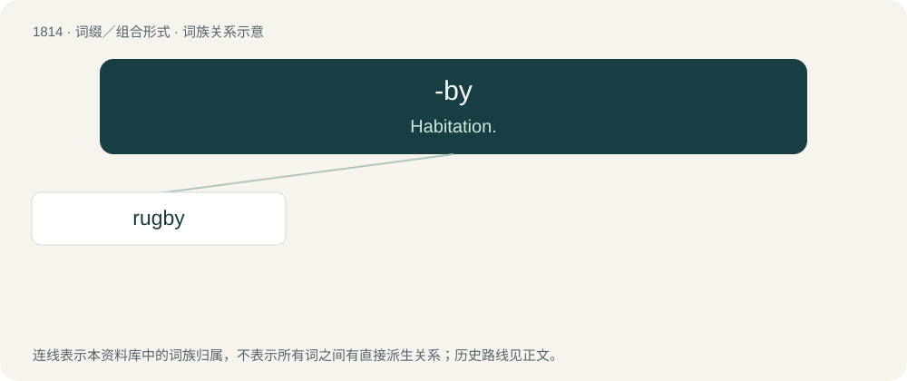

# 1921 · -by — Habitation.

[总目录](../00_总目录_按常用程度.md)

**类型**：词缀／组合形式　｜　**来源语言**：见词源记录

## 核心含义与来源

- 核心含义：Habitation.
- 英文含义：Habitation.
- 词形：-by

**来源记录 1**（后缀／后置成分；Habitation.）

Ultimately from Old Norse býr (“settlement”).

## 词族图

## 单词速览（常用到不常用）

| 单词 | 音标 | 释义 |
|---|---|---|
| [rugby](#w-1) | 英 /ˈɹʌɡbi/ | n. 橄榄球, 橄榄球赛 |

## 逐词详解

### 1. rugby

**词性**：名词　｜　**音标**：英 /ˈɹʌɡbi/

**中文释义**：n. 橄榄球, 橄榄球赛

**英文义项**：A form of football in which players can hold or kick an ovoid ball; rugby football. The ball cannot be handled forwards and points are scored by touching the ball to the ground in the area past the opponent's territory or by kicking the ball between goalposts and over a crossbar. / The form of the game known as rugby union (see the usage note).

**构词拆分**：rook (“Corvus frugilegus, a bird of the crow family”) + -by (suffix indicating a village or town)

**词源与演化**：

From the name of Rugby School in Rugby, in Warwickshire, England, United Kingdom, where the modern game was developed in the 19th century. The place name Rugby is attested in the Domesday Book as Old English Rocheberie (probably equivalent to rook (“Corvus frugilegus, a bird of the crow family”) + -by (suffix indicating a village or town)), possibly from \*Hrōcebyriġ, dative singular of \*Hrōceburh, from hrōc (“rook”) (ultimately from Proto-Indo-European \*ker- (“to crow”)) + burh, burg (“castle, fort, stronghold; city; town”) (ultimately from Proto-Indo-European \*bʰerǵʰ- (“hill, mountain; high, lofty; to rise”)).

**例句**：

> The scrum is a distinctive element of rugby.

该用例对应义项：A form of football in which players can hold or kick an ovoid ball; rugby football. The ball cannot be handled forwards and points are scored by touching the ball to the ground in the area past the opponent's territory or by kicking the ball between goalposts and over a crossbar.
