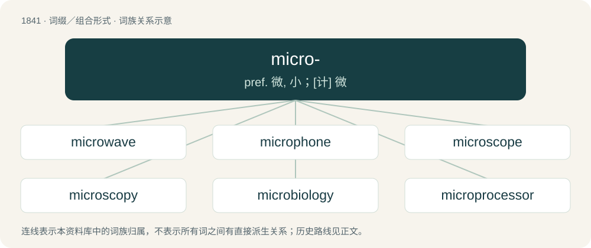

# 1945 · micro- — pref. 微, 小；\[计\] 微

[总目录](../00_总目录_按常用程度.md)

**类型**：词缀／组合形式　｜　**来源语言**：见词源记录

## 核心含义与来源

- 核心含义：pref. 微, 小；\[计\] 微
- 英文含义：Very small.
- 词形：micro-

**来源记录 1**（前缀／前置成分；Pertaining to an aspect of micronationalism; micronational.）

Clipping of micronation.

## 词族图

## 单词速览（常用到不常用）

| 单词 | 音标 | 释义 |
|---|---|---|
| [microwave](#w-1) | 英 /ˈmaɪkɹəʊˌweɪv/；美 /ˈmaɪkɹoʊˌweɪv/ | n. 微波；\[计\] 微波 |
| [microphone](#w-2) | 英 /ˈmaɪ.kɹəˌfəʊn/；美 /ˈmaɪ.kɹəˌfoʊn/ | n. 扩音器, 麦克风；\[医\] 扩音器, 传声器 |
| [microscope](#w-3) | 英 /ˈmaɪ.kɹəˌskəʊp/；美 /ˈmaɪ.kɹəˌskoʊp/ | n. 显微镜；\[化\] 显微镜 |
| [microscopy](#w-4) | 英 /maɪˈkɹɒs.kə.pi/；美 /maɪˈkɹɑ.skə.pi/ | n. 显微镜使用, 用显微镜检查, 显微镜学；\[医\] 显微镜检查 |
| [microbiology](#w-5) | /ˌmʌɪkrə(ʊ)bʌɪˈɒlədʒi/ | n. 微生物学；\[化\] 微生物学 |
| [microprocessor](#w-6) | /.maikrəuˈprəusesə/ | n. 微处理器；\[计\] 微处理器; 微处理机 |
| [microchip](#w-7) | 美 /ˈmaɪkɹoʊˌt͡ʃɪp/ | n. 微型集成电路片, 微片, 芯片；\[计\] 微片 |
| [microcosm](#w-8) | 英 /ˈmaɪ.kɹə(ʊ)ˌkɒz.əm/；美 /ˈmaɪ.kɹəˌkɑz.əm/ | n. 小宇宙, 小世界, 人类 |
| [microfilm](#w-9) | /ˈmaikrəufilm/ | n. 缩影胶卷；v. 缩微拍摄；\[计\] 缩微胶片; 缩微胶卷 |
| [microbiome](#w-10) |  | 微生物组；微生物群系 |
| [microfinance](#w-11) |  | n. 小额信贷 |
| [microbiota](#w-12) |  | \[医\] 微生物区\[系\] |
| [microstructure](#w-13) | /ˈmaikrəustrʌktʃə/ | n. 微观构造；\[计\] 微型结构 |
| [microgravity](#w-14) | /maɪkrəɡˈrævɪtɪ/ | n. 微重力, 无重力, 失重状态 |
| [microbiological](#w-15) |  | a. 微生物学的；\[医\] 微生物学的 |
| [microcontroller](#w-16) | 英 /ˈmaɪkɹə(ʊ)kənˌtɹəʊlə/；美 /ˈmaɪkɹoʊkənˌtɹoʊlɚ/ | \[计\] 微控制器 |
| [microfiber](#w-17) | /maɪkˈrəʊfɪbər/ | 微纤维 |
| [microbiologist](#w-18) | /ˌmaɪ.kɹəʊ.baɪˈɒ.lə.dʒɪst/ | \[医\] 微生物学家 |
| [microarray](#w-19) | /ˌmɑɪkrəʊəˈreɪ/ | 微阵列 |
| [micrometer](#w-20) | 英 /maɪˈkɹɒmɪtə/；美 /maɪˈkɹɑmɪtəɹ/ | n. 测微计；\[化\] 测微计 |
| [microorganism](#w-21) | 英 /ˌmaɪ.kɹəʊˈɔː.ɡəˌnɪz.m̩/；美 /ˌmaɪ.kɹoʊˈɔɹ.ɡəˌnɪz.m̩/ | n. 微生物, 微小动植物；\[化\] 微生物 |
| [microtubule](#w-22) | /,maikrəuˈtjuːbjuːl/ | n. 微管；\[化\] 微管 |
| [microcomputer](#w-23) | /.maikrəuˈkɒmpjutə/ | n. 微电脑, 微机；\[计\] 微型计算机; 微计算机 |
| [micromanage](#w-24) | /ˈmaɪkrəʊmænɪdʒ/ | vt. 微观管理\[处理\] |
| [microeconomics](#w-25) | /ˌmaɪkɹəʊˌɛkəˈnɒnɪks/ | n. 微观经济学 |
| [microfluidic](#w-26) |  | n. 微流体 |
| [microclimate](#w-27) | /ˈmaikrəu.klaimit/ | n. 小气候；\[医\] 微气候, 小气候 |
| [microenvironment](#w-28) | /,maikrəjinˈvaiərənmənt, -enˈvaiə-/ | n. 小环境；\[化\] 微环境 |
| [microglia](#w-29) | /ˈmaɪ.kɹoʊˌɡli.ə/ | \[医\] 小神经胶质\[细胞\] |
| [microcephaly](#w-30) | 美 /ˌmaɪkɹoʊˈsɛfəli/ | n. 小头畸型；\[医\] 小头 |
| [microsecond](#w-31) | /ˈmaikrəusekənd/ | n. 微秒；\[计\] 微秒 |
| [microvascular](#w-32) | /,maikrəjˈvæskjjlə(r)/ | a. \[解\]微脉管(直径小于0.3 毫米的微血管)的 |
| [micronutrient](#w-33) | /,maikrəjˈnjuːtriənt/ | n. 微量营养素；\[机\] 微量营养 |
| [microbrewery](#w-34) | /maɪkˈrəʊbrwrɪ/ | n. （规模很小的）小啤酒厂 |
| [micromanagement](#w-35) | /maikrəuˈmænidʒmənt/ | 微观管理 |
| [microeconomic](#w-36) | /ˈmaɪkrəʊˌɪkəˈnɒmɪk/ | n. 个体经济, 微观经济 |
| [microsatellite](#w-37) | /maɪkrəʊzəˈtelaɪt/ | 微卫星 |
| [microblogging](#w-38) | / ˈmaɪkrəʊblɒgɪŋ/ | 微博 |
| [microcredit](#w-39) | /ˈmaɪkɹoʊˌkɹɛdɪt/ | n. 小额信贷 |
| [microelectronic](#w-40) |  | \[计\] 微电子学的 |
| [microscale](#w-41) | /ˈmaikrəjskeil/ | n. 微小的规模,微尺度 ；a. 微观大气现象的 |
| [microsurgery](#w-42) | /ˈmaikrəuˈsəːdʒəri/ | \[医\] 显微外科, 显微手术 |

## 逐词详解

### 1. microwave

**词性**：名词　｜　**音标**：英 /ˈmaɪkɹəʊˌweɪv/；美 /ˈmaɪkɹoʊˌweɪv/

**中文释义**：n. 微波；\[计\] 微波

**英文义项**：An electromagnetic wave with wavelength between that of infrared light and radio waves.

**构词拆分**：From micro- + wave.

**词源与演化**：

From micro- + wave.

**例句**：

> Many radar systems use a combination of radio waves and microwaves.

该用例对应义项：An electromagnetic wave with wavelength between that of infrared light and radio waves.

### 2. microphone

**词性**：名词　｜　**音标**：英 /ˈmaɪ.kɹəˌfəʊn/；美 /ˈmaɪ.kɹəˌfoʊn/

**中文释义**：n. 扩音器, 麦克风；\[医\] 扩音器, 传声器

**英文义项**：A device (transducer) used to convert sound waves into a varying electric current; normally fed into an amplifier and either recorded or transmitted over radio. / A speaking trumpet or hearing trumpet; an acoustic device to concentrate or amplify sound.

**构词拆分**：micro- + -phone

**词源与演化**：

From micro- + -phone.

**例句**：

> You need have a good microphone because we care about sound quality.

### 3. microscope

**词性**：名词　｜　**音标**：英 /ˈmaɪ.kɹəˌskəʊp/；美 /ˈmaɪ.kɹəˌskoʊp/

**中文释义**：n. 显微镜；\[化\] 显微镜

**英文义项**：An optical instrument used for observing small objects. / Any instrument for imaging very small objects (such as an electron microscope).

**构词拆分**：micro- + -scope

**词源与演化**：

From New Latin microscopium and Italian microscopio, from Ancient Greek μικρός (mikrós, “small”) + σκοπέω (skopéō, “to look at”), equivalent to micro- + -scope.

**例句**：

> The invention of the microscope led to the discovery of the cell.

该用例对应义项：magnifier of the image of small objects

### 4. microscopy

**词性**：名词　｜　**音标**：英 /maɪˈkɹɒs.kə.pi/；美 /maɪˈkɹɑ.skə.pi/

**中文释义**：n. 显微镜使用, 用显微镜检查, 显微镜学；\[医\] 显微镜检查

**英文义项**：The study of microscopes, their design and manufacture. / The use of microscopes.

**构词拆分**：micro- + -scopy

**词源与演化**：

From micro- + -scopy.

### 5. microbiology

**词性**：名词　｜　**音标**：/ˌmʌɪkrə(ʊ)bʌɪˈɒlədʒi/

**中文释义**：n. 微生物学；\[化\] 微生物学

**英文义项**：The branch of biology that deals with microorganisms, especially their effects on man and other living organisms.

**构词拆分**：micro- + biology

**词源与演化**：

From micro- + biology.

**例句**：

> It covers everything from the fundamentals of microbiology to the latest news.

### 6. microprocessor

**词性**：名词　｜　**音标**：/.maikrəuˈprəusesə/

**中文释义**：n. 微处理器；\[计\] 微处理器; 微处理机

**英文义项**：The entire CPU of a computer on a single integrated circuit (chip).

**构词拆分**：From micro- + processor.

**词源与演化**：

From micro- + processor.

**例句**：

> A microprocessor functions as the central processing unit of a microcomputer.

该用例对应义项：integrated circuit semiconductor chip that performs the bulk of the processing and controls the parts of a system

### 7. microchip

**词性**：名词　｜　**音标**：美 /ˈmaɪkɹoʊˌt͡ʃɪp/

**中文释义**：n. 微型集成电路片, 微片, 芯片；\[计\] 微片

**英文义项**：An integrated circuit. / A microprocessor.

**构词拆分**：From micro- + chip.

**词源与演化**：

From micro- + chip.

**例句**：

> By the early 2020s, the strategic priority level of microchip fabrication prowess and capacity had only grown.

该用例对应义项：A microprocessor.

### 8. microcosm

**词性**：名词　｜　**音标**：英 /ˈmaɪ.kɹə(ʊ)ˌkɒz.əm/；美 /ˈmaɪ.kɹəˌkɑz.əm/

**中文释义**：n. 小宇宙, 小世界, 人类

**英文义项**：Human nature or the human body as representative of the wider universe; man considered as a miniature counterpart of divine or universal nature. / The human body; a person.

**构词拆分**：micro- + -cosm

**词源与演化**：

From French microcosme, from Latin microcosmus, from Ancient Greek μικρός (mikrós, “small”) + κόσμος (kósmos, “universe, order”); micro- + -cosm.

**例句**：

> The comment section is a microcosm of the larger cultural debate taking place.

### 9. microfilm

**词性**：名词　｜　**音标**：/ˈmaikrəufilm/

**中文释义**：n. 缩影胶卷；v. 缩微拍摄；\[计\] 缩微胶片; 缩微胶卷

**英文义项**：A continuous roll of film containing photographs of documents at a greatly reduced size.

**构词拆分**：micro- + film

**词源与演化**：

From micro- + film.

**例句**：

> The library has the paper's archives on microfilm.

### 10. microbiome

**词性**：名词

**中文释义**：微生物组；微生物群系

**英文义项**：The genetic information (genomes) of a microbiota. / A microbial biome, such as the community of microbes within the human gut.

**构词拆分**：micro- + biome

**词源与演化**：

From micro- + biome or blend of microbiota + genome.

**例句**：

> Some doctors recommend taking probiotics in order to restore the gut microbiome.

### 11. microfinance

**词性**：名词

**中文释义**：n. 小额信贷

**英文义项**：Finance that is provided to unemployed or low-income people or groups.

**构词拆分**：micro- + finance

**词源与演化**：

From micro- + finance. Coined by German sociologist and economist Hans Dieter Seibel in 1990.

### 12. microbiota

**词性**：名词

**中文释义**：\[医\] 微生物区\[系\]

**英文义项**：The microbial community that inhabits a multi-cellular organism, whether the entire organism or a specific body surface.

**构词拆分**：From micro- + biota.

**词源与演化**：

From micro- + biota.

### 13. microstructure

**词性**：名词　｜　**音标**：/ˈmaikrəustrʌktʃə/

**中文释义**：n. 微观构造；\[计\] 微型结构

**英文义项**：The fine structure of a material or tissue as revealed by microscopy. / The fine structure of a pure metal or alloy, as revealed by magnifications of 25X or greater.

**构词拆分**：From micro- + structure.

**词源与演化**：

From micro- + structure.

### 14. microgravity

**词性**：名词　｜　**音标**：/maɪkrəɡˈrævɪtɪ/

**中文释义**：n. 微重力, 无重力, 失重状态

**英文义项**：A state of very low acceleration between two free floating objects, as found in sustained freefall, in orbit, or in interstellar space.

**构词拆分**：micro- + gravity

**词源与演化**：

From micro- + gravity.

**例句**：

> The two cosmonauts looked at microgravity’s effect on pain sensitivity and bone tissue.

### 15. microbiological

**词性**：形容词

**中文释义**：a. 微生物学的；\[医\] 微生物学的

**英文义项**：Of or pertaining to microbiology.

**构词拆分**：micro- + biological

**词源与演化**：

From micro- + biological.

### 16. microcontroller

**词性**：名词　｜　**音标**：英 /ˈmaɪkɹə(ʊ)kənˌtɹəʊlə/；美 /ˈmaɪkɹoʊkənˌtɹoʊlɚ/

**中文释义**：\[计\] 微控制器

**英文义项**：A microcomputer on a single chip, used to control some device such as an automobile engine or a toy.

**构词拆分**：From micro- + controller.

**词源与演化**：

From micro- + controller.

### 17. microfiber

**词性**：名词　｜　**音标**：/maɪkˈrəʊfɪbər/

**中文释义**：微纤维

**英文义项**：Very fine synthetic fiber; cloth made of such fiber.

**构词拆分**：From micro- + fiber.

**词源与演化**：

From micro- + fiber.

**例句**：

> The spilled wine hadn't stained the microfiber couch.

该用例对应义项：Very fine synthetic fiber; cloth made of such fiber.

### 18. microbiologist

**词性**：名词　｜　**音标**：/ˌmaɪ.kɹəʊ.baɪˈɒ.lə.dʒɪst/

**中文释义**：\[医\] 微生物学家

**英文义项**：A biologist whose speciality is microbiology.

**构词拆分**：micro- + biologist

**词源与演化**：

From micro- + biologist.

**例句**：

> The University of Melbourne microbiologist explains how a vaccine combats a virus.

### 19. microarray

**词性**：名词　｜　**音标**：/ˌmɑɪkrəʊəˈreɪ/

**中文释义**：微阵列

**英文义项**：Any of several devices, containing a two-dimensional array of small quantities of biological material, used for various types of assay; the assay itself

**构词拆分**：From micro- + array.

**词源与演化**：

From micro- + array.

### 20. micrometer

**词性**：名词　｜　**音标**：英 /maɪˈkɹɒmɪtə/；美 /maɪˈkɹɑmɪtəɹ/

**中文释义**：n. 测微计；\[化\] 测微计

**英文义项**：A device used to measure distance very precisely but within a limited range, especially depth, thickness, and diameter.

**构词拆分**：micro- + -meter

**词源与演化**：

From French micromètre, equivalent to micro- + -meter.

**例句**：

> You'll need a micrometer to measure the change in length.

### 21. microorganism

**词性**：名词　｜　**音标**：英 /ˌmaɪ.kɹəʊˈɔː.ɡəˌnɪz.m̩/；美 /ˌmaɪ.kɹoʊˈɔɹ.ɡəˌnɪz.m̩/

**中文释义**：n. 微生物, 微小动植物；\[化\] 微生物

**英文义项**：An organism that is too small to be seen by the unaided eye; especially, a single-celled organism, such as a bacterium.

**构词拆分**：micro- + organism

**词源与演化**：

From micro- + organism.

**例句**：

> The cud is then reswallowed by the ruminant and further digested by specialized microorganisms that live in the rumen.

该用例对应义项：An organism that is too small to be seen by the unaided eye; especially, a single-celled organism, such as a bacterium.

### 22. microtubule

**词性**：名词　｜　**音标**：/,maikrəuˈtjuːbjuːl/

**中文释义**：n. 微管；\[化\] 微管

**英文义项**：A small tube made of protein and found in cells; part of the cytoskeleton.

**构词拆分**：micro- + tubule

**词源与演化**：

From micro- + tubule.

**例句**：

> Centrosomes act as the microtubule organising centre, where astral, kinetochore, and non-kinetochore microtubules extend from.

### 23. microcomputer

**词性**：名词　｜　**音标**：/.maikrəuˈkɒmpjutə/

**中文释义**：n. 微电脑, 微机；\[计\] 微型计算机; 微计算机

**英文义项**：A microprocessor that is based on a single chip.

**构词拆分**：micro- + computer

**词源与演化**：

From micro- + computer. First use appears c. 1956. See cite below.

**例句**：

> Students learned BASIC programming on a simple microcomputer connected to a small monitor.

### 24. micromanage

**词性**：动词　｜　**音标**：/ˈmaɪkrəʊmænɪdʒ/

**中文释义**：vt. 微观管理\[处理\]

**英文义项**：To manage, direct, or control a person, group, or system to an unnecessary level of detail or precision.

**构词拆分**：micro- + manage

**词源与演化**：

Back-formation from micromanagement, equivalent to micro- + manage.

### 25. microeconomics

**词性**：名词　｜　**音标**：/ˌmaɪkɹəʊˌɛkəˈnɒnɪks/

**中文释义**：n. 微观经济学

**英文义项**：The field of economics that deals with small-scale economic activities such as those of an individual or company.

**构词拆分**：micro- + economics

**词源与演化**：

From micro- + economics.

### 26. microfluidic

**词性**：形容词

**中文释义**：n. 微流体

**英文义项**：Of, pertaining to, or using microfluidics or a microfluid

**构词拆分**：From micro- + fluidic.

**词源与演化**：

From micro- + fluidic.

### 27. microclimate

**词性**：名词　｜　**音标**：/ˈmaikrəu.klaimit/

**中文释义**：n. 小气候；\[医\] 微气候, 小气候

**英文义项**：A small, local region having a unique pattern of weather or weather effects that differ from the local climate.

**构词拆分**：From micro- + climate.

**词源与演化**：

From micro- + climate.

**例句**：

> The coastal hills are home to many different microclimates.

该用例对应义项：A small, local region having a unique pattern of weather or weather effects that differ from the local climate.

### 28. microenvironment

**词性**：名词　｜　**音标**：/,maikrəjinˈvaiərənmənt, -enˈvaiə-/

**中文释义**：n. 小环境；\[化\] 微环境

**英文义项**：A very small area that has different characteristics than its surroundings; the milieu (set of conditions) within this area. / Synonym of microhabitat.

**构词拆分**：micro- + environment

**词源与演化**：

From micro- + environment.

### 29. microglia

**词性**：名词　｜　**音标**：/ˈmaɪ.kɹoʊˌɡli.ə/

**中文释义**：\[医\] 小神经胶质\[细胞\]

**英文义项**：The glial cells of the immune system; they can function as phagocytes

**构词拆分**：From micro- + glia.

**词源与演化**：

From micro- + glia.

### 30. microcephaly

**词性**：名词　｜　**音标**：美 /ˌmaɪkɹoʊˈsɛfəli/

**中文释义**：n. 小头畸型；\[医\] 小头

**英文义项**：A neurological disorder in which the person affected has an abnormally small head due to a failure of brain growth.

**构词拆分**：micro- + -cephaly

**词源与演化**：

From micro- + -cephaly.

### 31. microsecond

**词性**：名词　｜　**音标**：/ˈmaikrəusekənd/

**中文释义**：n. 微秒；\[计\] 微秒

**英文义项**：An SI unit of time equal to 10⁻⁶ seconds. Symbol: μs

**构词拆分**：micro- + second

**词源与演化**：

From micro- + second.

### 32. microvascular

**词性**：形容词　｜　**音标**：/,maikrəjˈvæskjjlə(r)/

**中文释义**：a. \[解\]微脉管(直径小于0.3 毫米的微血管)的

**英文义项**：Of or pertaining to extremely small blood vessels

**构词拆分**：From micro- + vascular.

**词源与演化**：

From micro- + vascular.

### 33. micronutrient

**词性**：名词　｜　**音标**：/,maikrəjˈnjuːtriənt/

**中文释义**：n. 微量营养素；\[机\] 微量营养

**英文义项**：A mineral, vitamin or other substance that is essential, even in very small quantities, for growth or metabolism.

**构词拆分**：From micro- + nutrient.

**词源与演化**：

From micro- + nutrient.

**例句**：

> Keeping on track of your daily micronutrient intake helps prevent deficiencies in vitamins and minerals.

### 34. microbrewery

**词性**：名词　｜　**音标**：/maɪkˈrəʊbrwrɪ/

**中文释义**：n. （规模很小的）小啤酒厂

**英文义项**：A small commercial brewery, often one serving a single pub at which it is physically located; in the United States, often used to indicate a brewery that produces fewer than 15,000 barrels of beer annually.

**构词拆分**：From micro- + brewery.

**词源与演化**：

From micro- + brewery.

### 35. micromanagement

**词性**：名词　｜　**音标**：/maikrəuˈmænidʒmənt/

**中文释义**：微观管理

**英文义项**：The direct management of a project, etc. to an excessive degree, with too much attention to detail and insufficient delegation. / The management of short-term or small-scale aspects of a strategy game.

**构词拆分**：micro- + management

**词源与演化**：

From micro- + management.

**例句**：

> It's a turn-based and squad-level tactical war game that requires a lot of micromanagement.

### 36. microeconomic

**词性**：形容词　｜　**音标**：/ˈmaɪkrəʊˌɪkəˈnɒmɪk/

**中文释义**：n. 个体经济, 微观经济

**英文义项**：Of, or relating to, microeconomics. / Of, or relating to, a microeconomy.

**构词拆分**：micro- + economic；microeconomy + -ic

**词源与演化**：

From micro- + economic or microeconomy + -ic.

### 37. microsatellite

**词性**：名词　｜　**音标**：/maɪkrəʊzəˈtelaɪt/

**中文释义**：微卫星

**英文义项**：A miniature satellite. / Any of a group of polymorphic loci in DNA that consist of repeat units of just a few base pairs.

**构词拆分**：micro- + satellite

**词源与演化**：

From micro- + satellite.

### 38. microblogging

**词性**：名词　｜　**音标**：/ ˈmaɪkrəʊblɒgɪŋ/

**中文释义**：微博

**英文义项**：The writing or publishing of a microblog.

**构词拆分**：From micro- + blogging.

**词源与演化**：

From micro- + blogging.

**例句**：

> A variety of microblogging sites have sprung up.

该用例对应义项：The writing or publishing of a microblog.

### 39. microcredit

**词性**：名词　｜　**音标**：/ˈmaɪkɹoʊˌkɹɛdɪt/

**中文释义**：n. 小额信贷

**英文义项**：The practice of making very small loans, especially to poor people to promote self-employment; microlending. / A microloan.

**构词拆分**：From micro- + credit.

**词源与演化**：

From micro- + credit.

### 40. microelectronic

**词性**：形容词

**中文释义**：\[计\] 微电子学的

**英文义项**：Relating to microelectronics.

**构词拆分**：micro- + electronic

**词源与演化**：

From micro- + electronic.

### 41. microscale

**词性**：名词　｜　**音标**：/ˈmaikrəjskeil/

**中文释义**：n. 微小的规模,微尺度 ；a. 微观大气现象的

**英文义项**：A very small or microscopic scale. / The scale of microanalysis.

**构词拆分**：micro- + scale

**词源与演化**：

From micro- + scale.

### 42. microsurgery

**词性**：名词　｜　**音标**：/ˈmaikrəuˈsəːdʒəri/

**中文释义**：\[医\] 显微外科, 显微手术

**英文义项**：Surgical procedures that are very small.

**构词拆分**：micro- + surgery

**词源与演化**：

From micro- + surgery.

**例句**：

> Reattaching his severed finger required microsurgery to suture together the tiny blood vessels.

该用例对应义项：Surgical procedures that are very small.
