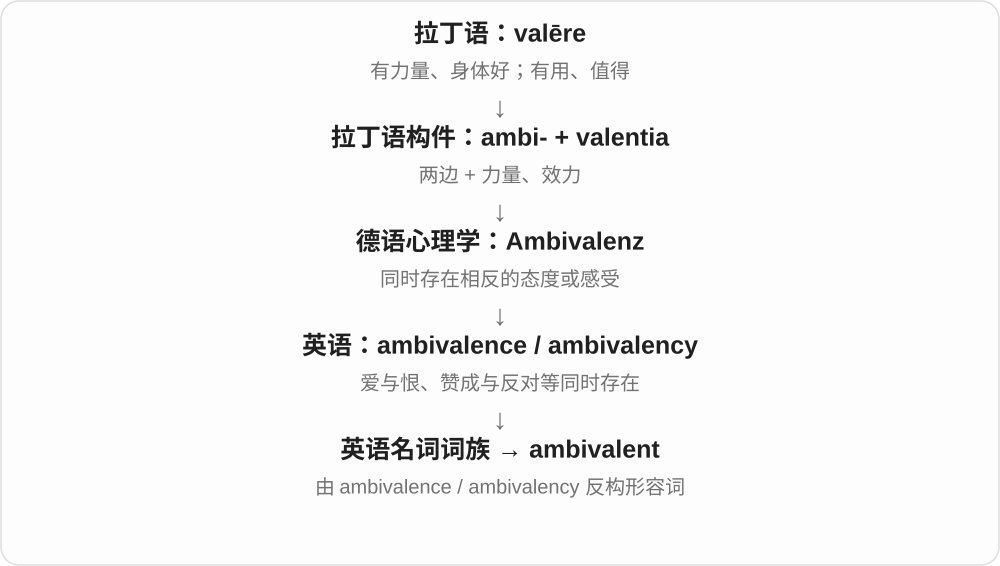

# 1959 · -valent — 有力量；有价值；价态相关

[逐词精讲目录](../00_逐词精讲目录.md) · [总目录](../00_总目录_按常用程度.md)

## 核心词根与来源

-valent 联系拉丁 valere 有力量、有价值。equivalent 经相应拉丁形式表示等效；ambivalent 来自 ambivalence 一支，更早接德语心理学命名，现代常说矛盾心态。

**VALENT：把相等、双向等关系放到“效力”上**

两件东西效力相当，或一种态度同时朝两个方向拉。

- **等效**：equivalent
- **矛盾或双向态度**：ambivalent

## 词形与演化规律

equi- 相等，ambi- 两边；但 ambivalent 不是普通英语把两个自由词临时拼起来，需保留现代借入和逆构历史。

## 单词速览（按词族由简到繁）

同一基础词的相关扩展放在一起，先读基础形式，再读扩展；各组之间优先读常用的。具体词源关系见各词讲解。

| 单词 | 音标 | 核心意思 |
|---|---|---|
| [equivalent](#w-1) | 英、美 /ɪˈkwɪvələnt/ | 等值、等效的；相当的；对应物 |
| [ambivalent](#w-2) | 英、美 /æmˈbɪvələnt/ | 心情矛盾的；态度摇摆的 |

## 逐词讲解

### 1. equivalent — 等值、等效的；相当的；对应物

**音标**：英、美 /ɪˈkwɪvələnt/

**先抓住这个画面**

样子可以不同，但在眼下比较的价值、作用或数量上，能放在同一个位置。

**怎么拆**

后期拉丁语 aequus“相等” + valēre“有力量、有价值” → aequivalēns；现代可识别 equi- + -valent。

**怎么变成今天的意思**

equivalent to 后接比较对象。两种资格等同，不表示课程完全一样；两种说法含义相当，也不表示每个字一一对应。

**常见搭配与例句**

equivalent to；an equivalent amount；the nearest equivalent。

> One kilometre is equivalent to one thousand metres.

一公里等于一千米。

> This expression has no exact equivalent in English.

这个表达在英语中没有完全对应的说法。

**别混淆**

equal 常直接说量相等；equivalent 常说在某个关系或用途上相当。

### 2. ambivalent — 心情矛盾的；态度摇摆的

**音标**：英、美 /æmˈbɪvələnt/

**先抓住这个画面**

嘴上说“我还没决定”，心里却不是空白，而是赞成和反对的理由都在用力。

**怎么拆**

英语从 ambivalence / 较早的 ambivalency 这组名词反构出形容词；更早来源是德语 Ambivalenz。

**怎么变成今天的意思**

常用 ambivalent about 或 towards。一个人可以对升职感到 ambivalent：想要机会，也担心更大的工作压力。

**常见搭配与例句**

feel ambivalent about；remain ambivalent；an ambivalent attitude。

> I’m ambivalent about the offer: the work is exciting, but the hours are long.

我对这个机会心情矛盾：工作很有意思，但工时很长。

> The review is ambivalent rather than wholly negative.

这篇评论的态度有褒有贬，并非全盘否定。

**别混淆**

uncertain 可能只是信息不足；ambivalent 更强调同时存在相反的感受或态度。

## 这一组要分清什么

ambivalent 是有相互冲突的感受，不是没有感觉；equivalent 也不必在所有属性上完全相同。

## 串起来练习

I see the options as equivalent in cost, but I remain ambivalent about their effects.

我认为两个方案成本相当，但对其效果仍心存矛盾。
